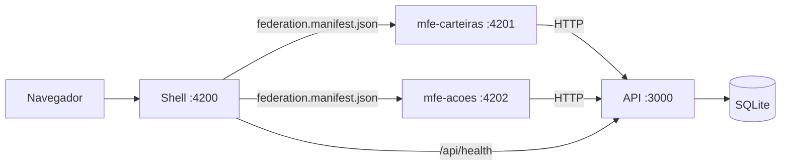
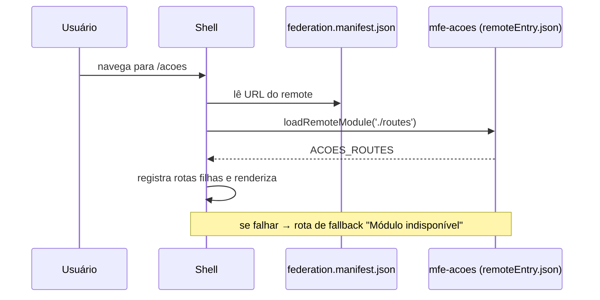
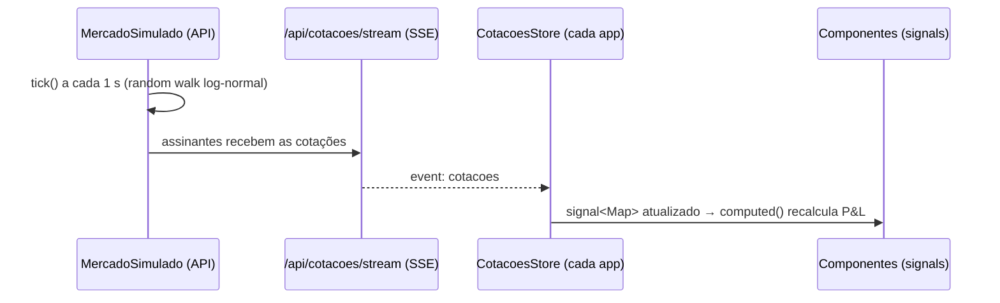
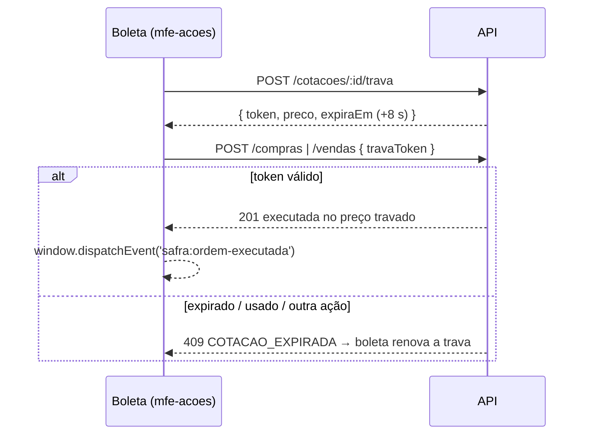

# Arquitetura

## Visão de runtime

## Como o shell carrega um MFE

1. `main.ts` do shell chama `initFederation()` **sem** pré-carregar remotes.
2. Cada rota usa `rotasRemotas(nome, export)`, que lê o manifest, chama `loadRemoteModule` e devolve as rotas exportadas. Qualquer erro vira a rota `RemoteIndisponivel`.
3. Trocar a URL de um remote é só editar `federation.manifest.json` — sem rebuild do shell.

## Tempo real

## Ordem com trava de preço

## Compartilhamento de dependências

`@angular/*`, `@angular/material`, `@angular/cdk` e `rxjs` são `shared` **singleton**: o navegador baixa uma única cópia, usada pelo shell e pelos dois MFEs. Isso exige versões idênticas — garantidas pelo npm workspaces (dependências hoisted na raiz).

## Injeção de dependência entre host e remote

Quando um MFE está hospedado, o *root injector* é o do **shell**. Por isso os MFEs:

- declaram seus services como `@Injectable()` **sem** `providedIn: 'root'`;
- registram `HttpClient` + interceptor, `LOCALE_ID` e os services nos `providers` da rota exposta.

Assim o comportamento é o mesmo hospedado ou em modo standalone.

## Comunicação entre MFEs

| Necessidade | Mecanismo |
|---|---|
| Dados (carteiras para o formulário de compra) | API — fonte única da verdade |
| Avisar que houve compra ou venda | `window.dispatchEvent(new CustomEvent('safra:ordem-executada'))` — o shell escuta e mostra uma notificação (com o resultado, na venda) |
| Vender a partir da carteira | Deep link `/acoes?ticker=PETR4&lado=VENDER&carteira=1` — o mfe-acoes lê os query params e pré-preenche a boleta |
| Ir da compra para a carteira | Navegação absoluta `/carteiras/:id` pelo router do shell |

Nenhum MFE importa código de outro. O contrato é o nome do evento, o tipo `OrdemExecutada` em `@safra/shared` e o formato do deep link.
