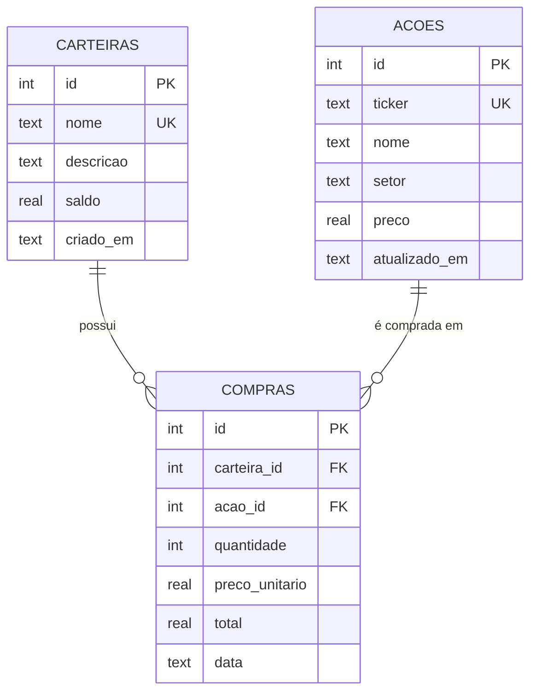

# Modelo de dados e API

## Tabelas



**Posição** não é tabela: é uma agregação de `compras` por ação — `quantidade = SUM(quantidade)`, `precoMedio = SUM(total) / SUM(quantidade)`.

## Regras de negócio

| Regra | Resposta |
|---|---|
| Compra acima do saldo | `422 SALDO_INSUFICIENTE` |
| Débito do saldo + registro da compra | uma transação SQLite (tudo ou nada) |
| Preço da compra | preço atual da ação, gravado em `preco_unitario` |
| Excluir carteira/ação com compras | `409 CARTEIRA_COM_COMPRAS` / `409 ACAO_COM_COMPRAS` |
| Nome de carteira ou ticker repetido | `409 DUPLICADO` |
| Ticker | `^[A-Z]{4}\d{1,2}$`, normalizado para maiúsculas |
| Valores em reais | no máximo 2 casas decimais; preço e depósito ≥ R$ 0,01; teto de R$ 1 trilhão |
| Dados inválidos | `400 VALIDACAO` com `details: [{ campo, mensagem }]` |
| JSON malformado | `400 JSON_INVALIDO` |
| Recurso inexistente | `404 NAO_ENCONTRADO` |

Formato de erro: `{ "code": "...", "message": "...", "details": ... }`. Datas são devolvidas em ISO 8601 UTC (`2026-10-09T18:28:38Z`).

## Endpoints

| Método | Rota | Corpo |
|---|---|---|
| GET | `/api/health` | — |
| GET / POST | `/api/carteiras` | `{ nome, descricao?, saldoInicial? }` |
| GET / PUT / DELETE | `/api/carteiras/:id` | PUT: `{ nome, descricao? }` |
| GET | `/api/carteiras/:id/posicoes` | — |
| POST | `/api/carteiras/:id/deposito` | `{ valor }` |
| GET / POST | `/api/acoes` | `?ticker=` / `{ ticker, nome, setor?, preco }` |
| GET / PUT / DELETE | `/api/acoes/:id` | PUT: `{ ticker, nome, setor?, preco }` |
| GET | `/api/compras` | `?carteiraId=` |
| POST | `/api/compras` | `{ carteiraId, acaoId, quantidade }` → `{ compra, saldoRestante }` |

## Exemplo

```bash
curl -s -X POST localhost:3000/api/compras \
  -H 'Content-Type: application/json' \
  -d '{"carteiraId":1,"acaoId":1,"quantidade":10}'
```
