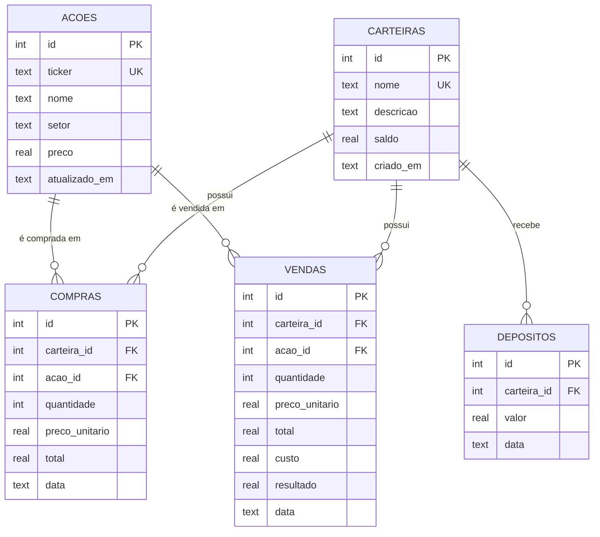

# Modelo de dados e API

## Tabelas



O schema é versionado por migrações (`api/src/db/migracoes.ts`), com a versão gravada em `PRAGMA user_version`: v1 = fase 1, v2 = `depositos` + `vendas`. Bancos antigos migram sozinhos ao subir a API.

**Posição** não é tabela: é uma agregação por ação — `quantidade = Σ compras − Σ vendas`, `custo = Σ total das compras − Σ custo das vendas`, `precoMedio = custo / quantidade` (**custo médio**). Cada venda baixa `precoMedio × quantidade` do custo e registra `resultado = total − custo`; vendendo a posição inteira, baixa o custo restante exato (sem centavo residual).

## Regras de negócio

| Regra | Resposta |
|---|---|
| Compra acima do saldo | `422 SALDO_INSUFICIENTE` |
| Venda acima da posição | `422 POSICAO_INSUFICIENTE` com `details.disponivel` |
| Ordem com trava expirada, já usada ou de outra ação | `409 COTACAO_EXPIRADA` |
| Débito/crédito do saldo + registro da ordem | uma transação SQLite (tudo ou nada) |
| Preço da ordem | o da trava (se `travaToken` válido) ou o preço atual da ação, gravado em `preco_unitario` |
| Excluir carteira/ação com compras | `409 CARTEIRA_COM_COMPRAS` / `409 ACAO_COM_COMPRAS` |
| Nome de carteira ou ticker repetido | `409 DUPLICADO` |
| Ticker | `^[A-Z]{4}\d{1,2}$`, normalizado para maiúsculas |
| Valores em reais | no máximo 2 casas decimais; preço e depósito ≥ R$ 0,01; teto de R$ 1 trilhão |
| Dados inválidos | `400 VALIDACAO` com `details: [{ campo, mensagem }]` |
| JSON malformado | `400 JSON_INVALIDO` |
| Recurso inexistente | `404 NAO_ENCONTRADO` |

Formato de erro: `{ "code": "...", "message": "...", "details": ... }`. Datas são devolvidas em ISO 8601 UTC (`2026-10-09T18:28:38Z`).

## Endpoints

| Método | Rota | Corpo |
|---|---|---|
| GET | `/api/health` | — |
| GET / POST | `/api/carteiras` | `{ nome, descricao?, saldoInicial? }` |
| GET / PUT / DELETE | `/api/carteiras/:id` | PUT: `{ nome, descricao? }` |
| GET | `/api/carteiras/:id/posicoes` | — |
| POST | `/api/carteiras/:id/deposito` | `{ valor }` |
| GET / POST | `/api/acoes` | `?ticker=` / `{ ticker, nome, setor?, preco }` |
| GET / PUT / DELETE | `/api/acoes/:id` | PUT: `{ ticker, nome, setor?, preco }` |
| GET | `/api/compras` | `?carteiraId=` |
| POST | `/api/compras` | `{ carteiraId, acaoId, quantidade, travaToken? }` → `{ compra, saldoRestante }` |
| POST | `/api/vendas` | `{ carteiraId, acaoId, quantidade, travaToken? }` → `{ venda, saldoRestante }` |
| GET | `/api/cotacoes` | foto atual: `[{ acaoId, ticker, preco, abertura, variacao, historico[] }]` |
| GET | `/api/cotacoes/stream` | **SSE**: `event: snapshot` ao conectar, `event: cotacoes` a cada tick (1 s), heartbeat a cada 15 s |
| POST | `/api/cotacoes/:acaoId/trava` | → `{ token, acaoId, preco, expiraEm }` (vale 8 s, uso único) |
| GET | `/api/extrato` | `?carteiraId&tipo=DEPOSITO\|COMPRA\|VENDA&de&ate&ticker&ordem=data\|valor&direcao=asc\|desc&pagina&tamanho` → `{ itens, total, pagina, tamanho }` |
| GET | `/api/dashboard` | `?carteiraId` (sem = consolidado) → KPIs, alocação, série intraday, maiores altas/baixas, posições |

## Exemplo

```bash
curl -s -X POST localhost:3000/api/compras \
  -H 'Content-Type: application/json' \
  -d '{"carteiraId":1,"acaoId":1,"quantidade":10}'
```
