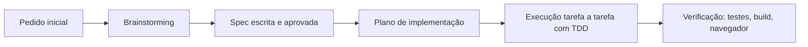

# Como a IA foi usada

O projeto foi construído com **Claude Code** (modelo Claude Opus 5.5) e o plugin **Superpowers**, que impõe um processo de engenharia: entender → especificar → planejar → implementar com testes → verificar. A IA escreveu a maior parte do código; as decisões e as aprovações de cada etapa foram humanas.

## Linha do tempo

### 1. Brainstorming (skill `superpowers:brainstorming`)
A IA classificou o pedido como **arquitetural** (projeto novo) e fez uma pergunta por vez antes de propor qualquer código:

| Pergunta | Decisão humana |
|---|---|
| Prazo e enunciado | Entrega no mesmo dia; persistência em SQLite |
| Back-end | Node + Express |
| Ferramenta de MFE | Native Federation |
| Organização | Monorepo com apps separadas |
| UI | Angular Material |
| Versão do runtime | Node 24 LTS + Angular 22 (a IA detectou que o Node 20 local estava em fim de vida e que as libs atuais exigiam Node ≥ 22) |

O design foi apresentado em 4 seções (arquitetura, domínio/API, telas, testes/entrega), cada uma aprovada antes da seguinte.

### 2. Spec ([Spec de design](superpowers/specs/2026-10-09-safra-mfe-investimentos-design.md))
Documento único com stack, arquitetura, modelo de dados, regras, telas, testes e o que ficou fora do escopo. Revisado pela IA (placeholders, contradições, ambiguidade) e aprovado por humano.

### 3. Plano ([Plano de implementação](superpowers/plans/2026-10-09-safra-mfe-investimentos.md))
Skill `superpowers:writing-plans`: 12 tarefas com arquivos exatos, código completo, testes escritos antes da implementação e commits por tarefa. Inclui uma seção **Review Focus** com os 5 casos de borda mais prováveis (centavos, ticker minúsculo, IDs inválidos, JSON malformado, quantidade fracionada), cada um com teste dedicado.

### 4. Execução
As tarefas foram implementadas em sequência na mesma sessão (skill `superpowers:executing-plans`), com um *ledger* de progresso e uma revisão final do branch inteiro feita por um revisor independente (outro agente, sem o contexto da implementação). A revisão apontou que a API aceitava preços abaixo de um centavo (compra "de graça") e datas fora do padrão ISO, que poderiam falhar no Safari. Os dois pontos foram corrigidos com testes que falharam antes da correção.

Em toda tarefa: **teste falhando → implementação mínima → teste passando → commit**. O ciclo vermelho → verde foi verificado pela execução dos testes a cada passo; o histórico do git (`git log`) tem um commit por tarefa, já com teste e implementação.

Quando a realidade divergiu do plano, a IA registrou uma decisão ("ruling") e seguiu — por exemplo: o Native Federation 22 gerou um formato de configuração diferente do previsto, e o compartilhamento do locale `pt-BR` exigiu um ajuste (ver [Decisões técnicas](05-decisoes.md)).

### 5. Verificação (skill `superpowers:verification-before-completion`)
Nenhuma etapa foi dada como pronta sem evidência: suíte de testes completa, build de produção dos 3 front-ends e navegação real no navegador (CRUD, compra, evento entre MFEs e queda proposital de um MFE).

## O que foi humano e o que foi IA

| Humano | IA |
|---|---|
| Objetivo, domínio e prazo | Perguntas de esclarecimento e propostas com trade-offs |
| Escolha de stack e arquitetura | Detecção de restrições do ambiente (Node EOL, versões) |
| Aprovação da spec e do plano | Spec, plano, código, testes e esta documentação |
| Revisão final | Verificação automatizada e no navegador |

## Prompts utilizados

Os pedidos feitos ao agente, na ordem da sessão, em formato de especificação técnica.

### 1. Escopo inicial (fase 1)

> Projete e implemente uma SPA em **Angular** com **arquitetura de micro front-ends**, no padrão adotado pelo Banco Safra. Composição:
> - **Shell (host)** responsável por layout, menu de navegação e roteamento entre os módulos.
> - **MFE Carteiras** com CRUD completo de carteiras de investimento.
> - **MFE Ações** com CRUD do catálogo de ações e fluxo de **compra**, onde cada compra é vinculada a uma carteira (relacionamento entre domínios de MFEs distintos).
> - **Home** com a documentação técnica do projeto: decisões de arquitetura, estrutura de pastas, contratos e o processo de desenvolvimento assistido por IA.
>
> Conduza o trabalho com o fluxo do Superpowers: *brainstorming* → especificação → plano de implementação → execução.

### 2. Persistência e prazo

> Entrega no mesmo dia. Substitua dados simulados por **serviços reais com persistência em SQLite**, expostos por uma API REST consumida pelos MFEs.

### 3. Correção da revisão final (fase 1)

> Implemente as correções apontadas na revisão de código final (itens classificados como pendentes): validação monetária, códigos HTTP corretos para erros do *body-parser*, estados de *loading*/erro, navegação entre MFEs no modo *standalone* e consistência de build da documentação.

### 4. Evolução funcional e redesign (fase 2)

> A aplicação atende ao CRUD, mas está rasa para uma avaliação técnica e com aparência de **Angular Material sem customização**. Evolua em duas frentes:
> - **Funcional:** cotações em **tempo real** (*streaming* do servidor), **venda** de ações com apuração de resultado, **extrato** de movimentações com filtros e paginação, e **dashboard** consolidado com indicadores e gráficos — priorizando soluções que demonstrem domínio técnico (concorrência de preço, reatividade, modelagem de dados, testes).
> - **Visual:** design system próprio, aderente a produtos do mercado financeiro (hierarquia tipográfica, números tabulares, semântica de alta/baixa, acessibilidade), substituindo o visual padrão do Material.

### 5. Pendências da revisão (fase 2)

> Resolva todos os itens classificados como menores na revisão final: ciclo de vida das conexões SSE por tela, `aria-live` nos valores agregados, consumo do token de cotação somente após validação, filtro de período no fuso do usuário, saneamento do filtro de *ticker*, preço vivo no catálogo, supressão de notificações em *polling* e semântica ARIA do seletor de lado da ordem.

### 6. Ajustes de layout

> Corrija problemas de responsividade: deslocamento do conteúdo, rolagem horizontal indevida e espaçamentos excessivos. Valide em *desktop* e *mobile*.

### 7. Documentação

> Reescreva os prompts registrados nesta página em linguagem técnica, no formato de especificação.

## Limites e cuidados

- A IA propõe; a decisão final ficou registrada com o humano em cada etapa.
- Versões e compatibilidades foram consultadas no registro npm durante a sessão, não presumidas.
- Simplificações conscientes (dinheiro em `REAL`, sem autenticação) estão em [Decisões técnicas](05-decisoes.md).

## Fase 2 — mercado ao vivo e redesign

> A aplicação atende ao CRUD, mas está rasa para uma avaliação técnica e com aparência de **Angular Material sem customização**. Evolua em duas frentes:
> - **Funcional:** cotações em **tempo real** via *streaming* do servidor, **venda** de ações com apuração de resultado pelo custo médio, **extrato** de movimentações com filtros, ordenação e paginação no servidor, e **dashboard** consolidado com indicadores e gráficos. Priorize soluções que demonstrem domínio técnico: controle de concorrência de preço na execução de ordens, reatividade com *signals*, modelagem de dados versionada e cobertura de testes.
> - **Visual:** *design system* próprio, aderente a produtos do mercado financeiro (hierarquia tipográfica, números tabulares, semântica de alta/baixa, contraste AA e acessibilidade), substituindo o visual padrão do Material.

- **Brainstorming com *visual companion***: a IA mostrou no navegador três direções visuais para o mesmo dashboard (private banking escuro, fintech clara, terminal de trading); a escolha humana foi um **híbrido terminal + fintech**, depois validado com mockups das telas de Dashboard e Mercado + boleta.
- **Decisões técnicas propostas com alternativas** e aprovadas: SSE, gráficos em SVG próprio, design tokens sobre o Material, migrações versionadas, trava de cotação RFQ.
- **Spec** ([Fase 2](superpowers/specs/2026-10-09-safra-fase-2-design.md)) e **plano** ([Plano da fase 2](superpowers/plans/2026-10-09-safra-fase-2.md)) no mesmo formato da fase 1, com *Review Focus* (venda total sem centavo residual, trava reutilizada, parâmetros hostis no extrato, dashboard vazio, queda do stream).
- Execução tarefa a tarefa com TDD (testes escritos e vistos falhando antes de cada implementação), verificação ponta a ponta no navegador e revisão final independente.
- Durante a execução, o deploy em container único (Docker/Coolify) foi mesclado no branch por outra sessão; a IA detectou a mudança (`criarApp` com `pastaWeb`, `API_BASE_URL` relativo) e adaptou o plano em vez de sobrescrevê-la — registrado como decisão no ledger de execução.
