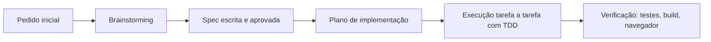

# Como a IA foi usada

O projeto foi construído com **Claude Code** (modelo Claude Opus 5.5) e o plugin **Superpowers**, que impõe um processo de engenharia: entender → especificar → planejar → implementar com testes → verificar. A IA escreveu a maior parte do código; as decisões e as aprovações de cada etapa foram humanas.

## Linha do tempo

### 1. Brainstorming (skill `superpowers:brainstorming`)
A IA classificou o pedido como **arquitetural** (projeto novo) e fez uma pergunta por vez antes de propor qualquer código:

| Pergunta | Decisão humana |
|---|---|
| Prazo e enunciado | Entrega no mesmo dia; persistência em SQLite |
| Back-end | Node + Express |
| Ferramenta de MFE | Native Federation |
| Organização | Monorepo com apps separadas |
| UI | Angular Material |
| Versão do runtime | Node 24 LTS + Angular 22 (a IA detectou que o Node 20 local estava em fim de vida e que as libs atuais exigiam Node ≥ 22) |

O design foi apresentado em 4 seções (arquitetura, domínio/API, telas, testes/entrega), cada uma aprovada antes da seguinte.

### 2. Spec ([Spec de design](superpowers/specs/2026-10-09-safra-mfe-investimentos-design.md))
Documento único com stack, arquitetura, modelo de dados, regras, telas, testes e o que ficou fora do escopo. Revisado pela IA (placeholders, contradições, ambiguidade) e aprovado por humano.

### 3. Plano ([Plano de implementação](superpowers/plans/2026-10-09-safra-mfe-investimentos.md))
Skill `superpowers:writing-plans`: 12 tarefas com arquivos exatos, código completo, testes escritos antes da implementação e commits por tarefa. Inclui uma seção **Review Focus** com os 5 casos de borda mais prováveis (centavos, ticker minúsculo, IDs inválidos, JSON malformado, quantidade fracionada), cada um com teste dedicado.

### 4. Execução
As tarefas foram implementadas em sequência na mesma sessão (skill `superpowers:executing-plans`), com um *ledger* de progresso e uma revisão final do branch inteiro feita por um revisor independente.

Em toda tarefa: **teste falhando → implementação mínima → teste passando → commit**. O histórico do git (`git log`) mostra essa sequência.

Quando a realidade divergiu do plano, a IA registrou uma decisão ("ruling") e seguiu — por exemplo: o Native Federation 22 gerou um formato de configuração diferente do previsto, e o compartilhamento do locale `pt-BR` exigiu um ajuste (ver [Decisões técnicas](05-decisoes.md)).

### 5. Verificação (skill `superpowers:verification-before-completion`)
Nenhuma etapa foi dada como pronta sem evidência: suíte de testes completa, build de produção dos 3 front-ends e navegação real no navegador (CRUD, compra, evento entre MFEs e queda proposital de um MFE).

## O que foi humano e o que foi IA

| Humano | IA |
|---|---|
| Objetivo, domínio e prazo | Perguntas de esclarecimento e propostas com trade-offs |
| Escolha de stack e arquitetura | Detecção de restrições do ambiente (Node EOL, versões) |
| Aprovação da spec e do plano | Spec, plano, código, testes e esta documentação |
| Revisão final | Verificação automatizada e no navegador |

## Prompt inicial (resumo)

> "Criar um projeto Angular com micro front-ends, com menu, páginas e CRUD: um MFE de carteiras e um de compra de ações relacionado às carteiras. A Home deve ser a documentação de como o projeto foi feito, sua estrutura e como a IA foi usada."

## Limites e cuidados

- A IA propõe; a decisão final ficou registrada com o humano em cada etapa.
- Versões e compatibilidades foram consultadas no registro npm durante a sessão, não presumidas.
- Simplificações conscientes (dinheiro em `REAL`, sem autenticação) estão em [Decisões técnicas](05-decisoes.md).
