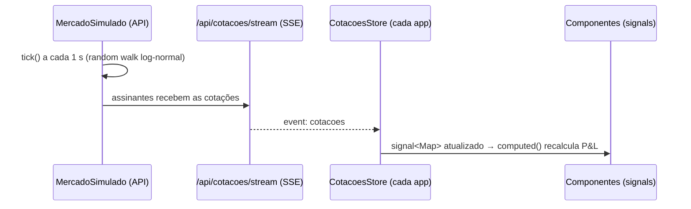
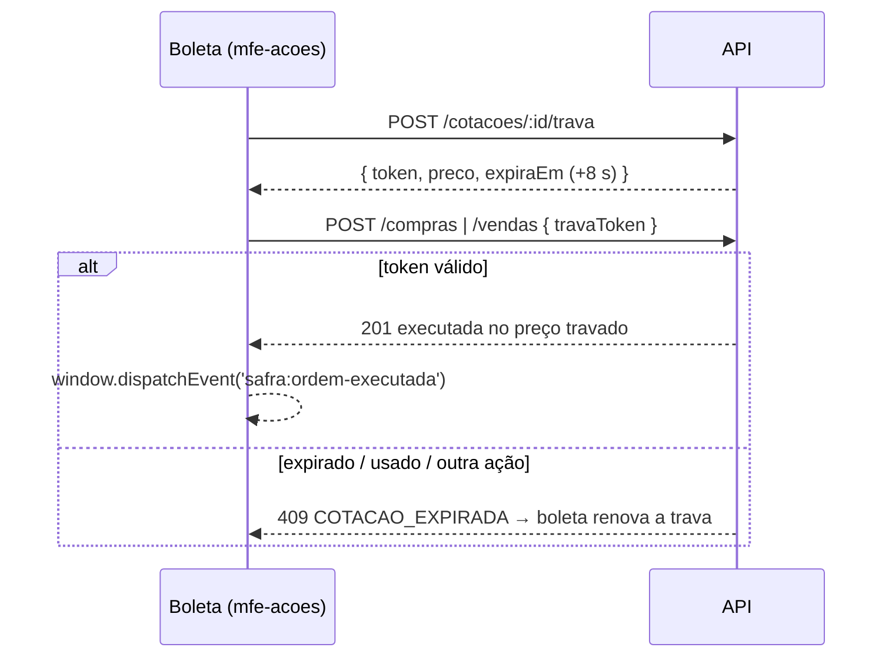

# Safra Invest Lab — Fase 2: Plano de Implementação

> **For agentic workers:** REQUIRED SUB-SKILL: Use superpowers:subagent-driven-development (recommended) or superpowers:executing-plans to implement this plan task-by-task. Steps use checkbox (`- [ ]`) syntax for tracking.

**Goal:** Mercado simulado ao vivo (SSE) com trava de preço, venda com custo médio, extrato paginado, dashboard e redesign "terminal + fintech" sobre a base da fase 1.

**Architecture:** A API ganha migrações versionadas, um `MercadoSimulado` (random walk log-normal) que grava preços e transmite via SSE, travas RFQ em memória, vendas, extrato (`UNION ALL`) e dashboard. Cada app Angular assina o stream com seu próprio `CotacoesStore` (signals) e usa componentes SVG próprios; o visual vem de tokens SCSS compartilhados em `libs/ui-tokens` aplicados sobre o Material (tema M3 escuro).

**Tech Stack:** Node 24, Express 5, better-sqlite3, zod 4, vitest 5, supertest; Angular 22 (signals, zoneless, standalone), Native Federation 22, Angular Material 22 (comportamento), SVG próprio para gráficos.

**Spec:** `docs/superpowers/specs/2026-10-09-safra-fase-2-design.md` (base: `docs/superpowers/specs/2026-10-09-safra-mfe-investimentos-design.md`)

## Global Constraints

- Todo comando começa com `export PATH=/Users/edu/.local/share/nvm/v24.21.0/bin:$PATH`; raiz `/Volumes/Secundary Disk Mac/dev/teste_safra` (aspas: caminho com espaços).
- **Nunca** usar `pkill -f`/matar por porta em processos que não foram iniciados nesta tarefa. Antes de subir stack para smoke: verificar que as portas 3000/4200/4201/4202 estão livres; se estiverem ocupadas, a stack é do usuário — usar a dele, sem reiniciar. Encerrar apenas os PIDs iniciados.
- Branch `feat/fase-2-mercado-ao-vivo`. Commits terminam com `Co-Authored-By: Claude Opus 5.5 (1M context) <noreply@anthropic.com>`.
- Os 89 testes da fase 1 continuam verdes (ajustes de asserção só onde o contrato mudou, declarados na tarefa).
- Dinheiro sempre via `arredondar()` na API; front exibe com `CurrencyPipe` (`pt-BR`, `BRL`) e números em `.num` (mono, tabular).
- Constantes: `API_BASE_URL = 'http://localhost:3000/api'`, `COTACOES_STREAM_URL = API_BASE_URL + '/cotacoes/stream'`, `ORDEM_EXECUTADA_EVENT = 'safra:ordem-executada'`, TTL da trava 8000 ms, tick 1000 ms, ponto de histórico a cada 5 ticks, máximo 120 pontos.
- Services/stores dos MFEs: `@Injectable()` sem `providedIn`, providos nas rotas expostas.
- Componentes novos: standalone, `ChangeDetectionStrategy.OnPush`, inputs via `input()`.
- **Desvio declarado da spec:** `Dashboard` ganha o campo `posicoes: Posicao[]` (necessário para recalcular o valor de mercado ao vivo no cliente); `CotacoesStore` usa listeners do `EventSource` direto em signals (sem Observable intermediário). Ambos ficam registrados no ledger.

## Review Focus

1. **Venda total com centavos residuais** — vender toda a posição deve zerar o custo exatamente (custo da venda = custo restante), sem deixar posição "fantasma" no consolidado. Teste na Task 4.
2. **Trava usada duas vezes / de outra ação / expirada** — sempre `409 COTACAO_EXPIRADA`, saldo e posição intactos. Testes na Task 4.
3. **Extrato com parâmetros hostis** (`ordem=preco;DROP`, `tamanho=500`, `pagina=0`, `de=2026-13-45`) — `400 VALIDACAO`, nunca SQL dinâmico com entrada do usuário. Testes na Task 5.
4. **Dashboard sem posições / carteira vazia** — percentuais vazios (sem divisão por zero, sem `NaN`), série só com caixa. Teste na Task 6.
5. **Stream cai e volta** — `CotacoesStore` vai a `reconectando` e volta a `ao-vivo` no próximo evento, sem perder o mapa atual. Teste na Task 8 (e cópias).

---

## Estrutura de arquivos (novos/alterados)

```
libs/shared/src/index.ts                     + Cotacao, Trava, Venda*, Movimentacao, Pagina, FiltroExtrato, Dashboard, OrdemExecutada…
libs/ui-tokens/_tokens.scss                  design tokens + tema Material escuro + utilitários
api/src/db/migracoes.ts                      (substitui schema.ts)
api/src/mercado/{mercado-simulado.ts, travas.ts}
api/src/repositories/{depositos,vendas,extrato}.repository.ts   (+ alterações em carteiras/compras)
api/src/services/{vendas,extrato,dashboard}.service.ts          (+ alterações em carteiras/compras)
api/src/routes/{cotacoes,vendas,extrato,dashboard}.routes.ts
api/src/schemas/{vendas,extrato}.ts                              (+ compras com travaToken)
api/test/{migracoes,mercado,cotacoes,vendas,extrato,dashboard}.test.ts
apps/shell/src/app/tempo-real/{cotacoes-store.ts,+spec, fonte-falsa.ts}
apps/shell/src/app/layout/{ticker-tape.ts, api-status.ts}
apps/shell/src/app/notificacoes/{ordem-notifier.ts,+spec}       (substitui compra-notifier)
apps/mfe-carteiras/src/app/ui/{cotacoes-store.ts,+spec, fonte-falsa.ts, flash.directive.ts,+spec, graficos.ts,+spec, sparkline.ts, area-chart.ts, donut.ts, kpi-card.ts, variacao.ts, estado-vazio.ts}
apps/mfe-carteiras/src/app/dashboard/{dashboard.ts,+spec}
apps/mfe-carteiras/src/app/extrato/{filtro-extrato.ts,+spec, extrato.ts,+spec}
apps/mfe-acoes/src/app/ui/…                                      (cópias: cotacoes-store, fonte-falsa, flash, graficos, sparkline, variacao)
apps/mfe-acoes/src/app/mercado/{mercado.ts,+spec}
apps/mfe-acoes/src/app/boleta/{calculos.ts,+spec, boleta.ts,+spec}
```

---

### Task 1: Migrações versionadas e depósitos registrados

**Files:**
- Create: `api/src/db/migracoes.ts`, `api/src/repositories/depositos.repository.ts`, `api/test/migracoes.test.ts`
- Delete: `api/src/db/schema.ts`
- Modify: `api/src/db/connection.ts`, `api/src/services/carteiras.service.ts`, `api/src/app.ts`

**Interfaces:**
- Produces: `MIGRACOES: ((db: DB) => void)[]`, `aplicarMigracoes(db: DB): void`, `versaoDoBanco(db: DB): number`, `class DepositosRepository(db)` com `inserir(carteiraId: number, valor: number): void`; `new CarteirasService(db, repo, depositos)`.

- [ ] **Step 1: Teste (falhando)** — `api/test/migracoes.test.ts`:
```ts
import Database from 'better-sqlite3';
import { describe, expect, it } from 'vitest';
import { aplicarMigracoes, MIGRACOES, versaoDoBanco } from '../src/db/migracoes';
import { novaApi } from './helpers';

const SCHEMA_FASE_1 = `
  CREATE TABLE carteiras (id INTEGER PRIMARY KEY AUTOINCREMENT, nome TEXT NOT NULL UNIQUE, descricao TEXT,
    saldo REAL NOT NULL DEFAULT 0 CHECK (saldo >= 0), criado_em TEXT NOT NULL DEFAULT (datetime('now')));
  CREATE TABLE acoes (id INTEGER PRIMARY KEY AUTOINCREMENT, ticker TEXT NOT NULL UNIQUE, nome TEXT NOT NULL, setor TEXT,
    preco REAL NOT NULL CHECK (preco > 0), atualizado_em TEXT NOT NULL DEFAULT (datetime('now')));
  CREATE TABLE compras (id INTEGER PRIMARY KEY AUTOINCREMENT, carteira_id INTEGER NOT NULL REFERENCES carteiras(id),
    acao_id INTEGER NOT NULL REFERENCES acoes(id), quantidade INTEGER NOT NULL CHECK (quantidade > 0),
    preco_unitario REAL NOT NULL, total REAL NOT NULL, data TEXT NOT NULL DEFAULT (datetime('now')));`;

const tabelas = (db: Database.Database) =>
  (db.prepare("SELECT name FROM sqlite_master WHERE type = 'table'").all() as { name: string }[]).map((t) => t.name);

describe('migrações', () => {
  it('banco novo fica na última versão com as tabelas da fase 2', () => {
    const { db } = novaApi();
    expect(versaoDoBanco(db)).toBe(MIGRACOES.length);
    expect(tabelas(db)).toEqual(expect.arrayContaining(['carteiras', 'acoes', 'compras', 'depositos', 'vendas']));
  });

  it('adota um banco da fase 1 (versão 0) sem perder dados', () => {
    const db = new Database(':memory:');
    db.exec(SCHEMA_FASE_1);
    db.prepare("INSERT INTO carteiras (nome, saldo) VALUES ('Antiga', 500)").run();
    db.prepare("INSERT INTO acoes (ticker, nome, preco) VALUES ('PETR4', 'Petrobras', 10)").run();
    db.prepare('INSERT INTO compras (carteira_id, acao_id, quantidade, preco_unitario, total) VALUES (1, 1, 5, 10, 50)').run();

    aplicarMigracoes(db);

    expect(versaoDoBanco(db)).toBe(MIGRACOES.length);
    expect(db.prepare('SELECT nome, saldo FROM carteiras').get()).toEqual({ nome: 'Antiga', saldo: 500 });
    expect((db.prepare('SELECT COUNT(*) AS n FROM compras').get() as { n: number }).n).toBe(1);
    expect(tabelas(db)).toEqual(expect.arrayContaining(['depositos', 'vendas']));
  });

  it('é idempotente', () => {
    const { db } = novaApi();
    expect(() => aplicarMigracoes(db)).not.toThrow();
    expect(versaoDoBanco(db)).toBe(MIGRACOES.length);
  });

  it('registra o depósito na tabela depositos', async () => {
    const { db, api } = novaApi();
    const { body } = await api.post('/api/carteiras').send({ nome: 'Renda' });
    await api.post(`/api/carteiras/${body.id}/deposito`).send({ valor: 250.5 });
    expect(db.prepare('SELECT carteira_id AS carteiraId, valor FROM depositos').all()).toEqual([{ carteiraId: body.id, valor: 250.5 }]);
  });
});
```

- [ ] **Step 2: Rodar e ver falhar** — `npm test -w api -- migracoes` → FAIL `Cannot find module '../src/db/migracoes'`.

- [ ] **Step 3: Implementar**

`api/src/db/migracoes.ts`:
```ts
import type { DB } from './connection';

type Migracao = (db: DB) => void;

/** Ordem importa: o índice + 1 é a versão gravada em PRAGMA user_version. Nunca editar migrações já publicadas. */
export const MIGRACOES: Migracao[] = [
  // v1 — schema da fase 1 (IF NOT EXISTS adota bancos criados antes do versionamento)
  (db) =>
    db.exec(`
      CREATE TABLE IF NOT EXISTS carteiras (
        id         INTEGER PRIMARY KEY AUTOINCREMENT,
        nome       TEXT    NOT NULL UNIQUE,
        descricao  TEXT,
        saldo      REAL    NOT NULL DEFAULT 0 CHECK (saldo >= 0),
        criado_em  TEXT    NOT NULL DEFAULT (datetime('now'))
      );
      CREATE TABLE IF NOT EXISTS acoes (
        id            INTEGER PRIMARY KEY AUTOINCREMENT,
        ticker        TEXT    NOT NULL UNIQUE,
        nome          TEXT    NOT NULL,
        setor         TEXT,
        preco         REAL    NOT NULL CHECK (preco > 0),
        atualizado_em TEXT    NOT NULL DEFAULT (datetime('now'))
      );
      CREATE TABLE IF NOT EXISTS compras (
        id             INTEGER PRIMARY KEY AUTOINCREMENT,
        carteira_id    INTEGER NOT NULL REFERENCES carteiras(id),
        acao_id        INTEGER NOT NULL REFERENCES acoes(id),
        quantidade     INTEGER NOT NULL CHECK (quantidade > 0),
        preco_unitario REAL    NOT NULL,
        total          REAL    NOT NULL,
        data           TEXT    NOT NULL DEFAULT (datetime('now'))
      );
      CREATE INDEX IF NOT EXISTS idx_compras_carteira ON compras(carteira_id);
      CREATE INDEX IF NOT EXISTS idx_compras_acao ON compras(acao_id);
    `),
  // v2 — depósitos e vendas
  (db) =>
    db.exec(`
      CREATE TABLE depositos (
        id          INTEGER PRIMARY KEY AUTOINCREMENT,
        carteira_id INTEGER NOT NULL REFERENCES carteiras(id),
        valor       REAL    NOT NULL CHECK (valor > 0),
        data        TEXT    NOT NULL DEFAULT (datetime('now'))
      );
      CREATE TABLE vendas (
        id             INTEGER PRIMARY KEY AUTOINCREMENT,
        carteira_id    INTEGER NOT NULL REFERENCES carteiras(id),
        acao_id        INTEGER NOT NULL REFERENCES acoes(id),
        quantidade     INTEGER NOT NULL CHECK (quantidade > 0),
        preco_unitario REAL    NOT NULL,
        total          REAL    NOT NULL,
        custo          REAL    NOT NULL,
        resultado      REAL    NOT NULL,
        data           TEXT    NOT NULL DEFAULT (datetime('now'))
      );
      CREATE INDEX idx_depositos_carteira ON depositos(carteira_id);
      CREATE INDEX idx_vendas_carteira ON vendas(carteira_id);
      CREATE INDEX idx_vendas_acao ON vendas(acao_id);
    `),
];

export function versaoDoBanco(db: DB): number {
  return db.pragma('user_version', { simple: true }) as number;
}

export function aplicarMigracoes(db: DB): void {
  for (let versao = versaoDoBanco(db); versao < MIGRACOES.length; versao++) {
    db.transaction(() => {
      MIGRACOES[versao](db);
      db.pragma(`user_version = ${versao + 1}`);
    })();
  }
}
```

`api/src/db/connection.ts`: trocar `import { aplicarSchema } from './schema';` por `import { aplicarMigracoes } from './migracoes';` e a chamada `aplicarSchema(db)` por `aplicarMigracoes(db)`. Apagar `api/src/db/schema.ts`.

`api/src/repositories/depositos.repository.ts`:
```ts
import type { DB } from '../db/connection';

export class DepositosRepository {
  constructor(private readonly db: DB) {}

  inserir(carteiraId: number, valor: number): void {
    this.db.prepare('INSERT INTO depositos (carteira_id, valor) VALUES (?, ?)').run(carteiraId, valor);
  }
}
```

`api/src/services/carteiras.service.ts`: construtor e `depositar`:
```ts
import type { DB } from '../db/connection';
import type { DepositosRepository } from '../repositories/depositos.repository';
```
```ts
  constructor(
    private readonly db: DB,
    private readonly repo: CarteirasRepository,
    private readonly depositos: DepositosRepository,
  ) {}
```
```ts
  depositar(id: number, valor: number): Carteira {
    return this.db.transaction(() => {
      const carteira = this.obter(id);
      this.repo.atualizarSaldo(id, arredondar(carteira.saldo + valor));
      this.depositos.inserir(id, valor);
      return this.obter(id);
    })();
  }
```

`api/src/app.ts`: importar `DepositosRepository` e trocar `new CarteirasService(carteirasRepo)` por `new CarteirasService(db, carteirasRepo, new DepositosRepository(db))`.

- [ ] **Step 4: Rodar** — `npm test -w api && npm run typecheck -w api` → todos PASS (fase 1 + 4 novos = 50).
- [ ] **Step 5: Commit** — `git add api && git commit -m "feat(api): versioned migrations and recorded deposits"`.

---

### Task 2: Simulador de mercado e travas (domínio puro) + tipos compartilhados

**Files:**
- Modify: `libs/shared/src/index.ts`
- Create: `api/src/mercado/mercado-simulado.ts`, `api/src/mercado/travas.ts`, `api/test/mercado.test.ts`
- Modify: `api/test/helpers.ts`

**Interfaces:**
- Produces (`@safra/shared`): `COTACOES_STREAM_URL`, `ORDEM_EXECUTADA_EVENT`, `Cotacao`, `Trava`, `NovaVenda`, `Venda`, `VendaResultado`, `TipoMovimentacao`, `Movimentacao`, `Pagina<T>`, `FiltroExtrato`, `FatiaAlocacao`, `PontoSerie`, `Dashboard`, `OrdemExecutada`; `NovaCompra.travaToken?`; `Posicao` ganha `setor`, `resultado`, `resultadoPercentual`.
- Produces (API): `class MercadoSimulado(db, opcoes?)` com `cotacoes(): Cotacao[]`, `cotacao(id): Cotacao | undefined`, `linhaDoTempo(): string[]`, `tick(): Cotacao[]`, `assinar(fn): () => void`, `iniciar(ms?)`, `parar()`; `class Travas(agora?, ttlMs?)` com `criar(acaoId, preco): Trava`, `consumir(token, acaoId): number`; teste: `semente(n): () => number`, `novaApi()` → `{ db, api, mercado, travas }`.

- [ ] **Step 1: Tipos compartilhados** — acrescentar ao fim de `libs/shared/src/index.ts` (manter `COMPRA_REALIZADA_EVENT` até a Task 13):
```ts
export const COTACOES_STREAM_URL = `${API_BASE_URL}/cotacoes/stream`;
export const ORDEM_EXECUTADA_EVENT = 'safra:ordem-executada';

export interface Cotacao {
  acaoId: number;
  ticker: string;
  nome: string;
  setor: string | null;
  preco: number;
  abertura: number;
  variacao: number;
  historico: number[];
  atualizadoEm: string;
}

export interface Trava {
  token: string;
  acaoId: number;
  preco: number;
  expiraEm: string;
}

export interface NovaVenda {
  carteiraId: number;
  acaoId: number;
  quantidade: number;
  travaToken?: string;
}

export interface Venda {
  id: number;
  carteiraId: number;
  acaoId: number;
  ticker: string;
  quantidade: number;
  precoUnitario: number;
  total: number;
  custo: number;
  resultado: number;
  data: string;
}

export interface VendaResultado {
  venda: Venda;
  saldoRestante: number;
}

export type TipoMovimentacao = 'DEPOSITO' | 'COMPRA' | 'VENDA';

export interface Movimentacao {
  id: string;
  tipo: TipoMovimentacao;
  carteiraId: number;
  carteiraNome: string;
  ticker: string | null;
  quantidade: number | null;
  precoUnitario: number | null;
  valor: number;
  resultado: number | null;
  data: string;
}

export interface Pagina<T> {
  itens: T[];
  total: number;
  pagina: number;
  tamanho: number;
}

export interface FiltroExtrato {
  carteiraId?: number;
  tipo?: TipoMovimentacao;
  de?: string;
  ate?: string;
  ticker?: string;
  ordem?: 'data' | 'valor';
  direcao?: 'asc' | 'desc';
  pagina?: number;
  tamanho?: number;
}

export interface FatiaAlocacao {
  nome: string;
  valor: number;
  percentual: number;
}

export interface PontoSerie {
  t: string;
  valor: number;
}

export interface Dashboard {
  patrimonio: number;
  caixa: number;
  valorMercado: number;
  investido: number;
  resultadoNaoRealizado: number;
  resultadoRealizado: number;
  variacaoDia: number;
  variacaoDiaPercentual: number;
  alocacaoPorSetor: FatiaAlocacao[];
  alocacaoPorAtivo: FatiaAlocacao[];
  serie: PontoSerie[];
  maioresAltas: Cotacao[];
  maioresBaixas: Cotacao[];
  posicoes: Posicao[];
}

export interface OrdemExecutada {
  tipo: 'COMPRA' | 'VENDA';
  carteiraId: number;
  ticker: string;
  quantidade: number;
  total: number;
  saldoRestante: number;
  resultado?: number;
}
```
E alterar as interfaces existentes:
```ts
export interface NovaCompra {
  carteiraId: number;
  acaoId: number;
  quantidade: number;
  travaToken?: string;
}
```
```ts
export interface Posicao {
  acaoId: number;
  ticker: string;
  nome: string;
  setor: string | null;
  quantidade: number;
  precoMedio: number;
  precoAtual: number;
  valorInvestido: number;
  valorAtual: number;
  resultado: number;
  resultadoPercentual: number;
}
```
(Os campos novos de `Posicao` só passam a ser preenchidos na Task 4; até lá o typecheck da API acusa falta de propriedades em `compras.repository.ts`. Para manter cada tarefa verde, nesta tarefa o mapeamento de `posicoes` em `compras.repository.ts` recebe provisoriamente `setor: null, resultado: 0, resultadoPercentual: 0` — substituído na Task 4. O spec do detalhe do mfe-carteiras recebe os mesmos três campos nos mocks.)

- [ ] **Step 2: Teste (falhando)** — `api/test/helpers.ts` (substituir):
```ts
import request from 'supertest';
import { criarApp } from '../src/app';
import { abrirBanco } from '../src/db/connection';
import { MercadoSimulado } from '../src/mercado/mercado-simulado';
import { Travas } from '../src/mercado/travas';

/** Gerador pseudoaleatório determinístico (mulberry32) para testes reproduzíveis. */
export function semente(n: number): () => number {
  let a = n >>> 0;
  return () => {
    a = (a + 0x6d2b79f5) >>> 0;
    let t = a;
    t = Math.imul(t ^ (t >>> 15), t | 1);
    t ^= t + Math.imul(t ^ (t >>> 7), t | 61);
    return ((t ^ (t >>> 14)) >>> 0) / 4294967296;
  };
}

export function novaApi(opcoes: { agora?: () => Date } = {}) {
  const db = abrirBanco(':memory:');
  const mercado = new MercadoSimulado(db, { aleatorio: semente(42), agora: opcoes.agora });
  const travas = new Travas(opcoes.agora);
  return { db, mercado, travas, api: request(criarApp(db, { mercado, travas })) };
}
```
(`criarApp` ainda tem um parâmetro; o segundo argumento é ignorado até a Task 3 — o TypeScript acusa; por isso nesta tarefa `criarApp` já ganha a assinatura `criarApp(db: DB, _opcoes: { mercado?: MercadoSimulado; travas?: Travas } = {})`, usada de fato na Task 3.)

`api/test/mercado.test.ts`:
```ts
import { describe, expect, it, vi } from 'vitest';
import { abrirBanco } from '../src/db/connection';
import { MercadoSimulado } from '../src/mercado/mercado-simulado';
import { Travas } from '../src/mercado/travas';
import { semente } from './helpers';

function bancoCom(acoes: [ticker: string, preco: number, setor?: string][]) {
  const db = abrirBanco(':memory:');
  const inserir = db.prepare('INSERT INTO acoes (ticker, nome, setor, preco) VALUES (?, ?, ?, ?)');
  for (const [ticker, preco, setor] of acoes) inserir.run(ticker, `${ticker} SA`, setor ?? null, preco);
  return db;
}

describe('MercadoSimulado', () => {
  it('antes do primeiro tick a cotação é o preço do banco, com variação zero', () => {
    const mercado = new MercadoSimulado(bancoCom([['PETR4', 38.42, 'Energia']]), { aleatorio: semente(1) });
    expect(mercado.cotacoes()).toEqual([
      expect.objectContaining({ ticker: 'PETR4', nome: 'PETR4 SA', setor: 'Energia', preco: 38.42, abertura: 38.42, variacao: 0, historico: [38.42] }),
    ]);
  });

  it('tick move o preço, grava no banco e calcula a variação sobre a abertura', () => {
    const db = bancoCom([['PETR4', 38.42]]);
    const mercado = new MercadoSimulado(db, { aleatorio: semente(1), volatilidade: 0.05 });
    const [depois] = mercado.tick();
    expect(depois.preco).not.toBe(38.42);
    expect((db.prepare('SELECT preco FROM acoes').get() as { preco: number }).preco).toBe(depois.preco);
    expect(depois.abertura).toBe(38.42);
    expect(depois.variacao).toBeCloseTo(((depois.preco - 38.42) / 38.42) * 100, 2);
  });

  it('é determinístico com a mesma semente', () => {
    const serie = () => {
      const mercado = new MercadoSimulado(bancoCom([['VALE3', 61.15]]), { aleatorio: semente(7) });
      return Array.from({ length: 10 }, () => mercado.tick()[0].preco);
    };
    expect(serie()).toEqual(serie());
  });

  it('nunca deixa o preço abaixo de R$ 0,01', () => {
    const mercado = new MercadoSimulado(bancoCom([['MGLU3', 0.01]]), { aleatorio: () => 0.5, volatilidade: 5 });
    expect(mercado.tick()[0].preco).toBe(0.01);
  });

  it('mantém histórico alinhado e limitado, incluindo ações novas e removendo excluídas', () => {
    const db = bancoCom([['PETR4', 10]]);
    const mercado = new MercadoSimulado(db, { aleatorio: semente(3), ticksPorPonto: 2, maxPontos: 3 });
    for (let i = 0; i < 4; i++) mercado.tick();
    db.prepare("INSERT INTO acoes (ticker, nome, preco) VALUES ('VALE3', 'Vale', 20)").run();
    for (let i = 0; i < 6; i++) mercado.tick();
    const [petr, vale] = mercado.cotacoes();
    expect(mercado.linhaDoTempo()).toHaveLength(3);
    expect(petr.historico).toHaveLength(3);
    expect(vale.historico).toHaveLength(3);

    db.prepare("DELETE FROM acoes WHERE ticker = 'PETR4'").run();
    expect(mercado.tick().map((c) => c.ticker)).toEqual(['VALE3']);
  });

  it('notifica assinantes a cada tick até cancelar', () => {
    const mercado = new MercadoSimulado(bancoCom([['PETR4', 10]]), { aleatorio: semente(5) });
    const ouvinte = vi.fn();
    const cancelar = mercado.assinar(ouvinte);
    mercado.tick();
    cancelar();
    mercado.tick();
    expect(ouvinte).toHaveBeenCalledTimes(1);
    expect(ouvinte.mock.calls[0][0][0]).toMatchObject({ ticker: 'PETR4' });
  });
});

describe('Travas', () => {
  it('consome uma trava válida e devolve o preço travado', () => {
    const travas = new Travas();
    const trava = travas.criar(1, 38.42);
    expect(trava).toMatchObject({ acaoId: 1, preco: 38.42, token: expect.any(String) });
    expect(travas.consumir(trava.token, 1)).toBe(38.42);
  });

  it('recusa trava reutilizada, de outra ação, inexistente ou expirada', () => {
    let agora = new Date('2026-10-09T12:00:00Z');
    const travas = new Travas(() => agora);
    const usada = travas.criar(1, 10);
    travas.consumir(usada.token, 1);
    expect(() => travas.consumir(usada.token, 1)).toThrow(expect.objectContaining({ status: 409, code: 'COTACAO_EXPIRADA' }));

    const outra = travas.criar(1, 10);
    expect(() => travas.consumir(outra.token, 2)).toThrow(expect.objectContaining({ code: 'COTACAO_EXPIRADA' }));
    expect(() => travas.consumir('nao-existe', 1)).toThrow(expect.objectContaining({ code: 'COTACAO_EXPIRADA' }));

    const expirada = travas.criar(1, 10);
    agora = new Date(agora.getTime() + 8001);
    expect(() => travas.consumir(expirada.token, 1)).toThrow(expect.objectContaining({ code: 'COTACAO_EXPIRADA' }));
  });

  it('informa a expiração em ISO 8601', () => {
    const travas = new Travas(() => new Date('2026-10-09T12:00:00Z'));
    expect(travas.criar(1, 10).expiraEm).toBe('2026-10-09T12:00:08.000Z');
  });
});
```

- [ ] **Step 3: Rodar e ver falhar** — `npm test -w api -- mercado` → FAIL `Cannot find module '../src/mercado/mercado-simulado'`.

- [ ] **Step 4: Implementar**

`api/src/mercado/mercado-simulado.ts`:
```ts
import type { Cotacao } from '@safra/shared';
import type { DB } from '../db/connection';
import { arredondar } from '../dinheiro';

export interface OpcoesMercado {
  aleatorio?: () => number;
  agora?: () => Date;
  /** Desvio-padrão do log-retorno por tick. */
  volatilidade?: number;
  ticksPorPonto?: number;
  maxPontos?: number;
}

interface AcaoLinha {
  id: number;
  ticker: string;
  nome: string;
  setor: string | null;
  preco: number;
}

interface Estado {
  abertura: number;
  historico: number[];
}

type Assinante = (cotacoes: Cotacao[]) => void;

/**
 * Mercado simulado: random walk log-normal (preço × e^(σ·Z)), o modelo clássico de preço de ação.
 * O banco continua sendo a fonte da verdade do preço de execução; o estado em memória guarda
 * abertura e histórico intraday do "pregão" (que reinicia junto com a API).
 */
export class MercadoSimulado {
  private readonly estados = new Map<number, Estado>();
  private readonly assinantes = new Set<Assinante>();
  private tempos: string[] = [];
  private ticks = 0;
  private timer: ReturnType<typeof setInterval> | undefined;
  private readonly aleatorio: () => number;
  private readonly agora: () => Date;
  private readonly volatilidade: number;
  private readonly ticksPorPonto: number;
  private readonly maxPontos: number;

  constructor(
    private readonly db: DB,
    opcoes: OpcoesMercado = {},
  ) {
    this.aleatorio = opcoes.aleatorio ?? Math.random;
    this.agora = opcoes.agora ?? (() => new Date());
    this.volatilidade = opcoes.volatilidade ?? 0.0015;
    this.ticksPorPonto = opcoes.ticksPorPonto ?? 5;
    this.maxPontos = opcoes.maxPontos ?? 120;
  }

  cotacoes(): Cotacao[] {
    return this.sincronizar(this.lerAcoes()).map(([acao, estado]) => this.paraCotacao(acao, estado));
  }

  cotacao(acaoId: number): Cotacao | undefined {
    return this.cotacoes().find((c) => c.acaoId === acaoId);
  }

  linhaDoTempo(): string[] {
    return [...this.tempos];
  }

  tick(): Cotacao[] {
    const atuais = this.sincronizar(this.lerAcoes());
    const atualizar = this.db.prepare('UPDATE acoes SET preco = ? WHERE id = ?');
    const novos = atuais.map(([acao, estado]) => {
      const preco = Math.max(0.01, arredondar(acao.preco * Math.exp(this.volatilidade * this.normal())));
      return [{ ...acao, preco }, estado] as const;
    });
    this.db.transaction(() => novos.forEach(([acao]) => atualizar.run(acao.preco, acao.id)))();

    this.ticks++;
    if (this.ticks % this.ticksPorPonto === 0) this.registrarPonto(novos.map(([acao, estado]) => [acao.preco, estado] as const));

    const cotacoes = novos.map(([acao, estado]) => this.paraCotacao(acao, estado));
    this.assinantes.forEach((assinante) => assinante(cotacoes));
    return cotacoes;
  }

  assinar(assinante: Assinante): () => void {
    this.assinantes.add(assinante);
    return () => this.assinantes.delete(assinante);
  }

  iniciar(intervaloMs = 1000): void {
    this.timer ??= setInterval(() => this.tick(), intervaloMs);
  }

  parar(): void {
    clearInterval(this.timer);
    this.timer = undefined;
  }

  private lerAcoes(): AcaoLinha[] {
    return this.db.prepare('SELECT id, ticker, nome, setor, preco FROM acoes ORDER BY ticker').all() as AcaoLinha[];
  }

  /** Cria estado para ações novas (alinhado à linha do tempo) e descarta o das excluídas. */
  private sincronizar(acoes: AcaoLinha[]): (readonly [AcaoLinha, Estado])[] {
    if (this.tempos.length === 0 && acoes.length > 0) this.tempos.push(this.agora().toISOString());
    const ids = new Set(acoes.map((a) => a.id));
    for (const id of this.estados.keys()) if (!ids.has(id)) this.estados.delete(id);
    return acoes.map((acao) => {
      let estado = this.estados.get(acao.id);
      if (!estado) {
        estado = { abertura: acao.preco, historico: Array(this.tempos.length).fill(acao.preco) };
        this.estados.set(acao.id, estado);
      }
      return [acao, estado] as const;
    });
  }

  private registrarPonto(precos: (readonly [number, Estado])[]): void {
    this.tempos.push(this.agora().toISOString());
    for (const [preco, estado] of precos) estado.historico.push(preco);
    if (this.tempos.length > this.maxPontos) {
      this.tempos.shift();
      for (const estado of this.estados.values()) estado.historico.shift();
    }
  }

  private paraCotacao(acao: AcaoLinha, estado: Estado): Cotacao {
    return {
      acaoId: acao.id,
      ticker: acao.ticker,
      nome: acao.nome,
      setor: acao.setor,
      preco: acao.preco,
      abertura: estado.abertura,
      variacao: arredondar(((acao.preco - estado.abertura) / estado.abertura) * 100),
      historico: [...estado.historico],
      atualizadoEm: this.agora().toISOString(),
    };
  }

  /** Normal padrão via Box–Muller. */
  private normal(): number {
    const u1 = 1 - this.aleatorio();
    const u2 = this.aleatorio();
    return Math.sqrt(-2 * Math.log(u1)) * Math.cos(2 * Math.PI * u2);
  }
}
```

`api/src/mercado/travas.ts`:
```ts
import type { Trava } from '@safra/shared';
import { randomUUID } from 'node:crypto';
import { DomainError } from '../errors';

/** Trava de cotação no estilo RFQ: o preço visto pelo usuário vale por alguns segundos, uma única vez. */
export class Travas {
  private readonly travas = new Map<string, { acaoId: number; preco: number; expiraEm: number }>();

  constructor(
    private readonly agora: () => Date = () => new Date(),
    private readonly ttlMs = 8000,
  ) {}

  criar(acaoId: number, preco: number): Trava {
    this.limparExpiradas();
    const token = randomUUID();
    const expiraEm = this.agora().getTime() + this.ttlMs;
    this.travas.set(token, { acaoId, preco, expiraEm });
    return { token, acaoId, preco, expiraEm: new Date(expiraEm).toISOString() };
  }

  consumir(token: string, acaoId: number): number {
    const trava = this.travas.get(token);
    this.travas.delete(token);
    if (!trava || trava.acaoId !== acaoId || trava.expiraEm < this.agora().getTime()) {
      throw new DomainError(409, 'COTACAO_EXPIRADA', 'A cotação travada expirou ou é inválida. Atualize e confirme novamente.');
    }
    return trava.preco;
  }

  private limparExpiradas(): void {
    const agora = this.agora().getTime();
    for (const [token, trava] of this.travas) if (trava.expiraEm < agora) this.travas.delete(token);
  }
}
```

`api/src/app.ts`: assinatura `export function criarApp(db: DB, _opcoes: { mercado?: MercadoSimulado; travas?: Travas } = {})` com os `import type` correspondentes. `api/src/repositories/compras.repository.ts`: no `map` de `posicoes`, acrescentar `setor: null, resultado: 0, resultadoPercentual: 0` (provisório). `apps/mfe-carteiras/src/app/detalhe/carteira-detalhe.spec.ts`: nos dois objetos de posição do mock, acrescentar `setor: null, resultado: 0, resultadoPercentual: 0`.

- [ ] **Step 5: Rodar** — `npm test -w api && npm run typecheck -w api && npm run test:ci -w mfe-carteiras` → PASS (API 59).
- [ ] **Step 6: Commit** — `git add api libs apps/mfe-carteiras && git commit -m "feat(api): simulated market (log-normal random walk) and RFQ price locks"`.

---

### Task 3: Endpoints de cotação (snapshot, SSE, trava) e simulador no servidor

**Files:**
- Create: `api/src/routes/cotacoes.routes.ts`, `api/test/cotacoes.test.ts`
- Modify: `api/src/app.ts`, `api/src/server.ts`

**Interfaces:**
- Consumes: `MercadoSimulado`, `Travas`, `AcoesService.obter`, `ouvir`.
- Produces: `criarApp(db, { mercado?, travas? })` usando as instâncias; rotas `GET /api/cotacoes`, `GET /api/cotacoes/stream`, `POST /api/cotacoes/:acaoId/trava`.

- [ ] **Step 1: Teste (falhando)** — `api/test/cotacoes.test.ts`:
```ts
import type { AddressInfo } from 'node:net';
import { describe, expect, it } from 'vitest';
import { criarApp } from '../src/app';
import { ouvir } from '../src/servidor';
import { novaApi } from './helpers';

async function criarAcao(api: ReturnType<typeof novaApi>['api'], ticker = 'PETR4', preco = 38.42) {
  return (await api.post('/api/acoes').send({ ticker, nome: `${ticker} SA`, preco })).body;
}

describe('cotações', () => {
  it('GET /api/cotacoes devolve a foto atual com histórico', async () => {
    const { api } = novaApi();
    await criarAcao(api);
    const res = await api.get('/api/cotacoes');
    expect(res.status).toBe(200);
    expect(res.body).toEqual([expect.objectContaining({ ticker: 'PETR4', preco: 38.42, abertura: 38.42, variacao: 0, historico: [38.42] })]);
  });

  it('POST /trava devolve token com o preço atual e 404 para ação inexistente', async () => {
    const { api } = novaApi();
    const acao = await criarAcao(api);
    const res = await api.post(`/api/cotacoes/${acao.id}/trava`);
    expect(res.status).toBe(201);
    expect(res.body).toEqual({ token: expect.any(String), acaoId: acao.id, preco: 38.42, expiraEm: expect.stringMatching(/Z$/) });
    expect((await api.post('/api/cotacoes/999/trava')).status).toBe(404);
  });

  it('stream SSE envia snapshot ao conectar e cotações a cada tick', async () => {
    const { db, mercado, travas, api } = novaApi();
    await criarAcao(api);
    const servidor = await ouvir(criarApp(db, { mercado, travas }), 0);
    const { port } = servidor.address() as AddressInfo;
    const controle = new AbortController();
    try {
      const res = await fetch(`http://127.0.0.1:${port}/api/cotacoes/stream`, { signal: controle.signal });
      expect(res.headers.get('content-type')).toContain('text/event-stream');
      const leitor = res.body!.getReader();
      const decodificador = new TextDecoder();
      let texto = '';
      const lerAte = async (marcador: string) => {
        while (!texto.includes(marcador)) texto += decodificador.decode((await leitor.read()).value);
      };
      await lerAte('event: snapshot');
      await lerAte('\n\n');
      expect(texto).toContain('"ticker":"PETR4"');
      mercado.tick();
      await lerAte('event: cotacoes');
    } finally {
      controle.abort();
      servidor.closeAllConnections();
      servidor.close();
    }
  });
});
```

- [ ] **Step 2: Rodar e ver falhar** — `npm test -w api -- cotacoes` → FAIL (404 Rota não encontrada).

- [ ] **Step 3: Implementar**

`api/src/routes/cotacoes.routes.ts`:
```ts
import { Router } from 'express';
import type { MercadoSimulado } from '../mercado/mercado-simulado';
import type { Travas } from '../mercado/travas';
import { idSchema } from '../schemas/comum';
import type { AcoesService } from '../services/acoes.service';

const HEARTBEAT_MS = 15_000;

export function rotasCotacoes(mercado: MercadoSimulado, travas: Travas, acoes: AcoesService): Router {
  const rotas = Router();

  rotas.get('/', (_req, res) => {
    res.json(mercado.cotacoes());
  });

  /** Server-Sent Events: snapshot ao conectar, depois um evento por tick. */
  rotas.get('/stream', (req, res) => {
    res.set({
      'Content-Type': 'text/event-stream',
      'Cache-Control': 'no-cache',
      Connection: 'keep-alive',
      'X-Accel-Buffering': 'no',
    });
    res.flushHeaders();
    const enviar = (evento: string, dados: unknown) => res.write(`event: ${evento}\ndata: ${JSON.stringify(dados)}\n\n`);

    enviar('snapshot', mercado.cotacoes());
    const cancelar = mercado.assinar((cotacoes) => enviar('cotacoes', cotacoes));
    const heartbeat = setInterval(() => res.write(': heartbeat\n\n'), HEARTBEAT_MS);
    req.on('close', () => {
      cancelar();
      clearInterval(heartbeat);
    });
  });

  rotas.post('/:acaoId/trava', (req, res) => {
    const acao = acoes.obter(idSchema.parse(req.params.acaoId));
    const cotacao = mercado.cotacao(acao.id) ?? { preco: acao.preco };
    res.status(201).json(travas.criar(acao.id, cotacao.preco));
  });

  return rotas;
}
```

`api/src/app.ts`:
```ts
import { MercadoSimulado } from './mercado/mercado-simulado';
import { Travas } from './mercado/travas';
import { rotasCotacoes } from './routes/cotacoes.routes';
```
```ts
export interface OpcoesApp {
  mercado?: MercadoSimulado;
  travas?: Travas;
}

export function criarApp(db: DB, opcoes: OpcoesApp = {}) {
  const mercado = opcoes.mercado ?? new MercadoSimulado(db);
  const travas = opcoes.travas ?? new Travas();
```
e registrar, após `/api/compras`: `app.use('/api/cotacoes', rotasCotacoes(mercado, travas, acoes));` (o `ComprasService` passa a receber `travas` na Task 4).

`api/src/server.ts`: criar o mercado e iniciar após ouvir; parar no encerramento:
```ts
import { MercadoSimulado } from './mercado/mercado-simulado';
```
```ts
const mercado = new MercadoSimulado(db);
```
dentro do `try`, trocar `ouvir(criarApp(db), porta)` por `ouvir(criarApp(db, { mercado }), porta)`, depois do `console.log` chamar `mercado.iniciar(1000);`, e no handler de sinal chamar `mercado.parar();` antes de `servidor.closeAllConnections();`.

- [ ] **Step 4: Rodar** — `npm test -w api && npm run typecheck -w api` → PASS (62).
Smoke: `PORT=3990 SAFRA_DB=:memory: npx tsx src/server.ts` em background (guardar PID), `curl -sN --max-time 3 localhost:3990/api/cotacoes/stream | head -c 400` mostra `event: snapshot` e ao menos um `event: cotacoes`; encerrar o PID.
- [ ] **Step 5: Commit** — `git commit -am "feat(api): live quotes over SSE and price-lock endpoint"` (incluir arquivo novo com `git add api`).

---

### Task 4: Compra com trava, venda com custo médio e posições recalculadas

**Files:**
- Create: `api/src/schemas/vendas.ts`, `api/src/repositories/vendas.repository.ts`, `api/src/services/vendas.service.ts`, `api/src/routes/vendas.routes.ts`, `api/test/vendas.test.ts`
- Modify: `api/src/schemas/compras.ts`, `api/src/repositories/compras.repository.ts`, `api/src/repositories/carteiras.repository.ts`, `api/src/services/compras.service.ts`, `api/src/app.ts`, `api/test/compras.test.ts` (asserção `toEqual` da posição ganha os campos novos)

**Interfaces:**
- Produces: `ComprasRepository.posicoes(carteiraId?: number): Posicao[]`, `ComprasRepository.posicao(carteiraId, acaoId): { quantidade: number; custo: number }`; `VendasRepository.inserir(...)`, `VendasRepository.somarResultado(carteiraId?)`; `VendasService.vender(NovaVendaInput): VendaResultado`; `ComprasService(db, carteiras, acoes, compras, travas)`; `POST /api/vendas`.

- [ ] **Step 1: Teste (falhando)** — `api/test/vendas.test.ts`:
```ts
import { describe, expect, it } from 'vitest';
import { novaApi } from './helpers';

type Api = ReturnType<typeof novaApi>['api'];

async function cenario(api: Api, { saldo = 1000, preco = 10, compra = 10 } = {}) {
  const carteira = (await api.post('/api/carteiras').send({ nome: 'Teste', saldoInicial: saldo })).body;
  const acao = (await api.post('/api/acoes').send({ ticker: 'PETR4', nome: 'Petrobras PN', preco })).body;
  if (compra > 0) await api.post('/api/compras').send({ carteiraId: carteira.id, acaoId: acao.id, quantidade: compra });
  const mudarPreco = (novo: number) => api.put(`/api/acoes/${acao.id}`).send({ ticker: 'PETR4', nome: 'Petrobras PN', preco: novo });
  return { carteira, acao, mudarPreco };
}

describe('vendas', () => {
  it('venda parcial credita saldo, apura resultado pelo custo médio e preserva o preço médio', async () => {
    const { api } = novaApi();
    const { carteira, acao, mudarPreco } = await cenario(api);
    await mudarPreco(15);
    const res = await api.post('/api/vendas').send({ carteiraId: carteira.id, acaoId: acao.id, quantidade: 4 });
    expect(res.status).toBe(201);
    expect(res.body).toEqual({
      venda: expect.objectContaining({ ticker: 'PETR4', quantidade: 4, precoUnitario: 15, total: 60, custo: 40, resultado: 20, data: expect.stringMatching(/Z$/) }),
      saldoRestante: 960,
    });
    const [posicao] = (await api.get(`/api/carteiras/${carteira.id}/posicoes`)).body;
    expect(posicao).toMatchObject({ quantidade: 6, precoMedio: 10, valorInvestido: 60, precoAtual: 15, valorAtual: 90, resultado: 30, resultadoPercentual: 50 });
  });

  it('resultado negativo quando vende abaixo do preço médio', async () => {
    const { api } = novaApi();
    const { carteira, acao, mudarPreco } = await cenario(api);
    await mudarPreco(8);
    const res = await api.post('/api/vendas').send({ carteiraId: carteira.id, acaoId: acao.id, quantidade: 10 });
    expect(res.body.venda.resultado).toBe(-20);
  });

  it('vender a posição inteira zera custo exatamente e a posição some', async () => {
    const { api } = novaApi();
    const { carteira, acao } = await cenario(api, { preco: 33.33, compra: 3 });
    await api.post('/api/vendas').send({ carteiraId: carteira.id, acaoId: acao.id, quantidade: 1 });
    await api.post('/api/vendas').send({ carteiraId: carteira.id, acaoId: acao.id, quantidade: 2 });
    expect((await api.get(`/api/carteiras/${carteira.id}/posicoes`)).body).toEqual([]);
    expect((await api.get('/api/carteiras')).body[0]).toMatchObject({ valorInvestido: 0, qtdAtivos: 0 });
  });

  it('recusa vender mais do que a posição (422) sem alterar saldo', async () => {
    const { api } = novaApi();
    const { carteira, acao } = await cenario(api);
    const res = await api.post('/api/vendas').send({ carteiraId: carteira.id, acaoId: acao.id, quantidade: 11 });
    expect(res.status).toBe(422);
    expect(res.body).toMatchObject({ code: 'POSICAO_INSUFICIENTE', details: { disponivel: 10 } });
    expect((await api.get(`/api/carteiras/${carteira.id}`)).body.saldo).toBe(900);
  });

  it('recusa vender ação nunca comprada', async () => {
    const { api } = novaApi();
    const { carteira, acao } = await cenario(api, { compra: 0 });
    const res = await api.post('/api/vendas').send({ carteiraId: carteira.id, acaoId: acao.id, quantidade: 1 });
    expect(res.status).toBe(422);
    expect(res.body.details).toEqual({ disponivel: 0 });
  });

  it('venda com trava executa no preço travado mesmo se o mercado mudou', async () => {
    const { api } = novaApi();
    const { carteira, acao, mudarPreco } = await cenario(api);
    const trava = (await api.post(`/api/cotacoes/${acao.id}/trava`)).body;
    await mudarPreco(99);
    const res = await api.post('/api/vendas').send({ carteiraId: carteira.id, acaoId: acao.id, quantidade: 1, travaToken: trava.token });
    expect(res.body.venda.precoUnitario).toBe(10);
  });
});

describe('compras com trava', () => {
  it('executa no preço travado e recusa reutilizar o token (409) sem debitar', async () => {
    const { api } = novaApi();
    const { carteira, acao, mudarPreco } = await cenario(api, { compra: 0 });
    const trava = (await api.post(`/api/cotacoes/${acao.id}/trava`)).body;
    await mudarPreco(50);
    const primeira = await api.post('/api/compras').send({ carteiraId: carteira.id, acaoId: acao.id, quantidade: 2, travaToken: trava.token });
    expect(primeira.body.compra.precoUnitario).toBe(10);

    const segunda = await api.post('/api/compras').send({ carteiraId: carteira.id, acaoId: acao.id, quantidade: 2, travaToken: trava.token });
    expect(segunda.status).toBe(409);
    expect(segunda.body.code).toBe('COTACAO_EXPIRADA');
    expect((await api.get(`/api/carteiras/${carteira.id}`)).body.saldo).toBe(980);
  });

  it('recusa trava de outra ação', async () => {
    const { api } = novaApi();
    const { carteira, acao } = await cenario(api, { compra: 0 });
    const outra = (await api.post('/api/acoes').send({ ticker: 'VALE3', nome: 'Vale', preco: 5 })).body;
    const trava = (await api.post(`/api/cotacoes/${outra.id}/trava`)).body;
    const res = await api.post('/api/compras').send({ carteiraId: carteira.id, acaoId: acao.id, quantidade: 1, travaToken: trava.token });
    expect(res.status).toBe(409);
  });
});
```
E em `api/test/compras.test.ts`, no teste "posição aparece na carteira e no resumo", a posição esperada passa a ser:
```ts
      { acaoId: acao.id, ticker: 'PETR4', nome: 'Petrobras PN', setor: null, quantidade: 5, precoMedio: 10, precoAtual: 10, valorInvestido: 50, valorAtual: 50, resultado: 0, resultadoPercentual: 0 },
```

- [ ] **Step 2: Rodar e ver falhar** — `npm test -w api -- vendas` → FAIL (404 em `/api/vendas`; `travaToken` ignorado).

- [ ] **Step 3: Implementar**

`api/src/schemas/compras.ts` — em `novaCompraSchema`, acrescentar `travaToken: z.string().min(1).max(64).optional(),`.

`api/src/schemas/vendas.ts`:
```ts
import { z } from 'zod';

export const novaVendaSchema = z.object({
  carteiraId: z.number().int().positive(),
  acaoId: z.number().int().positive(),
  quantidade: z.number().int('A quantidade deve ser um número inteiro').positive('A quantidade deve ser maior que zero'),
  travaToken: z.string().min(1).max(64).optional(),
});

export type NovaVendaInput = z.output<typeof novaVendaSchema>;
```

`api/src/repositories/compras.repository.ts` — substituir `PosicaoLinha` e o método `posicoes`, e acrescentar `posicao`:
```ts
interface PosicaoLinha {
  acao_id: number;
  ticker: string;
  nome: string;
  setor: string | null;
  preco_atual: number;
  quantidade: number;
  custo: number;
}

/** Posição líquida por (carteira, ação): compras − vendas; o custo restante segue o método do custo médio. */
const POSICOES_SQL = `
  WITH c AS (
    SELECT carteira_id, acao_id, SUM(quantidade) AS q, SUM(total) AS custo
      FROM compras WHERE (@carteira IS NULL OR carteira_id = @carteira) GROUP BY carteira_id, acao_id
  ), v AS (
    SELECT carteira_id, acao_id, SUM(quantidade) AS q, SUM(custo) AS custo
      FROM vendas WHERE (@carteira IS NULL OR carteira_id = @carteira) GROUP BY carteira_id, acao_id
  ), p AS (
    SELECT c.acao_id, SUM(c.q - COALESCE(v.q, 0)) AS quantidade, SUM(c.custo - COALESCE(v.custo, 0)) AS custo
      FROM c LEFT JOIN v ON v.carteira_id = c.carteira_id AND v.acao_id = c.acao_id
     WHERE c.q - COALESCE(v.q, 0) > 0
     GROUP BY c.acao_id
  )
  SELECT a.id AS acao_id, a.ticker, a.nome, a.setor, a.preco AS preco_atual, p.quantidade, p.custo
    FROM p JOIN acoes a ON a.id = p.acao_id
   ORDER BY a.ticker`;
```
```ts
  posicoes(carteiraId?: number): Posicao[] {
    const linhas = this.db.prepare(POSICOES_SQL).all({ carteira: carteiraId ?? null }) as PosicaoLinha[];
    return linhas.map((l) => {
      const valorInvestido = arredondar(l.custo);
      const valorAtual = arredondar(l.quantidade * l.preco_atual);
      const resultado = arredondar(valorAtual - valorInvestido);
      return {
        acaoId: l.acao_id,
        ticker: l.ticker,
        nome: l.nome,
        setor: l.setor,
        quantidade: l.quantidade,
        precoMedio: arredondar(l.custo / l.quantidade),
        precoAtual: l.preco_atual,
        valorInvestido,
        valorAtual,
        resultado,
        resultadoPercentual: valorInvestido > 0 ? arredondar((resultado / valorInvestido) * 100) : 0,
      };
    });
  }

  posicao(carteiraId: number, acaoId: number): { quantidade: number; custo: number } {
    const linha = this.db
      .prepare(
        `SELECT
           COALESCE((SELECT SUM(quantidade) FROM compras WHERE carteira_id = @c AND acao_id = @a), 0)
         - COALESCE((SELECT SUM(quantidade) FROM vendas  WHERE carteira_id = @c AND acao_id = @a), 0) AS quantidade,
           COALESCE((SELECT SUM(total) FROM compras WHERE carteira_id = @c AND acao_id = @a), 0)
         - COALESCE((SELECT SUM(custo) FROM vendas  WHERE carteira_id = @c AND acao_id = @a), 0) AS custo`,
      )
      .get({ c: carteiraId, a: acaoId }) as { quantidade: number; custo: number };
    return { quantidade: linha.quantidade, custo: arredondar(linha.custo) };
  }
```
(remover o provisório da Task 2.)

`api/src/repositories/carteiras.repository.ts` — `listarResumo` com custo restante:
```ts
  listarResumo(): CarteiraResumo[] {
    const linhas = this.db
      .prepare(
        `WITH c AS (
           SELECT carteira_id, acao_id, SUM(quantidade) AS q, SUM(total) AS custo FROM compras GROUP BY carteira_id, acao_id
         ), v AS (
           SELECT carteira_id, acao_id, SUM(quantidade) AS q, SUM(custo) AS custo FROM vendas GROUP BY carteira_id, acao_id
         ), p AS (
           SELECT c.carteira_id, c.custo - COALESCE(v.custo, 0) AS custo
             FROM c LEFT JOIN v ON v.carteira_id = c.carteira_id AND v.acao_id = c.acao_id
            WHERE c.q - COALESCE(v.q, 0) > 0
         )
         SELECT ca.*, COALESCE(SUM(p.custo), 0) AS valor_investido, COUNT(p.carteira_id) AS qtd_ativos
           FROM carteiras ca LEFT JOIN p ON p.carteira_id = ca.id
          GROUP BY ca.id
          ORDER BY ca.nome`,
      )
      .all() as ResumoLinha[];
    return linhas.map((l) => ({ ...paraCarteira(l), valorInvestido: arredondar(l.valor_investido), qtdAtivos: l.qtd_ativos }));
  }
```
e acrescentar:
```ts
  somarSaldos(carteiraId?: number): number {
    return (
      this.db.prepare('SELECT COALESCE(SUM(saldo), 0) AS s FROM carteiras WHERE (@c IS NULL OR id = @c)').get({ c: carteiraId ?? null }) as { s: number }
    ).s;
  }
```

`api/src/repositories/vendas.repository.ts`:
```ts
import type { Venda } from '@safra/shared';
import { paraIsoUtc } from '../datas';
import type { DB } from '../db/connection';

interface VendaLinha {
  id: number;
  carteira_id: number;
  acao_id: number;
  ticker: string;
  quantidade: number;
  preco_unitario: number;
  total: number;
  custo: number;
  resultado: number;
  data: string;
}

export class VendasRepository {
  constructor(private readonly db: DB) {}

  inserir(d: { carteiraId: number; acaoId: number; quantidade: number; precoUnitario: number; total: number; custo: number; resultado: number }): Venda {
    const { lastInsertRowid } = this.db
      .prepare(
        'INSERT INTO vendas (carteira_id, acao_id, quantidade, preco_unitario, total, custo, resultado) VALUES (?, ?, ?, ?, ?, ?, ?)',
      )
      .run(d.carteiraId, d.acaoId, d.quantidade, d.precoUnitario, d.total, d.custo, d.resultado);
    const l = this.db
      .prepare('SELECT v.*, a.ticker FROM vendas v JOIN acoes a ON a.id = v.acao_id WHERE v.id = ?')
      .get(Number(lastInsertRowid)) as VendaLinha;
    return {
      id: l.id,
      carteiraId: l.carteira_id,
      acaoId: l.acao_id,
      ticker: l.ticker,
      quantidade: l.quantidade,
      precoUnitario: l.preco_unitario,
      total: l.total,
      custo: l.custo,
      resultado: l.resultado,
      data: paraIsoUtc(l.data),
    };
  }

  somarResultado(carteiraId?: number): number {
    return (
      this.db.prepare('SELECT COALESCE(SUM(resultado), 0) AS s FROM vendas WHERE (@c IS NULL OR carteira_id = @c)').get({ c: carteiraId ?? null }) as {
        s: number;
      }
    ).s;
  }
}
```

`api/src/services/compras.service.ts` — construtor ganha `private readonly travas: Travas` (último parâmetro, `import type { Travas } from '../mercado/travas';`) e, dentro de `comprar`, logo após obter a ação:
```ts
      const preco = dados.travaToken ? this.travas.consumir(dados.travaToken, acao.id) : acao.preco;
      const total = arredondar(preco * dados.quantidade);
```
usando `preco` também em `precoUnitario: preco`.

`api/src/services/vendas.service.ts`:
```ts
import type { VendaResultado } from '@safra/shared';
import type { DB } from '../db/connection';
import { arredondar } from '../dinheiro';
import { DomainError, naoEncontrado } from '../errors';
import type { Travas } from '../mercado/travas';
import type { AcoesRepository } from '../repositories/acoes.repository';
import type { CarteirasRepository } from '../repositories/carteiras.repository';
import type { ComprasRepository } from '../repositories/compras.repository';
import type { VendasRepository } from '../repositories/vendas.repository';
import type { NovaVendaInput } from '../schemas/vendas';

export class VendasService {
  constructor(
    private readonly db: DB,
    private readonly carteiras: CarteirasRepository,
    private readonly acoes: AcoesRepository,
    private readonly compras: ComprasRepository,
    private readonly vendas: VendasRepository,
    private readonly travas: Travas,
  ) {}

  vender(dados: NovaVendaInput): VendaResultado {
    return this.db.transaction(() => {
      const carteira = this.carteiras.buscar(dados.carteiraId);
      if (!carteira) throw naoEncontrado('Carteira');
      const acao = this.acoes.buscar(dados.acaoId);
      if (!acao) throw naoEncontrado('Ação');

      const posicao = this.compras.posicao(carteira.id, acao.id);
      if (dados.quantidade > posicao.quantidade) {
        throw new DomainError(422, 'POSICAO_INSUFICIENTE', 'Quantidade maior que a posição na carteira', {
          disponivel: posicao.quantidade,
        });
      }

      const preco = dados.travaToken ? this.travas.consumir(dados.travaToken, acao.id) : acao.preco;
      const total = arredondar(preco * dados.quantidade);
      // Custo médio; vendendo tudo, baixa o custo restante inteiro (sem centavos residuais).
      const custo =
        dados.quantidade === posicao.quantidade ? posicao.custo : arredondar((posicao.custo / posicao.quantidade) * dados.quantidade);
      const resultado = arredondar(total - custo);
      const saldoRestante = arredondar(carteira.saldo + total);

      this.carteiras.atualizarSaldo(carteira.id, saldoRestante);
      const venda = this.vendas.inserir({ carteiraId: carteira.id, acaoId: acao.id, quantidade: dados.quantidade, precoUnitario: preco, total, custo, resultado });
      return { venda, saldoRestante };
    })();
  }
}
```

`api/src/routes/vendas.routes.ts`:
```ts
import { Router } from 'express';
import { novaVendaSchema } from '../schemas/vendas';
import type { VendasService } from '../services/vendas.service';

export function rotasVendas(vendas: VendasService): Router {
  const rotas = Router();
  rotas.post('/', (req, res) => {
    res.status(201).json(vendas.vender(novaVendaSchema.parse(req.body)));
  });
  return rotas;
}
```

`api/src/app.ts` — construir `comprasRepo = new ComprasRepository(db)` e `vendasRepo = new VendasRepository(db)`; `new ComprasService(db, carteirasRepo, acoesRepo, comprasRepo, travas)`; `const vendas = new VendasService(db, carteirasRepo, acoesRepo, comprasRepo, vendasRepo, travas);` e `app.use('/api/vendas', rotasVendas(vendas));`. Ajustar `api/test/compras.test.ts` (teste "reverte o débito…"): `new ComprasService(db, carteiras, acoes, compras, new Travas())` com `import { Travas } from '../src/mercado/travas';`.

- [ ] **Step 4: Rodar** — `npm test -w api && npm run typecheck -w api` → PASS (70).
- [ ] **Step 5: Commit** — `git add api && git commit -m "feat(api): sell orders with average-cost P&L and price-locked execution"`.

---

### Task 5: Extrato unificado paginado no servidor

**Files:**
- Create: `api/src/schemas/extrato.ts`, `api/src/repositories/extrato.repository.ts`, `api/src/routes/extrato.routes.ts`, `api/test/extrato.test.ts`
- Modify: `api/src/app.ts`

**Interfaces:**
- Produces: `filtroExtratoSchema`, `ExtratoRepository.buscar(f: FiltroExtratoInput): Pagina<Movimentacao>`, `GET /api/extrato`.

- [ ] **Step 1: Teste (falhando)** — `api/test/extrato.test.ts`:
```ts
import { describe, expect, it } from 'vitest';
import { novaApi } from './helpers';

async function cenario() {
  const contexto = novaApi();
  const { api } = contexto;
  const a = (await api.post('/api/carteiras').send({ nome: 'A', saldoInicial: 1000 })).body;
  const b = (await api.post('/api/carteiras').send({ nome: 'B', saldoInicial: 1000 })).body;
  const petr = (await api.post('/api/acoes').send({ ticker: 'PETR4', nome: 'Petrobras', preco: 10 })).body;
  await api.post(`/api/carteiras/${a.id}/deposito`).send({ valor: 500 });
  await api.post('/api/compras').send({ carteiraId: a.id, acaoId: petr.id, quantidade: 2 });
  await api.post('/api/vendas').send({ carteiraId: a.id, acaoId: petr.id, quantidade: 1 });
  await api.post('/api/compras').send({ carteiraId: b.id, acaoId: petr.id, quantidade: 3 });
  return { ...contexto, a, b };
}

describe('extrato', () => {
  it('lista todas as movimentações com ids prefixados, sinal e datas ISO', async () => {
    const { api } = await cenario();
    const res = await api.get('/api/extrato');
    expect(res.status).toBe(200);
    expect(res.body).toMatchObject({ total: 4, pagina: 1, tamanho: 20 });
    const porTipo = Object.fromEntries(res.body.itens.map((m: { tipo: string; id: string }) => [m.id[0], m.tipo]));
    expect(porTipo).toEqual({ D: 'DEPOSITO', C: 'COMPRA', V: 'VENDA' });
    const valores = res.body.itens.map((m: { valor: number }) => m.valor).sort((x: number, y: number) => x - y);
    expect(valores).toEqual([-30, -20, 10, 500]);
    expect(res.body.itens[0].data).toMatch(/^\d{4}-\d{2}-\d{2}T\d{2}:\d{2}:\d{2}Z$/);
  });

  it('filtra por carteira, tipo e ticker', async () => {
    const { api, a } = await cenario();
    const daA = (await api.get(`/api/extrato?carteiraId=${a.id}`)).body;
    expect(daA.total).toBe(3);
    expect(new Set(daA.itens.map((m: { carteiraNome: string }) => m.carteiraNome))).toEqual(new Set(['A']));
    expect((await api.get('/api/extrato?tipo=COMPRA')).body.total).toBe(2);
    expect((await api.get('/api/extrato?ticker=pet')).body.total).toBe(3);
  });

  it('ordena por valor e pagina', async () => {
    const { api } = await cenario();
    const asc = (await api.get('/api/extrato?ordem=valor&direcao=asc')).body.itens;
    expect(asc[0].valor).toBe(-30);
    const pagina2 = (await api.get('/api/extrato?ordem=valor&direcao=asc&tamanho=3&pagina=2')).body;
    expect(pagina2).toMatchObject({ total: 4, pagina: 2, tamanho: 3 });
    expect(pagina2.itens.map((m: { valor: number }) => m.valor)).toEqual([500]);
  });

  it('filtra por período (datas inclusivas)', async () => {
    const { db, api } = await cenario();
    db.prepare("UPDATE compras SET data = '2026-01-15 10:00:00'").run();
    const res = (await api.get('/api/extrato?de=2026-01-01&ate=2026-01-31')).body;
    expect(res.total).toBe(2);
    expect(res.itens.every((m: { tipo: string }) => m.tipo === 'COMPRA')).toBe(true);
  });

  it.each([
    ['tipo=XYZ'],
    ['ordem=preco;DROP TABLE vendas'],
    ['tamanho=500'],
    ['pagina=0'],
    ['de=2026-13-45x'],
  ])('rejeita parâmetro inválido: %s', async (query) => {
    const { api } = await cenario();
    const res = await api.get(`/api/extrato?${query}`);
    expect(res.status).toBe(400);
    expect(res.body.code).toBe('VALIDACAO');
  });
});
```

- [ ] **Step 2: Rodar e ver falhar** — `npm test -w api -- extrato` → FAIL (404).

- [ ] **Step 3: Implementar**

`api/src/schemas/extrato.ts`:
```ts
import { z } from 'zod';

const dia = z.string().regex(/^\d{4}-\d{2}-\d{2}$/, 'Use o formato AAAA-MM-DD');

export const filtroExtratoSchema = z.object({
  carteiraId: z.coerce.number().int().positive().optional(),
  tipo: z.enum(['DEPOSITO', 'COMPRA', 'VENDA']).optional(),
  de: dia.optional(),
  ate: dia.optional(),
  ticker: z.string().trim().min(1).max(10).optional(),
  ordem: z.enum(['data', 'valor']).default('data'),
  direcao: z.enum(['asc', 'desc']).default('desc'),
  pagina: z.coerce.number().int().min(1).default(1),
  tamanho: z.coerce.number().int().min(1).max(100).default(20),
});

export type FiltroExtratoInput = z.output<typeof filtroExtratoSchema>;
```

`api/src/repositories/extrato.repository.ts`:
```ts
import type { Movimentacao, Pagina, TipoMovimentacao } from '@safra/shared';
import { paraIsoUtc } from '../datas';
import type { DB } from '../db/connection';
import type { FiltroExtratoInput } from '../schemas/extrato';

const MOVIMENTACOES = `
  WITH mov AS (
    SELECT 'D-' || d.id AS id, d.id AS num, 'DEPOSITO' AS tipo, d.carteira_id, NULL AS ticker, NULL AS quantidade,
           NULL AS preco_unitario, d.valor AS valor, NULL AS resultado, d.data
      FROM depositos d
    UNION ALL
    SELECT 'C-' || c.id, c.id, 'COMPRA', c.carteira_id, a.ticker, c.quantidade, c.preco_unitario, -c.total, NULL, c.data
      FROM compras c JOIN acoes a ON a.id = c.acao_id
    UNION ALL
    SELECT 'V-' || v.id, v.id, 'VENDA', v.carteira_id, a.ticker, v.quantidade, v.preco_unitario, v.total, v.resultado, v.data
      FROM vendas v JOIN acoes a ON a.id = v.acao_id
  )`;

/** Colunas de ordenação em lista branca — a entrada do usuário nunca vira SQL. */
const COLUNAS_ORDEM = { data: 'mov.data', valor: 'mov.valor' } as const;

interface Linha {
  id: string;
  tipo: TipoMovimentacao;
  carteira_id: number;
  carteira_nome: string;
  ticker: string | null;
  quantidade: number | null;
  preco_unitario: number | null;
  valor: number;
  resultado: number | null;
  data: string;
}

export class ExtratoRepository {
  constructor(private readonly db: DB) {}

  buscar(f: FiltroExtratoInput): Pagina<Movimentacao> {
    const condicoes: string[] = [];
    const parametros: Record<string, unknown> = {};
    if (f.carteiraId !== undefined) (condicoes.push('mov.carteira_id = @carteiraId'), (parametros.carteiraId = f.carteiraId));
    if (f.tipo) (condicoes.push('mov.tipo = @tipo'), (parametros.tipo = f.tipo));
    if (f.de) (condicoes.push('date(mov.data) >= @de'), (parametros.de = f.de));
    if (f.ate) (condicoes.push('date(mov.data) <= @ate'), (parametros.ate = f.ate));
    if (f.ticker) (condicoes.push("mov.ticker LIKE '%' || @ticker || '%'"), (parametros.ticker = f.ticker.toUpperCase()));
    const where = condicoes.length ? `WHERE ${condicoes.join(' AND ')}` : '';
    const direcao = f.direcao === 'asc' ? 'ASC' : 'DESC';

    const total = (this.db.prepare(`${MOVIMENTACOES} SELECT COUNT(*) AS n FROM mov ${where}`).get(parametros) as { n: number }).n;
    const linhas = this.db
      .prepare(
        `${MOVIMENTACOES}
         SELECT mov.*, ca.nome AS carteira_nome
           FROM mov JOIN carteiras ca ON ca.id = mov.carteira_id
           ${where}
          ORDER BY ${COLUNAS_ORDEM[f.ordem]} ${direcao}, mov.data ${direcao}, mov.num ${direcao}
          LIMIT @limite OFFSET @deslocamento`,
      )
      .all({ ...parametros, limite: f.tamanho, deslocamento: (f.pagina - 1) * f.tamanho }) as Linha[];

    return {
      itens: linhas.map((l) => ({
        id: l.id,
        tipo: l.tipo,
        carteiraId: l.carteira_id,
        carteiraNome: l.carteira_nome,
        ticker: l.ticker,
        quantidade: l.quantidade,
        precoUnitario: l.preco_unitario,
        valor: l.valor,
        resultado: l.resultado,
        data: paraIsoUtc(l.data),
      })),
      total,
      pagina: f.pagina,
      tamanho: f.tamanho,
    };
  }
}
```

`api/src/routes/extrato.routes.ts`:
```ts
import { Router } from 'express';
import type { ExtratoRepository } from '../repositories/extrato.repository';
import { filtroExtratoSchema } from '../schemas/extrato';

export function rotasExtrato(extrato: ExtratoRepository): Router {
  const rotas = Router();
  rotas.get('/', (req, res) => {
    res.json(extrato.buscar(filtroExtratoSchema.parse(req.query)));
  });
  return rotas;
}
```
(O extrato é só leitura: o repositório é exposto direto, sem service — ADR curto em `05-decisoes.md` na Task 14.)

`api/src/app.ts`: `app.use('/api/extrato', rotasExtrato(new ExtratoRepository(db)));`.

- [ ] **Step 4: Rodar** — `npm test -w api && npm run typecheck -w api` → PASS (79).
- [ ] **Step 5: Commit** — `git add api && git commit -m "feat(api): unified statement with server-side filters, sorting and pagination"`.

---

### Task 6: Dashboard consolidado

**Files:**
- Create: `api/src/services/dashboard.service.ts`, `api/src/routes/dashboard.routes.ts`, `api/test/dashboard.test.ts`
- Modify: `api/src/app.ts`

**Interfaces:**
- Consumes: `CarteirasRepository.buscar/somarSaldos`, `ComprasRepository.posicoes`, `VendasRepository.somarResultado`, `MercadoSimulado.cotacoes/linhaDoTempo`.
- Produces: `DashboardService.obter(carteiraId?: number): Dashboard`, `GET /api/dashboard`.

- [ ] **Step 1: Teste (falhando)** — `api/test/dashboard.test.ts`:
```ts
import { describe, expect, it } from 'vitest';
import { novaApi } from './helpers';

async function cenario() {
  const contexto = novaApi();
  const { api } = contexto;
  const carteira = (await api.post('/api/carteiras').send({ nome: 'Principal', saldoInicial: 1000 })).body;
  const itub = (await api.post('/api/acoes').send({ ticker: 'ITUB4', nome: 'Itaú', setor: 'Financeiro', preco: 10 })).body;
  const mglu = (await api.post('/api/acoes').send({ ticker: 'MGLU3', nome: 'Magalu', preco: 20 })).body;
  await api.post('/api/compras').send({ carteiraId: carteira.id, acaoId: itub.id, quantidade: 10 });
  await api.post('/api/compras').send({ carteiraId: carteira.id, acaoId: mglu.id, quantidade: 5 });
  return { ...contexto, carteira, itub, mglu };
}

describe('dashboard', () => {
  it('soma caixa, valor de mercado e alocação por setor', async () => {
    const { api } = await cenario();
    const res = await api.get('/api/dashboard');
    expect(res.status).toBe(200);
    expect(res.body).toMatchObject({
      caixa: 800,
      valorMercado: 200,
      patrimonio: 1000,
      investido: 200,
      resultadoNaoRealizado: 0,
      resultadoRealizado: 0,
    });
    expect(res.body.alocacaoPorSetor).toEqual([
      { nome: 'Financeiro', valor: 100, percentual: 50 },
      { nome: 'Outros', valor: 100, percentual: 50 },
    ]);
    expect(res.body.posicoes).toHaveLength(2);
  });

  it('variação do dia acompanha as cotações e a série termina no patrimônio', async () => {
    const { api, mercado } = await cenario();
    await api.get('/api/dashboard');
    mercado.tick();
    const cotacoes = (await api.get('/api/cotacoes')).body as { ticker: string; preco: number; abertura: number }[];
    const qtd: Record<string, number> = { ITUB4: 10, MGLU3: 5 };
    const esperado = cotacoes.reduce((s, c) => s + qtd[c.ticker] * (c.preco - c.abertura), 0);
    const d = (await api.get('/api/dashboard')).body;
    expect(d.variacaoDia).toBeCloseTo(esperado, 2);
    expect(d.serie.length).toBe(mercado.linhaDoTempo().length);
    expect(d.maioresAltas.length).toBeLessThanOrEqual(3);
  });

  it('separa carteira e consolidado, e inclui resultado realizado', async () => {
    const { api, carteira, itub } = await cenario();
    const outra = (await api.post('/api/carteiras').send({ nome: 'Outra', saldoInicial: 500 })).body;
    await api.post('/api/vendas').send({ carteiraId: carteira.id, acaoId: itub.id, quantidade: 10 });
    await api.put(`/api/acoes/${itub.id}`).send({ ticker: 'ITUB4', nome: 'Itaú', setor: 'Financeiro', preco: 12 });
    expect((await api.get(`/api/dashboard?carteiraId=${outra.id}`)).body).toMatchObject({ caixa: 500, valorMercado: 0 });
    const consolidado = (await api.get('/api/dashboard')).body;
    expect(consolidado.caixa).toBe(1400);
    expect(consolidado.resultadoRealizado).toBe(0);
  });

  it('carteira vazia não gera NaN e carteira inexistente é 404', async () => {
    const { api } = novaApi();
    const vazia = (await api.post('/api/carteiras').send({ nome: 'Vazia', saldoInicial: 100 })).body;
    const d = (await api.get(`/api/dashboard?carteiraId=${vazia.id}`)).body;
    expect(d).toMatchObject({ patrimonio: 100, valorMercado: 0, variacaoDiaPercentual: 0, alocacaoPorSetor: [], alocacaoPorAtivo: [] });
    expect(JSON.stringify(d)).not.toContain('null');
    expect((await api.get('/api/dashboard?carteiraId=999')).status).toBe(404);
  });
});
```

- [ ] **Step 2: Rodar e ver falhar** — `npm test -w api -- dashboard` → FAIL (404).

- [ ] **Step 3: Implementar**

`api/src/services/dashboard.service.ts`:
```ts
import type { Cotacao, Dashboard, FatiaAlocacao } from '@safra/shared';
import { arredondar } from '../dinheiro';
import { naoEncontrado } from '../errors';
import type { MercadoSimulado } from '../mercado/mercado-simulado';
import type { CarteirasRepository } from '../repositories/carteiras.repository';
import type { ComprasRepository } from '../repositories/compras.repository';
import type { VendasRepository } from '../repositories/vendas.repository';

function fatias(valores: Map<string, number>): FatiaAlocacao[] {
  const total = [...valores.values()].reduce((s, v) => s + v, 0);
  if (total <= 0) return [];
  return [...valores.entries()]
    .map(([nome, valor]) => ({ nome, valor: arredondar(valor), percentual: arredondar((valor / total) * 100) }))
    .sort((a, b) => b.valor - a.valor || a.nome.localeCompare(b.nome));
}

export class DashboardService {
  constructor(
    private readonly carteiras: CarteirasRepository,
    private readonly compras: ComprasRepository,
    private readonly vendas: VendasRepository,
    private readonly mercado: MercadoSimulado,
  ) {}

  obter(carteiraId?: number): Dashboard {
    if (carteiraId !== undefined && !this.carteiras.buscar(carteiraId)) throw naoEncontrado('Carteira');

    const caixa = arredondar(this.carteiras.somarSaldos(carteiraId));
    const posicoes = this.compras.posicoes(carteiraId);
    const cotacoes = this.mercado.cotacoes();
    const porAcao = new Map<number, Cotacao>(cotacoes.map((c) => [c.acaoId, c]));
    const tempos = this.mercado.linhaDoTempo();

    let valorMercado = 0;
    let investido = 0;
    let variacaoDia = 0;
    let valorAbertura = 0;
    const porSetor = new Map<string, number>();
    const porAtivo = new Map<string, number>();
    for (const p of posicoes) {
      const c = porAcao.get(p.acaoId);
      const preco = c?.preco ?? p.precoAtual;
      const abertura = c?.abertura ?? preco;
      const valor = p.quantidade * preco;
      valorMercado += valor;
      investido += p.valorInvestido;
      variacaoDia += p.quantidade * (preco - abertura);
      valorAbertura += p.quantidade * abertura;
      porSetor.set(p.setor ?? 'Outros', (porSetor.get(p.setor ?? 'Outros') ?? 0) + valor);
      porAtivo.set(p.ticker, valor);
    }

    const serie = tempos.map((t, i) => ({
      t,
      valor: arredondar(caixa + posicoes.reduce((s, p) => s + p.quantidade * (porAcao.get(p.acaoId)?.historico[i] ?? p.precoAtual), 0)),
    }));
    const ordenadas = [...cotacoes].sort((a, b) => b.variacao - a.variacao);

    return {
      patrimonio: arredondar(caixa + valorMercado),
      caixa,
      valorMercado: arredondar(valorMercado),
      investido: arredondar(investido),
      resultadoNaoRealizado: arredondar(valorMercado - investido),
      resultadoRealizado: arredondar(this.vendas.somarResultado(carteiraId)),
      variacaoDia: arredondar(variacaoDia),
      variacaoDiaPercentual: valorAbertura > 0 ? arredondar((variacaoDia / valorAbertura) * 100) : 0,
      alocacaoPorSetor: fatias(porSetor),
      alocacaoPorAtivo: fatias(porAtivo),
      serie,
      maioresAltas: ordenadas.slice(0, 3),
      maioresBaixas: ordenadas.slice(-3).reverse(),
      posicoes,
    };
  }
}
```
(No teste "carteira vazia não gera NaN", `JSON.stringify(d)` não pode conter `null`: as `Posicao[]` estão vazias e `maioresAltas` são `Cotacao` cujo `setor` pode ser `null` — o cenário usa banco sem ações, então as listas são vazias.)

`api/src/routes/dashboard.routes.ts`:
```ts
import { Router } from 'express';
import { z } from 'zod';
import type { DashboardService } from '../services/dashboard.service';

const filtro = z.object({ carteiraId: z.coerce.number().int().positive().optional() });

export function rotasDashboard(dashboard: DashboardService): Router {
  const rotas = Router();
  rotas.get('/', (req, res) => {
    res.json(dashboard.obter(filtro.parse(req.query).carteiraId));
  });
  return rotas;
}
```

`api/src/app.ts`: `app.use('/api/dashboard', rotasDashboard(new DashboardService(carteirasRepo, comprasRepo, vendasRepo, mercado)));`.

- [ ] **Step 4: Rodar** — `npm test -w api && npm run typecheck -w api` → PASS (83).
- [ ] **Step 5: Commit** — `git add api && git commit -m "feat(api): consolidated dashboard with intraday series and allocation"`.

---

### Task 7: Design tokens e tema escuro nas 3 apps

**Files:**
- Create: `libs/ui-tokens/_tokens.scss`
- Modify: `apps/{shell,mfe-carteiras,mfe-acoes}/src/styles.scss`, `apps/*/src/index.html`, `apps/*/angular.json` (includePaths + budgets)

Tarefa de estilo/configuração (sem lógica nova): verificação por build, testes existentes e screenshot.

- [ ] **Step 1: Tokens** — `libs/ui-tokens/_tokens.scss`:
```scss
@use '@angular/material' as mat;

/// Tema global "terminal + fintech": base escura, números mono, dourado como acento de marca.
@mixin tema-global {
  html {
    color-scheme: dark;
    @include mat.theme((
      color: (theme-type: dark, primary: mat.$yellow-palette, tertiary: mat.$blue-palette),
      typography: (plain-family: 'Inter', brand-family: 'Inter'),
      density: -1,
    ));

    --sf-bg: #0b0e13;
    --sf-elev-1: #0e1219;
    --sf-card: #121821;
    --sf-card-hover: #161d28;
    --sf-border: #1e2530;
    --sf-border-strong: #2a3340;
    --tx-1: #ffffff;
    --tx-2: #d7dee8;
    --tx-3: #8b97a8;
    --alta: #22c55e;
    --baixa: #ef4444;
    --marca: #c9a24b;
    --marca-forte: #d6b25e;
    --info: #3b82f6;
    --font-sans: 'Inter', system-ui, -apple-system, 'Segoe UI', sans-serif;
    --font-mono: 'JetBrains Mono', 'SF Mono', Menlo, monospace;
    --raio-sm: 6px;
    --raio-md: 10px;
    --raio-lg: 14px;
    --sombra: 0 1px 2px rgb(0 0 0 / 40%), 0 8px 24px rgb(0 0 0 / 25%);
    --dur-rapida: 120ms;
    --dur-media: 200ms;

    // Material herda os tokens (dialogs, selects, menus, snackbars, tabs, campos)
    --mat-sys-surface: var(--sf-card);
    --mat-sys-surface-container-lowest: var(--sf-bg);
    --mat-sys-surface-container-low: var(--sf-elev-1);
    --mat-sys-surface-container: var(--sf-card);
    --mat-sys-surface-container-high: var(--sf-card-hover);
    --mat-sys-surface-container-highest: #1a2230;
    --mat-sys-on-surface: var(--tx-2);
    --mat-sys-on-surface-variant: var(--tx-3);
    --mat-sys-outline: var(--sf-border-strong);
    --mat-sys-outline-variant: var(--sf-border);
    --mat-sys-primary: var(--marca);
    --mat-sys-on-primary: #0b0e13;
    --mat-sys-error: var(--baixa);
  }

  html,
  body {
    height: 100%;
  }

  body {
    margin: 0;
    background: var(--sf-bg);
    color: var(--tx-2);
    font: 400 14px/1.5 var(--font-sans);
    -webkit-font-smoothing: antialiased;
  }

  a {
    color: var(--marca);
    text-decoration: none;
  }

  h1,
  h2,
  h3 {
    color: var(--tx-1);
    font-weight: 600;
    letter-spacing: -0.01em;
  }

  .num {
    font-family: var(--font-mono);
    font-variant-numeric: tabular-nums;
  }
  .alta {
    color: var(--alta);
  }
  .baixa {
    color: var(--baixa);
  }
  .neutro {
    color: var(--tx-3);
  }

  .sf-card {
    background: var(--sf-card);
    border: 1px solid var(--sf-border);
    border-radius: var(--raio-md);
  }

  .pagina-cabecalho {
    display: flex;
    justify-content: space-between;
    align-items: flex-end;
    gap: 16px;
    flex-wrap: wrap;
    margin-bottom: 20px;
    h1 {
      margin: 0;
      font-size: 22px;
    }
    p {
      margin: 4px 0 0;
      color: var(--tx-3);
    }
  }

  .btn {
    display: inline-flex;
    align-items: center;
    justify-content: center;
    gap: 6px;
    height: 34px;
    padding: 0 14px;
    border: 1px solid var(--sf-border-strong);
    border-radius: var(--raio-sm);
    background: transparent;
    color: var(--tx-1);
    font: 500 13px var(--font-sans);
    cursor: pointer;
    text-decoration: none;
    transition: background var(--dur-rapida), border-color var(--dur-rapida), opacity var(--dur-rapida);
    &:hover:not(:disabled) {
      background: rgb(255 255 255 / 5%);
      border-color: var(--tx-3);
    }
    &:disabled {
      opacity: 0.45;
      cursor: not-allowed;
    }
    .mat-icon {
      font-size: 18px;
      width: 18px;
      height: 18px;
    }
  }
  .btn-primario {
    background: var(--marca);
    border-color: var(--marca);
    color: #0b0e13;
    &:hover:not(:disabled) {
      background: var(--marca-forte);
      border-color: var(--marca-forte);
    }
  }
  .btn-compra {
    background: var(--alta);
    border-color: var(--alta);
    color: #04140a;
    font-weight: 600;
  }
  .btn-venda {
    background: var(--baixa);
    border-color: var(--baixa);
    color: #1a0505;
    font-weight: 600;
  }
  .btn-icone {
    width: 32px;
    height: 32px;
    padding: 0;
    border-color: transparent;
  }

  .tabela-container {
    overflow-x: auto;
  }
  .tabela {
    width: 100%;
    border-collapse: separate;
    border-spacing: 0;
    font-size: 13px;
    th {
      position: sticky;
      top: 0;
      z-index: 1;
      background: var(--sf-card);
      text-align: left;
      font: 500 11px var(--font-sans);
      color: var(--tx-3);
      text-transform: uppercase;
      letter-spacing: 0.06em;
      padding: 10px 14px;
      border-bottom: 1px solid var(--sf-border);
      white-space: nowrap;
    }
    th button {
      all: unset;
      cursor: pointer;
      &:focus-visible {
        outline: 2px solid var(--marca);
      }
    }
    td {
      padding: 10px 14px;
      border-bottom: 1px solid #161c26;
      white-space: nowrap;
    }
    tbody tr {
      transition: background var(--dur-rapida);
    }
    tbody tr:hover td {
      background: rgb(255 255 255 / 2.5%);
    }
    tbody tr:last-child td {
      border-bottom: 0;
    }
    .direita {
      text-align: right;
    }
    .ticker {
      color: var(--tx-1);
      font-weight: 600;
    }
    .sub {
      display: block;
      color: var(--tx-3);
      font-size: 11px;
    }
  }

  .badge {
    display: inline-flex;
    align-items: center;
    gap: 2px;
    padding: 1px 8px;
    border-radius: 999px;
    font: 500 12px var(--font-mono);
    background: rgb(139 151 168 / 15%);
    color: var(--tx-3);
  }
  .badge-alta {
    background: rgb(34 197 94 / 12%);
    color: var(--alta);
  }
  .badge-baixa {
    background: rgb(239 68 68 / 12%);
    color: var(--baixa);
  }

  .flash-alta {
    animation: flash-alta 600ms ease-out;
  }
  .flash-baixa {
    animation: flash-baixa 600ms ease-out;
  }
  @keyframes flash-alta {
    from {
      background: rgb(34 197 94 / 35%);
    }
    to {
      background: transparent;
    }
  }
  @keyframes flash-baixa {
    from {
      background: rgb(239 68 68 / 35%);
    }
    to {
      background: transparent;
    }
  }

  .skeleton {
    display: block;
    border-radius: var(--raio-sm);
    background: linear-gradient(90deg, #161d28 25%, #202a39 37%, #161d28 63%);
    background-size: 400% 100%;
    animation: shimmer 1.4s ease infinite;
  }
  @keyframes shimmer {
    from {
      background-position: 100% 50%;
    }
    to {
      background-position: 0 50%;
    }
  }

  .snack-erro {
    --mat-snack-bar-container-color: #2a1416;
    --mat-snack-bar-supporting-text-color: #ffd5d5;
    --mat-snack-bar-button-color: var(--baixa);
  }
  .snack-sucesso {
    --mat-snack-bar-container-color: #10241a;
    --mat-snack-bar-supporting-text-color: #d1fadf;
    --mat-snack-bar-button-color: var(--alta);
  }

  :focus-visible {
    outline: 2px solid var(--marca);
    outline-offset: 2px;
  }

  ::-webkit-scrollbar {
    width: 10px;
    height: 10px;
  }
  ::-webkit-scrollbar-thumb {
    background: var(--sf-border-strong);
    border-radius: 10px;
    border: 2px solid var(--sf-bg);
  }

  @media (prefers-reduced-motion: reduce) {
    *,
    *::before,
    *::after {
      animation-duration: 0.001ms !important;
      animation-iteration-count: 1 !important;
      transition-duration: 0.001ms !important;
    }
  }
}
```

- [ ] **Step 2: Aplicar nas 3 apps** — cada `apps/<app>/src/styles.scss` passa a ser:
```scss
@use 'tokens';

@include tokens.tema-global;
```
Em cada `apps/<app>/angular.json`, no target `esbuild`: `options.stylePreprocessorOptions.includePaths = ["../../libs/ui-tokens", "../../node_modules"]` e budgets de produção `anyComponentStyle` para `maximumWarning: "6kB"`, `maximumError: "12kB"` (componentes de gráfico/boleta trazem SVG+CSS próprios). Em cada `index.html`, trocar o `<link>` do Roboto por:
```html
<link href="https://fonts.googleapis.com/css2?family=Inter:wght@400;500;600;700&family=JetBrains+Mono:wght@400;500;600&display=swap" rel="stylesheet" />
```
(manter o link de Material Icons) e acrescentar `<meta name="theme-color" content="#0b0e13" />`.

- [ ] **Step 3: Verificar** — `npm run build -w shell && npm run build -w mfe-carteiras && npm run build -w mfe-acoes` → 3 OK sem erro de budget; `npm run test:ci` nas 3 apps → todos PASS.
- [ ] **Step 4: Commit** — `git add libs apps && git commit -m "style: dark design tokens shared by all apps on top of Material M3"`.

---

### Task 8: Shell — layout novo, ticker tape ao vivo, latência e notificação de ordens

**Files:**
- Create: `apps/shell/src/app/tempo-real/cotacoes-store.ts`, `apps/shell/src/app/tempo-real/cotacoes-store.spec.ts`, `apps/shell/src/app/tempo-real/fonte-falsa.ts`, `apps/shell/src/app/layout/ticker-tape.ts`, `apps/shell/src/app/notificacoes/ordem-notifier.ts`, `apps/shell/src/app/notificacoes/ordem-notifier.spec.ts`
- Delete: `apps/shell/src/app/notificacoes/compra-notifier.ts` e `.spec.ts`
- Modify: `apps/shell/src/app/menu.ts`, `app.ts`, `app.html`, `app.scss`, `app.config.ts`, `app.routes.ts`, `app.spec.ts`, `layout/api-status.ts`, `layout/api-status.spec.ts`, `docs/docs-page.ts`, `docs/mermaid.ts`

**Interfaces:**
- Produces: `CotacoesStore` (`status`, `cotacoes`, `lista`, `cotacao(id)`), `FABRICA_EVENT_SOURCE`, `FonteFalsa` (teste), `TickerTape`, `OrdemNotifier.iniciar()`, `mensagemOrdem(o: OrdemExecutada): string`, `MENU: GrupoMenu[]`.

- [ ] **Step 1: Testes (falhando)**

`apps/shell/src/app/tempo-real/fonte-falsa.ts`:
```ts
/** EventSource falso para testes: registra listeners e permite emitir eventos SSE. */
export class FonteFalsa {
  readonly ouvintes = new Map<string, (evento: MessageEvent<string>) => void>();
  onerror: (() => void) | null = null;
  fechada = false;

  addEventListener(tipo: string, ouvinte: (evento: MessageEvent<string>) => void): void {
    this.ouvintes.set(tipo, ouvinte);
  }

  close(): void {
    this.fechada = true;
  }

  emitir(tipo: string, dados: unknown): void {
    this.ouvintes.get(tipo)?.(new MessageEvent(tipo, { data: JSON.stringify(dados) }));
  }

  falhar(): void {
    this.onerror?.();
  }
}
```

`apps/shell/src/app/tempo-real/cotacoes-store.spec.ts`:
```ts
import { TestBed } from '@angular/core/testing';
import { Cotacao } from '@safra/shared';
import { CotacoesStore, FABRICA_EVENT_SOURCE } from './cotacoes-store';
import { FonteFalsa } from './fonte-falsa';

const cot = (acaoId: number, ticker: string, preco: number): Cotacao => ({
  acaoId, ticker, nome: ticker, setor: null, preco, abertura: preco, variacao: 0, historico: [preco], atualizadoEm: '',
});

describe('CotacoesStore', () => {
  let fonte: FonteFalsa;
  let store: CotacoesStore;

  beforeEach(() => {
    fonte = new FonteFalsa();
    TestBed.configureTestingModule({ providers: [CotacoesStore, { provide: FABRICA_EVENT_SOURCE, useValue: () => fonte }] });
    store = TestBed.inject(CotacoesStore);
  });

  it('começa conectando e fica ao vivo no snapshot', () => {
    expect(store.status()).toBe('conectando');
    fonte.emitir('snapshot', [cot(2, 'VALE3', 61), cot(1, 'PETR4', 38)]);
    expect(store.status()).toBe('ao-vivo');
    expect(store.lista().map((c) => c.ticker)).toEqual(['PETR4', 'VALE3']);
  });

  it('mescla ticks sobre o snapshot', () => {
    fonte.emitir('snapshot', [cot(1, 'PETR4', 38), cot(2, 'VALE3', 61)]);
    fonte.emitir('cotacoes', [cot(1, 'PETR4', 39)]);
    expect(store.cotacao(1)?.preco).toBe(39);
    expect(store.cotacao(2)?.preco).toBe(61);
  });

  it('vai a reconectando no erro e volta ao vivo sem perder o mapa', () => {
    fonte.emitir('snapshot', [cot(1, 'PETR4', 38)]);
    fonte.falhar();
    expect(store.status()).toBe('reconectando');
    expect(store.cotacao(1)?.preco).toBe(38);
    fonte.emitir('cotacoes', [cot(1, 'PETR4', 40)]);
    expect(store.status()).toBe('ao-vivo');
  });

  it('fecha a conexão ao destruir o injector', () => {
    TestBed.resetTestingModule();
    expect(fonte.fechada).toBe(true);
  });
});
```

`apps/shell/src/app/notificacoes/ordem-notifier.spec.ts`:
```ts
import { vi } from 'vitest';
import { registerLocaleData } from '@angular/common';
import localePt from '@angular/common/locales/pt';
import { TestBed } from '@angular/core/testing';
import { MatSnackBar } from '@angular/material/snack-bar';
import { ORDEM_EXECUTADA_EVENT, OrdemExecutada } from '@safra/shared';
import { OrdemNotifier, mensagemOrdem } from './ordem-notifier';

const compra: OrdemExecutada = { tipo: 'COMPRA', carteiraId: 1, ticker: 'PETR4', quantidade: 10, total: 384.2, saldoRestante: 615.8 };
const venda: OrdemExecutada = { tipo: 'VENDA', carteiraId: 1, ticker: 'PETR4', quantidade: 4, total: 60, saldoRestante: 960, resultado: -12.5 };

describe('OrdemNotifier', () => {
  beforeAll(() => registerLocaleData(localePt));

  it('descreve compra e venda (com resultado e sinal)', () => {
    expect(mensagemOrdem(compra)).toMatch(/^Compra executada: 10 × PETR4 por R\$\s384,20$/);
    expect(mensagemOrdem(venda)).toMatch(/^Venda executada: 4 × PETR4 por R\$\s60,00 · resultado −R\$\s12,50$/);
    expect(mensagemOrdem({ ...venda, resultado: 3 })).toContain('resultado +R$');
  });

  it('mostra snackbar ao receber safra:ordem-executada', () => {
    const open = vi.fn();
    TestBed.configureTestingModule({ providers: [{ provide: MatSnackBar, useValue: { open } }] });
    TestBed.inject(OrdemNotifier).iniciar();
    window.dispatchEvent(new CustomEvent(ORDEM_EXECUTADA_EVENT, { detail: venda }));
    expect(open).toHaveBeenCalledWith(mensagemOrdem(venda), 'OK', { duration: 5000, panelClass: 'snack-sucesso' });
  });
});
```

`apps/shell/src/app/app.spec.ts` (substituir):
```ts
import { provideHttpClient } from '@angular/common/http';
import { provideHttpClientTesting } from '@angular/common/http/testing';
import { TestBed } from '@angular/core/testing';
import { provideRouter } from '@angular/router';
import { App } from './app';
import { CotacoesStore, FABRICA_EVENT_SOURCE } from './tempo-real/cotacoes-store';
import { FonteFalsa } from './tempo-real/fonte-falsa';

describe('App (shell)', () => {
  it('renderiza o menu agrupado e o ticker', async () => {
    await TestBed.configureTestingModule({
      imports: [App],
      providers: [
        provideRouter([]),
        provideHttpClient(),
        provideHttpClientTesting(),
        CotacoesStore,
        { provide: FABRICA_EVENT_SOURCE, useValue: () => new FonteFalsa() },
      ],
    }).compileComponents();
    const fixture = TestBed.createComponent(App);
    fixture.detectChanges(); // não usar whenStable: o poll de /health fica pendente no HttpTestingController
    const texto = (fixture.nativeElement as HTMLElement).textContent ?? '';
    for (const rotulo of ['Investimentos', 'Dashboard', 'Carteiras', 'Mercado', 'Extrato', 'Documentação', 'CONECTANDO']) {
      expect(texto).toContain(rotulo);
    }
  });
});
```

`apps/shell/src/app/layout/api-status.spec.ts` — no teste "mostra online", trocar a asserção por `expect(texto).toMatch(/API online · \d+ ms/)` (lendo `textContent` em `texto`).

- [ ] **Step 2: Rodar e ver falhar** — `npm run test:ci -w shell` → FAIL (`Could not resolve "./cotacoes-store"` etc.).

- [ ] **Step 3: Implementar**

`apps/shell/src/app/tempo-real/cotacoes-store.ts`:
```ts
import { DestroyRef, Injectable, InjectionToken, computed, inject, signal } from '@angular/core';
import { COTACOES_STREAM_URL, Cotacao } from '@safra/shared';

export type StatusStream = 'conectando' | 'ao-vivo' | 'reconectando';

type FonteDeEventos = Pick<EventSource, 'addEventListener' | 'close'> & { onerror: ((this: EventSource, ev: Event) => unknown) | null };

/** Permite trocar o EventSource real por um falso nos testes. */
export const FABRICA_EVENT_SOURCE = new InjectionToken<(url: string) => FonteDeEventos>('FABRICA_EVENT_SOURCE', {
  factory: () => (url) => new EventSource(url),
});

/** Assina o stream SSE de cotações e expõe o estado como signals. Fecha a conexão junto com o injector. */
@Injectable()
export class CotacoesStore {
  private readonly mapa = signal<ReadonlyMap<number, Cotacao>>(new Map());
  readonly status = signal<StatusStream>('conectando');
  readonly cotacoes = this.mapa.asReadonly();
  readonly lista = computed(() => [...this.mapa().values()].sort((a, b) => a.ticker.localeCompare(b.ticker)));

  constructor() {
    const fonte = inject(FABRICA_EVENT_SOURCE)(COTACOES_STREAM_URL);
    const aplicar = (evento: Event, substituir: boolean) => {
      const recebidas = JSON.parse((evento as MessageEvent<string>).data) as Cotacao[];
      this.mapa.update((atual) => {
        const proximo = new Map(substituir ? [] : atual);
        for (const cotacao of recebidas) proximo.set(cotacao.acaoId, cotacao);
        return proximo;
      });
      this.status.set('ao-vivo');
    };
    fonte.addEventListener('snapshot', (e) => aplicar(e, true));
    fonte.addEventListener('cotacoes', (e) => aplicar(e, false));
    fonte.onerror = () => this.status.set('reconectando'); // o EventSource reconecta sozinho
    inject(DestroyRef).onDestroy(() => fonte.close());
  }

  cotacao(acaoId: number): Cotacao | undefined {
    return this.mapa().get(acaoId);
  }
}
```

`apps/shell/src/app/layout/ticker-tape.ts`:
```ts
import { DecimalPipe } from '@angular/common';
import { ChangeDetectionStrategy, Component, computed, inject } from '@angular/core';
import { CotacoesStore } from '../tempo-real/cotacoes-store';

@Component({
  selector: 'app-ticker-tape',
  imports: [DecimalPipe],
  changeDetection: ChangeDetectionStrategy.OnPush,
  template: `
    <div class="tape" aria-label="Cotações ao vivo">
      <span class="status" [class.vivo]="store.status() === 'ao-vivo'" role="status">● {{ rotuloStatus() }}</span>
      <div class="trilho">
        <div class="faixa" [style.animation-duration.s]="duracao()">
          @for (volta of voltas; track volta) {
            @for (c of store.lista(); track c.acaoId) {
              <span class="item" [attr.aria-hidden]="volta === 1">
                <b>{{ c.ticker }}</b>
                <span class="num" [class.alta]="c.variacao > 0" [class.baixa]="c.variacao < 0">
                  {{ c.preco | number: '1.2-2' }} {{ c.variacao >= 0 ? '▲' : '▼' }}{{ c.variacao | number: '1.2-2' }}%
                </span>
              </span>
            }
          }
        </div>
      </div>
    </div>
  `,
  styles: `
    .tape { display: flex; align-items: center; height: 34px; background: var(--sf-elev-1); border-bottom: 1px solid var(--sf-border); font-size: 12px; overflow: hidden; }
    .status { flex: none; padding: 0 14px; color: var(--tx-3); font: 600 11px var(--font-mono); letter-spacing: .08em; border-right: 1px solid var(--sf-border); }
    .status.vivo { color: var(--marca); }
    .trilho { flex: 1; overflow: hidden; mask-image: linear-gradient(90deg, transparent, #000 4%, #000 96%, transparent); }
    .faixa { display: inline-flex; gap: 28px; padding-left: 28px; white-space: nowrap; animation: rolar linear infinite; }
    .trilho:hover .faixa { animation-play-state: paused; }
    .item b { color: var(--tx-1); margin-right: 6px; font-weight: 600; }
    @keyframes rolar { from { transform: translateX(0); } to { transform: translateX(-50%); } }
  `,
})
export class TickerTape {
  protected readonly store = inject(CotacoesStore);
  protected readonly voltas = [0, 1];
  protected readonly duracao = computed(() => Math.max(20, this.store.lista().length * 4));
  protected readonly rotuloStatus = computed(() =>
    ({ 'ao-vivo': 'AO VIVO', conectando: 'CONECTANDO', reconectando: 'RECONECTANDO' })[this.store.status()],
  );
}
```

`apps/shell/src/app/layout/api-status.ts` (substituir):
```ts
import { HttpClient } from '@angular/common/http';
import { ChangeDetectionStrategy, Component, inject } from '@angular/core';
import { toSignal } from '@angular/core/rxjs-interop';
import { API_BASE_URL, Health } from '@safra/shared';
import { catchError, map, of, switchMap, timer } from 'rxjs';

interface Estado {
  online: boolean;
  ms: number | null;
}

@Component({
  selector: 'app-api-status',
  changeDetection: ChangeDetectionStrategy.OnPush,
  template: `
    @let e = estado();
    <span class="status" [class.online]="e?.online === true" [class.verificando]="e === null" role="status">
      <span class="ponto"></span>
      @if (e === null) { Verificando API… } @else if (e.online) { API online · {{ e.ms }} ms } @else { API offline }
    </span>
  `,
  styles: `
    .status { display: inline-flex; align-items: center; gap: 8px; font: 500 12px var(--font-mono); color: var(--tx-3); }
    .ponto { width: 8px; height: 8px; border-radius: 50%; background: var(--baixa); box-shadow: 0 0 0 3px rgb(239 68 68 / 15%); }
    .online .ponto { background: var(--alta); box-shadow: 0 0 0 3px rgb(34 197 94 / 15%); }
    .verificando .ponto { background: var(--tx-3); box-shadow: none; }
  `,
})
export class ApiStatus {
  private readonly http = inject(HttpClient);

  /** null = ainda verificando (evita mostrar "offline" antes da primeira resposta). */
  readonly estado = toSignal<Estado | null>(
    timer(0, 10_000).pipe(
      switchMap(() => {
        const inicio = performance.now();
        return this.http.get<Health>(`${API_BASE_URL}/health`).pipe(
          map(() => ({ online: true, ms: Math.round(performance.now() - inicio) })),
          catchError(() => of({ online: false, ms: null })),
        );
      }),
    ),
    { initialValue: null },
  );
}
```

`apps/shell/src/app/notificacoes/ordem-notifier.ts`:
```ts
import { formatCurrency } from '@angular/common';
import { DestroyRef, Injectable, inject } from '@angular/core';
import { takeUntilDestroyed } from '@angular/core/rxjs-interop';
import { MatSnackBar } from '@angular/material/snack-bar';
import { ORDEM_EXECUTADA_EVENT, OrdemExecutada } from '@safra/shared';
import { fromEvent } from 'rxjs';

const brl = (valor: number) => formatCurrency(valor, 'pt-BR', 'R$', 'BRL');

export function mensagemOrdem(o: OrdemExecutada): string {
  const base = `${o.tipo === 'COMPRA' ? 'Compra' : 'Venda'} executada: ${o.quantidade} × ${o.ticker} por ${brl(o.total)}`;
  if (o.tipo === 'COMPRA' || o.resultado === undefined) return base;
  return `${base} · resultado ${o.resultado >= 0 ? '+' : '−'}${brl(Math.abs(o.resultado))}`;
}

/** Escuta o evento global emitido pelos MFEs — o shell não importa código dos remotes. */
@Injectable({ providedIn: 'root' })
export class OrdemNotifier {
  private readonly snackBar = inject(MatSnackBar);
  private readonly destroyRef = inject(DestroyRef);

  iniciar(): void {
    fromEvent<CustomEvent<OrdemExecutada>>(window, ORDEM_EXECUTADA_EVENT)
      .pipe(takeUntilDestroyed(this.destroyRef))
      .subscribe((evento) => this.snackBar.open(mensagemOrdem(evento.detail), 'OK', { duration: 5000, panelClass: 'snack-sucesso' }));
  }
}
```
Apagar `notificacoes/compra-notifier.ts` e `compra-notifier.spec.ts`.

`apps/shell/src/app/menu.ts` (substituir):
```ts
export interface ItemMenu {
  rota: string;
  rotulo: string;
  icone: string;
  exato?: boolean;
}

export interface GrupoMenu {
  titulo: string;
  itens: ItemMenu[];
}

export const MENU: GrupoMenu[] = [
  {
    titulo: 'Investimentos',
    itens: [
      { rota: '/carteiras', rotulo: 'Dashboard', icone: 'space_dashboard', exato: true },
      { rota: '/carteiras/lista', rotulo: 'Carteiras', icone: 'account_balance_wallet' },
      { rota: '/acoes', rotulo: 'Mercado', icone: 'candlestick_chart' },
      { rota: '/carteiras/extrato', rotulo: 'Extrato', icone: 'receipt_long' },
    ],
  },
  { titulo: 'Projeto', itens: [{ rota: '/docs', rotulo: 'Documentação', icone: 'menu_book' }] },
];
```

`apps/shell/src/app/app.ts` (substituir):
```ts
import { BreakpointObserver } from '@angular/cdk/layout';
import { ChangeDetectionStrategy, Component, inject } from '@angular/core';
import { toSignal } from '@angular/core/rxjs-interop';
import { MatIconModule } from '@angular/material/icon';
import { MatSidenavModule } from '@angular/material/sidenav';
import { RouterLink, RouterLinkActive, RouterOutlet } from '@angular/router';
import { map } from 'rxjs';
import { ApiStatus } from './layout/api-status';
import { TickerTape } from './layout/ticker-tape';
import { MENU } from './menu';
import { OrdemNotifier } from './notificacoes/ordem-notifier';

@Component({
  selector: 'app-root',
  imports: [RouterOutlet, RouterLink, RouterLinkActive, MatSidenavModule, MatIconModule, ApiStatus, TickerTape],
  changeDetection: ChangeDetectionStrategy.OnPush,
  templateUrl: './app.html',
  styleUrl: './app.scss',
})
export class App {
  readonly menu = MENU;
  readonly mobile = toSignal(
    inject(BreakpointObserver)
      .observe('(max-width: 900px)')
      .pipe(map((estado) => estado.matches)),
    { initialValue: false },
  );

  constructor() {
    inject(OrdemNotifier).iniciar();
  }
}
```

`apps/shell/src/app/app.html` (substituir):
```html
<app-ticker-tape />
<mat-sidenav-container class="container">
  <mat-sidenav #sidenav class="menu" [mode]="mobile() ? 'over' : 'side'" [opened]="!mobile()">
    <div class="marca">
      <span class="logo" aria-hidden="true"></span>
      <div>
        <strong>Safra Invest Lab</strong>
        <small>teste técnico</small>
      </div>
    </div>
    <nav aria-label="Navegação principal">
      @for (grupo of menu; track grupo.titulo) {
        <p class="grupo">{{ grupo.titulo }}</p>
        @for (item of grupo.itens; track item.rota) {
          <a
            class="item"
            [routerLink]="item.rota"
            routerLinkActive="ativo"
            [routerLinkActiveOptions]="{ exact: item.exato ?? false }"
            (click)="mobile() && sidenav.close()"
          >
            <mat-icon aria-hidden="true">{{ item.icone }}</mat-icon>
            <span>{{ item.rotulo }}</span>
          </a>
        }
      }
    </nav>
    <div class="rodape"><app-api-status /></div>
  </mat-sidenav>
  <mat-sidenav-content class="conteudo">
    @if (mobile()) {
      <button class="btn btn-icone abrir-menu" type="button" (click)="sidenav.open()" aria-label="Abrir menu">
        <mat-icon>menu</mat-icon>
      </button>
    }
    <main><router-outlet /></main>
  </mat-sidenav-content>
</mat-sidenav-container>
```

`apps/shell/src/app/app.scss` (substituir):
```scss
:host {
  display: grid;
  grid-template-rows: 34px 1fr;
  height: 100vh;
}

.container {
  background: var(--sf-bg);
}

.menu {
  width: 232px;
  background: var(--sf-elev-1);
  border-right: 1px solid var(--sf-border);
  display: flex;
  flex-direction: column;
  --mat-sidenav-container-shape: 0;
}

.marca {
  display: flex;
  align-items: center;
  gap: 10px;
  padding: 18px 16px 14px;
  strong {
    display: block;
    color: var(--tx-1);
    font-size: 14px;
  }
  small {
    color: var(--tx-3);
    font-size: 11px;
  }
}

.logo {
  width: 28px;
  height: 28px;
  border-radius: 8px;
  background: linear-gradient(135deg, var(--marca-forte), #8a6b25);
  box-shadow: inset 0 0 0 1px rgb(255 255 255 / 15%);
}

nav {
  padding: 0 10px;
}

.grupo {
  margin: 18px 8px 6px;
  color: var(--tx-3);
  font: 600 10px var(--font-sans);
  letter-spacing: 0.12em;
  text-transform: uppercase;
}

.item {
  display: flex;
  align-items: center;
  gap: 10px;
  height: 36px;
  padding: 0 10px;
  margin-bottom: 2px;
  border-radius: var(--raio-sm);
  color: var(--tx-2);
  font-weight: 500;
  border-left: 2px solid transparent;
  transition: background var(--dur-rapida), color var(--dur-rapida);
  .mat-icon {
    font-size: 19px;
    width: 19px;
    height: 19px;
    color: var(--tx-3);
  }
  &:hover {
    background: rgb(255 255 255 / 4%);
    color: var(--tx-1);
  }
  &.ativo {
    background: rgb(201 162 75 / 12%);
    color: #e9cf8f;
    border-left-color: var(--marca);
    .mat-icon {
      color: var(--marca);
    }
  }
}

.rodape {
  margin-top: auto;
  padding: 14px 16px;
  border-top: 1px solid var(--sf-border);
}

.conteudo {
  background: var(--sf-bg);
}

main {
  max-width: 1360px;
  margin: 0 auto;
  padding: 24px 28px 48px;
}

.abrir-menu {
  position: fixed;
  top: 42px;
  left: 10px;
  z-index: 3;
  background: var(--sf-card);
}

@media (max-width: 900px) {
  main {
    padding: 56px 16px 32px;
  }
}
```

`apps/shell/src/app/app.config.ts`: acrescentar `CotacoesStore` aos providers (`import { CotacoesStore } from './tempo-real/cotacoes-store';`).

`apps/shell/src/app/app.routes.ts`: primeira rota passa a ser `{ path: '', pathMatch: 'full', redirectTo: 'carteiras' }` e a rota curinga `{ path: '**', redirectTo: 'carteiras' }`.

`apps/shell/src/app/docs/docs-page.ts` — nas `styles`, substituir as regras de `.docs-conteudo` e cabeçalhos por:
```css
    .docs-conteudo { background: var(--sf-card); border: 1px solid var(--sf-border); border-radius: var(--raio-lg); padding: 32px 40px; line-height: 1.7; color: var(--tx-2); }
    .docs-conteudo h1 { color: var(--tx-1); margin-top: 0; }
    .docs-conteudo h2 { color: var(--tx-1); border-bottom: 1px solid var(--sf-border); padding-bottom: 6px; margin-top: 36px; }
    .docs-conteudo h2::before { content: ''; display: inline-block; width: 4px; height: 16px; margin-right: 10px; border-radius: 2px; background: var(--marca); vertical-align: -2px; }
    .docs-conteudo pre { background: #0a0d12; border: 1px solid var(--sf-border); color: #e6edf3; padding: 16px; border-radius: var(--raio-md); overflow-x: auto; }
    .docs-conteudo code { font-family: var(--font-mono); font-size: 13px; }
    .docs-conteudo :not(pre) > code { background: #1a2230; color: #e9cf8f; padding: 1px 6px; border-radius: 4px; }
    .docs-conteudo table { border-collapse: collapse; width: 100%; display: block; overflow-x: auto; }
    .docs-conteudo th, .docs-conteudo td { border: 1px solid var(--sf-border); padding: 8px 12px; text-align: left; }
    .docs-conteudo th { background: var(--sf-elev-1); color: var(--tx-1); }
    .docs-conteudo blockquote { margin: 0; padding: 4px 16px; border-left: 3px solid var(--marca); color: var(--tx-3); }
    .docs-indice h2 { font-size: 11px; text-transform: uppercase; letter-spacing: .12em; color: var(--tx-3); margin: 8px 16px; }
```
`apps/shell/src/app/docs/mermaid.ts`: `theme: 'dark'` no `initialize`, com `themeVariables: { primaryColor: '#121821', primaryBorderColor: '#c9a24b', lineColor: '#8b97a8', primaryTextColor: '#d7dee8', fontFamily: 'Inter' }`.

- [ ] **Step 4: Rodar** — `npm run test:ci -w shell && npm run build -w shell` → PASS (shell: app 1, remote-loader 3, ordem-notifier 2, docs-pages 4, api-status 3, cotacoes-store 4 = 17); build OK.
Smoke (portas livres): API + shell; `/docs` com tema escuro, ticker rolando com `AO VIVO`, sidebar agrupada, `API online · N ms`. Screenshot.
- [ ] **Step 5: Commit** — `git add -A apps/shell && git commit -m "feat(shell): dark layout with live ticker tape, API latency and order notifications"`.

---

### Task 9: mfe-carteiras — fundação de tempo real e componentes visuais

**Files:**
- Create: `apps/mfe-carteiras/src/app/ui/cotacoes-store.ts` (cópia do shell), `ui/cotacoes-store.spec.ts` (cópia), `ui/fonte-falsa.ts` (cópia), `ui/flash.directive.ts`, `ui/flash.directive.spec.ts`, `ui/graficos.ts`, `ui/graficos.spec.ts`, `ui/sparkline.ts`, `ui/area-chart.ts`, `ui/donut.ts`, `ui/kpi-card.ts`, `ui/variacao.ts`, `ui/estado-vazio.ts`
- Modify: `apps/mfe-carteiras/src/app/data/carteiras-api.ts`, `data/carteiras-api.spec.ts`, `carteiras.routes.ts` (provider `CotacoesStore`)

**Interfaces:**
- Produces: `FlashDirective` (`[appFlash]`), `escalaLinear`, `pontosSerie`, `caminhoLinha`, `caminhoArea`, `arcosDonut`, componentes `Sparkline` (`valores`, `largura`, `altura`), `AreaChart` (`serie: PontoSerie[]`), `Donut` (`fatias: FatiaAlocacao[]`), `KpiCard` (`titulo`, `valor`, `detalhe`, `tendencia`, `carregando`), `Variacao` (`valor`), `EstadoVazio` (`icone`, `titulo`, `texto`); `CarteirasApi.dashboard(carteiraId?)`, `CarteirasApi.extrato(filtro)`.

- [ ] **Step 1: Copiar o store** —
```bash
mkdir -p apps/mfe-carteiras/src/app/ui
cp apps/shell/src/app/tempo-real/{cotacoes-store.ts,cotacoes-store.spec.ts,fonte-falsa.ts} apps/mfe-carteiras/src/app/ui/
```
(Cópia deliberada — independência de deploy; ADR na Task 14.)

- [ ] **Step 2: Testes (falhando)**

`apps/mfe-carteiras/src/app/ui/graficos.spec.ts`:
```ts
import { arcosDonut, caminhoArea, caminhoLinha, escalaLinear, pontosSerie } from './graficos';

describe('geometria dos gráficos', () => {
  it('escala linear mapeia o domínio no intervalo e centraliza domínio degenerado', () => {
    const x = escalaLinear([0, 10], [0, 100]);
    expect(x(5)).toBe(50);
    expect(escalaLinear([3, 3], [0, 100])(3)).toBe(50);
  });

  it('pontos da série: mínimo embaixo, máximo em cima', () => {
    const pontos = pontosSerie([10, 20, 15], 100, 50, 0);
    expect(pontos.map((p) => p.x)).toEqual([0, 50, 100]);
    expect(pontos[0].y).toBe(50);
    expect(pontos[1].y).toBe(0);
  });

  it('gera caminhos de linha e de área fechada', () => {
    const pontos = [{ x: 0, y: 10 }, { x: 5, y: 2 }];
    expect(caminhoLinha(pontos)).toBe('M0.00 10.00 L5.00 2.00');
    expect(caminhoArea(pontos, 20)).toBe('M0.00 10.00 L5.00 2.00 L5.00 20 L0.00 20 Z');
    expect(caminhoArea([], 20)).toBe('');
  });

  it('donut: um arco por valor positivo, nenhum quando o total é zero', () => {
    expect(arcosDonut([1, 1, 2], 50, 10, 60)).toHaveLength(3);
    expect(arcosDonut([0, 0], 50, 10, 60)).toEqual([]);
    expect(arcosDonut([5], 50, 10, 60)[0]).toMatch(/^M.* A50 50 0 1 1 .* Z$/);
  });
});
```

`apps/mfe-carteiras/src/app/ui/flash.directive.spec.ts`:
```ts
import { Component, signal } from '@angular/core';
import { TestBed } from '@angular/core/testing';
import { FlashDirective } from './flash.directive';

@Component({ imports: [FlashDirective], template: `<span [appFlash]="valor()">x</span>` })
class Hospedeiro {
  readonly valor = signal<number | null>(null);
}

describe('FlashDirective', () => {
  function montar() {
    const fixture = TestBed.createComponent(Hospedeiro);
    fixture.detectChanges();
    const span = (fixture.nativeElement as HTMLElement).querySelector('span')!;
    const definir = (v: number | null) => {
      fixture.componentInstance.valor.set(v);
      fixture.detectChanges();
    };
    return { span, definir };
  }

  it('não pisca no primeiro valor', () => {
    const { span, definir } = montar();
    definir(10);
    expect(span.className).toBe('');
  });

  it('pisca verde na alta e vermelho na baixa', () => {
    const { span, definir } = montar();
    definir(10);
    definir(12);
    expect(span.classList).toContain('flash-alta');
    definir(9);
    expect(span.classList).toContain('flash-baixa');
    expect(span.classList).not.toContain('flash-alta');
  });
});
```

`apps/mfe-carteiras/src/app/data/carteiras-api.spec.ts` — acrescentar:
```ts
  it('busca o dashboard consolidado ou de uma carteira', () => {
    api.dashboard().subscribe();
    expect(http.expectOne(`${API_BASE_URL}/dashboard`).request.params.keys()).toEqual([]);
    api.dashboard(3).subscribe();
    expect(http.expectOne((r) => r.url === `${API_BASE_URL}/dashboard`).request.params.get('carteiraId')).toBe('3');
  });

  it('busca o extrato só com os filtros definidos', () => {
    api.extrato({ carteiraId: 2, tipo: 'VENDA', ticker: undefined, pagina: 2 }).subscribe();
    const req = http.expectOne((r) => r.url === `${API_BASE_URL}/extrato`);
    expect(req.request.params.keys().sort()).toEqual(['carteiraId', 'pagina', 'tipo']);
    expect(req.request.params.get('tipo')).toBe('VENDA');
  });
```

- [ ] **Step 3: Rodar e ver falhar** — `npm run test:ci -w mfe-carteiras` → FAIL (`Could not resolve "./graficos"`, `./flash.directive`, `api.dashboard` inexistente).

- [ ] **Step 4: Implementar**

`ui/graficos.ts`:
```ts
export interface Ponto {
  x: number;
  y: number;
}

export function escalaLinear(dominio: [number, number], intervalo: [number, number]): (valor: number) => number {
  const [d0, d1] = dominio;
  const [r0, r1] = intervalo;
  if (d1 === d0) return () => (r0 + r1) / 2;
  return (valor) => r0 + ((valor - d0) / (d1 - d0)) * (r1 - r0);
}

export function pontosSerie(valores: number[], largura: number, altura: number, margem = 2): Ponto[] {
  if (valores.length === 0) return [];
  const x = escalaLinear([0, Math.max(valores.length - 1, 1)], [margem, largura - margem]);
  const y = escalaLinear([Math.min(...valores), Math.max(...valores)], [altura - margem, margem]);
  return valores.map((v, i) => ({ x: x(i), y: y(v) }));
}

const fmt = (n: number) => n.toFixed(2);

export function caminhoLinha(pontos: Ponto[]): string {
  return pontos.map((p, i) => `${i ? 'L' : 'M'}${fmt(p.x)} ${fmt(p.y)}`).join(' ');
}

export function caminhoArea(pontos: Ponto[], base: number): string {
  if (pontos.length === 0) return '';
  const ultimo = pontos[pontos.length - 1];
  return `${caminhoLinha(pontos)} L${fmt(ultimo.x)} ${base} L${fmt(pontos[0].x)} ${base} Z`;
}

/** Caminhos SVG de um donut (anel), um por valor, começando às 12h no sentido horário. */
export function arcosDonut(valores: number[], raio: number, espessura: number, centro: number): string[] {
  const total = valores.reduce((s, v) => s + Math.max(v, 0), 0);
  if (total <= 0) return [];
  let angulo = -Math.PI / 2;
  return valores.map((valor) => {
    const fatia = (Math.max(valor, 0) / total) * Math.PI * 2;
    const caminho = arco(centro, raio, espessura, angulo, angulo + Math.min(fatia, Math.PI * 2 - 1e-4));
    angulo += fatia;
    return caminho;
  });
}

function arco(centro: number, raio: number, espessura: number, inicio: number, fim: number): string {
  const interno = raio - espessura;
  const grande = fim - inicio > Math.PI ? 1 : 0;
  const ponto = (r: number, a: number) => `${fmt(centro + r * Math.cos(a))} ${fmt(centro + r * Math.sin(a))}`;
  return `M${ponto(raio, inicio)} A${raio} ${raio} 0 ${grande} 1 ${ponto(raio, fim)} L${ponto(interno, fim)} A${interno} ${interno} 0 ${grande} 0 ${ponto(interno, inicio)} Z`;
}
```

`ui/flash.directive.ts`:
```ts
import { Directive, ElementRef, effect, inject, input } from '@angular/core';

/** Pisca verde/vermelho quando o valor sobe/desce (animação desligada por prefers-reduced-motion no CSS global). */
@Directive({ selector: '[appFlash]' })
export class FlashDirective {
  readonly appFlash = input<number | null | undefined>();
  private readonly el = inject<ElementRef<HTMLElement>>(ElementRef).nativeElement;
  private anterior: number | null | undefined;

  constructor() {
    effect(() => {
      const atual = this.appFlash();
      const anterior = this.anterior;
      this.anterior = atual;
      if (anterior == null || atual == null || atual === anterior) return;
      this.el.classList.remove('flash-alta', 'flash-baixa');
      void this.el.offsetWidth; // reinicia a animação
      this.el.classList.add(atual > anterior ? 'flash-alta' : 'flash-baixa');
    });
  }
}
```

`ui/sparkline.ts`:
```ts
import { ChangeDetectionStrategy, Component, computed, input } from '@angular/core';
import { caminhoLinha, pontosSerie } from './graficos';

@Component({
  selector: 'app-sparkline',
  changeDetection: ChangeDetectionStrategy.OnPush,
  template: `
    <svg [attr.width]="largura()" [attr.height]="altura()" [attr.viewBox]="'0 0 ' + largura() + ' ' + altura()" role="img" [attr.aria-label]="rotulo()">
      <path [attr.d]="caminho()" fill="none" [attr.stroke]="cor()" stroke-width="1.5" stroke-linejoin="round" stroke-linecap="round" />
    </svg>
  `,
  styles: `:host { display: inline-block; line-height: 0; }`,
})
export class Sparkline {
  readonly valores = input.required<number[]>();
  readonly largura = input(84);
  readonly altura = input(24);

  protected readonly caminho = computed(() => caminhoLinha(pontosSerie(this.valores(), this.largura(), this.altura())));
  private readonly tendencia = computed(() => {
    const v = this.valores();
    return v.length < 2 ? 0 : v[v.length - 1] - v[0];
  });
  protected readonly cor = computed(() => (this.tendencia() > 0 ? 'var(--alta)' : this.tendencia() < 0 ? 'var(--baixa)' : 'var(--tx-3)'));
  protected readonly rotulo = computed(() =>
    this.tendencia() > 0 ? 'Tendência de alta' : this.tendencia() < 0 ? 'Tendência de baixa' : 'Estável',
  );
}
```

`ui/area-chart.ts`:
```ts
import { CurrencyPipe, DatePipe } from '@angular/common';
import { ChangeDetectionStrategy, Component, computed, input, signal } from '@angular/core';
import { PontoSerie } from '@safra/shared';
import { caminhoArea, caminhoLinha, pontosSerie } from './graficos';

const LARGURA = 600;
const ALTURA = 180;
let sequencia = 0;

@Component({
  selector: 'app-area-chart',
  imports: [CurrencyPipe, DatePipe],
  changeDetection: ChangeDetectionStrategy.OnPush,
  template: `
    <div class="grafico" (mousemove)="mover($event)" (mouseleave)="foco.set(null)">
      @if (serie().length < 2) {
        <p class="vazio">Coletando pontos do pregão…</p>
      } @else {
        <svg [attr.viewBox]="'0 0 ' + largura + ' ' + altura" preserveAspectRatio="none" role="img" aria-label="Evolução do patrimônio no pregão">
          <defs>
            <linearGradient [attr.id]="idGradiente" x1="0" x2="0" y1="0" y2="1">
              <stop offset="0" stop-color="#c9a24b" stop-opacity="0.32" />
              <stop offset="1" stop-color="#c9a24b" stop-opacity="0" />
            </linearGradient>
          </defs>
          <path [attr.d]="area()" [attr.fill]="'url(#' + idGradiente + ')'" />
          <path [attr.d]="linha()" fill="none" stroke="var(--marca)" stroke-width="2" vector-effect="non-scaling-stroke" />
          @if (pontoFoco(); as p) {
            <line [attr.x1]="p.x" [attr.x2]="p.x" y1="0" [attr.y2]="altura" stroke="var(--sf-border-strong)" stroke-dasharray="4 4" vector-effect="non-scaling-stroke" />
          }
        </svg>
        @if (itemFoco(); as item) {
          <div class="dica" [style.left.%]="posicaoFoco()">
            <span class="num">{{ item.valor | currency }}</span>
            <small>{{ item.t | date: 'HH:mm:ss' }}</small>
          </div>
        }
      }
    </div>
  `,
  styles: `
    .grafico { position: relative; height: 180px; }
    svg { width: 100%; height: 100%; display: block; }
    .vazio { display: grid; place-items: center; height: 100%; margin: 0; color: var(--tx-3); }
    .dica { position: absolute; top: 4px; transform: translateX(-50%); padding: 6px 10px; border-radius: var(--raio-sm); background: #0a0d12; border: 1px solid var(--sf-border-strong); pointer-events: none; white-space: nowrap; display: flex; flex-direction: column; }
    .dica .num { color: var(--tx-1); }
    .dica small { color: var(--tx-3); font-size: 11px; }
  `,
})
export class AreaChart {
  readonly serie = input.required<PontoSerie[]>();
  protected readonly largura = LARGURA;
  protected readonly altura = ALTURA;
  protected readonly idGradiente = `area-gradiente-${++sequencia}`;
  protected readonly foco = signal<number | null>(null);

  private readonly pontos = computed(() => pontosSerie(this.serie().map((p) => p.valor), LARGURA, ALTURA, 6));
  protected readonly linha = computed(() => caminhoLinha(this.pontos()));
  protected readonly area = computed(() => caminhoArea(this.pontos(), ALTURA));
  protected readonly pontoFoco = computed(() => (this.foco() === null ? null : this.pontos()[this.foco()!]));
  protected readonly itemFoco = computed(() => (this.foco() === null ? null : this.serie()[this.foco()!]));
  protected readonly posicaoFoco = computed(() => ((this.pontoFoco()?.x ?? 0) / LARGURA) * 100);

  protected mover(evento: MouseEvent): void {
    const n = this.serie().length;
    if (n < 2) return;
    const caixa = (evento.currentTarget as HTMLElement).getBoundingClientRect();
    const fracao = Math.min(Math.max((evento.clientX - caixa.left) / caixa.width, 0), 1);
    this.foco.set(Math.round(fracao * (n - 1)));
  }
}
```

`ui/donut.ts`:
```ts
import { DecimalPipe } from '@angular/common';
import { ChangeDetectionStrategy, Component, computed, input, signal } from '@angular/core';
import { FatiaAlocacao } from '@safra/shared';
import { arcosDonut } from './graficos';

export const CORES_DONUT = ['#c9a24b', '#3b82f6', '#22c55e', '#a78bfa', '#f97316', '#14b8a6', '#e879f9', '#8b97a8'];

@Component({
  selector: 'app-donut',
  imports: [DecimalPipe],
  changeDetection: ChangeDetectionStrategy.OnPush,
  template: `
    @if (fatias().length === 0) {
      <p class="vazio">Sem posições para alocar.</p>
    } @else {
      <div class="donut">
        <svg viewBox="0 0 120 120" width="132" height="132" role="img" [attr.aria-label]="rotulo()">
          @for (caminho of arcos(); track $index) {
            <path [attr.d]="caminho" [attr.fill]="cor($index)" [attr.opacity]="destaque() === null || destaque() === $index ? 1 : 0.35"
                  (mouseenter)="destaque.set($index)" (mouseleave)="destaque.set(null)" />
          }
          <text x="60" y="56" text-anchor="middle" class="centro-valor">{{ centro().valor }}</text>
          <text x="60" y="72" text-anchor="middle" class="centro-rotulo">{{ centro().rotulo }}</text>
        </svg>
        <ul>
          @for (f of fatias(); track f.nome) {
            <li (mouseenter)="destaque.set($index)" (mouseleave)="destaque.set(null)" [class.ativo]="destaque() === $index">
              <span class="cor" [style.background]="cor($index)"></span>
              <span class="nome">{{ f.nome }}</span>
              <span class="num">{{ f.percentual | number: '1.1-1' }}%</span>
            </li>
          }
        </ul>
      </div>
    }
  `,
  styles: `
    .donut { display: flex; align-items: center; gap: 20px; }
    path { transition: opacity var(--dur-media); cursor: pointer; }
    .centro-valor { fill: var(--tx-1); font: 600 15px var(--font-mono); }
    .centro-rotulo { fill: var(--tx-3); font: 500 9px var(--font-sans); text-transform: uppercase; letter-spacing: .08em; }
    ul { list-style: none; margin: 0; padding: 0; flex: 1; display: grid; gap: 6px; }
    li { display: grid; grid-template-columns: 10px 1fr auto; gap: 8px; align-items: center; padding: 2px 6px; border-radius: 4px; }
    li.ativo { background: rgb(255 255 255 / 4%); }
    .cor { width: 10px; height: 10px; border-radius: 3px; }
    .nome { color: var(--tx-2); }
    .vazio { color: var(--tx-3); margin: 24px 0; }
  `,
})
export class Donut {
  readonly fatias = input.required<FatiaAlocacao[]>();
  protected readonly destaque = signal<number | null>(null);
  protected readonly arcos = computed(() => arcosDonut(this.fatias().map((f) => f.valor), 56, 14, 60));
  protected readonly centro = computed(() => {
    const i = this.destaque();
    if (i === null) return { valor: `${this.fatias().length}`, rotulo: this.fatias().length === 1 ? 'grupo' : 'grupos' };
    return { valor: `${Math.round(this.fatias()[i].percentual)}%`, rotulo: this.fatias()[i].nome };
  });
  protected readonly rotulo = computed(() => this.fatias().map((f) => `${f.nome} ${f.percentual}%`).join(', '));

  protected cor(indice: number): string {
    return CORES_DONUT[indice % CORES_DONUT.length];
  }
}
```

`ui/kpi-card.ts`:
```ts
import { CurrencyPipe } from '@angular/common';
import { ChangeDetectionStrategy, Component, input } from '@angular/core';
import { FlashDirective } from './flash.directive';

@Component({
  selector: 'app-kpi-card',
  imports: [CurrencyPipe, FlashDirective],
  changeDetection: ChangeDetectionStrategy.OnPush,
  template: `
    <span class="titulo">{{ titulo() }}</span>
    @if (carregando()) {
      <span class="skeleton" style="height: 26px; width: 70%"></span>
      <span class="skeleton" style="height: 12px; width: 40%"></span>
    } @else {
      <strong class="num valor" [appFlash]="valor()" [class.alta]="colorirValor() && (tendencia() ?? 0) > 0" [class.baixa]="colorirValor() && (tendencia() ?? 0) < 0">
        {{ valor() | currency }}
      </strong>
      @if (detalhe()) {
        <small class="num" [class.alta]="(tendencia() ?? 0) > 0" [class.baixa]="(tendencia() ?? 0) < 0">{{ detalhe() }}</small>
      }
    }
  `,
  styles: `
    :host { display: flex; flex-direction: column; gap: 6px; padding: 16px 18px; background: var(--sf-card); border: 1px solid var(--sf-border); border-radius: var(--raio-md); min-width: 0; }
    .titulo { color: var(--tx-3); font-size: 12px; font-weight: 500; }
    .valor { color: var(--tx-1); font-size: 22px; font-weight: 600; letter-spacing: -.01em; border-radius: 4px; }
    small { color: var(--tx-3); font-size: 12px; }
  `,
})
export class KpiCard {
  readonly titulo = input.required<string>();
  readonly valor = input<number | null>(null);
  readonly detalhe = input<string | null>(null);
  readonly tendencia = input<number | null>(null);
  readonly colorirValor = input(false);
  readonly carregando = input(false);
}
```

`ui/variacao.ts`:
```ts
import { DecimalPipe } from '@angular/common';
import { ChangeDetectionStrategy, Component, input } from '@angular/core';

@Component({
  selector: 'app-variacao',
  imports: [DecimalPipe],
  changeDetection: ChangeDetectionStrategy.OnPush,
  template: `<span class="badge" [class.badge-alta]="valor() > 0" [class.badge-baixa]="valor() < 0">{{ valor() > 0 ? '▲' : valor() < 0 ? '▼' : '•' }} {{ abs() | number: '1.2-2' }}%</span>`,
})
export class Variacao {
  readonly valor = input.required<number>();
  protected abs(): number {
    return Math.abs(this.valor());
  }
}
```

`ui/estado-vazio.ts`:
```ts
import { ChangeDetectionStrategy, Component, input } from '@angular/core';
import { MatIconModule } from '@angular/material/icon';

@Component({
  selector: 'app-estado-vazio',
  imports: [MatIconModule],
  changeDetection: ChangeDetectionStrategy.OnPush,
  template: `
    <mat-icon aria-hidden="true">{{ icone() }}</mat-icon>
    <strong>{{ titulo() }}</strong>
    @if (texto()) { <p>{{ texto() }}</p> }
    <ng-content />
  `,
  styles: `
    :host { display: flex; flex-direction: column; align-items: center; gap: 8px; padding: 40px 16px; text-align: center; color: var(--tx-3); }
    mat-icon { font-size: 36px; width: 36px; height: 36px; color: var(--sf-border-strong); }
    strong { color: var(--tx-1); }
    p { margin: 0; max-width: 360px; }
  `,
})
export class EstadoVazio {
  readonly icone = input('inbox');
  readonly titulo = input.required<string>();
  readonly texto = input<string | null>(null);
}
```

`data/carteiras-api.ts` — imports de `Dashboard`, `FiltroExtrato`, `Movimentacao`, `Pagina` e `HttpParams`; acrescentar:
```ts
  dashboard(carteiraId?: number) {
    return this.http.get<Dashboard>(`${API_BASE_URL}/dashboard`, { params: carteiraId ? { carteiraId } : {} });
  }

  extrato(filtro: FiltroExtrato) {
    let params = new HttpParams();
    for (const [chave, valor] of Object.entries(filtro)) if (valor !== undefined && valor !== null && valor !== '') params = params.set(chave, String(valor));
    return this.http.get<Pagina<Movimentacao>>(`${API_BASE_URL}/extrato`, { params });
  }
```
`carteiras.routes.ts`: acrescentar `CotacoesStore` (de `./ui/cotacoes-store`) aos `providers` da rota exposta.

- [ ] **Step 5: Rodar** — `npm run test:ci -w mfe-carteiras && npm run build -w mfe-carteiras` → PASS (14 + 4 store + 4 gráficos + 2 flash + 2 api = 26); build OK.
- [ ] **Step 6: Commit** — `git add -A apps/mfe-carteiras && git commit -m "feat(mfe-carteiras): live quotes store, flash directive and SVG chart components"`.

---

### Task 10: mfe-carteiras — Dashboard e reorganização de rotas

**Files:**
- Create: `apps/mfe-carteiras/src/app/dashboard/dashboard.ts`, `dashboard/dashboard.spec.ts`
- Modify: `carteiras.routes.ts`, `lista/carteira-lista.ts` (links e visual), `form/carteira-form.ts` (Cancelar → `/carteiras/lista`), `detalhe/carteira-detalhe.ts` (voltar → `/carteiras/lista`)

**Interfaces:**
- Consumes: `CarteirasApi.dashboard/listar`, `CotacoesStore.cotacoes`, `KpiCard`, `AreaChart`, `Donut`, `Variacao`.
- Produces: `DashboardPage` com `aoVivo: Signal<{ patrimonio; valorMercado; resultadoNaoRealizado; variacaoDia } | null>`, `carteiraId: WritableSignal<number | null>`.

- [ ] **Step 1: Teste (falhando)** — `dashboard/dashboard.spec.ts`:
```ts
import { vi } from 'vitest';
import { registerLocaleData } from '@angular/common';
import localePt from '@angular/common/locales/pt';
import { DEFAULT_CURRENCY_CODE, LOCALE_ID, signal } from '@angular/core';
import { TestBed } from '@angular/core/testing';
import { provideRouter } from '@angular/router';
import { Cotacao, Dashboard } from '@safra/shared';
import { of } from 'rxjs';
import { CarteirasApi } from '../data/carteiras-api';
import { CotacoesStore } from '../ui/cotacoes-store';
import { DashboardPage } from './dashboard';

const cotacao = (preco: number): Cotacao => ({ acaoId: 1, ticker: 'ITUB4', nome: 'Itaú', setor: 'Financeiro', preco, abertura: 11, variacao: 0, historico: [11], atualizadoEm: '' });

const dashboard: Dashboard = {
  patrimonio: 160, caixa: 50, valorMercado: 110, investido: 100, resultadoNaoRealizado: 10, resultadoRealizado: 5,
  variacaoDia: 0, variacaoDiaPercentual: 0, alocacaoPorSetor: [], alocacaoPorAtivo: [], serie: [], maioresAltas: [], maioresBaixas: [],
  posicoes: [{ acaoId: 1, ticker: 'ITUB4', nome: 'Itaú', setor: 'Financeiro', quantidade: 10, precoMedio: 10, precoAtual: 11, valorInvestido: 100, valorAtual: 110, resultado: 10, resultadoPercentual: 10 }],
};

describe('DashboardPage', () => {
  const api = { dashboard: vi.fn(), listar: vi.fn() };
  const cotacoes = signal(new Map<number, Cotacao>([[1, cotacao(12)]]));

  beforeAll(() => registerLocaleData(localePt));

  beforeEach(async () => {
    vi.resetAllMocks();
    api.dashboard.mockReturnValue(of(dashboard));
    api.listar.mockReturnValue(of([{ id: 7, nome: 'Renda', descricao: null, saldo: 50, criadoEm: '', valorInvestido: 100, qtdAtivos: 1 }]));
    cotacoes.set(new Map([[1, cotacao(12)]]));
    await TestBed.configureTestingModule({
      imports: [DashboardPage],
      providers: [
        provideRouter([]),
        { provide: CarteirasApi, useValue: api },
        { provide: CotacoesStore, useValue: { cotacoes } },
        { provide: LOCALE_ID, useValue: 'pt-BR' },
        { provide: DEFAULT_CURRENCY_CODE, useValue: 'BRL' },
      ],
    }).compileComponents();
  });

  it('recalcula patrimônio, resultado e variação do dia com as cotações ao vivo', () => {
    const fixture = TestBed.createComponent(DashboardPage);
    fixture.detectChanges();
    const c = fixture.componentInstance;
    expect(c.aoVivo()).toEqual({ valorMercado: 120, patrimonio: 170, resultadoNaoRealizado: 20, variacaoDia: 10 });
    cotacoes.set(new Map([[1, cotacao(13)]]));
    expect(c.aoVivo()?.patrimonio).toBe(180);
    fixture.destroy();
  });

  it('troca de carteira recarrega o dashboard filtrado', () => {
    const fixture = TestBed.createComponent(DashboardPage);
    fixture.detectChanges();
    expect(api.dashboard).toHaveBeenLastCalledWith(undefined);
    fixture.componentInstance.carteiraId.set(7);
    fixture.detectChanges();
    expect(api.dashboard).toHaveBeenLastCalledWith(7);
    fixture.destroy();
  });
});
```

- [ ] **Step 2: Rodar e ver falhar** — `npm run test:ci -w mfe-carteiras` → FAIL (`Could not resolve "./dashboard"`).

- [ ] **Step 3: Implementar** — `dashboard/dashboard.ts`:
```ts
import { DecimalPipe } from '@angular/common';
import { ChangeDetectionStrategy, Component, computed, inject, signal } from '@angular/core';
import { takeUntilDestroyed, toObservable } from '@angular/core/rxjs-interop';
import { MatIconModule } from '@angular/material/icon';
import { RouterLink } from '@angular/router';
import { CarteiraResumo, Dashboard } from '@safra/shared';
import { catchError, combineLatest, interval, of, startWith, switchMap, tap } from 'rxjs';
import { CarteirasApi } from '../data/carteiras-api';
import { AreaChart } from '../ui/area-chart';
import { CotacoesStore } from '../ui/cotacoes-store';
import { Donut } from '../ui/donut';
import { EstadoVazio } from '../ui/estado-vazio';
import { KpiCard } from '../ui/kpi-card';
import { Variacao } from '../ui/variacao';

const brl = (n: number) => n.toLocaleString('pt-BR', { style: 'currency', currency: 'BRL' });
const sinal = (n: number) => (n > 0 ? '+' : n < 0 ? '−' : '');

@Component({
  selector: 'app-dashboard',
  imports: [DecimalPipe, RouterLink, MatIconModule, KpiCard, AreaChart, Donut, Variacao, EstadoVazio],
  changeDetection: ChangeDetectionStrategy.OnPush,
  template: `
    <header class="pagina-cabecalho">
      <div>
        <h1>{{ titulo() }}</h1>
        <p>{{ subtitulo() }}</p>
      </div>
      <div class="acoes">
        <label class="seletor">
          <span class="sr-only">Carteira</span>
          <select [value]="carteiraId() ?? ''" (change)="selecionar($any($event.target).value)">
            <option value="">Todas as carteiras</option>
            @for (c of carteiras(); track c.id) { <option [value]="c.id">{{ c.nome }}</option> }
          </select>
        </label>
        <a class="btn btn-primario" routerLink="/acoes"><mat-icon>bolt</mat-icon>Nova ordem</a>
      </div>
    </header>

    @if (erro()) {
      <app-estado-vazio icone="cloud_off" titulo="Não foi possível carregar o dashboard" texto="Verifique se a API está rodando." />
    } @else {
      @let v = aoVivo();
      @let d = dados();
      <section class="kpis">
        <app-kpi-card titulo="Patrimônio" [valor]="v?.patrimonio ?? null" [carregando]="!d" [tendencia]="v?.variacaoDia ?? 0" [detalhe]="detalheDia()" />
        <app-kpi-card titulo="Caixa disponível" [valor]="d?.caixa ?? null" [carregando]="!d" [detalhe]="detalheCaixa()" />
        <app-kpi-card titulo="Resultado não realizado" [valor]="v?.resultadoNaoRealizado ?? null" [carregando]="!d" [tendencia]="v?.resultadoNaoRealizado ?? 0" [colorirValor]="true" [detalhe]="detalheNaoRealizado()" />
        <app-kpi-card titulo="Resultado realizado" [valor]="d?.resultadoRealizado ?? null" [carregando]="!d" [tendencia]="d?.resultadoRealizado ?? 0" [colorirValor]="true" detalhe="vendas acumuladas" />
      </section>

      <section class="grade">
        <article class="sf-card painel">
          <header><h2>Evolução no pregão</h2><span class="neutro">posições atuais × preços do dia</span></header>
          @if (d) { <app-area-chart [serie]="d.serie" /> } @else { <span class="skeleton" style="height: 180px"></span> }
        </article>
        <article class="sf-card painel">
          <header><h2>Alocação por setor</h2></header>
          @if (d) { <app-donut [fatias]="d.alocacaoPorSetor" /> } @else { <span class="skeleton" style="height: 132px"></span> }
        </article>
      </section>

      <section class="grade movimentos">
        @for (bloco of blocos(); track bloco.titulo) {
          <article class="sf-card painel">
            <header><h2>{{ bloco.titulo }}</h2><span class="neutro">do dia</span></header>
            <ul class="lista">
              @for (c of bloco.itens; track c.acaoId) {
                <li>
                  <span><b class="ticker">{{ c.ticker }}</b> <span class="neutro">{{ c.nome }}</span></span>
                  <span class="num">{{ c.preco | number: '1.2-2' }}</span>
                  <app-variacao [valor]="c.variacao" />
                </li>
              } @empty {
                <li class="neutro">Aguardando o mercado…</li>
              }
            </ul>
          </article>
        }
      </section>
    }
  `,
  styles: `
    .acoes { display: flex; gap: 10px; align-items: center; }
    select { height: 34px; padding: 0 32px 0 12px; border-radius: var(--raio-sm); border: 1px solid var(--sf-border-strong); background: var(--sf-card); color: var(--tx-1); font: 500 13px var(--font-sans); }
    .sr-only { position: absolute; width: 1px; height: 1px; overflow: hidden; clip: rect(0 0 0 0); }
    .kpis { display: grid; grid-template-columns: repeat(4, minmax(0, 1fr)); gap: 12px; margin-bottom: 12px; }
    .grade { display: grid; grid-template-columns: 1.7fr 1fr; gap: 12px; margin-bottom: 12px; }
    .grade.movimentos { grid-template-columns: 1fr 1fr; }
    .painel { padding: 16px 18px; }
    .painel header { display: flex; justify-content: space-between; align-items: baseline; margin-bottom: 12px; }
    .painel h2 { margin: 0; font-size: 14px; }
    .lista { list-style: none; margin: 0; padding: 0; }
    .lista li { display: grid; grid-template-columns: 1fr auto 90px; gap: 12px; align-items: center; padding: 8px 0; border-bottom: 1px solid #161c26; }
    .lista li:last-child { border-bottom: 0; }
    .ticker { color: var(--tx-1); }
    @media (max-width: 1100px) { .kpis { grid-template-columns: repeat(2, minmax(0, 1fr)); } .grade, .grade.movimentos { grid-template-columns: 1fr; } }
  `,
})
export class DashboardPage {
  private readonly api = inject(CarteirasApi);
  private readonly cotacoes = inject(CotacoesStore).cotacoes;

  readonly carteiras = signal<CarteiraResumo[]>([]);
  readonly carteiraId = signal<number | null>(null);
  readonly dados = signal<Dashboard | null>(null);
  readonly erro = signal(false);

  /** Valor de mercado recalculado a cada tick: posições (HTTP) × cotações (SSE). */
  readonly aoVivo = computed(() => {
    const d = this.dados();
    if (!d) return null;
    const mapa = this.cotacoes();
    let valorMercado = 0;
    let variacaoDia = 0;
    for (const p of d.posicoes) {
      const c = mapa.get(p.acaoId);
      const preco = c?.preco ?? p.precoAtual;
      valorMercado += p.quantidade * preco;
      variacaoDia += p.quantidade * (preco - (c?.abertura ?? preco));
    }
    const r = (n: number) => Math.round(n * 100) / 100;
    return {
      valorMercado: r(valorMercado),
      patrimonio: r(d.caixa + valorMercado),
      resultadoNaoRealizado: r(valorMercado - d.investido),
      variacaoDia: r(variacaoDia),
    };
  });

  readonly titulo = computed(() => {
    const id = this.carteiraId();
    return id === null ? 'Visão consolidada' : (this.carteiras().find((c) => c.id === id)?.nome ?? 'Carteira');
  });
  readonly subtitulo = computed(() => `${this.carteiras().length} carteira(s) · valores atualizados ao vivo`);
  readonly detalheDia = computed(() => {
    const v = this.aoVivo();
    return v ? `${sinal(v.variacaoDia)}${brl(Math.abs(v.variacaoDia))} hoje` : null;
  });
  readonly detalheCaixa = computed(() => {
    const d = this.dados();
    const v = this.aoVivo();
    return d && v && v.patrimonio > 0 ? `${Math.round((d.caixa / v.patrimonio) * 100)}% do patrimônio` : null;
  });
  readonly detalheNaoRealizado = computed(() => {
    const d = this.dados();
    const v = this.aoVivo();
    if (!d || !v || d.investido <= 0) return 'sem posições';
    const pct = (v.resultadoNaoRealizado / d.investido) * 100;
    return `${sinal(pct)}${Math.abs(pct).toFixed(2).replace('.', ',')}% sobre o custo`;
  });
  readonly blocos = computed(() => [
    { titulo: 'Maiores altas', itens: this.dados()?.maioresAltas ?? [] },
    { titulo: 'Maiores baixas', itens: this.dados()?.maioresBaixas ?? [] },
  ]);

  constructor() {
    this.api.listar().subscribe({ next: (lista) => this.carteiras.set(lista), error: () => undefined });
    // startWith: a primeira carga é síncrona ao toObservable emitir (sem esperar o intervalo)
    combineLatest([toObservable(this.carteiraId), interval(10_000).pipe(startWith(0))])
      .pipe(
        switchMap(([id]) =>
          this.api.dashboard(id ?? undefined).pipe(
            tap(() => this.erro.set(false)),
            catchError(() => {
              this.erro.set(true);
              return of(null);
            }),
          ),
        ),
        takeUntilDestroyed(),
      )
      .subscribe((d) => d && this.dados.set(d));
  }

  selecionar(valor: string): void {
    this.dados.set(null);
    this.carteiraId.set(valor ? Number(valor) : null);
  }
}
```
(`toObservable` emite de forma assíncrona após a detecção de mudanças; nos testes, `fixture.detectChanges()` dispara a primeira emissão e a troca de carteira.)

`carteiras.routes.ts` — filhos:
```ts
    children: [
      { path: '', component: DashboardPage },
      { path: 'lista', component: CarteiraLista },
      { path: 'nova', component: CarteiraForm },
      { path: ':id', component: CarteiraDetalhe },
      { path: ':id/editar', component: CarteiraForm },
    ],
```
(rota `extrato` entra na Task 11, antes de `:id`.)

`lista/carteira-lista.ts` — trocar a tabela Material por tabela densa e os botões por `.btn`; template:
```html
    <header class="pagina-cabecalho">
      <div>
        <h1>Carteiras</h1>
        <p>Saldo, custo das posições e quantidade de ativos por carteira.</p>
      </div>
      <a class="btn btn-primario" routerLink="/carteiras/nova"><mat-icon>add</mat-icon>Nova carteira</a>
    </header>

    <section class="sf-card">
      @if (carregando()) {
        <div class="carregando">@for (i of [1, 2, 3]; track i) { <span class="skeleton" style="height: 18px"></span> }</div>
      } @else if (erro()) {
        <app-estado-vazio icone="cloud_off" titulo="Não foi possível carregar as carteiras">
          <button class="btn" type="button" (click)="carregar()">Tentar novamente</button>
        </app-estado-vazio>
      } @else if (carteiras().length === 0) {
        <app-estado-vazio icone="account_balance_wallet" titulo="Nenhuma carteira ainda" texto="Crie uma carteira para começar a investir.">
          <a class="btn btn-primario" routerLink="/carteiras/nova">Criar carteira</a>
        </app-estado-vazio>
      } @else {
        <div class="tabela-container">
          <table class="tabela">
            <thead>
              <tr><th>Carteira</th><th class="direita">Saldo</th><th class="direita">Custo das posições</th><th class="direita">Ativos</th><th></th></tr>
            </thead>
            <tbody>
              @for (c of carteiras(); track c.id) {
                <tr>
                  <td><a class="ticker" [routerLink]="['/carteiras', c.id]">{{ c.nome }}</a>@if (c.descricao) { <span class="sub">{{ c.descricao }}</span> }</td>
                  <td class="direita num">{{ c.saldo | currency }}</td>
                  <td class="direita num">{{ c.valorInvestido | currency }}</td>
                  <td class="direita num">{{ c.qtdAtivos }}</td>
                  <td class="direita">
                    <a class="btn btn-icone" [routerLink]="['/carteiras', c.id]" aria-label="Ver detalhes"><mat-icon>visibility</mat-icon></a>
                    <a class="btn btn-icone" [routerLink]="['/carteiras', c.id, 'editar']" aria-label="Editar"><mat-icon>edit</mat-icon></a>
                    <button class="btn btn-icone" type="button" (click)="excluir(c)" aria-label="Excluir"><mat-icon>delete</mat-icon></button>
                  </td>
                </tr>
              }
            </tbody>
          </table>
        </div>
      }
    </section>
```
com `styles: '.carregando { display: grid; gap: 12px; padding: 18px; }'`, `imports: [CurrencyPipe, RouterLink, MatIconModule, EstadoVazio]` e removidos os imports de `MatTableModule`, `MatButtonModule`, `MatProgressSpinnerModule`, `MatTooltipModule` e o campo `colunas`.
`form/carteira-form.ts`: o link Cancelar aponta para `/carteiras/lista`; botões viram `class="btn"` / `class="btn btn-primario"`; o `.formulario` usa `background: var(--sf-card); border: 1px solid var(--sf-border);` no lugar do branco.
`detalhe/carteira-detalhe.ts`: o link de voltar aponta para `/carteiras/lista` (o resto muda na Task 11).

- [ ] **Step 4: Rodar** — `npm run test:ci -w mfe-carteiras && npm run build -w mfe-carteiras` → PASS (28).
- [ ] **Step 5: Commit** — `git add -A apps/mfe-carteiras && git commit -m "feat(mfe-carteiras): live dashboard as the app home"`.

---

### Task 11: mfe-carteiras — Detalhe ao vivo e Extrato

**Files:**
- Create: `apps/mfe-carteiras/src/app/extrato/filtro-extrato.ts`, `filtro-extrato.spec.ts`, `extrato/extrato.ts`, `extrato/extrato.spec.ts`
- Modify: `detalhe/carteira-detalhe.ts`, `detalhe/carteira-detalhe.spec.ts`, `carteiras.routes.ts`

**Interfaces:**
- Produces: `filtroDeParams(params: ParamMap): Required<Pick<FiltroExtrato,'ordem'|'direcao'|'pagina'|'tamanho'>> & FiltroExtrato`, `paramsDeFiltro(f: FiltroExtrato): Params`; `ExtratoPage`; `CarteiraDetalhe.posicoesAoVivo`.

- [ ] **Step 1: Testes (falhando)**

`extrato/filtro-extrato.spec.ts`:
```ts
import { convertToParamMap } from '@angular/router';
import { filtroDeParams, paramsDeFiltro } from './filtro-extrato';

describe('filtro do extrato ↔ URL', () => {
  it('aplica padrões e converte tipos', () => {
    expect(filtroDeParams(convertToParamMap({}))).toEqual({ ordem: 'data', direcao: 'desc', pagina: 1, tamanho: 20 });
    expect(filtroDeParams(convertToParamMap({ carteiraId: '3', tipo: 'VENDA', pagina: '2', ordem: 'valor', direcao: 'asc', ticker: 'PETR' }))).toEqual({
      carteiraId: 3, tipo: 'VENDA', ticker: 'PETR', ordem: 'valor', direcao: 'asc', pagina: 2, tamanho: 20,
    });
  });

  it('descarta valores inválidos', () => {
    expect(filtroDeParams(convertToParamMap({ tipo: 'X', ordem: 'preco', pagina: '-1', carteiraId: 'abc' }))).toEqual({ ordem: 'data', direcao: 'desc', pagina: 1, tamanho: 20 });
  });

  it('omite padrões e vazios na URL', () => {
    expect(paramsDeFiltro({ ordem: 'data', direcao: 'desc', pagina: 1, tamanho: 20, tipo: 'COMPRA', ticker: '' })).toEqual({ tipo: 'COMPRA' });
  });
});
```

`extrato/extrato.spec.ts`:
```ts
import { vi } from 'vitest';
import { registerLocaleData } from '@angular/common';
import localePt from '@angular/common/locales/pt';
import { DEFAULT_CURRENCY_CODE, LOCALE_ID } from '@angular/core';
import { TestBed } from '@angular/core/testing';
import { ActivatedRoute, Router, convertToParamMap, provideRouter } from '@angular/router';
import { BehaviorSubject, of } from 'rxjs';
import { CarteirasApi } from '../data/carteiras-api';
import { ExtratoPage } from './extrato';

describe('ExtratoPage', () => {
  const api = { extrato: vi.fn(), listar: vi.fn() };
  const query = new BehaviorSubject(convertToParamMap({ tipo: 'COMPRA', pagina: '1' }));

  beforeAll(() => registerLocaleData(localePt));

  beforeEach(async () => {
    vi.resetAllMocks();
    api.listar.mockReturnValue(of([]));
    api.extrato.mockReturnValue(
      of({
        itens: [{ id: 'C-1', tipo: 'COMPRA', carteiraId: 1, carteiraNome: 'A', ticker: 'PETR4', quantidade: 2, precoUnitario: 10, valor: -20, resultado: null, data: '2026-10-09T12:00:00Z' }],
        total: 45, pagina: 1, tamanho: 20,
      }),
    );
    await TestBed.configureTestingModule({
      imports: [ExtratoPage],
      providers: [
        provideRouter([]),
        { provide: ActivatedRoute, useValue: { queryParamMap: query } },
        { provide: CarteirasApi, useValue: api },
        { provide: LOCALE_ID, useValue: 'pt-BR' },
        { provide: DEFAULT_CURRENCY_CODE, useValue: 'BRL' },
      ],
    }).compileComponents();
  });

  it('busca com o filtro da URL e mostra o intervalo paginado', () => {
    const fixture = TestBed.createComponent(ExtratoPage);
    fixture.detectChanges();
    expect(api.extrato).toHaveBeenCalledWith({ tipo: 'COMPRA', ordem: 'data', direcao: 'desc', pagina: 1, tamanho: 20 });
    const texto = (fixture.nativeElement as HTMLElement).textContent ?? '';
    expect(texto).toContain('1–20 de 45');
    expect(texto).toContain('PETR4');
  });

  it('próxima página e ordenação atualizam a URL', () => {
    const navegar = vi.spyOn(TestBed.inject(Router), 'navigate').mockResolvedValue(true);
    const fixture = TestBed.createComponent(ExtratoPage);
    fixture.detectChanges();
    fixture.componentInstance.irParaPagina(2);
    expect(navegar).toHaveBeenLastCalledWith([], expect.objectContaining({ queryParams: { tipo: 'COMPRA', pagina: 2 } }));
    fixture.componentInstance.ordenar('valor');
    expect(navegar).toHaveBeenLastCalledWith([], expect.objectContaining({ queryParams: { tipo: 'COMPRA', ordem: 'valor' } }));
  });
});
```

`detalhe/carteira-detalhe.spec.ts` (substituir):
```ts
import { vi } from 'vitest';
import { registerLocaleData } from '@angular/common';
import { HttpErrorResponse } from '@angular/common/http';
import localePt from '@angular/common/locales/pt';
import { DEFAULT_CURRENCY_CODE, LOCALE_ID, signal } from '@angular/core';
import { TestBed } from '@angular/core/testing';
import { provideRouter } from '@angular/router';
import { Cotacao, Posicao } from '@safra/shared';
import { of, throwError } from 'rxjs';
import { CarteirasApi } from '../data/carteiras-api';
import { CotacoesStore } from '../ui/cotacoes-store';
import { CarteiraDetalhe } from './carteira-detalhe';

const posicao: Posicao = { acaoId: 1, ticker: 'PETR4', nome: 'Petrobras', setor: null, quantidade: 10, precoMedio: 10, precoAtual: 12, valorInvestido: 100, valorAtual: 120, resultado: 20, resultadoPercentual: 20 };
const cotacao = (preco: number): Cotacao => ({ acaoId: 1, ticker: 'PETR4', nome: 'Petrobras', setor: null, preco, abertura: 12, variacao: 0, historico: [], atualizadoEm: '' });

describe('CarteiraDetalhe', () => {
  const api = { obter: vi.fn(), posicoes: vi.fn(), extrato: vi.fn(), depositar: vi.fn() };
  const cotacoes = signal(new Map<number, Cotacao>());

  beforeAll(() => registerLocaleData(localePt));

  beforeEach(async () => {
    vi.resetAllMocks();
    cotacoes.set(new Map());
    api.extrato.mockReturnValue(of({ itens: [], total: 0, pagina: 1, tamanho: 10 }));
    await TestBed.configureTestingModule({
      imports: [CarteiraDetalhe],
      providers: [
        provideRouter([]),
        { provide: CarteirasApi, useValue: api },
        { provide: CotacoesStore, useValue: { cotacoes } },
        { provide: LOCALE_ID, useValue: 'pt-BR' },
        { provide: DEFAULT_CURRENCY_CODE, useValue: 'BRL' },
      ],
    }).compileComponents();
  });

  async function montar() {
    const fixture = TestBed.createComponent(CarteiraDetalhe);
    fixture.componentRef.setInput('id', '1');
    await fixture.whenStable();
    return fixture;
  }

  it('recalcula posições e patrimônio com as cotações ao vivo', async () => {
    api.obter.mockReturnValue(of({ id: 1, nome: 'Renda', descricao: null, saldo: 100, criadoEm: '' }));
    api.posicoes.mockReturnValue(of([posicao]));
    const fixture = await montar();
    const c = fixture.componentInstance;
    expect(c.patrimonio()).toBe(220);
    cotacoes.set(new Map([[1, cotacao(15)]]));
    expect(c.posicoesAoVivo()[0]).toMatchObject({ precoAtual: 15, valorAtual: 150, resultado: 50, resultadoPercentual: 50 });
    expect(c.patrimonio()).toBe(250);
  });

  it('link de vender leva ao mercado com ticker, lado e carteira', async () => {
    api.obter.mockReturnValue(of({ id: 1, nome: 'Renda', descricao: null, saldo: 100, criadoEm: '' }));
    api.posicoes.mockReturnValue(of([posicao]));
    const fixture = await montar();
    const link = (fixture.nativeElement as HTMLElement).querySelector<HTMLAnchorElement>('a[data-testid="vender"]');
    expect(link?.getAttribute('href')).toBe('/acoes?ticker=PETR4&lado=VENDER&carteira=1');
  });

  it('mostra estado de erro quando a carteira não existe', async () => {
    api.obter.mockReturnValue(throwError(() => new HttpErrorResponse({ status: 404 })));
    api.posicoes.mockReturnValue(of([]));
    const fixture = await montar();
    expect(fixture.componentInstance.erro()).toBe(true);
    expect((fixture.nativeElement as HTMLElement).textContent).toContain('Carteira não encontrada');
  });
});
```

- [ ] **Step 2: Rodar e ver falhar** — `npm run test:ci -w mfe-carteiras` → FAIL.

- [ ] **Step 3: Implementar**

`extrato/filtro-extrato.ts`:
```ts
import { ParamMap, Params } from '@angular/router';
import { FiltroExtrato, TipoMovimentacao } from '@safra/shared';

export type FiltroCompleto = FiltroExtrato & Required<Pick<FiltroExtrato, 'ordem' | 'direcao' | 'pagina' | 'tamanho'>>;

export const PADRAO: Required<Pick<FiltroExtrato, 'ordem' | 'direcao' | 'pagina' | 'tamanho'>> = { ordem: 'data', direcao: 'desc', pagina: 1, tamanho: 20 };
const TIPOS: TipoMovimentacao[] = ['DEPOSITO', 'COMPRA', 'VENDA'];
const DIA = /^\d{4}-\d{2}-\d{2}$/;

const inteiroPositivo = (v: string | null) => (v && /^\d+$/.test(v) && Number(v) > 0 ? Number(v) : undefined);

export function filtroDeParams(params: ParamMap): FiltroCompleto {
  const f: FiltroCompleto = { ...PADRAO };
  const carteiraId = inteiroPositivo(params.get('carteiraId'));
  if (carteiraId) f.carteiraId = carteiraId;
  const tipo = params.get('tipo') as TipoMovimentacao | null;
  if (tipo && TIPOS.includes(tipo)) f.tipo = tipo;
  for (const chave of ['de', 'ate'] as const) {
    const v = params.get(chave);
    if (v && DIA.test(v)) f[chave] = v;
  }
  const ticker = params.get('ticker')?.trim();
  if (ticker) f.ticker = ticker;
  if (params.get('ordem') === 'valor') f.ordem = 'valor';
  if (params.get('direcao') === 'asc') f.direcao = 'asc';
  f.pagina = inteiroPositivo(params.get('pagina')) ?? 1;
  return f;
}

export function paramsDeFiltro(f: FiltroExtrato): Params {
  const params: Params = {};
  for (const [chave, valor] of Object.entries(f)) {
    if (valor === undefined || valor === null || valor === '') continue;
    if (chave in PADRAO && PADRAO[chave as keyof typeof PADRAO] === valor) continue;
    params[chave] = valor;
  }
  return params;
}
```

`extrato/extrato.ts`:
```ts
import { CurrencyPipe, DatePipe, DecimalPipe } from '@angular/common';
import { ChangeDetectionStrategy, Component, computed, inject, signal } from '@angular/core';
import { takeUntilDestroyed, toSignal } from '@angular/core/rxjs-interop';
import { MatIconModule } from '@angular/material/icon';
import { ActivatedRoute, Router, RouterLink } from '@angular/router';
import { CarteiraResumo, FiltroExtrato, Movimentacao, Pagina } from '@safra/shared';
import { catchError, map, of, switchMap, tap } from 'rxjs';
import { CarteirasApi } from '../data/carteiras-api';
import { EstadoVazio } from '../ui/estado-vazio';
import { filtroDeParams, paramsDeFiltro } from './filtro-extrato';

const ROTULO_TIPO = { DEPOSITO: 'Depósito', COMPRA: 'Compra', VENDA: 'Venda' } as const;

@Component({
  selector: 'app-extrato',
  imports: [CurrencyPipe, DatePipe, DecimalPipe, RouterLink, MatIconModule, EstadoVazio],
  changeDetection: ChangeDetectionStrategy.OnPush,
  template: `
    <header class="pagina-cabecalho">
      <div><h1>Extrato</h1><p>Depósitos, compras e vendas de todas as carteiras.</p></div>
    </header>

    @let f = filtro();
    <section class="sf-card filtros" aria-label="Filtros">
      <label>Carteira
        <select [value]="f.carteiraId ?? ''" (change)="alterar({ carteiraId: numero($any($event.target).value) })">
          <option value="">Todas</option>
          @for (c of carteiras(); track c.id) { <option [value]="c.id">{{ c.nome }}</option> }
        </select>
      </label>
      <label>Tipo
        <select [value]="f.tipo ?? ''" (change)="alterar({ tipo: $any($event.target).value || undefined })">
          <option value="">Todos</option>
          <option value="DEPOSITO">Depósito</option>
          <option value="COMPRA">Compra</option>
          <option value="VENDA">Venda</option>
        </select>
      </label>
      <label>De <input type="date" [value]="f.de ?? ''" (change)="alterar({ de: $any($event.target).value || undefined })" /></label>
      <label>Até <input type="date" [value]="f.ate ?? ''" (change)="alterar({ ate: $any($event.target).value || undefined })" /></label>
      <label>Ticker <input type="search" placeholder="PETR4" [value]="f.ticker ?? ''" (change)="alterar({ ticker: $any($event.target).value.trim() || undefined })" /></label>
      <button class="btn" type="button" (click)="limpar()"><mat-icon>filter_alt_off</mat-icon>Limpar</button>
    </section>

    <section class="sf-card">
      @if (erro()) {
        <app-estado-vazio icone="cloud_off" titulo="Não foi possível carregar o extrato" />
      } @else if (pagina(); as p) {
        @if (p.total === 0) {
          <app-estado-vazio icone="receipt_long" titulo="Nenhuma movimentação" texto="Ajuste os filtros ou faça sua primeira ordem no Mercado." />
        } @else {
          <div class="tabela-container" [class.recarregando]="carregando()">
            <table class="tabela">
              <thead>
                <tr>
                  <th [attr.aria-sort]="ariaSort('data')"><button type="button" (click)="ordenar('data')">Data {{ seta('data') }}</button></th>
                  <th>Tipo</th><th>Carteira</th><th>Ativo</th>
                  <th class="direita">Qtd</th><th class="direita">Preço</th>
                  <th class="direita" [attr.aria-sort]="ariaSort('valor')"><button type="button" (click)="ordenar('valor')">Valor {{ seta('valor') }}</button></th>
                  <th class="direita">Resultado</th>
                </tr>
              </thead>
              <tbody>
                @for (m of p.itens; track m.id) {
                  <tr>
                    <td class="num">{{ m.data | date: 'dd/MM/yy HH:mm' }}</td>
                    <td><span class="tipo" [attr.data-tipo]="m.tipo">{{ rotulo(m) }}</span></td>
                    <td><a [routerLink]="['/carteiras', m.carteiraId]">{{ m.carteiraNome }}</a></td>
                    <td class="ticker">{{ m.ticker ?? '—' }}</td>
                    <td class="direita num">{{ m.quantidade ?? '—' }}</td>
                    <td class="direita num">{{ m.precoUnitario === null ? '—' : (m.precoUnitario | number: '1.2-2') }}</td>
                    <td class="direita num" [class.alta]="m.valor > 0" [class.baixa]="m.valor < 0">{{ m.valor > 0 ? '+' : '' }}{{ m.valor | currency }}</td>
                    <td class="direita num" [class.alta]="(m.resultado ?? 0) > 0" [class.baixa]="(m.resultado ?? 0) < 0">{{ m.resultado === null ? '—' : (m.resultado | currency) }}</td>
                  </tr>
                }
              </tbody>
            </table>
          </div>
          <footer class="paginacao">
            <span class="num neutro">{{ intervalo() }}</span>
            <div>
              <button class="btn" type="button" [disabled]="p.pagina <= 1" (click)="irParaPagina(p.pagina - 1)"><mat-icon>chevron_left</mat-icon>Anterior</button>
              <button class="btn" type="button" [disabled]="p.pagina * p.tamanho >= p.total" (click)="irParaPagina(p.pagina + 1)">Próxima<mat-icon>chevron_right</mat-icon></button>
            </div>
          </footer>
        }
      } @else {
        <div class="carregando">@for (i of [1, 2, 3, 4, 5]; track i) { <span class="skeleton" style="height: 18px"></span> }</div>
      }
    </section>
  `,
  styles: `
    .filtros { display: flex; flex-wrap: wrap; gap: 12px; align-items: flex-end; padding: 14px 16px; margin-bottom: 12px; }
    label { display: flex; flex-direction: column; gap: 4px; color: var(--tx-3); font-size: 12px; }
    select, input { height: 34px; padding: 0 10px; border-radius: var(--raio-sm); border: 1px solid var(--sf-border-strong); background: var(--sf-bg); color: var(--tx-1); font: 500 13px var(--font-sans); color-scheme: dark; }
    .tipo { font-size: 12px; font-weight: 600; padding: 2px 8px; border-radius: 999px; background: rgb(139 151 168 / 15%); }
    .tipo[data-tipo='COMPRA'] { color: var(--baixa); background: rgb(239 68 68 / 10%); }
    .tipo[data-tipo='VENDA'] { color: var(--alta); background: rgb(34 197 94 / 10%); }
    .tipo[data-tipo='DEPOSITO'] { color: var(--info); background: rgb(59 130 246 / 12%); }
    .paginacao { display: flex; justify-content: space-between; align-items: center; padding: 12px 16px; border-top: 1px solid var(--sf-border); }
    .paginacao div { display: flex; gap: 8px; }
    .recarregando { opacity: .6; transition: opacity var(--dur-media); }
    .carregando { display: grid; gap: 12px; padding: 18px; }
  `,
})
export class ExtratoPage {
  private readonly api = inject(CarteirasApi);
  private readonly router = inject(Router);
  private readonly rota = inject(ActivatedRoute);

  readonly filtro = toSignal(this.rota.queryParamMap.pipe(map(filtroDeParams)), { requireSync: true });
  readonly carteiras = signal<CarteiraResumo[]>([]);
  readonly pagina = signal<Pagina<Movimentacao> | null>(null);
  readonly carregando = signal(false);
  readonly erro = signal(false);
  readonly intervalo = computed(() => {
    const p = this.pagina();
    if (!p || p.total === 0) return '';
    const inicio = (p.pagina - 1) * p.tamanho + 1;
    return `${inicio}–${Math.min(p.pagina * p.tamanho, p.total)} de ${p.total}`;
  });

  constructor() {
    this.api.listar().subscribe({ next: (lista) => this.carteiras.set(lista), error: () => undefined });
    this.rota.queryParamMap
      .pipe(
        map(filtroDeParams),
        tap(() => this.carregando.set(true)),
        switchMap((f) =>
          this.api.extrato(f).pipe(
            catchError(() => {
              this.erro.set(true);
              return of(null);
            }),
          ),
        ),
        takeUntilDestroyed(),
      )
      .subscribe((p) => {
        this.carregando.set(false);
        if (p) {
          this.erro.set(false);
          this.pagina.set(p);
        }
      });
  }

  alterar(parcial: FiltroExtrato): void {
    this.navegar({ ...this.filtro(), ...parcial, pagina: 1 });
  }

  irParaPagina(pagina: number): void {
    this.navegar({ ...this.filtro(), pagina });
  }

  ordenar(coluna: 'data' | 'valor'): void {
    const f = this.filtro();
    const direcao = f.ordem === coluna && f.direcao === 'desc' ? 'asc' : 'desc';
    this.navegar({ ...f, ordem: coluna, direcao, pagina: 1 });
  }

  limpar(): void {
    this.navegar({});
  }

  seta(coluna: 'data' | 'valor'): string {
    const f = this.filtro();
    return f.ordem !== coluna ? '' : f.direcao === 'asc' ? '↑' : '↓';
  }

  ariaSort(coluna: 'data' | 'valor'): string | null {
    const f = this.filtro();
    return f.ordem !== coluna ? null : f.direcao === 'asc' ? 'ascending' : 'descending';
  }

  rotulo(m: Movimentacao): string {
    return ROTULO_TIPO[m.tipo];
  }

  numero(valor: string): number | undefined {
    return valor ? Number(valor) : undefined;
  }

  private navegar(f: FiltroExtrato): void {
    void this.router.navigate([], { relativeTo: this.rota, queryParams: paramsDeFiltro(f) });
  }
}
```

`detalhe/carteira-detalhe.ts` (substituir):
```ts
import { CurrencyPipe, DatePipe, DecimalPipe } from '@angular/common';
import { ChangeDetectionStrategy, Component, OnInit, computed, inject, input, signal } from '@angular/core';
import { MatDialog } from '@angular/material/dialog';
import { MatIconModule } from '@angular/material/icon';
import { RouterLink } from '@angular/router';
import { Carteira, Movimentacao, Posicao } from '@safra/shared';
import { filter, finalize, forkJoin, switchMap } from 'rxjs';
import { CarteirasApi } from '../data/carteiras-api';
import { CotacoesStore } from '../ui/cotacoes-store';
import { EstadoVazio } from '../ui/estado-vazio';
import { FlashDirective } from '../ui/flash.directive';
import { KpiCard } from '../ui/kpi-card';
import { DepositoDialog } from './deposito-dialog';

const r = (n: number) => Math.round(n * 100) / 100;

@Component({
  selector: 'app-carteira-detalhe',
  imports: [CurrencyPipe, DatePipe, DecimalPipe, RouterLink, MatIconModule, KpiCard, EstadoVazio, FlashDirective],
  changeDetection: ChangeDetectionStrategy.OnPush,
  template: `
    <a class="voltar" routerLink="/carteiras/lista"><mat-icon>arrow_back</mat-icon>Carteiras</a>

    @if (erro()) {
      <app-estado-vazio icone="search_off" titulo="Carteira não encontrada ou API indisponível." />
    } @else {
      @let c = carteira();
      <header class="pagina-cabecalho">
        <div>
          <h1>{{ c?.nome ?? '…' }}</h1>
          <p>{{ c?.descricao || 'Posições e resultado atualizados ao vivo.' }}</p>
        </div>
        @if (c) {
          <div class="acoes">
            <a class="btn" [routerLink]="['/carteiras', c.id, 'editar']"><mat-icon>edit</mat-icon>Editar</a>
            <button class="btn" type="button" (click)="depositar()"><mat-icon>savings</mat-icon>Depositar</button>
            <a class="btn btn-primario" routerLink="/acoes" [queryParams]="{ carteira: c.id }"><mat-icon>bolt</mat-icon>Comprar</a>
          </div>
        }
      </header>

      <section class="kpis">
        <app-kpi-card titulo="Patrimônio" [valor]="c ? patrimonio() : null" [carregando]="carregando()" />
        <app-kpi-card titulo="Caixa disponível" [valor]="c?.saldo ?? null" [carregando]="carregando()" />
        <app-kpi-card titulo="Custo das posições" [valor]="c ? investido() : null" [carregando]="carregando()" />
        <app-kpi-card titulo="Resultado não realizado" [valor]="c ? resultado() : null" [tendencia]="resultado()" [colorirValor]="true" [carregando]="carregando()" />
      </section>

      <section class="sf-card bloco">
        <header><h2>Posições</h2><span class="neutro">custo médio · preço ao vivo</span></header>
        @if (!carregando() && posicoesAoVivo().length === 0) {
          <app-estado-vazio icone="candlestick_chart" titulo="Nenhuma posição" texto="Compre ações no Mercado para montar a carteira.">
            <a class="btn btn-primario" routerLink="/acoes">Ir ao Mercado</a>
          </app-estado-vazio>
        } @else {
          <div class="tabela-container">
            <table class="tabela">
              <thead><tr><th>Ativo</th><th class="direita">Qtd</th><th class="direita">Preço médio</th><th class="direita">Preço atual</th><th class="direita">Valor</th><th class="direita">Resultado</th><th></th></tr></thead>
              <tbody>
                @for (p of posicoesAoVivo(); track p.acaoId) {
                  <tr>
                    <td><span class="ticker">{{ p.ticker }}</span><span class="sub">{{ p.nome }}</span></td>
                    <td class="direita num">{{ p.quantidade | number }}</td>
                    <td class="direita num">{{ p.precoMedio | number: '1.2-2' }}</td>
                    <td class="direita num"><span [appFlash]="p.precoAtual">{{ p.precoAtual | number: '1.2-2' }}</span></td>
                    <td class="direita num">{{ p.valorAtual | currency }}</td>
                    <td class="direita num" [class.alta]="p.resultado > 0" [class.baixa]="p.resultado < 0">
                      {{ p.resultado | currency }} <small>({{ p.resultadoPercentual | number: '1.2-2' }}%)</small>
                    </td>
                    <td class="direita">
                      <a class="btn" data-testid="vender" routerLink="/acoes" [queryParams]="{ ticker: p.ticker, lado: 'VENDER', carteira: c?.id }">Vender</a>
                    </td>
                  </tr>
                }
              </tbody>
            </table>
          </div>
        }
      </section>

      <section class="sf-card bloco">
        <header><h2>Últimas movimentações</h2><a [routerLink]="['/carteiras/extrato']" [queryParams]="{ carteiraId: c?.id }">Ver extrato completo →</a></header>
        <ul class="movs">
          @for (m of movimentacoes(); track m.id) {
            <li>
              <span class="num neutro">{{ m.data | date: 'dd/MM HH:mm' }}</span>
              <span>{{ m.tipo === 'DEPOSITO' ? 'Depósito' : (m.tipo === 'COMPRA' ? 'Compra ' : 'Venda ') + m.ticker }}</span>
              <span class="num" [class.alta]="m.valor > 0" [class.baixa]="m.valor < 0">{{ m.valor > 0 ? '+' : '' }}{{ m.valor | currency }}</span>
            </li>
          } @empty {
            <li class="neutro">Sem movimentações.</li>
          }
        </ul>
      </section>
    }
  `,
  styles: `
    .voltar { display: inline-flex; align-items: center; gap: 4px; color: var(--tx-3); margin-bottom: 12px; }
    .voltar .mat-icon { font-size: 18px; width: 18px; height: 18px; }
    .acoes { display: flex; gap: 8px; flex-wrap: wrap; }
    .kpis { display: grid; grid-template-columns: repeat(4, minmax(0, 1fr)); gap: 12px; margin-bottom: 12px; }
    .bloco { margin-bottom: 12px; }
    .bloco > header { display: flex; justify-content: space-between; align-items: baseline; padding: 14px 16px 6px; }
    .bloco h2 { margin: 0; font-size: 14px; }
    .movs { list-style: none; margin: 0; padding: 0 16px 8px; }
    .movs li { display: grid; grid-template-columns: 110px 1fr auto; gap: 12px; padding: 8px 0; border-bottom: 1px solid #161c26; }
    .movs li:last-child { border-bottom: 0; }
    small { color: var(--tx-3); }
    @media (max-width: 1100px) { .kpis { grid-template-columns: repeat(2, minmax(0, 1fr)); } }
  `,
})
export class CarteiraDetalhe implements OnInit {
  readonly id = input.required<string>();

  private readonly api = inject(CarteirasApi);
  private readonly dialog = inject(MatDialog);
  private readonly cotacoes = inject(CotacoesStore).cotacoes;

  readonly carteira = signal<Carteira | null>(null);
  readonly posicoes = signal<Posicao[]>([]);
  readonly movimentacoes = signal<Movimentacao[]>([]);
  readonly carregando = signal(true);
  readonly erro = signal(false);

  /** Posições (HTTP) reprecificadas a cada tick do stream. */
  readonly posicoesAoVivo = computed(() =>
    this.posicoes().map((p) => {
      const precoAtual = this.cotacoes().get(p.acaoId)?.preco ?? p.precoAtual;
      const valorAtual = r(p.quantidade * precoAtual);
      const resultado = r(valorAtual - p.valorInvestido);
      return { ...p, precoAtual, valorAtual, resultado, resultadoPercentual: p.valorInvestido > 0 ? r((resultado / p.valorInvestido) * 100) : 0 };
    }),
  );
  readonly investido = computed(() => r(this.posicoesAoVivo().reduce((s, p) => s + p.valorInvestido, 0)));
  readonly resultado = computed(() => r(this.posicoesAoVivo().reduce((s, p) => s + p.resultado, 0)));
  readonly patrimonio = computed(() => r((this.carteira()?.saldo ?? 0) + this.posicoesAoVivo().reduce((s, p) => s + p.valorAtual, 0)));

  ngOnInit(): void {
    this.carregar();
  }

  carregar(): void {
    const id = Number(this.id());
    this.carregando.set(true);
    this.erro.set(false);
    forkJoin({ carteira: this.api.obter(id), posicoes: this.api.posicoes(id), extrato: this.api.extrato({ carteiraId: id, tamanho: 8 }) })
      .pipe(finalize(() => this.carregando.set(false)))
      .subscribe({
        next: ({ carteira, posicoes, extrato }) => {
          this.carteira.set(carteira);
          this.posicoes.set(posicoes);
          this.movimentacoes.set(extrato.itens);
        },
        error: () => this.erro.set(true),
      });
  }

  depositar(): void {
    this.dialog
      .open<DepositoDialog, void, number>(DepositoDialog, { width: '380px' })
      .afterClosed()
      .pipe(
        filter((valor): valor is number => typeof valor === 'number' && valor > 0),
        switchMap((valor) => this.api.depositar(Number(this.id()), valor)),
      )
      .subscribe({ next: () => this.carregar(), error: () => undefined });
  }
}
```
(`api.compras` deixa de ser usado no detalhe; o método continua no client.)

`carteiras.routes.ts`: acrescentar `{ path: 'extrato', component: ExtratoPage },` **antes** de `{ path: ':id', … }`.

- [ ] **Step 4: Rodar** — `npm run test:ci -w mfe-carteiras && npm run build -w mfe-carteiras` → PASS (35).
Smoke (portas livres): stack completa; `/carteiras` dashboard reagindo; detalhe com preço piscando; `/carteiras/extrato?tipo=COMPRA` filtra e pagina. Screenshot.
- [ ] **Step 5: Commit** — `git add -A apps/mfe-carteiras && git commit -m "feat(mfe-carteiras): live wallet detail and server-paginated statement"`.

---

### Task 12: mfe-acoes — Mercado ao vivo e catálogo em rota própria

**Files:**
- Create: `apps/mfe-acoes/src/app/ui/` (cópias de `cotacoes-store.ts`, `cotacoes-store.spec.ts`, `fonte-falsa.ts`, `flash.directive.ts`, `flash.directive.spec.ts`, `graficos.ts`, `graficos.spec.ts`, `sparkline.ts`, `variacao.ts`, `estado-vazio.ts`), `apps/mfe-acoes/src/app/mercado/mercado.ts`, `mercado/mercado.spec.ts`
- Modify: `data/acoes-api.ts`, `data/acoes-api.spec.ts`, `acoes.routes.ts`, `catalogo/catalogo.ts` (visual + voltar)
- Delete: `acoes-page.ts`

**Interfaces:**
- Produces: `AcoesApi.cotacoes()`, `AcoesApi.travar(acaoId): Observable<Trava>`, `AcoesApi.vender(d: NovaVenda): Observable<VendaResultado>`, `AcoesApi.posicoes(carteiraId): Observable<Posicao[]>`; `MercadoPage` com `busca`, `filtradas`, `selecionada: Signal<Cotacao | null>`, `lado`, `carteiraInicial` (deep link). A boleta entra na Task 13 — nesta tarefa o painel lateral mostra o resumo da ação selecionada.

- [ ] **Step 1: Copiar UI** —
```bash
mkdir -p apps/mfe-acoes/src/app/ui
cp apps/mfe-carteiras/src/app/ui/{cotacoes-store.ts,cotacoes-store.spec.ts,fonte-falsa.ts,flash.directive.ts,flash.directive.spec.ts,graficos.ts,graficos.spec.ts,sparkline.ts,variacao.ts,estado-vazio.ts} apps/mfe-acoes/src/app/ui/
```

- [ ] **Step 2: Testes (falhando)**

`data/acoes-api.spec.ts` — acrescentar:
```ts
  it('trava cotação, vende e lê posições da carteira', () => {
    api.travar(5).subscribe();
    expect(http.expectOne(`${API_BASE_URL}/cotacoes/5/trava`).request.method).toBe('POST');
    api.vender({ carteiraId: 1, acaoId: 5, quantidade: 2, travaToken: 't' }).subscribe();
    expect(http.expectOne(`${API_BASE_URL}/vendas`).request.body).toEqual({ carteiraId: 1, acaoId: 5, quantidade: 2, travaToken: 't' });
    api.posicoes(1).subscribe();
    expect(http.expectOne(`${API_BASE_URL}/carteiras/1/posicoes`).request.method).toBe('GET');
  });
```

`mercado/mercado.spec.ts`:
```ts
import { registerLocaleData } from '@angular/common';
import localePt from '@angular/common/locales/pt';
import { DEFAULT_CURRENCY_CODE, LOCALE_ID, signal } from '@angular/core';
import { TestBed } from '@angular/core/testing';
import { ActivatedRoute, convertToParamMap, provideRouter } from '@angular/router';
import { Cotacao } from '@safra/shared';
import { of } from 'rxjs';
import { CotacoesStore } from '../ui/cotacoes-store';
import { MercadoPage } from './mercado';

const cot = (acaoId: number, ticker: string, nome: string, variacao: number): Cotacao => ({
  acaoId, ticker, nome, setor: null, preco: 10, abertura: 10, variacao, historico: [10, 10.1], atualizadoEm: '',
});

describe('MercadoPage', () => {
  beforeAll(() => registerLocaleData(localePt));

  async function montar(query: Record<string, string> = {}) {
    const lista = signal([cot(1, 'PETR4', 'Petrobras PN', 1.2), cot(2, 'VALE3', 'Vale ON', -0.8)]);
    await TestBed.configureTestingModule({
      imports: [MercadoPage],
      providers: [
        provideRouter([]),
        { provide: ActivatedRoute, useValue: { snapshot: { queryParamMap: convertToParamMap(query) }, queryParamMap: of(convertToParamMap(query)) } },
        { provide: CotacoesStore, useValue: { lista, status: signal('ao-vivo'), cotacoes: signal(new Map()) } },
        { provide: LOCALE_ID, useValue: 'pt-BR' },
        { provide: DEFAULT_CURRENCY_CODE, useValue: 'BRL' },
      ],
    }).compileComponents();
    const fixture = TestBed.createComponent(MercadoPage);
    fixture.detectChanges();
    return fixture;
  }

  it('lista as cotações ao vivo e filtra por ticker ou nome', async () => {
    const fixture = await montar();
    const c = fixture.componentInstance;
    expect(c.filtradas().map((x) => x.ticker)).toEqual(['PETR4', 'VALE3']);
    c.busca.set('vale');
    expect(c.filtradas().map((x) => x.ticker)).toEqual(['VALE3']);
  });

  it('seleciona a primeira ação por padrão e respeita o deep link', async () => {
    expect((await montar()).componentInstance.selecionada()?.ticker).toBe('PETR4');
    TestBed.resetTestingModule();
    const c = (await montar({ ticker: 'VALE3', lado: 'VENDER', carteira: '3' })).componentInstance;
    expect(c.selecionada()?.ticker).toBe('VALE3');
    expect(c.lado()).toBe('VENDER');
    expect(c.carteiraInicial()).toBe(3);
  });
});
```

- [ ] **Step 3: Rodar e ver falhar** — `npm run test:ci -w mfe-acoes` → FAIL.

- [ ] **Step 4: Implementar**

`data/acoes-api.ts` — imports de `Posicao`, `NovaVenda`, `VendaResultado`, `Trava`, `Cotacao`; acrescentar:
```ts
  cotacoes() {
    return this.http.get<Cotacao[]>(`${API_BASE_URL}/cotacoes`);
  }

  travar(acaoId: number) {
    return this.http.post<Trava>(`${API_BASE_URL}/cotacoes/${acaoId}/trava`, {});
  }

  vender(dados: NovaVenda) {
    return this.http.post<VendaResultado>(`${API_BASE_URL}/vendas`, dados);
  }

  posicoes(carteiraId: number) {
    return this.http.get<Posicao[]>(`${API_BASE_URL}/carteiras/${carteiraId}/posicoes`);
  }
```

`mercado/mercado.ts`:
```ts
import { DecimalPipe } from '@angular/common';
import { ChangeDetectionStrategy, Component, computed, inject, signal } from '@angular/core';
import { MatIconModule } from '@angular/material/icon';
import { ActivatedRoute, RouterLink } from '@angular/router';
import { Cotacao } from '@safra/shared';
import { CotacoesStore } from '../ui/cotacoes-store';
import { EstadoVazio } from '../ui/estado-vazio';
import { FlashDirective } from '../ui/flash.directive';
import { Sparkline } from '../ui/sparkline';
import { Variacao } from '../ui/variacao';

export type Lado = 'COMPRAR' | 'VENDER';

@Component({
  selector: 'app-mercado',
  imports: [DecimalPipe, RouterLink, MatIconModule, Sparkline, Variacao, FlashDirective, EstadoVazio],
  changeDetection: ChangeDetectionStrategy.OnPush,
  template: `
    <header class="pagina-cabecalho">
      <div><h1>Mercado</h1><p>Cotações simuladas em tempo real · clique em uma ação para negociar.</p></div>
      <a class="btn" routerLink="/acoes/catalogo"><mat-icon>tune</mat-icon>Gerenciar catálogo</a>
    </header>

    <div class="layout">
      <section class="sf-card">
        <div class="barra">
          <label class="busca">
            <mat-icon aria-hidden="true">search</mat-icon>
            <input type="search" placeholder="Buscar ticker ou empresa" [value]="busca()" (input)="busca.set($any($event.target).value)" aria-label="Buscar ação" />
          </label>
          <span class="status num" [class.vivo]="store.status() === 'ao-vivo'">● {{ store.status() === 'ao-vivo' ? 'ao vivo' : store.status() }}</span>
        </div>
        @if (filtradas().length === 0) {
          <app-estado-vazio icone="search_off" titulo="Nenhuma ação encontrada" />
        } @else {
          <div class="tabela-container">
            <table class="tabela">
              <thead><tr><th>Ativo</th><th class="direita">Preço</th><th class="direita">Var. dia</th><th>Intraday</th><th></th></tr></thead>
              <tbody>
                @for (c of filtradas(); track c.acaoId) {
                  <tr [class.selecionada]="c.acaoId === selecionada()?.acaoId" (click)="selecionar(c)">
                    <td><span class="ticker">{{ c.ticker }}</span><span class="sub">{{ c.nome }}</span></td>
                    <td class="direita num"><span [appFlash]="c.preco">{{ c.preco | number: '1.2-2' }}</span></td>
                    <td class="direita"><app-variacao [valor]="c.variacao" /></td>
                    <td><app-sparkline [valores]="c.historico" /></td>
                    <td class="direita"><button class="btn" type="button" (click)="selecionar(c); $event.stopPropagation()">Negociar</button></td>
                  </tr>
                }
              </tbody>
            </table>
          </div>
        }
      </section>

      <aside class="sf-card lateral" aria-label="Ordem">
        @if (selecionada(); as acao) {
          <header>
            <div><strong class="ticker">{{ acao.ticker }}</strong><span class="sub">{{ acao.nome }}</span></div>
            <strong class="num preco" [appFlash]="acao.preco">{{ acao.preco | number: '1.2-2' }}</strong>
          </header>
          <!-- boleta entra na Task 13 -->
        } @else {
          <app-estado-vazio icone="touch_app" titulo="Selecione uma ação" />
        }
      </aside>
    </div>
  `,
  styles: `
    .layout { display: grid; grid-template-columns: minmax(0, 1.7fr) minmax(320px, 1fr); gap: 12px; align-items: start; }
    .barra { display: flex; justify-content: space-between; align-items: center; gap: 12px; padding: 12px 14px; border-bottom: 1px solid var(--sf-border); }
    .busca { display: flex; align-items: center; gap: 6px; flex: 1; max-width: 340px; height: 34px; padding: 0 10px; border: 1px solid var(--sf-border-strong); border-radius: var(--raio-sm); background: var(--sf-bg); }
    .busca input { all: unset; flex: 1; color: var(--tx-1); font-size: 13px; }
    .busca .mat-icon { color: var(--tx-3); font-size: 18px; width: 18px; height: 18px; }
    .status { color: var(--tx-3); font-size: 11px; text-transform: uppercase; letter-spacing: .08em; }
    .status.vivo { color: var(--marca); }
    tbody tr { cursor: pointer; }
    tr.selecionada td { background: rgb(201 162 75 / 7%); }
    tr.selecionada td:first-child { box-shadow: inset 2px 0 0 var(--marca); }
    .lateral { position: sticky; top: 16px; padding: 16px; }
    .lateral header { display: flex; justify-content: space-between; align-items: baseline; margin-bottom: 14px; }
    .ticker { color: var(--tx-1); font-size: 16px; display: block; }
    .preco { font-size: 22px; color: var(--tx-1); border-radius: 4px; padding: 0 4px; }
    @media (max-width: 1100px) { .layout { grid-template-columns: 1fr; } .lateral { position: static; } }
  `,
})
export class MercadoPage {
  protected readonly store = inject(CotacoesStore);
  private readonly consulta = inject(ActivatedRoute).snapshot.queryParamMap;

  readonly busca = signal('');
  readonly lado = signal<Lado>(this.consulta.get('lado') === 'VENDER' ? 'VENDER' : 'COMPRAR');
  readonly carteiraInicial = signal<number | null>(Number(this.consulta.get('carteira')) || null);
  private readonly selecionadaId = signal<number | null>(null);
  private readonly tickerInicial = this.consulta.get('ticker')?.toUpperCase() ?? null;

  readonly filtradas = computed(() => {
    const termo = this.busca().trim().toUpperCase();
    const lista = this.store.lista();
    return termo ? lista.filter((c) => c.ticker.includes(termo) || c.nome.toUpperCase().includes(termo)) : lista;
  });

  /** Seleção explícita > ticker do deep link > primeira da lista. */
  readonly selecionada = computed<Cotacao | null>(() => {
    const lista = this.store.lista();
    const id = this.selecionadaId();
    return (
      (id !== null ? lista.find((c) => c.acaoId === id) : undefined) ??
      (this.tickerInicial ? lista.find((c) => c.ticker === this.tickerInicial) : undefined) ??
      lista[0] ??
      null
    );
  });

  selecionar(cotacao: Cotacao): void {
    this.selecionadaId.set(cotacao.acaoId);
  }
}
```

`acoes.routes.ts` — providers ganham `CotacoesStore` (de `./ui/cotacoes-store`); filhos:
```ts
    children: [
      { path: '', component: MercadoPage },
      { path: 'catalogo', component: Catalogo },
    ],
```
(remover `component: AcoesPage` e o import; apagar `acoes-page.ts`.)

`catalogo/catalogo.ts` — cabeçalho com voltar e visual novo:
```html
    <a class="voltar" routerLink="/acoes"><mat-icon>arrow_back</mat-icon>Mercado</a>
    <header class="pagina-cabecalho">
      <div><h1>Catálogo de ações</h1><p>Ativos disponíveis para negociação.</p></div>
      <button class="btn btn-primario" type="button" (click)="abrir(null)"><mat-icon>add</mat-icon>Nova ação</button>
    </header>
```
seguido de `<section class="sf-card">` com a barra de busca (mesma marcação `.barra`/`.busca` do Mercado) e a tabela `.tabela` (colunas Ticker, Nome, Setor, Preço à direita em `.num`, ações com `.btn-icone`), estados com `app-estado-vazio`; `imports` trocam `MatTableModule`/`MatFormFieldModule`/`MatInputModule`/`MatProgressSpinnerModule`/`MatTooltipModule`/`MatButtonModule` por `RouterLink`, `MatIconModule`, `EstadoVazio`; estilos `.voltar` (como no detalhe) e `.barra`/`.busca` (como no Mercado). A lógica (`carregar`, `abrir`, `excluir`, `filtradas`) não muda.

- [ ] **Step 5: Rodar** — `npm run test:ci -w mfe-acoes && npm run build -w mfe-acoes` → PASS (14 anteriores − comprar fica até a Task 13 + 1 api + 4 store + 4 gráficos + 2 flash + 2 mercado).
- [ ] **Step 6: Commit** — `git add -A apps/mfe-acoes && git commit -m "feat(mfe-acoes): live market table and catalog route"`.

---

### Task 13: mfe-acoes — Boleta com trava, compra e venda

**Files:**
- Create: `apps/mfe-acoes/src/app/boleta/calculos.ts`, `boleta/calculos.spec.ts`, `boleta/boleta.ts`, `boleta/boleta.spec.ts`
- Modify: `mercado/mercado.ts` (usa a boleta), `libs/shared/src/index.ts` (remove `COMPRA_REALIZADA_EVENT`)
- Delete: `comprar/comprar.ts`, `comprar/comprar.spec.ts`

**Interfaces:**
- Consumes: `AcoesApi.carteiras/posicoes/travar/comprar/vender`, `ORDEM_EXECUTADA_EVENT`.
- Produces: `quantidadeMaxima(lado, preco, saldo, posicao): number`, `quantidadePorFracao(max, fracao): number`, `resumoOrdem(entrada): ResumoOrdem`; componente `Boleta` (inputs `acao: Cotacao`, `lado: Lado` (model), `carteiraInicial: number | null`).

- [ ] **Step 1: Testes (falhando)**

`boleta/calculos.spec.ts`:
```ts
import { quantidadeMaxima, quantidadePorFracao, resumoOrdem } from './calculos';

describe('cálculos da boleta', () => {
  it('quantidade máxima: compra pelo saldo, venda pela posição', () => {
    expect(quantidadeMaxima('COMPRAR', 33.33, 100, 0)).toBe(3);
    expect(quantidadeMaxima('COMPRAR', 0, 100, 0)).toBe(0);
    expect(quantidadeMaxima('VENDER', 33.33, 100, 7)).toBe(7);
  });

  it('frações arredondam para baixo', () => {
    expect(quantidadePorFracao(7, 0.25)).toBe(1);
    expect(quantidadePorFracao(7, 0.5)).toBe(3);
    expect(quantidadePorFracao(7, 1)).toBe(7);
  });

  it('resumo de compra valida saldo', () => {
    expect(resumoOrdem({ lado: 'COMPRAR', preco: 33.33, quantidade: 3, saldo: 100, posicao: null })).toEqual({ total: 99.99, saldoApos: 0.01, resultadoEstimado: null, valida: true, motivo: null });
    expect(resumoOrdem({ lado: 'COMPRAR', preco: 33.33, quantidade: 4, saldo: 100, posicao: null })).toMatchObject({ valida: false, motivo: 'Saldo insuficiente' });
  });

  it('resumo de venda estima o resultado pelo preço médio e valida a posição', () => {
    const posicao = { quantidade: 10, precoMedio: 10 };
    expect(resumoOrdem({ lado: 'VENDER', preco: 15, quantidade: 4, saldo: 900, posicao })).toEqual({ total: 60, saldoApos: 960, resultadoEstimado: 20, valida: true, motivo: null });
    expect(resumoOrdem({ lado: 'VENDER', preco: 15, quantidade: 11, saldo: 900, posicao })).toMatchObject({ valida: false, motivo: 'Quantidade acima da posição' });
    expect(resumoOrdem({ lado: 'VENDER', preco: 15, quantidade: 1, saldo: 900, posicao: null })).toMatchObject({ valida: false, motivo: 'Sem posição nesta carteira' });
  });

  it('quantidade precisa ser inteira e positiva', () => {
    expect(resumoOrdem({ lado: 'COMPRAR', preco: 10, quantidade: 1.5, saldo: 100, posicao: null })).toMatchObject({ valida: false, motivo: 'Informe uma quantidade inteira' });
    expect(resumoOrdem({ lado: 'COMPRAR', preco: 10, quantidade: 0, saldo: 100, posicao: null }).valida).toBe(false);
  });
});
```

`boleta/boleta.spec.ts`:
```ts
import { vi } from 'vitest';
import { registerLocaleData } from '@angular/common';
import { HttpErrorResponse } from '@angular/common/http';
import localePt from '@angular/common/locales/pt';
import { DEFAULT_CURRENCY_CODE, LOCALE_ID } from '@angular/core';
import { TestBed } from '@angular/core/testing';
import { provideRouter } from '@angular/router';
import { Cotacao, ORDEM_EXECUTADA_EVENT } from '@safra/shared';
import { of, throwError } from 'rxjs';
import { AcoesApi } from '../data/acoes-api';
import { Boleta } from './boleta';

const acao: Cotacao = { acaoId: 10, ticker: 'PETR4', nome: 'Petrobras PN', setor: null, preco: 33.33, abertura: 33, variacao: 1, historico: [], atualizadoEm: '' };
const carteiras = [{ id: 1, nome: 'Renda', descricao: null, saldo: 100, criadoEm: '', valorInvestido: 0, qtdAtivos: 0 }];
const trava = (token: string, preco = 33.33) => ({ token, acaoId: 10, preco, expiraEm: new Date(Date.now() + 8000).toISOString() });

describe('Boleta', () => {
  const api = { carteiras: vi.fn(), posicoes: vi.fn(), travar: vi.fn(), comprar: vi.fn(), vender: vi.fn() };

  beforeAll(() => registerLocaleData(localePt));
  afterEach(() => vi.useRealTimers());

  beforeEach(async () => {
    vi.resetAllMocks();
    vi.useFakeTimers({ toFake: ['setInterval', 'clearInterval', 'Date'] });
    api.carteiras.mockReturnValue(of(carteiras));
    api.posicoes.mockReturnValue(of([{ acaoId: 10, ticker: 'PETR4', nome: '', setor: null, quantidade: 7, precoMedio: 30, precoAtual: 33.33, valorInvestido: 210, valorAtual: 233.31, resultado: 23.31, resultadoPercentual: 11.1 }]));
    api.travar.mockImplementation(() => of(trava(`t${api.travar.mock.calls.length}`)));
    await TestBed.configureTestingModule({
      imports: [Boleta],
      providers: [provideRouter([]), { provide: AcoesApi, useValue: api }, { provide: LOCALE_ID, useValue: 'pt-BR' }, { provide: DEFAULT_CURRENCY_CODE, useValue: 'BRL' }],
    }).compileComponents();
  });

  function montar(lado: 'COMPRAR' | 'VENDER' = 'COMPRAR') {
    const fixture = TestBed.createComponent(Boleta);
    fixture.componentRef.setInput('acao', acao);
    fixture.componentRef.setInput('lado', lado);
    fixture.componentRef.setInput('carteiraInicial', 1);
    fixture.detectChanges();
    return fixture;
  }

  it('trava a cotação ao abrir e conta 8 segundos regressivos', () => {
    const fixture = montar();
    expect(api.travar).toHaveBeenCalledWith(10);
    expect(fixture.componentInstance.segundosRestantes()).toBe(8);
    vi.advanceTimersByTime(3000);
    expect(fixture.componentInstance.segundosRestantes()).toBe(5);
    fixture.destroy();
  });

  it('MÁX usa o saldo na compra e a posição na venda', () => {
    const compra = montar('COMPRAR').componentInstance;
    compra.aplicarFracao(1);
    expect(compra.quantidade()).toBe(3);
  });

  it('MÁX na venda usa a posição da carteira', () => {
    const venda = montar('VENDER').componentInstance;
    venda.aplicarFracao(1);
    expect(venda.quantidade()).toBe(7);
  });

  it('confirma com o token da trava e dispara safra:ordem-executada', () => {
    api.comprar.mockReturnValue(of({ compra: { id: 1, carteiraId: 1, acaoId: 10, ticker: 'PETR4', quantidade: 2, precoUnitario: 33.33, total: 66.66, data: '' }, saldoRestante: 33.34 }));
    const ouvinte = vi.fn();
    window.addEventListener(ORDEM_EXECUTADA_EVENT, ouvinte);
    const c = montar().componentInstance;
    c.quantidade.set(2);
    c.confirmar();
    window.removeEventListener(ORDEM_EXECUTADA_EVENT, ouvinte);
    expect(api.comprar).toHaveBeenCalledWith({ carteiraId: 1, acaoId: 10, quantidade: 2, travaToken: 't1' });
    expect((ouvinte.mock.calls[0][0] as CustomEvent).detail).toEqual({ tipo: 'COMPRA', carteiraId: 1, ticker: 'PETR4', quantidade: 2, total: 66.66, saldoRestante: 33.34 });
  });

  it('COTACAO_EXPIRADA na confirmação renova a trava e não dispara evento', () => {
    api.comprar.mockReturnValue(throwError(() => new HttpErrorResponse({ status: 409, error: { code: 'COTACAO_EXPIRADA', message: 'expirou' } })));
    const ouvinte = vi.fn();
    window.addEventListener(ORDEM_EXECUTADA_EVENT, ouvinte);
    const c = montar().componentInstance;
    c.quantidade.set(1);
    c.confirmar();
    window.removeEventListener(ORDEM_EXECUTADA_EVENT, ouvinte);
    expect(api.travar).toHaveBeenCalledTimes(2);
    expect(ouvinte).not.toHaveBeenCalled();
    expect(c.aviso()).toContain('Cotação renovada');
  });

  it('com a trava expirada, confirmar apenas renova (não envia ordem)', () => {
    const c = montar().componentInstance;
    c.quantidade.set(1);
    vi.advanceTimersByTime(8500);
    c.confirmar();
    expect(api.comprar).not.toHaveBeenCalled();
    expect(api.travar).toHaveBeenCalledTimes(2);
  });
});
```

- [ ] **Step 2: Rodar e ver falhar** — `npm run test:ci -w mfe-acoes` → FAIL.

- [ ] **Step 3: Implementar**

`boleta/calculos.ts`:
```ts
import type { Lado } from '../mercado/mercado';

const r = (n: number) => Math.round((n + Number.EPSILON) * 100) / 100;

export function quantidadeMaxima(lado: Lado, preco: number, saldo: number, posicao: number): number {
  if (lado === 'VENDER') return posicao;
  return preco > 0 ? Math.floor(r(saldo) / preco + 1e-9) : 0;
}

export function quantidadePorFracao(maximo: number, fracao: number): number {
  return Math.max(0, Math.floor(maximo * fracao));
}

export interface ResumoOrdem {
  total: number;
  saldoApos: number;
  resultadoEstimado: number | null;
  valida: boolean;
  motivo: string | null;
}

export function resumoOrdem(e: { lado: Lado; preco: number; quantidade: number; saldo: number; posicao: { quantidade: number; precoMedio: number } | null }): ResumoOrdem {
  const inteira = Number.isInteger(e.quantidade) && e.quantidade > 0;
  const total = inteira ? r(e.preco * e.quantidade) : 0;
  const compra = e.lado === 'COMPRAR';
  const saldoApos = r(compra ? e.saldo - total : e.saldo + total);
  const resultadoEstimado = !compra && e.posicao && inteira ? r(total - e.posicao.precoMedio * e.quantidade) : null;

  let motivo: string | null = null;
  if (!inteira) motivo = 'Informe uma quantidade inteira';
  else if (compra && total > e.saldo) motivo = 'Saldo insuficiente';
  else if (!compra && !e.posicao) motivo = 'Sem posição nesta carteira';
  else if (!compra && e.quantidade > e.posicao!.quantidade) motivo = 'Quantidade acima da posição';

  return { total, saldoApos, resultadoEstimado, valida: motivo === null, motivo };
}
```

`boleta/boleta.ts`:
```ts
import { CurrencyPipe, DecimalPipe } from '@angular/common';
import { HttpErrorResponse } from '@angular/common/http';
import { ChangeDetectionStrategy, Component, DestroyRef, computed, effect, inject, input, model, signal, untracked } from '@angular/core';
import { MatIconModule } from '@angular/material/icon';
import { RouterLink } from '@angular/router';
import { CarteiraResumo, CompraResultado, Cotacao, ORDEM_EXECUTADA_EVENT, OrdemExecutada, Posicao, Trava, VendaResultado } from '@safra/shared';
import { Observable, finalize } from 'rxjs';
import { AcoesApi } from '../data/acoes-api';
import type { Lado } from '../mercado/mercado';
import { quantidadeMaxima, quantidadePorFracao, resumoOrdem } from './calculos';

const FRACOES = [
  { rotulo: '25%', valor: 0.25 },
  { rotulo: '50%', valor: 0.5 },
  { rotulo: 'MÁX', valor: 1 },
];
const TTL_MS = 8000;

@Component({
  selector: 'app-boleta',
  imports: [CurrencyPipe, DecimalPipe, RouterLink, MatIconModule],
  changeDetection: ChangeDetectionStrategy.OnPush,
  template: `
    <div class="lados" role="tablist" aria-label="Lado da ordem">
      <button type="button" role="tab" [attr.aria-selected]="lado() === 'COMPRAR'" [class.ativo-compra]="lado() === 'COMPRAR'" (click)="trocarLado('COMPRAR')">Comprar</button>
      <button type="button" role="tab" [attr.aria-selected]="lado() === 'VENDER'" [class.ativo-venda]="lado() === 'VENDER'" (click)="trocarLado('VENDER')">Vender</button>
    </div>

    <label class="campo">Carteira
      <select [value]="carteiraId() ?? ''" (change)="trocarCarteira($any($event.target).value)">
        @for (c of carteiras(); track c.id) { <option [value]="c.id">{{ c.nome }} · {{ c.saldo | currency }}</option> }
      </select>
    </label>

    <label class="campo">Quantidade
      <div class="quantidade">
        <input type="number" min="1" step="1" inputmode="numeric" [value]="quantidade()" (input)="definirQuantidade($any($event.target).valueAsNumber)" aria-describedby="maximo" />
        @for (f of fracoes; track f.rotulo) {
          <button type="button" class="chip" (click)="aplicarFracao(f.valor)">{{ f.rotulo }}</button>
        }
      </div>
      <small id="maximo" class="neutro">{{ lado() === 'COMPRAR' ? 'Máximo pelo saldo' : 'Posição disponível' }}: <span class="num">{{ maximo() }}</span></small>
    </label>

    <dl class="resumo num">
      <div><dt>Preço {{ trava() && !expirada() ? 'travado' : 'de mercado' }}</dt><dd>{{ preco() | number: '1.2-2' }}</dd></div>
      <div><dt>Total</dt><dd class="destaque">{{ resumo().total | currency }}</dd></div>
      <div><dt>Saldo após</dt><dd [class.baixa]="resumo().saldoApos < 0">{{ resumo().saldoApos | currency }}</dd></div>
      @if (lado() === 'VENDER') {
        <div><dt>Resultado estimado</dt><dd [class.alta]="(resumo().resultadoEstimado ?? 0) > 0" [class.baixa]="(resumo().resultadoEstimado ?? 0) < 0">{{ resumo().resultadoEstimado === null ? '—' : (resumo().resultadoEstimado | currency) }}</dd></div>
      }
      <div class="trava">
        <dt>Cotação válida por</dt>
        <dd>
          <svg viewBox="0 0 20 20" width="18" height="18" aria-hidden="true">
            <circle cx="10" cy="10" r="8" fill="none" stroke="var(--sf-border-strong)" stroke-width="2.5" />
            <circle cx="10" cy="10" r="8" fill="none" stroke="var(--marca)" stroke-width="2.5" stroke-linecap="round" pathLength="100"
                    [attr.stroke-dasharray]="100" [attr.stroke-dashoffset]="100 - fracaoRestante() * 100" transform="rotate(-90 10 10)" />
          </svg>
          <span [class.neutro]="expirada()">{{ expirada() ? 'expirada' : segundosRestantes() + 's' }}</span>
        </dd>
      </div>
    </dl>

    @if (aviso()) { <p class="aviso" role="status">{{ aviso() }}</p> }
    @if (!resumo().valida && quantidade() > 0) { <p class="erro" role="alert">{{ resumo().motivo }}</p> }

    <button type="button" class="btn confirmar" [class.btn-compra]="lado() === 'COMPRAR'" [class.btn-venda]="lado() === 'VENDER'"
            [disabled]="!resumo().valida || enviando() || !carteiraId()" (click)="confirmar()">
      {{ expirada() ? 'Renovar cotação' : (lado() === 'COMPRAR' ? 'Confirmar compra' : 'Confirmar venda') }}
    </button>

    @if (ultima(); as o) {
      <div class="sucesso" role="status">
        <mat-icon>check_circle</mat-icon>
        <div>
          <strong>{{ o.tipo === 'COMPRA' ? 'Compra' : 'Venda' }} executada</strong>
          <span class="num">{{ o.quantidade }} × {{ o.ticker }} · {{ o.total | currency }}</span>
          <a [routerLink]="['/carteiras', o.carteiraId]">Ver carteira →</a>
        </div>
      </div>
    }
  `,
  styles: `
    :host { display: flex; flex-direction: column; gap: 14px; }
    .lados { display: grid; grid-template-columns: 1fr 1fr; border: 1px solid var(--sf-border-strong); border-radius: var(--raio-sm); overflow: hidden; }
    .lados button { all: unset; text-align: center; padding: 8px; font-weight: 600; color: var(--tx-3); cursor: pointer; transition: background var(--dur-rapida); }
    .lados .ativo-compra { background: var(--alta); color: #04140a; }
    .lados .ativo-venda { background: var(--baixa); color: #1a0505; }
    .campo { display: flex; flex-direction: column; gap: 6px; color: var(--tx-3); font-size: 12px; }
    select, input { height: 36px; padding: 0 10px; border-radius: var(--raio-sm); border: 1px solid var(--sf-border-strong); background: var(--sf-bg); color: var(--tx-1); font: 500 14px var(--font-sans); color-scheme: dark; }
    .quantidade { display: flex; gap: 6px; }
    .quantidade input { flex: 1; min-width: 0; font-family: var(--font-mono); }
    .chip { all: unset; padding: 0 10px; height: 36px; display: grid; place-items: center; border: 1px solid var(--sf-border-strong); border-radius: var(--raio-sm); color: var(--tx-2); font: 600 12px var(--font-mono); cursor: pointer; }
    .chip:hover { border-color: var(--marca); color: var(--marca); }
    .resumo { margin: 0; padding-top: 12px; border-top: 1px dashed var(--sf-border-strong); display: grid; gap: 6px; }
    .resumo div { display: flex; justify-content: space-between; }
    dt { color: var(--tx-3); font-family: var(--font-sans); }
    dd { margin: 0; color: var(--tx-2); display: flex; align-items: center; gap: 6px; }
    .destaque { color: var(--tx-1); font-weight: 600; }
    .aviso { margin: 0; color: var(--marca); font-size: 13px; }
    .erro { margin: 0; color: var(--baixa); font-size: 13px; }
    .confirmar { height: 42px; font-size: 14px; }
    .sucesso { display: flex; gap: 10px; padding: 12px; border-radius: var(--raio-sm); background: rgb(34 197 94 / 8%); border: 1px solid rgb(34 197 94 / 25%); }
    .sucesso .mat-icon { color: var(--alta); }
    .sucesso div { display: flex; flex-direction: column; gap: 2px; }
    .sucesso strong { color: var(--tx-1); }
  `,
})
export class Boleta {
  readonly acao = input.required<Cotacao>();
  readonly lado = model<Lado>('COMPRAR');
  readonly carteiraInicial = input<number | null>(null);

  private readonly api = inject(AcoesApi);
  protected readonly fracoes = FRACOES;

  readonly carteiras = signal<CarteiraResumo[]>([]);
  readonly carteiraId = signal<number | null>(null);
  readonly posicoes = signal<Posicao[]>([]);
  readonly quantidade = signal(1);
  readonly trava = signal<Trava | null>(null);
  readonly enviando = signal(false);
  readonly aviso = signal<string | null>(null);
  readonly ultima = signal<OrdemExecutada | null>(null);
  private readonly agora = signal(Date.now());

  readonly carteira = computed(() => this.carteiras().find((c) => c.id === this.carteiraId()) ?? null);
  readonly posicao = computed(() => this.posicoes().find((p) => p.acaoId === this.acao().acaoId) ?? null);
  readonly restanteMs = computed(() => {
    const t = this.trava();
    return t ? Math.max(0, Date.parse(t.expiraEm) - this.agora()) : 0;
  });
  readonly expirada = computed(() => !this.trava() || this.restanteMs() === 0);
  readonly segundosRestantes = computed(() => Math.ceil(this.restanteMs() / 1000));
  readonly fracaoRestante = computed(() => this.restanteMs() / TTL_MS);
  readonly preco = computed(() => (this.trava() && !this.expirada() ? this.trava()!.preco : this.acao().preco));
  readonly maximo = computed(() => quantidadeMaxima(this.lado(), this.preco(), this.carteira()?.saldo ?? 0, this.posicao()?.quantidade ?? 0));
  readonly resumo = computed(() =>
    resumoOrdem({ lado: this.lado(), preco: this.preco(), quantidade: this.quantidade(), saldo: this.carteira()?.saldo ?? 0, posicao: this.posicao() }),
  );

  constructor() {
    const relogio = setInterval(() => this.agora.set(Date.now()), 250);
    inject(DestroyRef).onDestroy(() => clearInterval(relogio));

    this.carregarCarteiras();
    // Deep link: a carteira pedida na URL prevalece sobre a padrão.
    effect(() => {
      const inicial = this.carteiraInicial();
      if (inicial !== null) untracked(() => this.carteiraId.set(inicial));
    });
    // Troca de ação → nova trava (a trava não depende da carteira).
    effect(() => {
      const acaoId = this.acao().acaoId;
      untracked(() => {
        this.ultima.set(null);
        this.travar(acaoId);
      });
    });
    // Troca de carteira → posição atualizada (para MÁX e resultado estimado na venda).
    effect(() => {
      const carteiraId = this.carteiraId();
      if (carteiraId) untracked(() => this.carregarPosicoes(carteiraId));
    });
  }

  trocarLado(lado: Lado): void {
    this.lado.set(lado);
    this.renovarSeExpirada();
  }

  trocarCarteira(valor: string): void {
    this.carteiraId.set(valor ? Number(valor) : null);
  }

  definirQuantidade(valor: number): void {
    this.quantidade.set(Number.isFinite(valor) ? valor : 0);
    this.renovarSeExpirada();
  }

  aplicarFracao(fracao: number): void {
    this.quantidade.set(quantidadePorFracao(this.maximo(), fracao));
    this.renovarSeExpirada();
  }

  confirmar(): void {
    if (this.expirada()) {
      this.travar(this.acao().acaoId);
      this.aviso.set('Cotação renovada — confira o preço e confirme novamente.');
      return;
    }
    const carteiraId = this.carteiraId();
    if (!carteiraId || !this.resumo().valida || this.enviando()) return;

    const ordem = { carteiraId, acaoId: this.acao().acaoId, quantidade: this.quantidade(), travaToken: this.trava()!.token };
    this.enviando.set(true);
    this.aviso.set(null);
    const requisicao: Observable<CompraResultado | VendaResultado> =
      this.lado() === 'COMPRAR' ? this.api.comprar(ordem) : this.api.vender(ordem);
    requisicao.pipe(finalize(() => this.enviando.set(false))).subscribe({
      next: (resposta) => {
        const executada: OrdemExecutada =
          'compra' in resposta
            ? { tipo: 'COMPRA', carteiraId, ticker: resposta.compra.ticker, quantidade: resposta.compra.quantidade, total: resposta.compra.total, saldoRestante: resposta.saldoRestante }
            : { tipo: 'VENDA', carteiraId, ticker: resposta.venda.ticker, quantidade: resposta.venda.quantidade, total: resposta.venda.total, saldoRestante: resposta.saldoRestante, resultado: resposta.venda.resultado };
        this.ultima.set(executada);
        // Contrato entre MFEs: o shell escuta este evento sem importar código daqui.
        window.dispatchEvent(new CustomEvent<OrdemExecutada>(ORDEM_EXECUTADA_EVENT, { detail: executada }));
        this.quantidade.set(1);
        this.carregarCarteiras();
        this.carregarPosicoes(carteiraId);
        this.travar(this.acao().acaoId);
      },
      error: (erro: HttpErrorResponse) => {
        if (erro.error?.code === 'COTACAO_EXPIRADA') {
          this.travar(this.acao().acaoId);
          this.aviso.set('Cotação renovada — confira o preço e confirme novamente.');
        }
      },
    });
  }

  private renovarSeExpirada(): void {
    if (this.expirada()) this.travar(this.acao().acaoId);
  }

  private travar(acaoId: number): void {
    this.api.travar(acaoId).subscribe({
      next: (t) => {
        this.trava.set(t);
        this.agora.set(Date.now());
      },
      error: () => this.trava.set(null),
    });
  }

  private carregarCarteiras(): void {
    this.api.carteiras().subscribe({
      next: (lista) => {
        this.carteiras.set(lista);
        if (this.carteiraId() === null) this.carteiraId.set(this.carteiraInicial() ?? lista[0]?.id ?? null);
      },
      error: () => undefined,
    });
  }

  private carregarPosicoes(carteiraId: number): void {
    this.api.posicoes(carteiraId).subscribe({ next: (lista) => this.posicoes.set(lista), error: () => this.posicoes.set([]) });
  }
}
```
(Nota: no teste com `useFakeTimers`, o único `travar` da montagem ocorre no `effect` da ação, executado no `detectChanges`; `Date.now()` falso começa no mesmo instante → 8 s restantes. No app real, a lista de carteiras chega depois; o `effect` do deep link garante que `carteira=3` prevaleça sobre a primeira da lista.)

`mercado/mercado.ts` — importar `Boleta` e, no `<aside>`, trocar o comentário por:
```html
          <app-boleta [acao]="acao" [(lado)]="ladoModelo" [carteiraInicial]="carteiraInicial()" />
```
com `ladoModelo = this.lado` (o mesmo `signal`, exposto para two-way binding: `protected readonly ladoModelo = this.lado;`) e `Boleta` em `imports`.

Apagar `comprar/comprar.ts` e `comprar/comprar.spec.ts`. Em `libs/shared/src/index.ts`, remover `COMPRA_REALIZADA_EVENT` (último uso some com o `comprar`).

- [ ] **Step 4: Rodar** — `npm run test:ci -w mfe-acoes && npm run build -w mfe-acoes && npm test` → tudo PASS.
Smoke (portas livres): comprar com trava e contagem; esperar expirar → botão "Renovar cotação"; vender pelo link do detalhe da carteira (deep link pré-preenche); snackbar do shell com resultado. Screenshots.
- [ ] **Step 5: Commit** — `git add -A apps/mfe-acoes libs && git commit -m "feat(mfe-acoes): order ticket with RFQ price lock for buy and sell"`.

---

### Task 14: Documentação da fase 2 e verificação ponta a ponta

**Files:**
- Modify: `docs/01-visao-geral.md`, `docs/02-arquitetura.md`, `docs/04-dados-e-api.md`, `docs/05-decisoes.md`, `docs/06-como-rodar.md`, `docs/07-uso-de-ia.md`, `README.md`

- [ ] **Step 1: Documentos**

`docs/01-visao-geral.md` — seção "O que dá para fazer" passa a:
```markdown
- **Dashboard** — patrimônio, caixa, resultado realizado e não realizado, evolução no pregão e alocação por setor, tudo recalculado ao vivo.
- **Mercado ao vivo** — cotações simuladas transmitidas por SSE, com variação do dia, mini gráfico e boleta de compra/venda com **trava de preço de 8 s**.
- **Carteiras** — cadastro, depósitos e detalhe com posições reprecificadas a cada tick (custo médio).
- **Extrato** — depósitos, compras e vendas com filtros, ordenação e paginação no servidor.
- **Home de documentação** — estas páginas.
```
e a tabela "Destaques" ganha: "Tempo real via SSE + signals", "Trava de cotação (RFQ) com token de uso único", "Migrações versionadas do SQLite", "Design system próprio (tokens) sobre o Material".

`docs/02-arquitetura.md` — acrescentar a seção:
````markdown
## Tempo real



## Ordem com trava de preço


````
e na tabela "Comunicação entre MFEs", trocar a linha do evento por `safra:ordem-executada` (compra e venda) e acrescentar "Vender a partir da carteira → deep link `/acoes?ticker=&lado=VENDER&carteira=`".

`docs/04-dados-e-api.md` — acrescentar as tabelas `depositos` e `vendas` ao diagrama ER e à lista; regras novas (`422 POSICAO_INSUFICIENTE`, `409 COTACAO_EXPIRADA`, custo médio); endpoints novos: `GET /api/cotacoes`, `GET /api/cotacoes/stream`, `POST /api/cotacoes/:acaoId/trava`, `POST /api/vendas`, `GET /api/extrato` (parâmetros), `GET /api/dashboard`; nota "versão do schema em `PRAGMA user_version` (migrações em `api/src/db/migracoes.ts`)".

`docs/05-decisoes.md` — acrescentar ADRs: **SSE em vez de WebSocket/polling**; **Trava RFQ de 8 s com token de uso único**; **Migrações versionadas via `PRAGMA user_version`**; **Custo médio (padrão BR)** com "venda total baixa o custo restante inteiro"; **Extrato lido direto do repositório** (só leitura, sem service); **Design tokens próprios + Material como motor de comportamento**; **Componentes de gráfico em SVG próprio**; **Duplicação consciente** (`CotacoesStore`, `FlashDirective`, gráficos copiados por app — independência de deploy; numa empresa iriam para uma lib versionada); **Pregão reinicia com a API** (histórico intraday em memória).

`docs/06-como-rodar.md` — nota: "As cotações começam a variar assim que a API sobe; o histórico do gráfico é do pregão atual (reinicia com a API)."

`docs/07-uso-de-ia.md` — acrescentar ao fim:
```markdown
## Fase 2 — mercado ao vivo e redesign

Pedido: "o sistema está simples; refine as funcionalidades, deixe-as tecnicamente apelativas e melhore o design, que está muito Angular Material padrão".

- **Brainstorming com *visual companion***: a IA mostrou no navegador três direções visuais para o mesmo dashboard (private banking escuro, fintech clara, terminal de trading); a escolha humana foi um **híbrido terminal + fintech**, depois validado com mockups das telas de Dashboard e Mercado + boleta.
- **Decisões técnicas propostas com alternativas** e aprovadas: SSE, gráficos em SVG próprio, design tokens sobre o Material, migrações versionadas, trava de cotação RFQ.
- **Spec** ([Fase 2](superpowers/specs/2026-10-09-safra-fase-2-design.md)) e **plano** ([Plano da fase 2](superpowers/plans/2026-10-09-safra-fase-2.md)) no mesmo formato da fase 1, com *Review Focus* (venda total sem centavo residual, trava reutilizada, parâmetros hostis no extrato, dashboard vazio, queda do stream).
- Execução tarefa a tarefa com TDD; verificação no navegador após cada bloco; revisão final independente.
```
e incluir as duas páginas novas (`spec-fase-2`, `plano-fase-2`) em `apps/shell/src/app/docs/docs-pages.ts`:
```ts
  { slug: 'spec-fase-2', titulo: 'Spec — fase 2', arquivo: 'superpowers/specs/2026-10-09-safra-fase-2-design.md' },
  { slug: 'plano-fase-2', titulo: 'Plano — fase 2', arquivo: 'superpowers/plans/2026-10-09-safra-fase-2.md' },
```

`README.md` — resumo menciona mercado ao vivo (SSE), venda/extrato, dashboard e o tema escuro.

- [ ] **Step 2: Suíte e build** — `npm test` e `npm run build` → tudo PASS.
- [ ] **Step 3: Smoke ponta a ponta** (portas livres; senão usar a stack do usuário sem reiniciar). Com screenshots:
  1. Home `/` → Dashboard; KPIs e gráfico se movendo; ticker tape rolando `AO VIVO`.
  2. Mercado: preços piscando; comprar 10 PETR4 na Carteira Arrojada com contagem visível → snackbar do shell "Compra executada…".
  3. Esperar a trava expirar → botão "Renovar cotação" → confirmar.
  4. Carteira → posição PETR4 com resultado ao vivo → **Vender** → Mercado com lado Vender e carteira pré-selecionados → vender 4 → snackbar com resultado.
  5. Extrato filtrado por tipo `VENDA` e por carteira; ordenar por valor; paginar.
  6. Parar só a API (PID iniciado) → ticker mostra `RECONECTANDO`; subir de novo → volta `AO VIVO`.
  7. Docs: páginas novas renderizando, diagramas no tema escuro.
- [ ] **Step 4: Commit** — `git add docs README.md apps/shell && git commit -m "docs: phase 2 architecture, decisions and AI usage"`.
