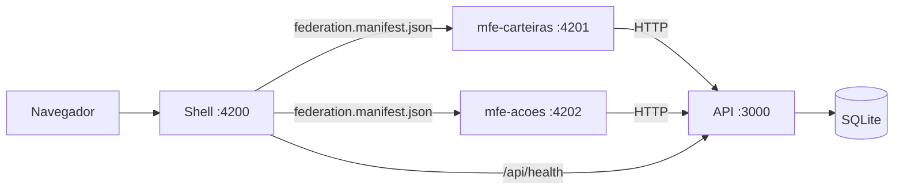
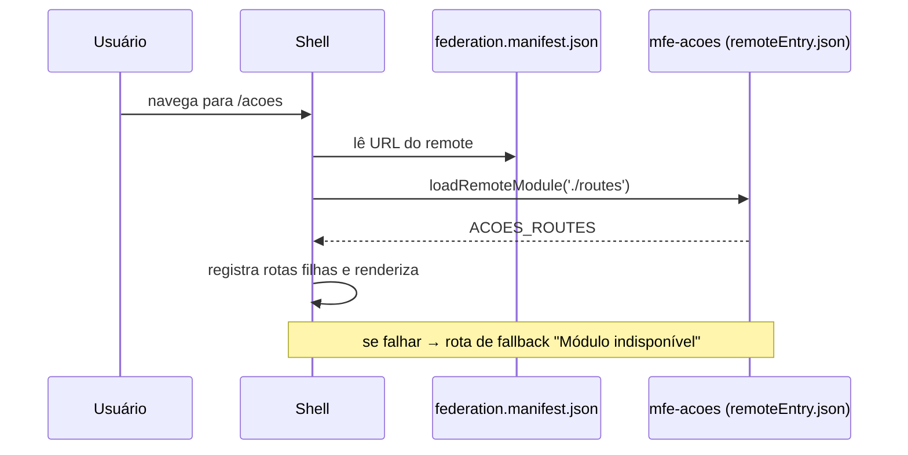
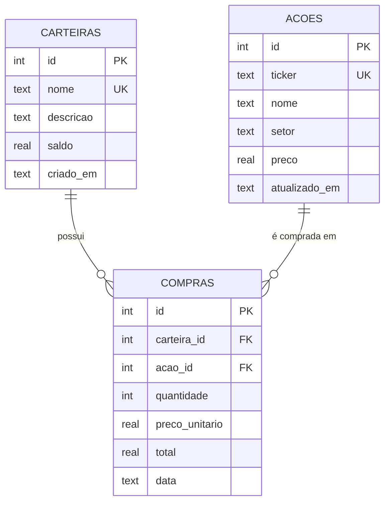
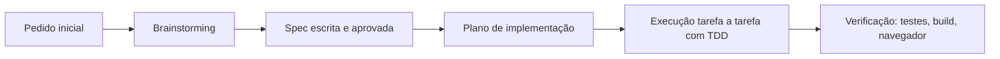

# Safra Invest Lab — Plano de Implementação

> **For agentic workers:** REQUIRED SUB-SKILL: Use superpowers:subagent-driven-development (recommended) or superpowers:executing-plans to implement this plan task-by-task. Steps use checkbox (`- [ ]`) syntax for tracking.

**Goal:** Monorepo com shell Angular + 2 micro front-ends (Carteiras, Ações) via Native Federation, API Express + SQLite, e Home que renderiza a documentação do projeto.

**Architecture:** npm workspaces na raiz. `apps/shell` (host :4200) carrega `apps/mfe-carteiras` (:4201) e `apps/mfe-acoes` (:4202) em runtime via `federation.manifest.json`. Os MFEs falam só com a `api/` (:3000, Express 5 + better-sqlite3); entre si, comunicam-se por `CustomEvent` no `window` e por navegação do router do shell. Tipos de domínio ficam em `libs/shared` (somente tipos/constantes).

**Tech Stack:** Node 24.21, Angular 22.2 (standalone, zoneless, signals), @angular-architects/native-federation 22.2, Angular Material 22.2, ngx-markdown 22.1 + mermaid 11, Express 5, better-sqlite3 13, zod 4, vitest 4, supertest 7, concurrently 10.

**Spec:** `docs/superpowers/specs/2026-10-09-safra-mfe-investimentos-design.md`

## Global Constraints

- **Toda** linha de comando começa com `export PATH=/Users/edu/.nvm/versions/node/v24.21.0/bin:$PATH` (o shell padrão da máquina está em Node 18; `node -v` deve imprimir `v24.21.0`).
- Raiz do projeto: `/Volumes/Secundary Disk Mac/dev/teste_safra` (caminho com espaços — sempre entre aspas).
- Angular `~22.2.0` em todas as apps (mesma versão = requisito do `shared` singleton). Material/CDK `~22.2.0`. Native Federation `~22.2.2`.
- Portas fixas: shell 4200, mfe-carteiras 4201, mfe-acoes 4202, API 3000.
- `API_BASE_URL = 'http://localhost:3000/api'`; evento `COMPRA_REALIZADA_EVENT = 'safra:compra-realizada'`.
- Nomes dos remotes (federation `name` e chaves do manifest): `mfe-carteiras`, `mfe-acoes`. Exports das rotas: `CARTEIRAS_ROUTES`, `ACOES_ROUTES`, expostos como `./routes`.
- Rotas absolutas dos MFEs começam com `/carteiras` e `/acoes` (iguais no shell e no modo standalone).
- Formato de erro da API: `{ code, message, details? }`. Códigos: `VALIDACAO`, `JSON_INVALIDO`, `NAO_ENCONTRADO`, `DUPLICADO`, `CARTEIRA_COM_COMPRAS`, `ACAO_COM_COMPRAS`, `SALDO_INSUFICIENTE`, `ERRO_INTERNO`.
- Dinheiro sempre arredondado a 2 casas com `arredondar()` na API; front usa `CurrencyPipe` com `LOCALE_ID 'pt-BR'` e `DEFAULT_CURRENCY_CODE 'BRL'`.
- Services Angular dos MFEs são `@Injectable()` **sem** `providedIn` e providos nas rotas expostas (quando hospedado, o root injector é o do shell).
- Convenção Angular 20+: arquivos `nome.ts` (sem sufixo `.component`), classes sem sufixo `Component`.
- Texto de UI e mensagens em português.
- Commits terminam com a linha `Co-Authored-By: Claude Opus 5.5 (1M context) <noreply@anthropic.com>`.

## Review Focus

1. **Arredondamento monetário** (ex.: 3 × R$ 33,33 contra saldo R$ 100,00) — saldo restante deve ser exatamente `0.01`, e compra igual ao saldo deve ser aceita. Teste na Task 5; depósito `0.1 + 0.2 = 0.3` na Task 3; total do front na Task 11.
2. **Ticker com minúsculas/espaços** (`" petr4 "`) — deve ser normalizado para `PETR4` e contar como duplicado de `PETR4`. Testes na Task 4 (API) e Task 10 (dialog).
3. **IDs inválidos na URL** (`/api/carteiras/abc`, `/api/carteiras/999`) — `400 VALIDACAO` e `404 NAO_ENCONTRADO`, nunca 500. Teste na Task 3; estado de erro do detalhe no front na Task 9.
4. **Corpo JSON malformado** — `400 JSON_INVALIDO`, nunca 500. Teste na Task 2.
5. **Quantidade fracionada** (`1.5`) — rejeitada com 400 na API (Task 5) e botão desabilitado no front (Task 11).

---

## Estrutura de arquivos

```
teste_safra/
├── package.json · .nvmrc · .gitignore · README.md
├── scripts/sync-docs.mjs                      copia docs/ → apps/shell/public/docs/
├── libs/shared/{tsconfig.json, src/index.ts}  tipos + constantes
├── api/
│   ├── package.json · tsconfig.json
│   ├── src/server.ts · src/app.ts · src/errors.ts · src/dinheiro.ts
│   ├── src/db/{connection,schema,seed}.ts
│   ├── src/middleware/error-handler.ts
│   ├── src/schemas/{comum,carteiras,acoes,compras}.ts
│   ├── src/repositories/{carteiras,acoes,compras}.repository.ts
│   ├── src/services/{carteiras,acoes,compras}.service.ts
│   ├── src/routes/{carteiras,acoes,compras}.routes.ts
│   └── test/{helpers,fundacao,carteiras,acoes,compras}.test.ts (helpers.ts sem .test)
├── apps/shell/src/
│   ├── main.ts · bootstrap.ts · styles.scss · index.html
│   ├── public/federation.manifest.json
│   └── app/
│       ├── app.ts/.html/.scss · app.config.ts · app.routes.ts · menu.ts
│       ├── federation/{remote-loader.ts, remote-indisponivel.ts, remote-loader.spec.ts}
│       ├── layout/api-status.ts
│       ├── notificacoes/{compra-notifier.ts, compra-notifier.spec.ts}
│       └── docs/{docs-pages.ts, docs-pages.spec.ts, mermaid.ts, docs-page.ts}
├── apps/mfe-carteiras/src/app/
│   ├── app.ts · app.config.ts · app.routes.ts · carteiras.routes.ts
│   ├── data/{carteiras-api.ts, carteiras-api.spec.ts, api-error.interceptor.ts}
│   ├── shared/confirm-dialog.ts
│   ├── lista/carteira-lista.ts
│   ├── form/{carteira-form.ts, carteira-form.spec.ts}
│   └── detalhe/{carteira-detalhe.ts, carteira-detalhe.spec.ts, deposito-dialog.ts}
└── apps/mfe-acoes/src/app/
    ├── app.ts · app.config.ts · app.routes.ts · acoes.routes.ts · acoes-page.ts
    ├── data/{acoes-api.ts, acoes-api.spec.ts, api-error.interceptor.ts}
    ├── shared/confirm-dialog.ts
    ├── catalogo/{catalogo.ts, acao-dialog.ts, acao-dialog.spec.ts}
    └── comprar/{comprar.ts, comprar.spec.ts}
```

`api-error.interceptor.ts` e `confirm-dialog.ts` são **duplicados de propósito** em cada MFE: MFEs não compartilham código de runtime (independência de deploy). Documentado em `05-decisoes.md`.

---

### Task 1: Monorepo, contratos compartilhados e scaffold das 3 apps com Native Federation

**Files:**
- Create: `package.json`, `.nvmrc`, `.gitignore`, `scripts/sync-docs.mjs`, `libs/shared/tsconfig.json`, `libs/shared/src/index.ts`
- Create (gerado por CLI): `apps/shell/**`, `apps/mfe-carteiras/**`, `apps/mfe-acoes/**`
- Modify (cada app): `federation.config.js`, `tsconfig.json`, `angular.json`, `package.json`, `src/styles.scss`, `src/index.html`, `src/app/app.ts`, `src/app/app.config.ts`, `src/app/app.routes.ts`, `src/app/app.spec.ts`
- Create: `apps/mfe-carteiras/src/app/carteiras.routes.ts`, `apps/mfe-acoes/src/app/acoes.routes.ts`, `apps/shell/public/federation.manifest.json`

**Interfaces:**
- Produces: `@safra/shared` (tipos abaixo), `CARTEIRAS_ROUTES: Routes` e `ACOES_ROUTES: Routes` (vazios por ora), remotes `mfe-carteiras`/`mfe-acoes` expondo `./routes`.

- [ ] **Step 1: Arquivos da raiz**

`package.json`:
```json
{
  "name": "safra-invest-lab",
  "private": true,
  "workspaces": ["apps/*", "api"],
  "engines": { "node": ">=22.22.3" },
  "scripts": {
    "sync-docs": "node scripts/sync-docs.mjs",
    "predev": "npm run sync-docs",
    "dev": "concurrently -k -n api,carteiras,acoes,shell -c blue,green,magenta,yellow \"npm run dev -w api\" \"npm run start -w mfe-carteiras\" \"npm run start -w mfe-acoes\" \"npm run start -w shell\"",
    "prebuild": "npm run sync-docs",
    "build": "npm run build -w mfe-carteiras && npm run build -w mfe-acoes && npm run build -w shell",
    "test": "npm run test -w api && npm run test:ci -w shell && npm run test:ci -w mfe-carteiras && npm run test:ci -w mfe-acoes"
  }
}
```

`.nvmrc`:
```
24
```

`.gitignore`:
```
node_modules/
dist/
.angular/
coverage/
api/data/
apps/shell/public/docs/
*.log
.DS_Store
```

`scripts/sync-docs.mjs`:
```js
import { cpSync, mkdirSync, rmSync } from 'node:fs';
import { dirname, join } from 'node:path';
import { fileURLToPath } from 'node:url';

const raiz = join(dirname(fileURLToPath(import.meta.url)), '..');
const origem = join(raiz, 'docs');
const destino = join(raiz, 'apps', 'shell', 'public', 'docs');

rmSync(destino, { recursive: true, force: true });
mkdirSync(destino, { recursive: true });
cpSync(origem, destino, { recursive: true, filter: (src) => !src.endsWith('.DS_Store') });
console.log(`[sync-docs] ${origem} -> ${destino}`);
```

`libs/shared/tsconfig.json`:
```json
{
  "compilerOptions": {
    "strict": true,
    "target": "ES2022",
    "module": "ES2022",
    "moduleResolution": "bundler",
    "noEmit": true,
    "verbatimModuleSyntax": true
  },
  "include": ["src"]
}
```

`libs/shared/src/index.ts`:
```ts
export const API_BASE_URL = 'http://localhost:3000/api';
export const COMPRA_REALIZADA_EVENT = 'safra:compra-realizada';

export interface Carteira {
  id: number;
  nome: string;
  descricao: string | null;
  saldo: number;
  criadoEm: string;
}

export interface CarteiraResumo extends Carteira {
  valorInvestido: number;
  qtdAtivos: number;
}

export interface NovaCarteira {
  nome: string;
  descricao?: string | null;
  saldoInicial?: number;
}

export interface AtualizaCarteira {
  nome: string;
  descricao?: string | null;
}

export interface Acao {
  id: number;
  ticker: string;
  nome: string;
  setor: string | null;
  preco: number;
  atualizadoEm: string;
}

export interface NovaAcao {
  ticker: string;
  nome: string;
  setor?: string | null;
  preco: number;
}

export interface Compra {
  id: number;
  carteiraId: number;
  acaoId: number;
  ticker: string;
  quantidade: number;
  precoUnitario: number;
  total: number;
  data: string;
}

export interface NovaCompra {
  carteiraId: number;
  acaoId: number;
  quantidade: number;
}

export interface CompraResultado {
  compra: Compra;
  saldoRestante: number;
}

export interface Posicao {
  acaoId: number;
  ticker: string;
  nome: string;
  quantidade: number;
  precoMedio: number;
  precoAtual: number;
  valorInvestido: number;
  valorAtual: number;
}

export interface ApiError {
  code: string;
  message: string;
  details?: unknown;
}

export interface Health {
  status: 'ok';
}
```

- [ ] **Step 2: Gerar as 3 apps Angular**

```bash
export PATH=/Users/edu/.nvm/versions/node/v24.21.0/bin:$PATH
cd "/Volumes/Secundary Disk Mac/dev/teste_safra"
export NG_CLI_ANALYTICS=false
for app in shell mfe-carteiras mfe-acoes; do
  npx -y @angular/cli@22.2.2 new "$app" --directory "apps/$app" --style=scss --ssr=false --skip-git --skip-install --interactive=false
done
ls apps/shell/src/app
```
Expected: `app.config.ts app.html app.routes.ts app.scss app.spec.ts app.ts` (se a CLI gerar nomes diferentes, adapte os caminhos dos próximos passos aos nomes gerados e registre no commit).

- [ ] **Step 3: Instalar dependências (hoisted na raiz)**

```bash
npm install
npm install -D concurrently@^10.0.6
npm install @angular/material@~22.2.0 @angular/cdk@~22.2.0 -w shell -w mfe-carteiras -w mfe-acoes
npm install -D @angular-architects/native-federation@~22.2.2 -w shell -w mfe-carteiras -w mfe-acoes
npm install ngx-markdown@~22.1.0 marked@^18.1.0 mermaid@^11.17.0 -w shell
npm ls @angular/core
```
Expected: uma única versão `22.2.x` de `@angular/core` (deduped).

- [ ] **Step 4: Inicializar Native Federation**

```bash
(cd apps/shell && npx ng g @angular-architects/native-federation:init --project shell --port 4200 --type dynamic-host)
(cd apps/mfe-carteiras && npx ng g @angular-architects/native-federation:init --project mfe-carteiras --port 4201 --type remote)
(cd apps/mfe-acoes && npx ng g @angular-architects/native-federation:init --project mfe-acoes --port 4202 --type remote)
ls apps/shell apps/shell/src apps/shell/public
```
Expected: `federation.config.js` em cada app, `src/bootstrap.ts` criado, `src/main.ts` chamando `initFederation`, `public/federation.manifest.json` no shell. No `angular.json`, o target `build` passa a usar `@angular-architects/native-federation:build` e o builder original vai para um target auxiliar (normalmente `esbuild`). Anote o nome desse target:
```bash
node -e "const a=require('./apps/shell/angular.json');console.log(Object.keys(a.projects.shell.architect))"
```

- [ ] **Step 5: Configurar federação**

`apps/mfe-carteiras/federation.config.js` (substituir o conteúdo, mantendo o estilo `require` gerado):
```js
const { withNativeFederation, shareAll } = require('@angular-architects/native-federation/config');

module.exports = withNativeFederation({
  name: 'mfe-carteiras',
  exposes: {
    './routes': './src/app/carteiras.routes.ts',
  },
  shared: {
    ...shareAll({ singleton: true, strictVersion: true, requiredVersion: 'auto' }),
  },
  skip: ['rxjs/ajax', 'rxjs/fetch', 'rxjs/testing', 'rxjs/webSocket', '@safra/shared'],
  features: {
    ignoreUnusedDeps: true,
  },
});
```

`apps/mfe-acoes/federation.config.js`: idêntico, com `name: 'mfe-acoes'` e `'./routes': './src/app/acoes.routes.ts'`.

`apps/shell/federation.config.js`:
```js
const { withNativeFederation, shareAll } = require('@angular-architects/native-federation/config');

module.exports = withNativeFederation({
  name: 'shell',
  shared: {
    ...shareAll({ singleton: true, strictVersion: true, requiredVersion: 'auto' }),
  },
  skip: ['rxjs/ajax', 'rxjs/fetch', 'rxjs/testing', 'rxjs/webSocket', '@safra/shared', 'mermaid'],
  features: {
    ignoreUnusedDeps: true,
  },
});
```
(Se o arquivo gerado tiver opções extras além destas, preserve-as.)

`apps/shell/public/federation.manifest.json`:
```json
{
  "mfe-carteiras": "http://localhost:4201/remoteEntry.json",
  "mfe-acoes": "http://localhost:4202/remoteEntry.json"
}
```

`apps/shell/src/main.ts` (o shell **não** pré-carrega remotes; cada rota carrega o seu, isolando falhas):
```ts
import { initFederation } from '@angular-architects/native-federation';

initFederation()
  .catch((err) => console.error(err))
  .then(() => import('./bootstrap'))
  .catch((err) => console.error(err));
```

- [ ] **Step 6: Paths do `@safra/shared`, scripts e target de testes**

Em `compilerOptions` de `apps/<app>/tsconfig.json` (as 3 apps) adicionar:
```json
"paths": {
  "@safra/shared": ["../../libs/shared/src/index.ts"]
}
```

Em `apps/<app>/package.json` (as 3 apps) adicionar ao bloco `scripts`:
```json
"test:ci": "ng test --watch=false"
```

Em `apps/<app>/angular.json`, no target `test`, garantir que `options.buildTarget` aponte para o builder **original** (não o da federação). Usando o nome anotado no Step 4 (ex.: `esbuild`):
```json
"test": {
  "builder": "@angular/build:unit-test",
  "options": { "buildTarget": "shell:esbuild:development" }
}
```
(`mfe-carteiras:esbuild:development` e `mfe-acoes:esbuild:development` nas outras apps; preserve demais opções existentes.)

- [ ] **Step 7: Tema Material (3 apps)**

`apps/<app>/src/styles.scss` (igual nas 3):
```scss
@use '@angular/material' as mat;

html {
  color-scheme: light;
  @include mat.theme((
    color: (
      primary: mat.$blue-palette,
      tertiary: mat.$orange-palette,
    ),
    typography: Roboto,
    density: 0,
  ));

  // Paleta inspirada (sem marca) — azul-marinho + dourado
  --mat-sys-primary: #0b2a4a;
  --mat-sys-on-primary: #ffffff;
  --mat-sys-primary-container: #d6e3f3;
  --mat-sys-on-primary-container: #0b2a4a;
  --mat-sys-tertiary: #b08d3c;
  --mat-sys-on-tertiary: #ffffff;
  --mat-sys-surface: #f7f8fa;

  --safra-dourado: #b08d3c;
  --safra-marinho: #0b2a4a;
  --safra-erro: #b3261e;
  --safra-sucesso: #1e7b34;
}

html, body { height: 100%; }

body {
  margin: 0;
  font-family: Roboto, 'Helvetica Neue', sans-serif;
  background: var(--mat-sys-surface);
  color: var(--mat-sys-on-surface);
}

.snack-erro { --mat-snack-bar-container-color: var(--safra-erro); }
```

Em `apps/<app>/src/index.html`: trocar `<html lang="en">` por `<html lang="pt-BR">` e adicionar no `<head>`:
```html
<link rel="preconnect" href="https://fonts.gstatic.com" />
<link href="https://fonts.googleapis.com/css2?family=Roboto:wght@300;400;500;700&display=swap" rel="stylesheet" />
<link href="https://fonts.googleapis.com/icon?family=Material+Icons" rel="stylesheet" />
```
Título: `Safra Invest Lab` (shell), `mfe-carteiras` e `mfe-acoes` nos remotes.

- [ ] **Step 8: Rotas expostas (vazias) e app standalone dos remotes**

`apps/mfe-carteiras/src/app/carteiras.routes.ts`:
```ts
import { Routes } from '@angular/router';

export const CARTEIRAS_ROUTES: Routes = [];
```

`apps/mfe-acoes/src/app/acoes.routes.ts`:
```ts
import { Routes } from '@angular/router';

export const ACOES_ROUTES: Routes = [];
```

`apps/mfe-carteiras/src/app/app.routes.ts`:
```ts
import { Routes } from '@angular/router';
import { CARTEIRAS_ROUTES } from './carteiras.routes';

export const routes: Routes = [
  { path: 'carteiras', children: CARTEIRAS_ROUTES },
  { path: '', pathMatch: 'full', redirectTo: 'carteiras' },
];
```

`apps/mfe-acoes/src/app/app.routes.ts`:
```ts
import { Routes } from '@angular/router';
import { ACOES_ROUTES } from './acoes.routes';

export const routes: Routes = [
  { path: 'acoes', children: ACOES_ROUTES },
  { path: '', pathMatch: 'full', redirectTo: 'acoes' },
];
```

`apps/mfe-carteiras/src/app/app.config.ts` (igual em mfe-acoes):
```ts
import { ApplicationConfig, provideBrowserGlobalErrorListeners } from '@angular/core';
import { provideRouter, withComponentInputBinding } from '@angular/router';
import { routes } from './app.routes';

export const appConfig: ApplicationConfig = {
  providers: [provideBrowserGlobalErrorListeners(), provideRouter(routes, withComponentInputBinding())],
};
```

`apps/mfe-carteiras/src/app/app.ts` (em mfe-acoes trocar o texto para `mfe-acoes`):
```ts
import { Component } from '@angular/core';
import { RouterOutlet } from '@angular/router';
import { MatToolbarModule } from '@angular/material/toolbar';

@Component({
  selector: 'app-root',
  imports: [RouterOutlet, MatToolbarModule],
  template: `
    <mat-toolbar class="barra">mfe-carteiras · modo standalone</mat-toolbar>
    <main class="standalone"><router-outlet /></main>
  `,
  styles: `
    .barra { background: var(--safra-marinho); color: #fff; }
    .standalone { padding: 24px; max-width: 1200px; margin: 0 auto; }
  `,
})
export class App {}
```
Apagar `app.html` e `app.scss` dos remotes (o template agora é inline).

`apps/mfe-carteiras/src/app/app.spec.ts` (igual em mfe-acoes):
```ts
import { TestBed } from '@angular/core/testing';
import { provideRouter } from '@angular/router';
import { App } from './app';

describe('App (standalone)', () => {
  it('cria o app', async () => {
    await TestBed.configureTestingModule({ imports: [App], providers: [provideRouter([])] }).compileComponents();
    const fixture = TestBed.createComponent(App);
    expect(fixture.componentInstance).toBeTruthy();
  });
});
```

No shell, por ora, apenas apagar o conteúdo de `app.html` (deixar `<router-outlet />`) e substituir `app.spec.ts` pelo mesmo teste "cria o app" acima (a Task 6 reescreve o shell).

- [ ] **Step 9: Build e testes das 3 apps**

```bash
npm run build -w mfe-carteiras && npm run build -w mfe-acoes && npm run build -w shell
npm run test:ci -w shell && npm run test:ci -w mfe-carteiras && npm run test:ci -w mfe-acoes
ls apps/mfe-carteiras/dist/mfe-carteiras/browser | grep remoteEntry
```
Expected: 3 builds OK, 3 suítes com 1 teste passando, `remoteEntry.json` presente. Se o build reclamar de `@safra/shared` no compartilhamento, confirme que está em `skip`.

- [ ] **Step 10: Commit**

```bash
git add -A
git commit -m "chore: scaffold monorepo with shell and two native federation remotes

Co-Authored-By: Claude Opus 5.5 (1M context) <noreply@anthropic.com>"
```

---

### Task 2: API — fundação (banco, erros, health, seed)

**Files:**
- Create: `api/package.json`, `api/tsconfig.json`, `api/src/server.ts`, `api/src/app.ts`, `api/src/errors.ts`, `api/src/dinheiro.ts`, `api/src/db/connection.ts`, `api/src/db/schema.ts`, `api/src/db/seed.ts`, `api/src/middleware/error-handler.ts`, `api/src/schemas/comum.ts`
- Test: `api/test/helpers.ts`, `api/test/fundacao.test.ts`

**Interfaces:**
- Produces:
  - `abrirBanco(arquivo: string, opcoes?: { seed?: boolean }): DB` e `type DB = Database.Database`
  - `popularSeVazio(db: DB): void`
  - `criarApp(db: DB): express.Express`
  - `class DomainError(status: number, code: string, message: string, details?: unknown)`
  - `naoEncontrado(recurso: string): DomainError` (mensagem `"<recurso> não encontrada"`)
  - `comUnicidade<T>(fn: () => T, mensagem: string): T` (converte `SQLITE_CONSTRAINT_UNIQUE` em `409 DUPLICADO`)
  - `arredondar(valor: number): number`
  - `idSchema` (zod: coerce → inteiro positivo)
  - Teste: `novaApi(): { db: DB; api: ReturnType<typeof request> }`

- [ ] **Step 1: Pacote da API**

`api/package.json`:
```json
{
  "name": "api",
  "private": true,
  "type": "module",
  "scripts": {
    "dev": "tsx watch src/server.ts",
    "start": "tsx src/server.ts",
    "test": "vitest run",
    "typecheck": "tsc --noEmit -p tsconfig.json"
  }
}
```

```bash
export PATH=/Users/edu/.nvm/versions/node/v24.21.0/bin:$PATH
cd "/Volumes/Secundary Disk Mac/dev/teste_safra"
npm install -w api express@^5.3.0 cors@^2.8.6 better-sqlite3@^13.0.3 zod@^4.6.5
npm install -D -w api tsx@^4.23.0 vitest@^4.1.11 supertest@^7.3.1 @types/express@^5 @types/cors @types/better-sqlite3 @types/supertest @types/node@^24 "typescript@$(node -p "require('./node_modules/typescript/package.json').version")"
```
(A última linha fixa o TypeScript da API na mesma versão que o Angular trouxe, evitando duas versões hoisted.)

`api/tsconfig.json`:
```json
{
  "compilerOptions": {
    "target": "ES2023",
    "module": "ESNext",
    "moduleResolution": "bundler",
    "strict": true,
    "esModuleInterop": true,
    "skipLibCheck": true,
    "noEmit": true,
    "verbatimModuleSyntax": true,
    "types": ["node"],
    "paths": {
      "@safra/shared": ["../libs/shared/src/index.ts"]
    }
  },
  "include": ["src", "test"]
}
```
A API só usa `import type` de `@safra/shared` (apagado em runtime), então `tsx`/`vitest` não precisam resolver o path.

- [ ] **Step 2: Escrever o teste da fundação (falhando)**

`api/test/helpers.ts`:
```ts
import request from 'supertest';
import { abrirBanco } from '../src/db/connection';
import { criarApp } from '../src/app';

export function novaApi() {
  const db = abrirBanco(':memory:');
  return { db, api: request(criarApp(db)) };
}
```

`api/test/fundacao.test.ts`:
```ts
import { describe, expect, it } from 'vitest';
import { abrirBanco } from '../src/db/connection';
import { popularSeVazio } from '../src/db/seed';
import { novaApi } from './helpers';

describe('fundação da API', () => {
  it('GET /api/health responde ok', async () => {
    const { api } = novaApi();
    const res = await api.get('/api/health');
    expect(res.status).toBe(200);
    expect(res.body).toEqual({ status: 'ok' });
  });

  it('rota inexistente retorna 404 padronizado', async () => {
    const { api } = novaApi();
    const res = await api.get('/api/nao-existe');
    expect(res.status).toBe(404);
    expect(res.body).toEqual({ code: 'NAO_ENCONTRADO', message: 'Rota não encontrada' });
  });

  it('JSON malformado retorna 400 JSON_INVALIDO', async () => {
    const { api } = novaApi();
    const res = await api.post('/api/health').set('Content-Type', 'application/json').send('{"nome":');
    expect(res.status).toBe(400);
    expect(res.body.code).toBe('JSON_INVALIDO');
  });

  it('libera CORS para o shell', async () => {
    const { api } = novaApi();
    const res = await api.get('/api/health').set('Origin', 'http://localhost:4200');
    expect(res.headers['access-control-allow-origin']).toBe('http://localhost:4200');
  });

  it('cria as tabelas', () => {
    const { db } = novaApi();
    const tabelas = (db.prepare("SELECT name FROM sqlite_master WHERE type = 'table'").all() as { name: string }[]).map((t) => t.name);
    expect(tabelas).toEqual(expect.arrayContaining(['carteiras', 'acoes', 'compras']));
  });

  it('seed popula 8 ações e 2 carteiras apenas uma vez', () => {
    const db = abrirBanco(':memory:', { seed: true });
    popularSeVazio(db);
    const contar = (tabela: string) => (db.prepare(`SELECT COUNT(*) AS n FROM ${tabela}`).get() as { n: number }).n;
    expect(contar('acoes')).toBe(8);
    expect(contar('carteiras')).toBe(2);
  });
});
```

- [ ] **Step 3: Rodar e ver falhar**

Run: `npm test -w api`
Expected: FAIL — `Cannot find module '../src/db/connection'`.

- [ ] **Step 4: Implementar**

`api/src/dinheiro.ts`:
```ts
export function arredondar(valor: number): number {
  return Math.round((valor + Number.EPSILON) * 100) / 100;
}
```

`api/src/errors.ts`:
```ts
export class DomainError extends Error {
  constructor(
    readonly status: number,
    readonly code: string,
    message: string,
    readonly details?: unknown,
  ) {
    super(message);
    this.name = 'DomainError';
  }
}

export function naoEncontrado(recurso: string): DomainError {
  return new DomainError(404, 'NAO_ENCONTRADO', `${recurso} não encontrada`);
}

export function comUnicidade<T>(fn: () => T, mensagem: string): T {
  try {
    return fn();
  } catch (err) {
    if (err instanceof Error && 'code' in err && err.code === 'SQLITE_CONSTRAINT_UNIQUE') {
      throw new DomainError(409, 'DUPLICADO', mensagem);
    }
    throw err;
  }
}
```

`api/src/db/schema.ts`:
```ts
import type { DB } from './connection';

export function aplicarSchema(db: DB): void {
  db.exec(`
    CREATE TABLE IF NOT EXISTS carteiras (
      id         INTEGER PRIMARY KEY AUTOINCREMENT,
      nome       TEXT    NOT NULL UNIQUE,
      descricao  TEXT,
      saldo      REAL    NOT NULL DEFAULT 0 CHECK (saldo >= 0),
      criado_em  TEXT    NOT NULL DEFAULT (datetime('now'))
    );

    CREATE TABLE IF NOT EXISTS acoes (
      id            INTEGER PRIMARY KEY AUTOINCREMENT,
      ticker        TEXT    NOT NULL UNIQUE,
      nome          TEXT    NOT NULL,
      setor         TEXT,
      preco         REAL    NOT NULL CHECK (preco > 0),
      atualizado_em TEXT    NOT NULL DEFAULT (datetime('now'))
    );

    CREATE TABLE IF NOT EXISTS compras (
      id             INTEGER PRIMARY KEY AUTOINCREMENT,
      carteira_id    INTEGER NOT NULL REFERENCES carteiras(id),
      acao_id        INTEGER NOT NULL REFERENCES acoes(id),
      quantidade     INTEGER NOT NULL CHECK (quantidade > 0),
      preco_unitario REAL    NOT NULL,
      total          REAL    NOT NULL,
      data           TEXT    NOT NULL DEFAULT (datetime('now'))
    );

    CREATE INDEX IF NOT EXISTS idx_compras_carteira ON compras(carteira_id);
    CREATE INDEX IF NOT EXISTS idx_compras_acao ON compras(acao_id);
  `);
}
```

`api/src/db/seed.ts`:
```ts
import type { DB } from './connection';

const ACOES: [ticker: string, nome: string, setor: string, preco: number][] = [
  ['PETR4', 'Petrobras PN', 'Petróleo e Gás', 38.42],
  ['VALE3', 'Vale ON', 'Mineração', 61.15],
  ['ITUB4', 'Itaú Unibanco PN', 'Financeiro', 35.8],
  ['BBDC4', 'Bradesco PN', 'Financeiro', 15.27],
  ['BBAS3', 'Banco do Brasil ON', 'Financeiro', 27.9],
  ['WEGE3', 'WEG ON', 'Bens Industriais', 52.64],
  ['ABEV3', 'Ambev ON', 'Consumo', 13.05],
  ['MGLU3', 'Magazine Luiza ON', 'Varejo', 9.48],
];

export function popularSeVazio(db: DB): void {
  const { n } = db.prepare('SELECT COUNT(*) AS n FROM acoes').get() as { n: number };
  if (n > 0) return;

  const inserirAcao = db.prepare('INSERT INTO acoes (ticker, nome, setor, preco) VALUES (?, ?, ?, ?)');
  const inserirCarteira = db.prepare('INSERT INTO carteiras (nome, descricao, saldo) VALUES (?, ?, ?)');

  db.transaction(() => {
    for (const acao of ACOES) inserirAcao.run(...acao);
    inserirCarteira.run('Carteira Conservadora', 'Foco em bancos e dividendos', 10000);
    inserirCarteira.run('Carteira Arrojada', 'Mais exposição a varejo e indústria', 25000);
  })();
}
```

`api/src/db/connection.ts`:
```ts
import Database from 'better-sqlite3';
import { aplicarSchema } from './schema';
import { popularSeVazio } from './seed';

export type DB = Database.Database;

export function abrirBanco(arquivo: string, opcoes: { seed?: boolean } = {}): DB {
  const db = new Database(arquivo);
  if (arquivo !== ':memory:') db.pragma('journal_mode = WAL');
  db.pragma('foreign_keys = ON');
  aplicarSchema(db);
  if (opcoes.seed) popularSeVazio(db);
  return db;
}
```

`api/src/schemas/comum.ts`:
```ts
import { z } from 'zod';

export const idSchema = z.coerce.number().int().positive();
```

`api/src/middleware/error-handler.ts`:
```ts
import type { ErrorRequestHandler, RequestHandler } from 'express';
import { ZodError } from 'zod';
import { DomainError } from '../errors';

export const rotaNaoEncontrada: RequestHandler = (_req, res) => {
  res.status(404).json({ code: 'NAO_ENCONTRADO', message: 'Rota não encontrada' });
};

export const tratarErros: ErrorRequestHandler = (err, _req, res, _next) => {
  if (err instanceof ZodError) {
    res.status(400).json({
      code: 'VALIDACAO',
      message: 'Dados inválidos',
      details: err.issues.map((i) => ({ campo: i.path.map(String).join('.'), mensagem: i.message })),
    });
    return;
  }
  if (err instanceof DomainError) {
    res.status(err.status).json({
      code: err.code,
      message: err.message,
      ...(err.details !== undefined && { details: err.details }),
    });
    return;
  }
  if (err?.type === 'entity.parse.failed') {
    res.status(400).json({ code: 'JSON_INVALIDO', message: 'Corpo da requisição não é um JSON válido' });
    return;
  }
  console.error('[api] erro não tratado', err);
  res.status(500).json({ code: 'ERRO_INTERNO', message: 'Erro interno do servidor' });
};
```

`api/src/app.ts`:
```ts
import cors from 'cors';
import express from 'express';
import type { DB } from './db/connection';
import { rotaNaoEncontrada, tratarErros } from './middleware/error-handler';

export const ORIGENS_PERMITIDAS = ['http://localhost:4200', 'http://localhost:4201', 'http://localhost:4202'];

export function criarApp(db: DB) {
  const app = express();
  app.use(cors({ origin: ORIGENS_PERMITIDAS }));
  app.use(express.json());

  app.get('/api/health', (_req, res) => {
    res.json({ status: 'ok' });
  });

  // rotas de domínio são registradas aqui nas Tasks 3–5

  app.use(rotaNaoEncontrada);
  app.use(tratarErros);
  return app;
}
```
(`db` fica sem uso até a Task 3 — tudo bem.)

`api/src/server.ts`:
```ts
import { mkdirSync } from 'node:fs';
import { dirname, join } from 'node:path';
import { fileURLToPath } from 'node:url';
import { criarApp } from './app';
import { abrirBanco } from './db/connection';

const pastaDados = join(dirname(fileURLToPath(import.meta.url)), '..', 'data');
mkdirSync(pastaDados, { recursive: true });

const db = abrirBanco(process.env.SAFRA_DB ?? join(pastaDados, 'safra.db'), { seed: true });
const porta = Number(process.env.PORT ?? 3000);

criarApp(db).listen(porta, () => {
  console.log(`[api] ouvindo em http://localhost:${porta}/api`);
});
```

- [ ] **Step 5: Rodar e ver passar**

Run: `npm test -w api && npm run typecheck -w api`
Expected: 6 testes PASS; typecheck sem erros.

Smoke: `npm start -w api` em background, `curl -s localhost:3000/api/health` → `{"status":"ok"}`; encerrar o processo.

- [ ] **Step 6: Commit**

```bash
git add api package.json package-lock.json
git commit -m "feat(api): add express + sqlite foundation with health, errors and seed

Co-Authored-By: Claude Opus 5.5 (1M context) <noreply@anthropic.com>"
```

---

### Task 3: API — CRUD de carteiras e depósito

**Files:**
- Create: `api/src/schemas/carteiras.ts`, `api/src/repositories/carteiras.repository.ts`, `api/src/services/carteiras.service.ts`, `api/src/routes/carteiras.routes.ts`
- Modify: `api/src/app.ts`
- Test: `api/test/carteiras.test.ts`

**Interfaces:**
- Consumes: `DB`, `DomainError`, `naoEncontrado`, `comUnicidade`, `arredondar`, `idSchema`, tipos `Carteira`/`CarteiraResumo` de `@safra/shared`.
- Produces:
  - `class CarteirasRepository(db)` com `listarResumo(): CarteiraResumo[]`, `buscar(id): Carteira | undefined`, `inserir({ nome, descricao, saldo }): Carteira`, `atualizar(id, { nome, descricao }): void`, `atualizarSaldo(id, saldo): void`, `excluir(id): void`, `contarCompras(id): number`
  - `class CarteirasService(repo)` com `listar()`, `obter(id)`, `criar(d)`, `atualizar(id, d)`, `excluir(id)`, `depositar(id, valor)`
  - `rotasCarteiras(servico: CarteirasService): Router` (a Task 5 adiciona um 2º parâmetro)

- [ ] **Step 1: Teste (falhando)**

`api/test/carteiras.test.ts`:
```ts
import { describe, expect, it } from 'vitest';
import { novaApi } from './helpers';

describe('carteiras', () => {
  it('cria carteira com saldo inicial', async () => {
    const { api } = novaApi();
    const res = await api.post('/api/carteiras').send({ nome: 'Renda', descricao: 'Dividendos', saldoInicial: 1500 });
    expect(res.status).toBe(201);
    expect(res.body).toMatchObject({ id: expect.any(Number), nome: 'Renda', descricao: 'Dividendos', saldo: 1500 });
    expect(res.body.criadoEm).toEqual(expect.any(String));
  });

  it('saldo inicial padrão é zero', async () => {
    const { api } = novaApi();
    const res = await api.post('/api/carteiras').send({ nome: 'Vazia' });
    expect(res.body.saldo).toBe(0);
  });

  it('rejeita nome duplicado com 409', async () => {
    const { api } = novaApi();
    await api.post('/api/carteiras').send({ nome: 'Renda' });
    const res = await api.post('/api/carteiras').send({ nome: 'Renda' });
    expect(res.status).toBe(409);
    expect(res.body.code).toBe('DUPLICADO');
  });

  it('valida nome vazio e saldo negativo', async () => {
    const { api } = novaApi();
    const res = await api.post('/api/carteiras').send({ nome: '   ', saldoInicial: -1 });
    expect(res.status).toBe(400);
    expect(res.body.code).toBe('VALIDACAO');
    const campos = res.body.details.map((d: { campo: string }) => d.campo);
    expect(campos).toEqual(expect.arrayContaining(['nome', 'saldoInicial']));
  });

  it('lista com resumo ordenado por nome', async () => {
    const { api } = novaApi();
    await api.post('/api/carteiras').send({ nome: 'Zeta' });
    await api.post('/api/carteiras').send({ nome: 'Alfa', saldoInicial: 10 });
    const res = await api.get('/api/carteiras');
    expect(res.status).toBe(200);
    expect(res.body.map((c: { nome: string }) => c.nome)).toEqual(['Alfa', 'Zeta']);
    expect(res.body[0]).toMatchObject({ saldo: 10, valorInvestido: 0, qtdAtivos: 0 });
  });

  it('obtém por id, 404 para inexistente e 400 para id inválido', async () => {
    const { api } = novaApi();
    const { body } = await api.post('/api/carteiras').send({ nome: 'Renda' });
    expect((await api.get(`/api/carteiras/${body.id}`)).body.nome).toBe('Renda');

    const inexistente = await api.get('/api/carteiras/999');
    expect(inexistente.status).toBe(404);
    expect(inexistente.body).toEqual({ code: 'NAO_ENCONTRADO', message: 'Carteira não encontrada' });

    const invalido = await api.get('/api/carteiras/abc');
    expect(invalido.status).toBe(400);
    expect(invalido.body.code).toBe('VALIDACAO');
  });

  it('atualiza nome e descrição sem alterar saldo', async () => {
    const { api } = novaApi();
    const { body } = await api.post('/api/carteiras').send({ nome: 'Renda', saldoInicial: 100 });
    const res = await api.put(`/api/carteiras/${body.id}`).send({ nome: 'Renda Plus', descricao: 'Nova', saldo: 999999 });
    expect(res.status).toBe(200);
    expect(res.body).toMatchObject({ nome: 'Renda Plus', descricao: 'Nova', saldo: 100 });
  });

  it('exclui carteira sem compras', async () => {
    const { api } = novaApi();
    const { body } = await api.post('/api/carteiras').send({ nome: 'Temp' });
    expect((await api.delete(`/api/carteiras/${body.id}`)).status).toBe(204);
    expect((await api.get(`/api/carteiras/${body.id}`)).status).toBe(404);
  });

  it('depósito soma ao saldo com arredondamento', async () => {
    const { api } = novaApi();
    const { body } = await api.post('/api/carteiras').send({ nome: 'Renda', saldoInicial: 0.1 });
    const res = await api.post(`/api/carteiras/${body.id}/deposito`).send({ valor: 0.2 });
    expect(res.status).toBe(200);
    expect(res.body.saldo).toBe(0.3);
  });

  it('rejeita depósito zero ou negativo', async () => {
    const { api } = novaApi();
    const { body } = await api.post('/api/carteiras').send({ nome: 'Renda' });
    expect((await api.post(`/api/carteiras/${body.id}/deposito`).send({ valor: 0 })).status).toBe(400);
    expect((await api.post(`/api/carteiras/${body.id}/deposito`).send({ valor: -5 })).status).toBe(400);
  });
});
```

- [ ] **Step 2: Rodar e ver falhar**

Run: `npm test -w api -- carteiras`
Expected: FAIL — respostas `404 Rota não encontrada`.

- [ ] **Step 3: Implementar**

`api/src/schemas/carteiras.ts`:
```ts
import { z } from 'zod';

const nome = z.string().trim().min(1, 'Informe o nome').max(60, 'Máximo de 60 caracteres');
const descricao = z.string().trim().max(200, 'Máximo de 200 caracteres').nullish();

export const novaCarteiraSchema = z.object({
  nome,
  descricao,
  saldoInicial: z.number().min(0, 'Saldo inicial não pode ser negativo').default(0),
});

export const atualizaCarteiraSchema = z.object({ nome, descricao });

export const depositoSchema = z.object({
  valor: z.number().positive('O depósito deve ser maior que zero'),
});

export type NovaCarteiraInput = z.output<typeof novaCarteiraSchema>;
export type AtualizaCarteiraInput = z.output<typeof atualizaCarteiraSchema>;
```

`api/src/repositories/carteiras.repository.ts`:
```ts
import type { Carteira, CarteiraResumo } from '@safra/shared';
import type { DB } from '../db/connection';
import { arredondar } from '../dinheiro';

interface CarteiraLinha {
  id: number;
  nome: string;
  descricao: string | null;
  saldo: number;
  criado_em: string;
}

interface ResumoLinha extends CarteiraLinha {
  valor_investido: number;
  qtd_ativos: number;
}

const paraCarteira = (l: CarteiraLinha): Carteira => ({
  id: l.id,
  nome: l.nome,
  descricao: l.descricao,
  saldo: l.saldo,
  criadoEm: l.criado_em,
});

export class CarteirasRepository {
  constructor(private readonly db: DB) {}

  listarResumo(): CarteiraResumo[] {
    const linhas = this.db
      .prepare(
        `SELECT c.*, COALESCE(SUM(co.total), 0) AS valor_investido, COUNT(DISTINCT co.acao_id) AS qtd_ativos
           FROM carteiras c
           LEFT JOIN compras co ON co.carteira_id = c.id
          GROUP BY c.id
          ORDER BY c.nome`,
      )
      .all() as ResumoLinha[];
    return linhas.map((l) => ({ ...paraCarteira(l), valorInvestido: arredondar(l.valor_investido), qtdAtivos: l.qtd_ativos }));
  }

  buscar(id: number): Carteira | undefined {
    const linha = this.db.prepare('SELECT * FROM carteiras WHERE id = ?').get(id) as CarteiraLinha | undefined;
    return linha && paraCarteira(linha);
  }

  inserir(dados: { nome: string; descricao: string | null; saldo: number }): Carteira {
    const { lastInsertRowid } = this.db
      .prepare('INSERT INTO carteiras (nome, descricao, saldo) VALUES (?, ?, ?)')
      .run(dados.nome, dados.descricao, dados.saldo);
    return this.buscar(Number(lastInsertRowid))!;
  }

  atualizar(id: number, dados: { nome: string; descricao: string | null }): void {
    this.db.prepare('UPDATE carteiras SET nome = ?, descricao = ? WHERE id = ?').run(dados.nome, dados.descricao, id);
  }

  atualizarSaldo(id: number, saldo: number): void {
    this.db.prepare('UPDATE carteiras SET saldo = ? WHERE id = ?').run(saldo, id);
  }

  excluir(id: number): void {
    this.db.prepare('DELETE FROM carteiras WHERE id = ?').run(id);
  }

  contarCompras(id: number): number {
    return (this.db.prepare('SELECT COUNT(*) AS n FROM compras WHERE carteira_id = ?').get(id) as { n: number }).n;
  }
}
```

`api/src/services/carteiras.service.ts`:
```ts
import type { Carteira, CarteiraResumo } from '@safra/shared';
import { arredondar } from '../dinheiro';
import { comUnicidade, DomainError, naoEncontrado } from '../errors';
import type { CarteirasRepository } from '../repositories/carteiras.repository';
import type { AtualizaCarteiraInput, NovaCarteiraInput } from '../schemas/carteiras';

const NOME_DUPLICADO = 'Já existe uma carteira com este nome';

export class CarteirasService {
  constructor(private readonly repo: CarteirasRepository) {}

  listar(): CarteiraResumo[] {
    return this.repo.listarResumo();
  }

  obter(id: number): Carteira {
    const carteira = this.repo.buscar(id);
    if (!carteira) throw naoEncontrado('Carteira');
    return carteira;
  }

  criar(dados: NovaCarteiraInput): Carteira {
    return comUnicidade(
      () => this.repo.inserir({ nome: dados.nome, descricao: dados.descricao ?? null, saldo: arredondar(dados.saldoInicial) }),
      NOME_DUPLICADO,
    );
  }

  atualizar(id: number, dados: AtualizaCarteiraInput): Carteira {
    this.obter(id);
    comUnicidade(() => this.repo.atualizar(id, { nome: dados.nome, descricao: dados.descricao ?? null }), NOME_DUPLICADO);
    return this.obter(id);
  }

  excluir(id: number): void {
    this.obter(id);
    if (this.repo.contarCompras(id) > 0) {
      throw new DomainError(409, 'CARTEIRA_COM_COMPRAS', 'Carteira possui compras e não pode ser excluída');
    }
    this.repo.excluir(id);
  }

  depositar(id: number, valor: number): Carteira {
    const carteira = this.obter(id);
    this.repo.atualizarSaldo(id, arredondar(carteira.saldo + valor));
    return this.obter(id);
  }
}
```

`api/src/routes/carteiras.routes.ts`:
```ts
import { Router } from 'express';
import { idSchema } from '../schemas/comum';
import { atualizaCarteiraSchema, depositoSchema, novaCarteiraSchema } from '../schemas/carteiras';
import type { CarteirasService } from '../services/carteiras.service';

export function rotasCarteiras(carteiras: CarteirasService): Router {
  const rotas = Router();

  rotas.get('/', (_req, res) => {
    res.json(carteiras.listar());
  });

  rotas.post('/', (req, res) => {
    res.status(201).json(carteiras.criar(novaCarteiraSchema.parse(req.body)));
  });

  rotas.get('/:id', (req, res) => {
    res.json(carteiras.obter(idSchema.parse(req.params.id)));
  });

  rotas.put('/:id', (req, res) => {
    res.json(carteiras.atualizar(idSchema.parse(req.params.id), atualizaCarteiraSchema.parse(req.body)));
  });

  rotas.delete('/:id', (req, res) => {
    carteiras.excluir(idSchema.parse(req.params.id));
    res.status(204).end();
  });

  rotas.post('/:id/deposito', (req, res) => {
    res.json(carteiras.depositar(idSchema.parse(req.params.id), depositoSchema.parse(req.body).valor));
  });

  return rotas;
}
```

Em `api/src/app.ts`, adicionar imports e substituir o comentário `// rotas de domínio...`:
```ts
import { CarteirasRepository } from './repositories/carteiras.repository';
import { rotasCarteiras } from './routes/carteiras.routes';
import { CarteirasService } from './services/carteiras.service';
```
```ts
  const carteirasRepo = new CarteirasRepository(db);
  const carteiras = new CarteirasService(carteirasRepo);

  app.use('/api/carteiras', rotasCarteiras(carteiras));
```

- [ ] **Step 4: Rodar e ver passar**

Run: `npm test -w api && npm run typecheck -w api`
Expected: todos PASS.

- [ ] **Step 5: Commit**

```bash
git add api
git commit -m "feat(api): add carteiras CRUD and deposit

Co-Authored-By: Claude Opus 5.5 (1M context) <noreply@anthropic.com>"
```

---

### Task 4: API — CRUD de ações

**Files:**
- Create: `api/src/schemas/acoes.ts`, `api/src/repositories/acoes.repository.ts`, `api/src/services/acoes.service.ts`, `api/src/routes/acoes.routes.ts`
- Modify: `api/src/app.ts`
- Test: `api/test/acoes.test.ts`

**Interfaces:**
- Produces:
  - `class AcoesRepository(db)` com `listar(ticker?: string): Acao[]`, `buscar(id): Acao | undefined`, `inserir(d: AcaoInput): Acao`, `atualizar(id, d: AcaoInput): void`, `excluir(id): void`, `contarCompras(id): number`
  - `class AcoesService(repo)` com `listar(ticker?)`, `obter(id)`, `criar(d)`, `atualizar(id, d)`, `excluir(id)`
  - `rotasAcoes(servico: AcoesService): Router`
  - `type AcaoInput = { ticker: string; nome: string; setor?: string | null; preco: number }`

- [ ] **Step 1: Teste (falhando)**

`api/test/acoes.test.ts`:
```ts
import { describe, expect, it } from 'vitest';
import { novaApi } from './helpers';

const PETR4 = { ticker: 'PETR4', nome: 'Petrobras PN', setor: 'Petróleo e Gás', preco: 38.42 };

describe('ações', () => {
  it('cria ação', async () => {
    const { api } = novaApi();
    const res = await api.post('/api/acoes').send(PETR4);
    expect(res.status).toBe(201);
    expect(res.body).toMatchObject({ id: expect.any(Number), ...PETR4, atualizadoEm: expect.any(String) });
  });

  it('normaliza ticker com espaços e minúsculas', async () => {
    const { api } = novaApi();
    const res = await api.post('/api/acoes').send({ ...PETR4, ticker: '  petr4 ' });
    expect(res.status).toBe(201);
    expect(res.body.ticker).toBe('PETR4');
  });

  it('ticker normalizado conta como duplicado', async () => {
    const { api } = novaApi();
    await api.post('/api/acoes').send(PETR4);
    const res = await api.post('/api/acoes').send({ ...PETR4, ticker: 'petr4' });
    expect(res.status).toBe(409);
    expect(res.body.code).toBe('DUPLICADO');
  });

  it('rejeita ticker fora do padrão e preço não positivo', async () => {
    const { api } = novaApi();
    const res = await api.post('/api/acoes').send({ ...PETR4, ticker: 'PETRO', preco: 0 });
    expect(res.status).toBe(400);
    const campos = res.body.details.map((d: { campo: string }) => d.campo);
    expect(campos).toEqual(expect.arrayContaining(['ticker', 'preco']));
  });

  it('lista ordenado por ticker e filtra por trecho do ticker', async () => {
    const { api } = novaApi();
    await api.post('/api/acoes').send({ ...PETR4, ticker: 'VALE3', nome: 'Vale ON' });
    await api.post('/api/acoes').send(PETR4);
    expect((await api.get('/api/acoes')).body.map((a: { ticker: string }) => a.ticker)).toEqual(['PETR4', 'VALE3']);
    expect((await api.get('/api/acoes?ticker=pe')).body.map((a: { ticker: string }) => a.ticker)).toEqual(['PETR4']);
  });

  it('atualiza preço', async () => {
    const { api } = novaApi();
    const { body } = await api.post('/api/acoes').send(PETR4);
    const res = await api.put(`/api/acoes/${body.id}`).send({ ...PETR4, preco: 40 });
    expect(res.status).toBe(200);
    expect(res.body.preco).toBe(40);
  });

  it('404 para ação inexistente', async () => {
    const { api } = novaApi();
    const res = await api.get('/api/acoes/999');
    expect(res.status).toBe(404);
    expect(res.body.message).toBe('Ação não encontrada');
  });

  it('exclui ação sem compras', async () => {
    const { api } = novaApi();
    const { body } = await api.post('/api/acoes').send(PETR4);
    expect((await api.delete(`/api/acoes/${body.id}`)).status).toBe(204);
    expect((await api.get(`/api/acoes/${body.id}`)).status).toBe(404);
  });
});
```

- [ ] **Step 2: Rodar e ver falhar**

Run: `npm test -w api -- acoes`
Expected: FAIL — `404 Rota não encontrada`.

- [ ] **Step 3: Implementar**

`api/src/schemas/acoes.ts`:
```ts
import { z } from 'zod';

export const acaoSchema = z.object({
  ticker: z
    .string()
    .trim()
    .toUpperCase()
    .regex(/^[A-Z]{4}\d{1,2}$/, 'Ticker inválido (ex.: PETR4)'),
  nome: z.string().trim().min(1, 'Informe o nome').max(80, 'Máximo de 80 caracteres'),
  setor: z.string().trim().max(40, 'Máximo de 40 caracteres').nullish(),
  preco: z.number().positive('O preço deve ser maior que zero'),
});

export const filtroAcoesSchema = z.object({
  ticker: z.string().trim().optional(),
});

export type AcaoInput = z.output<typeof acaoSchema>;
```

`api/src/repositories/acoes.repository.ts`:
```ts
import type { Acao } from '@safra/shared';
import type { DB } from '../db/connection';
import type { AcaoInput } from '../schemas/acoes';

interface AcaoLinha {
  id: number;
  ticker: string;
  nome: string;
  setor: string | null;
  preco: number;
  atualizado_em: string;
}

const paraAcao = (l: AcaoLinha): Acao => ({
  id: l.id,
  ticker: l.ticker,
  nome: l.nome,
  setor: l.setor,
  preco: l.preco,
  atualizadoEm: l.atualizado_em,
});

export class AcoesRepository {
  constructor(private readonly db: DB) {}

  listar(ticker?: string): Acao[] {
    const linhas = ticker
      ? (this.db.prepare(`SELECT * FROM acoes WHERE ticker LIKE '%' || ? || '%' ORDER BY ticker`).all(ticker.toUpperCase()) as AcaoLinha[])
      : (this.db.prepare('SELECT * FROM acoes ORDER BY ticker').all() as AcaoLinha[]);
    return linhas.map(paraAcao);
  }

  buscar(id: number): Acao | undefined {
    const linha = this.db.prepare('SELECT * FROM acoes WHERE id = ?').get(id) as AcaoLinha | undefined;
    return linha && paraAcao(linha);
  }

  inserir(d: AcaoInput): Acao {
    const { lastInsertRowid } = this.db
      .prepare('INSERT INTO acoes (ticker, nome, setor, preco) VALUES (?, ?, ?, ?)')
      .run(d.ticker, d.nome, d.setor ?? null, d.preco);
    return this.buscar(Number(lastInsertRowid))!;
  }

  atualizar(id: number, d: AcaoInput): void {
    this.db
      .prepare(`UPDATE acoes SET ticker = ?, nome = ?, setor = ?, preco = ?, atualizado_em = datetime('now') WHERE id = ?`)
      .run(d.ticker, d.nome, d.setor ?? null, d.preco, id);
  }

  excluir(id: number): void {
    this.db.prepare('DELETE FROM acoes WHERE id = ?').run(id);
  }

  contarCompras(id: number): number {
    return (this.db.prepare('SELECT COUNT(*) AS n FROM compras WHERE acao_id = ?').get(id) as { n: number }).n;
  }
}
```

`api/src/services/acoes.service.ts`:
```ts
import type { Acao } from '@safra/shared';
import { comUnicidade, DomainError, naoEncontrado } from '../errors';
import type { AcoesRepository } from '../repositories/acoes.repository';
import type { AcaoInput } from '../schemas/acoes';

const TICKER_DUPLICADO = 'Já existe uma ação com este ticker';

export class AcoesService {
  constructor(private readonly repo: AcoesRepository) {}

  listar(ticker?: string): Acao[] {
    return this.repo.listar(ticker || undefined);
  }

  obter(id: number): Acao {
    const acao = this.repo.buscar(id);
    if (!acao) throw naoEncontrado('Ação');
    return acao;
  }

  criar(dados: AcaoInput): Acao {
    return comUnicidade(() => this.repo.inserir(dados), TICKER_DUPLICADO);
  }

  atualizar(id: number, dados: AcaoInput): Acao {
    this.obter(id);
    comUnicidade(() => this.repo.atualizar(id, dados), TICKER_DUPLICADO);
    return this.obter(id);
  }

  excluir(id: number): void {
    this.obter(id);
    if (this.repo.contarCompras(id) > 0) {
      throw new DomainError(409, 'ACAO_COM_COMPRAS', 'Ação já foi comprada e não pode ser excluída');
    }
    this.repo.excluir(id);
  }
}
```

`api/src/routes/acoes.routes.ts`:
```ts
import { Router } from 'express';
import { acaoSchema, filtroAcoesSchema } from '../schemas/acoes';
import { idSchema } from '../schemas/comum';
import type { AcoesService } from '../services/acoes.service';

export function rotasAcoes(acoes: AcoesService): Router {
  const rotas = Router();

  rotas.get('/', (req, res) => {
    res.json(acoes.listar(filtroAcoesSchema.parse(req.query).ticker));
  });

  rotas.post('/', (req, res) => {
    res.status(201).json(acoes.criar(acaoSchema.parse(req.body)));
  });

  rotas.get('/:id', (req, res) => {
    res.json(acoes.obter(idSchema.parse(req.params.id)));
  });

  rotas.put('/:id', (req, res) => {
    res.json(acoes.atualizar(idSchema.parse(req.params.id), acaoSchema.parse(req.body)));
  });

  rotas.delete('/:id', (req, res) => {
    acoes.excluir(idSchema.parse(req.params.id));
    res.status(204).end();
  });

  return rotas;
}
```

Em `api/src/app.ts` adicionar:
```ts
import { AcoesRepository } from './repositories/acoes.repository';
import { rotasAcoes } from './routes/acoes.routes';
import { AcoesService } from './services/acoes.service';
```
```ts
  const acoesRepo = new AcoesRepository(db);
  const acoes = new AcoesService(acoesRepo);

  app.use('/api/acoes', rotasAcoes(acoes));
```
(antes de `app.use(rotaNaoEncontrada)`).

- [ ] **Step 4: Rodar e ver passar**

Run: `npm test -w api && npm run typecheck -w api`
Expected: todos PASS.

- [ ] **Step 5: Commit**

```bash
git add api
git commit -m "feat(api): add acoes CRUD with ticker normalization

Co-Authored-By: Claude Opus 5.5 (1M context) <noreply@anthropic.com>"
```

---

### Task 5: API — compras e posições

**Files:**
- Create: `api/src/schemas/compras.ts`, `api/src/repositories/compras.repository.ts`, `api/src/services/compras.service.ts`, `api/src/routes/compras.routes.ts`
- Modify: `api/src/routes/carteiras.routes.ts`, `api/src/app.ts`
- Test: `api/test/compras.test.ts`

**Interfaces:**
- Consumes: `CarteirasRepository.buscar/atualizarSaldo`, `AcoesRepository.buscar`.
- Produces:
  - `class ComprasRepository(db)` com `inserir({ carteiraId, acaoId, quantidade, precoUnitario, total }): Compra`, `listar(carteiraId?: number): Compra[]`, `posicoes(carteiraId: number): Posicao[]`
  - `class ComprasService(db, carteiras: CarteirasRepository, acoes: AcoesRepository, compras: ComprasRepository)` com `comprar(d: NovaCompraInput): CompraResultado`, `listar(carteiraId?)`, `posicoes(carteiraId)`
  - `rotasCompras(servico: ComprasService): Router`
  - `rotasCarteiras(carteiras: CarteirasService, compras: ComprasService): Router` (nova assinatura)

- [ ] **Step 1: Teste (falhando)**

`api/test/compras.test.ts`:
```ts
import { describe, expect, it, vi } from 'vitest';
import { abrirBanco } from '../src/db/connection';
import { AcoesRepository } from '../src/repositories/acoes.repository';
import { CarteirasRepository } from '../src/repositories/carteiras.repository';
import { ComprasRepository } from '../src/repositories/compras.repository';
import { ComprasService } from '../src/services/compras.service';
import { novaApi } from './helpers';

type Api = ReturnType<typeof novaApi>['api'];

async function preparar(api: Api, saldo: number, preco: number) {
  const carteira = (await api.post('/api/carteiras').send({ nome: 'Teste', saldoInicial: saldo })).body;
  const acao = (await api.post('/api/acoes').send({ ticker: 'PETR4', nome: 'Petrobras PN', preco })).body;
  return { carteira, acao };
}

describe('compras', () => {
  it('compra debita saldo e retorna a compra', async () => {
    const { api } = novaApi();
    const { carteira, acao } = await preparar(api, 1000, 38.42);
    const res = await api.post('/api/compras').send({ carteiraId: carteira.id, acaoId: acao.id, quantidade: 10 });
    expect(res.status).toBe(201);
    expect(res.body).toEqual({
      compra: expect.objectContaining({ carteiraId: carteira.id, acaoId: acao.id, ticker: 'PETR4', quantidade: 10, precoUnitario: 38.42, total: 384.2 }),
      saldoRestante: 615.8,
    });
    expect((await api.get(`/api/carteiras/${carteira.id}`)).body.saldo).toBe(615.8);
  });

  it('posição aparece na carteira e no resumo', async () => {
    const { api } = novaApi();
    const { carteira, acao } = await preparar(api, 1000, 10);
    await api.post('/api/compras').send({ carteiraId: carteira.id, acaoId: acao.id, quantidade: 5 });
    const posicoes = (await api.get(`/api/carteiras/${carteira.id}/posicoes`)).body;
    expect(posicoes).toEqual([
      { acaoId: acao.id, ticker: 'PETR4', nome: 'Petrobras PN', quantidade: 5, precoMedio: 10, precoAtual: 10, valorInvestido: 50, valorAtual: 50 },
    ]);
    const resumo = (await api.get('/api/carteiras')).body[0];
    expect(resumo).toMatchObject({ valorInvestido: 50, qtdAtivos: 1 });
  });

  it('preço médio é ponderado entre compras a preços diferentes', async () => {
    const { api } = novaApi();
    const { carteira, acao } = await preparar(api, 1000, 10);
    await api.post('/api/compras').send({ carteiraId: carteira.id, acaoId: acao.id, quantidade: 10 });
    await api.put(`/api/acoes/${acao.id}`).send({ ticker: 'PETR4', nome: 'Petrobras PN', preco: 20 });
    await api.post('/api/compras').send({ carteiraId: carteira.id, acaoId: acao.id, quantidade: 10 });
    const [posicao] = (await api.get(`/api/carteiras/${carteira.id}/posicoes`)).body;
    expect(posicao).toMatchObject({ quantidade: 20, precoMedio: 15, precoAtual: 20, valorInvestido: 300, valorAtual: 400 });
  });

  it('saldo insuficiente retorna 422 e não altera nada', async () => {
    const { api } = novaApi();
    const { carteira, acao } = await preparar(api, 100, 38.42);
    const res = await api.post('/api/compras').send({ carteiraId: carteira.id, acaoId: acao.id, quantidade: 3 });
    expect(res.status).toBe(422);
    expect(res.body).toMatchObject({ code: 'SALDO_INSUFICIENTE', details: { necessario: 115.26, disponivel: 100 } });
    expect((await api.get(`/api/carteiras/${carteira.id}`)).body.saldo).toBe(100);
    expect((await api.get(`/api/compras?carteiraId=${carteira.id}`)).body).toEqual([]);
  });

  it('arredonda centavos: 3 × 33,33 com saldo 100 deixa 0,01', async () => {
    const { api } = novaApi();
    const { carteira, acao } = await preparar(api, 100, 33.33);
    const res = await api.post('/api/compras').send({ carteiraId: carteira.id, acaoId: acao.id, quantidade: 3 });
    expect(res.status).toBe(201);
    expect(res.body.compra.total).toBe(99.99);
    expect(res.body.saldoRestante).toBe(0.01);
  });

  it('aceita compra exatamente igual ao saldo', async () => {
    const { api } = novaApi();
    const { carteira, acao } = await preparar(api, 99.99, 33.33);
    const res = await api.post('/api/compras').send({ carteiraId: carteira.id, acaoId: acao.id, quantidade: 3 });
    expect(res.status).toBe(201);
    expect(res.body.saldoRestante).toBe(0);
  });

  it('rejeita quantidade fracionada ou zero', async () => {
    const { api } = novaApi();
    const { carteira, acao } = await preparar(api, 1000, 10);
    expect((await api.post('/api/compras').send({ carteiraId: carteira.id, acaoId: acao.id, quantidade: 1.5 })).status).toBe(400);
    expect((await api.post('/api/compras').send({ carteiraId: carteira.id, acaoId: acao.id, quantidade: 0 })).status).toBe(400);
  });

  it('404 para carteira ou ação inexistente', async () => {
    const { api } = novaApi();
    const { carteira, acao } = await preparar(api, 1000, 10);
    const semCarteira = await api.post('/api/compras').send({ carteiraId: 999, acaoId: acao.id, quantidade: 1 });
    expect(semCarteira.status).toBe(404);
    expect(semCarteira.body.message).toBe('Carteira não encontrada');
    const semAcao = await api.post('/api/compras').send({ carteiraId: carteira.id, acaoId: 999, quantidade: 1 });
    expect(semAcao.status).toBe(404);
    expect(semAcao.body.message).toBe('Ação não encontrada');
  });

  it('bloqueia exclusão de carteira e ação com compras', async () => {
    const { api } = novaApi();
    const { carteira, acao } = await preparar(api, 1000, 10);
    await api.post('/api/compras').send({ carteiraId: carteira.id, acaoId: acao.id, quantidade: 1 });
    const delCarteira = await api.delete(`/api/carteiras/${carteira.id}`);
    expect(delCarteira.status).toBe(409);
    expect(delCarteira.body.code).toBe('CARTEIRA_COM_COMPRAS');
    const delAcao = await api.delete(`/api/acoes/${acao.id}`);
    expect(delAcao.status).toBe(409);
    expect(delAcao.body.code).toBe('ACAO_COM_COMPRAS');
  });

  it('lista compras filtrando por carteira, mais recentes primeiro', async () => {
    const { api } = novaApi();
    const { carteira, acao } = await preparar(api, 1000, 10);
    const outra = (await api.post('/api/carteiras').send({ nome: 'Outra', saldoInicial: 1000 })).body;
    await api.post('/api/compras').send({ carteiraId: carteira.id, acaoId: acao.id, quantidade: 1 });
    await api.post('/api/compras').send({ carteiraId: carteira.id, acaoId: acao.id, quantidade: 2 });
    await api.post('/api/compras').send({ carteiraId: outra.id, acaoId: acao.id, quantidade: 3 });
    const res = await api.get(`/api/compras?carteiraId=${carteira.id}`);
    expect(res.body.map((c: { quantidade: number }) => c.quantidade)).toEqual([2, 1]);
    expect((await api.get('/api/compras')).body).toHaveLength(3);
  });

  it('posições de carteira inexistente retornam 404', async () => {
    const { api } = novaApi();
    expect((await api.get('/api/carteiras/999/posicoes')).status).toBe(404);
  });

  it('reverte o débito se a inserção da compra falhar (transação)', () => {
    const db = abrirBanco(':memory:');
    const carteiras = new CarteirasRepository(db);
    const acoes = new AcoesRepository(db);
    const compras = new ComprasRepository(db);
    const carteira = carteiras.inserir({ nome: 'Atômica', descricao: null, saldo: 1000 });
    const acao = acoes.inserir({ ticker: 'VALE3', nome: 'Vale ON', setor: null, preco: 50 });
    vi.spyOn(compras, 'inserir').mockImplementation(() => {
      throw new Error('falha simulada');
    });
    const servico = new ComprasService(db, carteiras, acoes, compras);
    expect(() => servico.comprar({ carteiraId: carteira.id, acaoId: acao.id, quantidade: 2 })).toThrow('falha simulada');
    expect(carteiras.buscar(carteira.id)!.saldo).toBe(1000);
  });
});
```

- [ ] **Step 2: Rodar e ver falhar**

Run: `npm test -w api -- compras`
Expected: FAIL — `Cannot find module '../src/repositories/compras.repository'`.

- [ ] **Step 3: Implementar**

`api/src/schemas/compras.ts`:
```ts
import { z } from 'zod';

export const novaCompraSchema = z.object({
  carteiraId: z.number().int().positive(),
  acaoId: z.number().int().positive(),
  quantidade: z.number().int('A quantidade deve ser um número inteiro').positive('A quantidade deve ser maior que zero'),
});

export const filtroComprasSchema = z.object({
  carteiraId: z.coerce.number().int().positive().optional(),
});

export type NovaCompraInput = z.output<typeof novaCompraSchema>;
```

`api/src/repositories/compras.repository.ts`:
```ts
import type { Compra, Posicao } from '@safra/shared';
import type { DB } from '../db/connection';
import { arredondar } from '../dinheiro';

interface CompraLinha {
  id: number;
  carteira_id: number;
  acao_id: number;
  ticker: string;
  quantidade: number;
  preco_unitario: number;
  total: number;
  data: string;
}

interface PosicaoLinha {
  acao_id: number;
  ticker: string;
  nome: string;
  preco_atual: number;
  quantidade: number;
  valor_investido: number;
}

const SELECT_COMPRA = `
  SELECT co.id, co.carteira_id, co.acao_id, a.ticker, co.quantidade, co.preco_unitario, co.total, co.data
    FROM compras co
    JOIN acoes a ON a.id = co.acao_id`;

const paraCompra = (l: CompraLinha): Compra => ({
  id: l.id,
  carteiraId: l.carteira_id,
  acaoId: l.acao_id,
  ticker: l.ticker,
  quantidade: l.quantidade,
  precoUnitario: l.preco_unitario,
  total: l.total,
  data: l.data,
});

export class ComprasRepository {
  constructor(private readonly db: DB) {}

  inserir(d: { carteiraId: number; acaoId: number; quantidade: number; precoUnitario: number; total: number }): Compra {
    const { lastInsertRowid } = this.db
      .prepare('INSERT INTO compras (carteira_id, acao_id, quantidade, preco_unitario, total) VALUES (?, ?, ?, ?, ?)')
      .run(d.carteiraId, d.acaoId, d.quantidade, d.precoUnitario, d.total);
    return paraCompra(this.db.prepare(`${SELECT_COMPRA} WHERE co.id = ?`).get(Number(lastInsertRowid)) as CompraLinha);
  }

  listar(carteiraId?: number): Compra[] {
    const linhas =
      carteiraId === undefined
        ? (this.db.prepare(`${SELECT_COMPRA} ORDER BY co.data DESC, co.id DESC`).all() as CompraLinha[])
        : (this.db.prepare(`${SELECT_COMPRA} WHERE co.carteira_id = ? ORDER BY co.data DESC, co.id DESC`).all(carteiraId) as CompraLinha[]);
    return linhas.map(paraCompra);
  }

  posicoes(carteiraId: number): Posicao[] {
    const linhas = this.db
      .prepare(
        `SELECT a.id AS acao_id, a.ticker, a.nome, a.preco AS preco_atual,
                SUM(co.quantidade) AS quantidade, SUM(co.total) AS valor_investido
           FROM compras co
           JOIN acoes a ON a.id = co.acao_id
          WHERE co.carteira_id = ?
          GROUP BY a.id
          ORDER BY a.ticker`,
      )
      .all(carteiraId) as PosicaoLinha[];
    return linhas.map((l) => ({
      acaoId: l.acao_id,
      ticker: l.ticker,
      nome: l.nome,
      quantidade: l.quantidade,
      precoMedio: arredondar(l.valor_investido / l.quantidade),
      precoAtual: l.preco_atual,
      valorInvestido: arredondar(l.valor_investido),
      valorAtual: arredondar(l.quantidade * l.preco_atual),
    }));
  }
}
```

`api/src/services/compras.service.ts`:
```ts
import type { Compra, CompraResultado, Posicao } from '@safra/shared';
import type { DB } from '../db/connection';
import { arredondar } from '../dinheiro';
import { DomainError, naoEncontrado } from '../errors';
import type { AcoesRepository } from '../repositories/acoes.repository';
import type { CarteirasRepository } from '../repositories/carteiras.repository';
import type { ComprasRepository } from '../repositories/compras.repository';
import type { NovaCompraInput } from '../schemas/compras';

export class ComprasService {
  constructor(
    private readonly db: DB,
    private readonly carteiras: CarteirasRepository,
    private readonly acoes: AcoesRepository,
    private readonly compras: ComprasRepository,
  ) {}

  comprar(dados: NovaCompraInput): CompraResultado {
    return this.db.transaction(() => {
      const carteira = this.carteiras.buscar(dados.carteiraId);
      if (!carteira) throw naoEncontrado('Carteira');
      const acao = this.acoes.buscar(dados.acaoId);
      if (!acao) throw naoEncontrado('Ação');

      const total = arredondar(acao.preco * dados.quantidade);
      if (total > carteira.saldo) {
        throw new DomainError(422, 'SALDO_INSUFICIENTE', 'Saldo insuficiente para esta compra', {
          necessario: total,
          disponivel: carteira.saldo,
        });
      }

      const saldoRestante = arredondar(carteira.saldo - total);
      this.carteiras.atualizarSaldo(carteira.id, saldoRestante);
      const compra = this.compras.inserir({
        carteiraId: carteira.id,
        acaoId: acao.id,
        quantidade: dados.quantidade,
        precoUnitario: acao.preco,
        total,
      });
      return { compra, saldoRestante };
    })();
  }

  listar(carteiraId?: number): Compra[] {
    return this.compras.listar(carteiraId);
  }

  posicoes(carteiraId: number): Posicao[] {
    if (!this.carteiras.buscar(carteiraId)) throw naoEncontrado('Carteira');
    return this.compras.posicoes(carteiraId);
  }
}
```

`api/src/routes/compras.routes.ts`:
```ts
import { Router } from 'express';
import { filtroComprasSchema, novaCompraSchema } from '../schemas/compras';
import type { ComprasService } from '../services/compras.service';

export function rotasCompras(compras: ComprasService): Router {
  const rotas = Router();

  rotas.get('/', (req, res) => {
    res.json(compras.listar(filtroComprasSchema.parse(req.query).carteiraId));
  });

  rotas.post('/', (req, res) => {
    res.status(201).json(compras.comprar(novaCompraSchema.parse(req.body)));
  });

  return rotas;
}
```

Em `api/src/routes/carteiras.routes.ts`: mudar a assinatura e adicionar a rota de posições:
```ts
import type { ComprasService } from '../services/compras.service';

export function rotasCarteiras(carteiras: CarteirasService, compras: ComprasService): Router {
```
```ts
  rotas.get('/:id/posicoes', (req, res) => {
    res.json(compras.posicoes(idSchema.parse(req.params.id)));
  });
```

Em `api/src/app.ts`: adicionar imports de `ComprasRepository`, `ComprasService`, `rotasCompras` e deixar o bloco de rotas assim:
```ts
  const carteirasRepo = new CarteirasRepository(db);
  const acoesRepo = new AcoesRepository(db);
  const carteiras = new CarteirasService(carteirasRepo);
  const acoes = new AcoesService(acoesRepo);
  const compras = new ComprasService(db, carteirasRepo, acoesRepo, new ComprasRepository(db));

  app.use('/api/carteiras', rotasCarteiras(carteiras, compras));
  app.use('/api/acoes', rotasAcoes(acoes));
  app.use('/api/compras', rotasCompras(compras));
```

- [ ] **Step 4: Rodar e ver passar**

Run: `npm test -w api && npm run typecheck -w api`
Expected: todos PASS (≈ 36 testes).

- [ ] **Step 5: Commit**

```bash
git add api
git commit -m "feat(api): add purchases with atomic balance debit and positions

Co-Authored-By: Claude Opus 5.5 (1M context) <noreply@anthropic.com>"
```

---

### Task 6: Shell — layout, menu, carregamento dos remotes com fallback, status da API e notificações

**Files:**
- Create: `apps/shell/src/app/menu.ts`, `apps/shell/src/app/federation/remote-loader.ts`, `apps/shell/src/app/federation/remote-indisponivel.ts`, `apps/shell/src/app/layout/api-status.ts`, `apps/shell/src/app/notificacoes/compra-notifier.ts`
- Modify: `apps/shell/src/app/app.ts`, `app.html`, `app.scss`, `app.config.ts`, `app.routes.ts`, `app.spec.ts`
- Test: `apps/shell/src/app/federation/remote-loader.spec.ts`, `apps/shell/src/app/notificacoes/compra-notifier.spec.ts`

**Interfaces:**
- Consumes: `COMPRA_REALIZADA_EVENT`, `CompraResultado`, `API_BASE_URL`, `Health` de `@safra/shared`; `loadRemoteModule` de `@angular-architects/native-federation`.
- Produces:
  - `rotasRemotas(remoteName: string, exportName: string, loader?: () => Promise<Record<string, unknown>>): () => Promise<Routes>`
  - `RemoteIndisponivel` (input `remoteName`)
  - `CompraNotifier.iniciar(): void`, `mensagemCompra(r: CompraResultado): string`
  - Rota `docs` reservada para a Task 7 (por ora aponta para um componente provisório — ver Step 3).

- [ ] **Step 1: Testes (falhando)**

`apps/shell/src/app/federation/remote-loader.spec.ts`:
```ts
import { vi } from 'vitest';
import { Routes } from '@angular/router';
import { rotasRemotas } from './remote-loader';
import { RemoteIndisponivel } from './remote-indisponivel';

describe('rotasRemotas', () => {
  it('retorna as rotas exportadas pelo remote', async () => {
    const rotas: Routes = [{ path: '' }];
    const carregar = rotasRemotas('mfe-x', 'X_ROUTES', async () => ({ X_ROUTES: rotas }));
    expect(await carregar()).toBe(rotas);
  });

  it('usa a rota de fallback quando o remote está fora do ar', async () => {
    vi.spyOn(console, 'error').mockImplementation(() => undefined);
    const rotas = await rotasRemotas('mfe-x', 'X_ROUTES', () => Promise.reject(new Error('offline')))();
    expect(rotas).toEqual([{ path: '**', component: RemoteIndisponivel, data: { remoteName: 'mfe-x' } }]);
  });

  it('usa a rota de fallback quando o export não existe', async () => {
    vi.spyOn(console, 'error').mockImplementation(() => undefined);
    const rotas = await rotasRemotas('mfe-x', 'X_ROUTES', async () => ({ OUTRO: [] }))();
    expect(rotas[0].component).toBe(RemoteIndisponivel);
  });
});
```

`apps/shell/src/app/notificacoes/compra-notifier.spec.ts`:
```ts
import { vi } from 'vitest';
import { registerLocaleData } from '@angular/common';
import localePt from '@angular/common/locales/pt';
import { TestBed } from '@angular/core/testing';
import { MatSnackBar } from '@angular/material/snack-bar';
import { COMPRA_REALIZADA_EVENT, CompraResultado } from '@safra/shared';
import { CompraNotifier, mensagemCompra } from './compra-notifier';

const resultado: CompraResultado = {
  compra: { id: 1, carteiraId: 2, acaoId: 3, ticker: 'PETR4', quantidade: 10, precoUnitario: 38, total: 380, data: '2026-10-09 12:00:00' },
  saldoRestante: 9620,
};

describe('CompraNotifier', () => {
  beforeAll(() => registerLocaleData(localePt));

  it('formata a mensagem em pt-BR', () => {
    expect(mensagemCompra(resultado)).toMatch(/^Compra registrada: 10 × PETR4 · saldo restante R\$\s9\.620,00$/);
  });

  it('mostra snackbar ao receber safra:compra-realizada', () => {
    const open = vi.fn();
    TestBed.configureTestingModule({ providers: [{ provide: MatSnackBar, useValue: { open } }] });
    TestBed.inject(CompraNotifier).iniciar();
    window.dispatchEvent(new CustomEvent(COMPRA_REALIZADA_EVENT, { detail: resultado }));
    expect(open).toHaveBeenCalledWith(mensagemCompra(resultado), 'OK', { duration: 5000 });
  });
});
```

- [ ] **Step 2: Rodar e ver falhar**

Run: `npm run test:ci -w shell`
Expected: FAIL — `Cannot find module './remote-loader'`.

- [ ] **Step 3: Implementar**

`apps/shell/src/app/federation/remote-indisponivel.ts`:
```ts
import { Component, input } from '@angular/core';
import { MatButtonModule } from '@angular/material/button';
import { MatCardModule } from '@angular/material/card';
import { MatIconModule } from '@angular/material/icon';

@Component({
  selector: 'app-remote-indisponivel',
  imports: [MatButtonModule, MatCardModule, MatIconModule],
  template: `
    <mat-card class="indisponivel" appearance="outlined">
      <mat-card-header>
        <mat-icon mat-card-avatar>cloud_off</mat-icon>
        <mat-card-title>Módulo indisponível</mat-card-title>
        <mat-card-subtitle>{{ remoteName() }}</mat-card-subtitle>
      </mat-card-header>
      <mat-card-content>
        <p>Não foi possível carregar este micro front-end. O restante da aplicação continua funcionando.</p>
        <p>Verifique se ele está rodando (<code>npm run dev</code>) e recarregue a página.</p>
      </mat-card-content>
      <mat-card-actions>
        <button mat-flat-button (click)="recarregar()">Recarregar</button>
      </mat-card-actions>
    </mat-card>
  `,
  styles: `
    .indisponivel { max-width: 560px; margin: 48px auto; }
    mat-icon[mat-card-avatar] { color: var(--safra-erro); font-size: 40px; width: 40px; height: 40px; }
  `,
})
export class RemoteIndisponivel {
  readonly remoteName = input('');

  recarregar(): void {
    window.location.reload();
  }
}
```

`apps/shell/src/app/federation/remote-loader.ts`:
```ts
import { Routes } from '@angular/router';
import { loadRemoteModule } from '@angular-architects/native-federation';
import { RemoteIndisponivel } from './remote-indisponivel';

type CarregadorDeModulo = () => Promise<Record<string, unknown>>;

let manifest: Promise<Record<string, string>> | undefined;

function carregarManifest(): Promise<Record<string, string>> {
  manifest ??= fetch('federation.manifest.json')
    .then((res) => {
      if (!res.ok) throw new Error(`HTTP ${res.status} ao ler federation.manifest.json`);
      return res.json() as Promise<Record<string, string>>;
    })
    .catch((err) => {
      manifest = undefined;
      throw err;
    });
  return manifest;
}

export async function carregarDoManifest(remoteName: string, exposedModule: string): Promise<Record<string, unknown>> {
  const remoteEntry = (await carregarManifest())[remoteName];
  if (!remoteEntry) throw new Error(`Remote "${remoteName}" não está no federation.manifest.json`);
  return loadRemoteModule({ remoteName, remoteEntry, exposedModule });
}

export function rotasRemotas(
  remoteName: string,
  exportName: string,
  loader: CarregadorDeModulo = () => carregarDoManifest(remoteName, './routes'),
): () => Promise<Routes> {
  return async () => {
    try {
      const modulo = await loader();
      const rotas = modulo[exportName];
      if (!Array.isArray(rotas)) throw new Error(`"${exportName}" não foi exportado por ${remoteName}`);
      return rotas as Routes;
    } catch (err) {
      console.error(`[shell] falha ao carregar ${remoteName}`, err);
      return [{ path: '**', component: RemoteIndisponivel, data: { remoteName } }];
    }
  };
}
```

`apps/shell/src/app/notificacoes/compra-notifier.ts`:
```ts
import { formatCurrency } from '@angular/common';
import { DestroyRef, Injectable, inject } from '@angular/core';
import { takeUntilDestroyed } from '@angular/core/rxjs-interop';
import { MatSnackBar } from '@angular/material/snack-bar';
import { COMPRA_REALIZADA_EVENT, CompraResultado } from '@safra/shared';
import { fromEvent } from 'rxjs';

export function mensagemCompra({ compra, saldoRestante }: CompraResultado): string {
  const saldo = formatCurrency(saldoRestante, 'pt-BR', 'R$', 'BRL');
  return `Compra registrada: ${compra.quantidade} × ${compra.ticker} · saldo restante ${saldo}`;
}

/** Escuta o evento global emitido pelo mfe-acoes — o shell não importa código do remote. */
@Injectable({ providedIn: 'root' })
export class CompraNotifier {
  private readonly snackBar = inject(MatSnackBar);
  private readonly destroyRef = inject(DestroyRef);

  iniciar(): void {
    fromEvent<CustomEvent<CompraResultado>>(window, COMPRA_REALIZADA_EVENT)
      .pipe(takeUntilDestroyed(this.destroyRef))
      .subscribe((evento) => this.snackBar.open(mensagemCompra(evento.detail), 'OK', { duration: 5000 }));
  }
}
```

`apps/shell/src/app/layout/api-status.ts`:
```ts
import { HttpClient } from '@angular/common/http';
import { Component, inject } from '@angular/core';
import { toSignal } from '@angular/core/rxjs-interop';
import { API_BASE_URL, Health } from '@safra/shared';
import { catchError, map, of, switchMap, timer } from 'rxjs';

@Component({
  selector: 'app-api-status',
  template: `
    <span class="status" [class.online]="online()" role="status">
      <span class="ponto"></span>{{ online() ? 'API online' : 'API offline' }}
    </span>
  `,
  styles: `
    .status { display: inline-flex; align-items: center; gap: 6px; font-size: 13px; opacity: 0.9; }
    .ponto { width: 10px; height: 10px; border-radius: 50%; background: var(--safra-erro); }
    .online .ponto { background: #4caf50; }
  `,
})
export class ApiStatus {
  private readonly http = inject(HttpClient);

  readonly online = toSignal(
    timer(0, 10_000).pipe(
      switchMap(() =>
        this.http.get<Health>(`${API_BASE_URL}/health`).pipe(
          map(() => true),
          catchError(() => of(false)),
        ),
      ),
    ),
    { initialValue: false },
  );
}
```

`apps/shell/src/app/menu.ts`:
```ts
export interface ItemMenu {
  rota: string;
  rotulo: string;
  icone: string;
}

export const MENU: ItemMenu[] = [
  { rota: '/docs', rotulo: 'Home · Documentação', icone: 'menu_book' },
  { rota: '/carteiras', rotulo: 'Carteiras', icone: 'account_balance_wallet' },
  { rota: '/acoes', rotulo: 'Ações', icone: 'show_chart' },
];
```

`apps/shell/src/app/app.routes.ts` (a Task 7 troca o componente de `docs`; por ora a Home mostra o fallback de documentação que já existe: um componente simples inline):
```ts
import { Component } from '@angular/core';
import { Routes } from '@angular/router';
import { rotasRemotas } from './federation/remote-loader';

@Component({ selector: 'app-docs-provisorio', template: `<h1>Safra Invest Lab</h1>` })
class DocsProvisorio {}

export const routes: Routes = [
  { path: '', pathMatch: 'full', redirectTo: 'docs' },
  { path: 'docs', component: DocsProvisorio, title: 'Documentação · Safra Invest Lab' },
  { path: 'carteiras', loadChildren: rotasRemotas('mfe-carteiras', 'CARTEIRAS_ROUTES'), title: 'Carteiras · Safra Invest Lab' },
  { path: 'acoes', loadChildren: rotasRemotas('mfe-acoes', 'ACOES_ROUTES'), title: 'Ações · Safra Invest Lab' },
  { path: '**', redirectTo: 'docs' },
];
```

`apps/shell/src/app/app.config.ts`:
```ts
import { registerLocaleData } from '@angular/common';
import { provideHttpClient, withFetch } from '@angular/common/http';
import localePt from '@angular/common/locales/pt';
import { ApplicationConfig, DEFAULT_CURRENCY_CODE, LOCALE_ID, provideBrowserGlobalErrorListeners } from '@angular/core';
import { provideRouter, withComponentInputBinding } from '@angular/router';
import { routes } from './app.routes';

registerLocaleData(localePt);

export const appConfig: ApplicationConfig = {
  providers: [
    provideBrowserGlobalErrorListeners(),
    provideRouter(routes, withComponentInputBinding()),
    provideHttpClient(withFetch()),
    { provide: LOCALE_ID, useValue: 'pt-BR' },
    { provide: DEFAULT_CURRENCY_CODE, useValue: 'BRL' },
  ],
};
```

`apps/shell/src/app/app.ts`:
```ts
import { BreakpointObserver } from '@angular/cdk/layout';
import { Component, inject } from '@angular/core';
import { toSignal } from '@angular/core/rxjs-interop';
import { MatButtonModule } from '@angular/material/button';
import { MatIconModule } from '@angular/material/icon';
import { MatListModule } from '@angular/material/list';
import { MatSidenavModule } from '@angular/material/sidenav';
import { MatToolbarModule } from '@angular/material/toolbar';
import { RouterLink, RouterLinkActive, RouterOutlet } from '@angular/router';
import { map } from 'rxjs';
import { ApiStatus } from './layout/api-status';
import { MENU } from './menu';
import { CompraNotifier } from './notificacoes/compra-notifier';

@Component({
  selector: 'app-root',
  imports: [RouterOutlet, RouterLink, RouterLinkActive, MatToolbarModule, MatSidenavModule, MatListModule, MatIconModule, MatButtonModule, ApiStatus],
  templateUrl: './app.html',
  styleUrl: './app.scss',
})
export class App {
  readonly menu = MENU;
  readonly mobile = toSignal(
    inject(BreakpointObserver)
      .observe('(max-width: 768px)')
      .pipe(map((estado) => estado.matches)),
    { initialValue: false },
  );

  constructor() {
    inject(CompraNotifier).iniciar();
  }
}
```

`apps/shell/src/app/app.html`:
```html
<mat-toolbar class="topo">
  @if (mobile()) {
    <button mat-icon-button (click)="sidenav.toggle()" aria-label="Abrir menu"><mat-icon>menu</mat-icon></button>
  }
  <span class="marca">Safra Invest Lab</span>
  <span class="selo">teste técnico</span>
  <span class="espaco"></span>
  <app-api-status />
</mat-toolbar>

<mat-sidenav-container class="container">
  <mat-sidenav #sidenav class="menu" [mode]="mobile() ? 'over' : 'side'" [opened]="!mobile()">
    <mat-nav-list>
      @for (item of menu; track item.rota) {
        <a mat-list-item [routerLink]="item.rota" routerLinkActive #rla="routerLinkActive" [activated]="rla.isActive" (click)="mobile() && sidenav.close()">
          <mat-icon matListItemIcon>{{ item.icone }}</mat-icon>
          <span matListItemTitle>{{ item.rotulo }}</span>
        </a>
      }
    </mat-nav-list>
  </mat-sidenav>
  <mat-sidenav-content class="conteudo">
    <router-outlet />
  </mat-sidenav-content>
</mat-sidenav-container>
```

`apps/shell/src/app/app.scss`:
```scss
:host { display: flex; flex-direction: column; height: 100vh; }

.topo {
  background: var(--safra-marinho);
  color: #fff;
  gap: 12px;
  position: sticky;
  top: 0;
  z-index: 2;
}

.marca { font-weight: 500; letter-spacing: 0.5px; }

.selo {
  border: 1px solid var(--safra-dourado);
  color: var(--safra-dourado);
  border-radius: 12px;
  padding: 0 10px;
  font-size: 12px;
  line-height: 22px;
}

.espaco { flex: 1; }

.container { flex: 1; }

.menu { width: 240px; border-right: 1px solid rgba(0, 0, 0, 0.08); }

.conteudo { padding: 24px; }

@media (max-width: 768px) {
  .conteudo { padding: 16px; }
  .selo { display: none; }
}
```

`apps/shell/src/app/app.spec.ts`:
```ts
import { provideHttpClient } from '@angular/common/http';
import { provideHttpClientTesting } from '@angular/common/http/testing';
import { TestBed } from '@angular/core/testing';
import { provideRouter } from '@angular/router';
import { App } from './app';

describe('App (shell)', () => {
  it('renderiza o menu com Home, Carteiras e Ações', async () => {
    await TestBed.configureTestingModule({
      imports: [App],
      providers: [provideRouter([]), provideHttpClient(), provideHttpClientTesting()],
    }).compileComponents();
    const fixture = TestBed.createComponent(App);
    fixture.detectChanges(); // não usar whenStable: o poll de /health fica pendente no HttpTestingController
    const texto = (fixture.nativeElement as HTMLElement).textContent ?? '';
    expect(texto).toContain('Home · Documentação');
    expect(texto).toContain('Carteiras');
    expect(texto).toContain('Ações');
  });
});
```

- [ ] **Step 4: Rodar e ver passar**

Run: `npm run test:ci -w shell && npm run build -w shell`
Expected: 6 testes PASS; build OK.

Smoke: `npm run start -w shell` (sem remotes rodando) → abrir `http://localhost:4200/carteiras` → card "Módulo indisponível · mfe-carteiras"; toolbar mostra "API offline". Encerrar.

- [ ] **Step 5: Commit**

```bash
git add apps/shell
git commit -m "feat(shell): add layout, menu, resilient remote loading and purchase notifications

Co-Authored-By: Claude Opus 5.5 (1M context) <noreply@anthropic.com>"
```

---

### Task 7: Shell — Home de documentação (markdown + mermaid)

**Files:**
- Create: `apps/shell/src/app/docs/docs-pages.ts`, `apps/shell/src/app/docs/mermaid.ts`, `apps/shell/src/app/docs/docs-page.ts`
- Modify: `apps/shell/src/app/app.routes.ts`, `apps/shell/src/app/app.config.ts`
- Test: `apps/shell/src/app/docs/docs-pages.spec.ts`

**Interfaces:**
- Produces: `PAGINAS_DOC: PaginaDoc[]`, `paginaPorSlug(slug?: string): PaginaDoc`, `paginaPorHref(href: string): PaginaDoc | undefined`, `renderizarMermaid(raiz: HTMLElement): Promise<void>`, componente `DocsPage` (input `slug`).
- Os arquivos `.md` listados em `PAGINAS_DOC` são escritos na Task 12; spec e plano já existem.

- [ ] **Step 1: Teste (falhando)**

`apps/shell/src/app/docs/docs-pages.spec.ts`:
```ts
import { PAGINAS_DOC, paginaPorHref, paginaPorSlug } from './docs-pages';

describe('páginas de documentação', () => {
  it('slug desconhecido ou ausente cai na visão geral', () => {
    expect(paginaPorSlug(undefined).slug).toBe('visao-geral');
    expect(paginaPorSlug('nao-existe').slug).toBe('visao-geral');
    expect(paginaPorSlug('arquitetura').arquivo).toBe('02-arquitetura.md');
  });

  it('resolve links relativos .md para páginas internas', () => {
    expect(paginaPorHref('02-arquitetura.md')?.slug).toBe('arquitetura');
    expect(paginaPorHref('./05-decisoes.md#native-federation')?.slug).toBe('decisoes');
    expect(paginaPorHref('superpowers/specs/2026-10-09-safra-mfe-investimentos-design.md')?.slug).toBe('spec');
  });

  it('ignora links que não são markdown conhecido', () => {
    expect(paginaPorHref('https://angular.dev')).toBeUndefined();
    expect(paginaPorHref('desconhecido.md')).toBeUndefined();
    expect(paginaPorHref('#ancora')).toBeUndefined();
  });

  it('slugs são únicos', () => {
    const slugs = PAGINAS_DOC.map((p) => p.slug);
    expect(new Set(slugs).size).toBe(slugs.length);
  });
});
```

- [ ] **Step 2: Rodar e ver falhar**

Run: `npm run test:ci -w shell`
Expected: FAIL — `Cannot find module './docs-pages'`.

- [ ] **Step 3: Implementar**

`apps/shell/src/app/docs/docs-pages.ts`:
```ts
export interface PaginaDoc {
  slug: string;
  titulo: string;
  arquivo: string;
}

export const PAGINAS_DOC: PaginaDoc[] = [
  { slug: 'visao-geral', titulo: 'Visão geral', arquivo: '01-visao-geral.md' },
  { slug: 'arquitetura', titulo: 'Arquitetura', arquivo: '02-arquitetura.md' },
  { slug: 'estrutura', titulo: 'Estrutura de pastas', arquivo: '03-estrutura.md' },
  { slug: 'dados-e-api', titulo: 'Modelo de dados e API', arquivo: '04-dados-e-api.md' },
  { slug: 'decisoes', titulo: 'Decisões técnicas', arquivo: '05-decisoes.md' },
  { slug: 'como-rodar', titulo: 'Como rodar', arquivo: '06-como-rodar.md' },
  { slug: 'uso-de-ia', titulo: 'Como a IA foi usada', arquivo: '07-uso-de-ia.md' },
  { slug: 'spec', titulo: 'Spec de design', arquivo: 'superpowers/specs/2026-10-09-safra-mfe-investimentos-design.md' },
  { slug: 'plano', titulo: 'Plano de implementação', arquivo: 'superpowers/plans/2026-10-09-safra-mfe-investimentos.md' },
];

const nomeDoArquivo = (caminho: string) => caminho.split('#')[0].split('/').pop() ?? '';

export function paginaPorSlug(slug: string | undefined): PaginaDoc {
  return PAGINAS_DOC.find((p) => p.slug === slug) ?? PAGINAS_DOC[0];
}

export function paginaPorHref(href: string): PaginaDoc | undefined {
  const arquivo = nomeDoArquivo(href);
  if (!arquivo.endsWith('.md')) return undefined;
  return PAGINAS_DOC.find((p) => nomeDoArquivo(p.arquivo) === arquivo);
}
```

`apps/shell/src/app/docs/mermaid.ts`:
```ts
type Mermaid = (typeof import('mermaid'))['default'];

let mermaidPronto: Promise<Mermaid> | undefined;

/** Converte blocos ```mermaid renderizados pelo marked em diagramas SVG. Mermaid é carregado sob demanda. */
export async function renderizarMermaid(raiz: HTMLElement): Promise<void> {
  const blocos = Array.from(raiz.querySelectorAll<HTMLElement>('pre > code.language-mermaid'));
  if (blocos.length === 0) return;

  const nos = blocos.map((codigo) => {
    const diagrama = document.createElement('div');
    diagrama.className = 'mermaid';
    diagrama.textContent = codigo.textContent ?? '';
    codigo.parentElement!.replaceWith(diagrama);
    return diagrama;
  });

  mermaidPronto ??= import('mermaid').then(({ default: mermaid }) => {
    mermaid.initialize({ startOnLoad: false, theme: 'neutral', securityLevel: 'strict' });
    return mermaid;
  });
  await (await mermaidPronto).run({ nodes: nos });
}
```

`apps/shell/src/app/docs/docs-page.ts`:
```ts
import { Component, ElementRef, ViewEncapsulation, computed, inject, input, linkedSignal } from '@angular/core';
import { MatListModule } from '@angular/material/list';
import { Router, RouterLink } from '@angular/router';
import { MarkdownComponent } from 'ngx-markdown';
import { PAGINAS_DOC, paginaPorHref, paginaPorSlug } from './docs-pages';
import { renderizarMermaid } from './mermaid';

@Component({
  selector: 'app-docs-page',
  imports: [MarkdownComponent, RouterLink, MatListModule],
  encapsulation: ViewEncapsulation.None,
  template: `
    <div class="docs">
      <nav class="docs-indice" aria-label="Índice da documentação">
        <h2>Documentação</h2>
        <mat-nav-list>
          @for (p of paginas; track p.slug) {
            <a mat-list-item [routerLink]="['/docs', p.slug]" [activated]="p.slug === pagina().slug">{{ p.titulo }}</a>
          }
        </mat-nav-list>
      </nav>
      <article class="docs-conteudo" (click)="interceptarLink($event)">
        @if (erro()) {
          <p class="docs-erro">Não foi possível carregar <code>{{ pagina().arquivo }}</code>. Rode <code>npm run sync-docs</code>.</p>
        } @else {
          <markdown [src]="'docs/' + pagina().arquivo" (ready)="aoRenderizar()" (error)="erro.set(true)" />
        }
      </article>
    </div>
  `,
  styles: `
    .docs { display: grid; grid-template-columns: 240px minmax(0, 1fr); gap: 24px; max-width: 1200px; margin: 0 auto; }
    .docs-indice h2 { font-size: 14px; text-transform: uppercase; letter-spacing: 1px; color: var(--safra-dourado); margin: 8px 16px; }
    .docs-indice { position: sticky; top: 88px; align-self: start; }
    .docs-conteudo { background: #fff; border-radius: 12px; padding: 32px 40px; box-shadow: 0 1px 3px rgba(0, 0, 0, 0.08); line-height: 1.6; }
    .docs-conteudo h1 { color: var(--safra-marinho); margin-top: 0; }
    .docs-conteudo h2 { color: var(--safra-marinho); border-bottom: 2px solid var(--safra-dourado); padding-bottom: 4px; margin-top: 32px; }
    .docs-conteudo pre { background: #0f1b2b; color: #e6edf3; padding: 16px; border-radius: 8px; overflow-x: auto; }
    .docs-conteudo code { font-family: 'JetBrains Mono', Menlo, monospace; font-size: 13px; }
    .docs-conteudo :not(pre) > code { background: #eef2f7; padding: 1px 6px; border-radius: 4px; }
    .docs-conteudo table { border-collapse: collapse; width: 100%; display: block; overflow-x: auto; }
    .docs-conteudo th, .docs-conteudo td { border: 1px solid #dde3ea; padding: 6px 10px; text-align: left; }
    .docs-conteudo th { background: #eef2f7; }
    .docs-conteudo .mermaid { text-align: center; margin: 16px 0; }
    .docs-erro { color: var(--safra-erro); }
    @media (max-width: 900px) {
      .docs { grid-template-columns: 1fr; }
      .docs-indice { position: static; }
      .docs-conteudo { padding: 20px; }
    }
  `,
})
export class DocsPage {
  readonly slug = input<string>();
  readonly paginas = PAGINAS_DOC;
  readonly pagina = computed(() => paginaPorSlug(this.slug()));
  readonly erro = linkedSignal({ source: this.pagina, computation: () => false });

  private readonly host = inject<ElementRef<HTMLElement>>(ElementRef);
  private readonly router = inject(Router);

  aoRenderizar(): void {
    void renderizarMermaid(this.host.nativeElement);
  }

  interceptarLink(evento: MouseEvent): void {
    const href = (evento.target as HTMLElement).closest('a')?.getAttribute('href');
    if (!href || /^[a-z]+:/i.test(href)) return;
    const destino = paginaPorHref(href);
    if (destino) {
      evento.preventDefault();
      void this.router.navigate(['/docs', destino.slug]);
    }
  }
}
```

Em `apps/shell/src/app/app.routes.ts`: remover `DocsProvisorio` e o import de `Component`, importar `DocsPage` e usar:
```ts
import { DocsPage } from './docs/docs-page';
```
```ts
  { path: 'docs', component: DocsPage, title: 'Documentação · Safra Invest Lab' },
  { path: 'docs/:slug', component: DocsPage, title: 'Documentação · Safra Invest Lab' },
```

Em `apps/shell/src/app/app.config.ts`: adicionar `provideMarkdown({ loader: HttpClient })` aos providers:
```ts
import { HttpClient, provideHttpClient, withFetch } from '@angular/common/http';
import { provideMarkdown } from 'ngx-markdown';
```
```ts
    provideMarkdown({ loader: HttpClient }),
```

- [ ] **Step 4: Rodar e ver passar**

Run: `npm run test:ci -w shell && npm run sync-docs && npm run build -w shell`
Expected: 10 testes PASS; build OK.

Smoke: `npm run start -w shell` → `http://localhost:4200/docs/spec` renderiza a spec com o diagrama Mermaid desenhado (SVG) e a tabela de stack; `http://localhost:4200/docs` mostra "Não foi possível carregar 01-visao-geral.md" (escrito na Task 12). Encerrar.

- [ ] **Step 5: Commit**

```bash
git add apps/shell
git commit -m "feat(shell): render project documentation as the home page

Co-Authored-By: Claude Opus 5.5 (1M context) <noreply@anthropic.com>"
```

---

### Task 8: mfe-carteiras — cliente HTTP, interceptor, lista e formulário

**Files:**
- Create: `apps/mfe-carteiras/src/app/data/carteiras-api.ts`, `data/api-error.interceptor.ts`, `shared/confirm-dialog.ts`, `lista/carteira-lista.ts`, `form/carteira-form.ts`
- Modify: `apps/mfe-carteiras/src/app/carteiras.routes.ts`
- Test: `apps/mfe-carteiras/src/app/data/carteiras-api.spec.ts`, `form/carteira-form.spec.ts`

**Interfaces:**
- Consumes: tipos `Carteira`, `CarteiraResumo`, `NovaCarteira`, `AtualizaCarteira`, `Posicao`, `Compra`, `ApiError`, `API_BASE_URL`.
- Produces:
  - `CarteirasApi` (`@Injectable()`): `listar(): Observable<CarteiraResumo[]>`, `obter(id: number): Observable<Carteira>`, `criar(d: NovaCarteira): Observable<Carteira>`, `atualizar(id: number, d: AtualizaCarteira): Observable<Carteira>`, `excluir(id: number): Observable<void>`, `posicoes(id: number): Observable<Posicao[]>`, `compras(id: number): Observable<Compra[]>`, `depositar(id: number, valor: number): Observable<Carteira>`
  - `apiErrorInterceptor: HttpInterceptorFn`, `mensagemDeErro(err: HttpErrorResponse): string`
  - `ConfirmDialog` com dados `ConfirmacaoDados { titulo: string; mensagem: string; confirmar?: string }`, fecha com `boolean`
  - `CARTEIRAS_ROUTES` com rotas `''`, `nova`, `:id`, `:id/editar` (`:id` aponta para `CarteiraDetalhe` na Task 9)

- [ ] **Step 1: Testes (falhando)**

`apps/mfe-carteiras/src/app/data/carteiras-api.spec.ts`:
```ts
import { provideHttpClient } from '@angular/common/http';
import { HttpTestingController, provideHttpClientTesting } from '@angular/common/http/testing';
import { TestBed } from '@angular/core/testing';
import { API_BASE_URL } from '@safra/shared';
import { CarteirasApi } from './carteiras-api';

describe('CarteirasApi', () => {
  let api: CarteirasApi;
  let http: HttpTestingController;

  beforeEach(() => {
    TestBed.configureTestingModule({ providers: [CarteirasApi, provideHttpClient(), provideHttpClientTesting()] });
    api = TestBed.inject(CarteirasApi);
    http = TestBed.inject(HttpTestingController);
  });

  afterEach(() => http.verify());

  it('lista carteiras', () => {
    let recebido: unknown;
    api.listar().subscribe((r) => (recebido = r));
    http.expectOne(`${API_BASE_URL}/carteiras`).flush([]);
    expect(recebido).toEqual([]);
  });

  it('cria carteira via POST', () => {
    api.criar({ nome: 'Renda', saldoInicial: 100 }).subscribe();
    const req = http.expectOne(`${API_BASE_URL}/carteiras`);
    expect(req.request.method).toBe('POST');
    expect(req.request.body).toEqual({ nome: 'Renda', saldoInicial: 100 });
    req.flush({});
  });

  it('atualiza via PUT e exclui via DELETE', () => {
    api.atualizar(3, { nome: 'X' }).subscribe();
    expect(http.expectOne(`${API_BASE_URL}/carteiras/3`).request.method).toBe('PUT');
    api.excluir(3).subscribe();
    expect(http.expectOne(`${API_BASE_URL}/carteiras/3`).request.method).toBe('DELETE');
  });

  it('busca compras filtrando pela carteira', () => {
    api.compras(7).subscribe();
    const req = http.expectOne((r) => r.url === `${API_BASE_URL}/compras`);
    expect(req.request.params.get('carteiraId')).toBe('7');
    req.flush([]);
  });

  it('deposita via POST no recurso da carteira', () => {
    api.depositar(7, 50).subscribe();
    const req = http.expectOne(`${API_BASE_URL}/carteiras/7/deposito`);
    expect(req.request.body).toEqual({ valor: 50 });
    req.flush({});
  });
});
```

`apps/mfe-carteiras/src/app/form/carteira-form.spec.ts`:
```ts
import { vi } from 'vitest';
import { TestBed } from '@angular/core/testing';
import { Router, provideRouter } from '@angular/router';
import { of } from 'rxjs';
import { CarteirasApi } from '../data/carteiras-api';
import { CarteiraForm } from './carteira-form';

describe('CarteiraForm', () => {
  const api = { obter: vi.fn(), criar: vi.fn(), atualizar: vi.fn() };

  beforeEach(async () => {
    vi.resetAllMocks();
    await TestBed.configureTestingModule({
      imports: [CarteiraForm],
      providers: [provideRouter([]), { provide: CarteirasApi, useValue: api }],
    }).compileComponents();
  });

  function montar(id?: string) {
    const fixture = TestBed.createComponent(CarteiraForm);
    if (id) fixture.componentRef.setInput('id', id);
    fixture.detectChanges();
    return fixture.componentInstance;
  }

  it('exige nome e limita a 60 caracteres', () => {
    const form = montar().form;
    form.controls.nome.setValue('');
    expect(form.controls.nome.hasError('required')).toBe(true);
    form.controls.nome.setValue('a'.repeat(61));
    expect(form.controls.nome.hasError('maxlength')).toBe(true);
  });

  it('rejeita saldo inicial negativo', () => {
    const form = montar().form;
    form.controls.saldoInicial.setValue(-1);
    expect(form.controls.saldoInicial.hasError('min')).toBe(true);
  });

  it('não envia formulário inválido', () => {
    const c = montar();
    c.salvar();
    expect(api.criar).not.toHaveBeenCalled();
    expect(c.form.controls.nome.touched).toBe(true);
  });

  it('cria e navega para o detalhe', () => {
    api.criar.mockReturnValue(of({ id: 5, nome: 'Nova', descricao: null, saldo: 100, criadoEm: '' }));
    const navegar = vi.spyOn(TestBed.inject(Router), 'navigate').mockResolvedValue(true);
    const c = montar();
    c.form.setValue({ nome: 'Nova', descricao: '', saldoInicial: 100 });
    c.salvar();
    expect(api.criar).toHaveBeenCalledWith({ nome: 'Nova', descricao: null, saldoInicial: 100 });
    expect(navegar).toHaveBeenCalledWith(['/carteiras', 5]);
  });

  it('em edição carrega os dados e desabilita o saldo inicial', () => {
    api.obter.mockReturnValue(of({ id: 3, nome: 'Antiga', descricao: 'd', saldo: 50, criadoEm: '' }));
    const c = montar('3');
    expect(api.obter).toHaveBeenCalledWith(3);
    expect(c.form.controls.nome.value).toBe('Antiga');
    expect(c.form.controls.saldoInicial.disabled).toBe(true);
  });

  it('em edição envia só nome e descrição', () => {
    api.obter.mockReturnValue(of({ id: 3, nome: 'Antiga', descricao: null, saldo: 50, criadoEm: '' }));
    api.atualizar.mockReturnValue(of({ id: 3, nome: 'Nova', descricao: null, saldo: 50, criadoEm: '' }));
    vi.spyOn(TestBed.inject(Router), 'navigate').mockResolvedValue(true);
    const c = montar('3');
    c.form.controls.nome.setValue('Nova');
    c.salvar();
    expect(api.atualizar).toHaveBeenCalledWith(3, { nome: 'Nova', descricao: null });
  });
});
```

- [ ] **Step 2: Rodar e ver falhar**

Run: `npm run test:ci -w mfe-carteiras`
Expected: FAIL — `Cannot find module './carteiras-api'`.

- [ ] **Step 3: Implementar**

`apps/mfe-carteiras/src/app/data/carteiras-api.ts`:
```ts
import { HttpClient } from '@angular/common/http';
import { Injectable, inject } from '@angular/core';
import { API_BASE_URL, AtualizaCarteira, Carteira, CarteiraResumo, Compra, NovaCarteira, Posicao } from '@safra/shared';

/** Provido nas rotas do MFE (não em root): quando hospedado, o root injector é o do shell. */
@Injectable()
export class CarteirasApi {
  private readonly http = inject(HttpClient);
  private readonly base = `${API_BASE_URL}/carteiras`;

  listar() {
    return this.http.get<CarteiraResumo[]>(this.base);
  }

  obter(id: number) {
    return this.http.get<Carteira>(`${this.base}/${id}`);
  }

  criar(dados: NovaCarteira) {
    return this.http.post<Carteira>(this.base, dados);
  }

  atualizar(id: number, dados: AtualizaCarteira) {
    return this.http.put<Carteira>(`${this.base}/${id}`, dados);
  }

  excluir(id: number) {
    return this.http.delete<void>(`${this.base}/${id}`);
  }

  posicoes(id: number) {
    return this.http.get<Posicao[]>(`${this.base}/${id}/posicoes`);
  }

  compras(id: number) {
    return this.http.get<Compra[]>(`${API_BASE_URL}/compras`, { params: { carteiraId: id } });
  }

  depositar(id: number, valor: number) {
    return this.http.post<Carteira>(`${this.base}/${id}/deposito`, { valor });
  }
}
```

`apps/mfe-carteiras/src/app/data/api-error.interceptor.ts`:
```ts
import { HttpErrorResponse, HttpInterceptorFn } from '@angular/common/http';
import { inject } from '@angular/core';
import { MatSnackBar } from '@angular/material/snack-bar';
import { ApiError } from '@safra/shared';
import { catchError, throwError } from 'rxjs';

export function mensagemDeErro(err: HttpErrorResponse): string {
  if (err.status === 0) return 'API indisponível. Verifique se ela está rodando.';
  const corpo = err.error as Partial<ApiError> | null;
  const base = corpo?.message ?? 'Erro inesperado';
  const detalhes = Array.isArray(corpo?.details)
    ? (corpo.details as { mensagem?: string }[]).map((d) => d.mensagem).filter(Boolean).join('; ')
    : '';
  return detalhes ? `${base}: ${detalhes}` : base;
}

export const apiErrorInterceptor: HttpInterceptorFn = (req, next) => {
  const snackBar = inject(MatSnackBar);
  return next(req).pipe(
    catchError((err: HttpErrorResponse) => {
      snackBar.open(mensagemDeErro(err), 'Fechar', { duration: 6000, panelClass: 'snack-erro' });
      return throwError(() => err);
    }),
  );
};
```

`apps/mfe-carteiras/src/app/shared/confirm-dialog.ts`:
```ts
import { Component, inject } from '@angular/core';
import { MatButtonModule } from '@angular/material/button';
import { MAT_DIALOG_DATA, MatDialogModule } from '@angular/material/dialog';

export interface ConfirmacaoDados {
  titulo: string;
  mensagem: string;
  confirmar?: string;
}

@Component({
  selector: 'app-confirm-dialog',
  imports: [MatDialogModule, MatButtonModule],
  template: `
    <h2 mat-dialog-title>{{ dados.titulo }}</h2>
    <mat-dialog-content>{{ dados.mensagem }}</mat-dialog-content>
    <mat-dialog-actions align="end">
      <button mat-button [mat-dialog-close]="false">Cancelar</button>
      <button mat-flat-button [mat-dialog-close]="true">{{ dados.confirmar ?? 'Confirmar' }}</button>
    </mat-dialog-actions>
  `,
})
export class ConfirmDialog {
  readonly dados = inject<ConfirmacaoDados>(MAT_DIALOG_DATA);
}
```

`apps/mfe-carteiras/src/app/lista/carteira-lista.ts`:
```ts
import { CurrencyPipe } from '@angular/common';
import { Component, inject, signal } from '@angular/core';
import { MatButtonModule } from '@angular/material/button';
import { MatDialog } from '@angular/material/dialog';
import { MatIconModule } from '@angular/material/icon';
import { MatProgressSpinnerModule } from '@angular/material/progress-spinner';
import { MatTableModule } from '@angular/material/table';
import { MatTooltipModule } from '@angular/material/tooltip';
import { RouterLink } from '@angular/router';
import { CarteiraResumo } from '@safra/shared';
import { filter, finalize, switchMap } from 'rxjs';
import { CarteirasApi } from '../data/carteiras-api';
import { ConfirmDialog, ConfirmacaoDados } from '../shared/confirm-dialog';

@Component({
  selector: 'app-carteira-lista',
  imports: [CurrencyPipe, RouterLink, MatTableModule, MatButtonModule, MatIconModule, MatProgressSpinnerModule, MatTooltipModule],
  template: `
    <header class="cabecalho">
      <div>
        <h1>Carteiras</h1>
        <p>Cadastre carteiras e acompanhe saldo e posições.</p>
      </div>
      <a mat-flat-button routerLink="/carteiras/nova"><mat-icon>add</mat-icon>Nova carteira</a>
    </header>

    @if (carregando()) {
      <div class="estado"><mat-spinner diameter="40" /></div>
    } @else if (erro()) {
      <p class="estado">Não foi possível carregar as carteiras. <button mat-button (click)="carregar()">Tentar novamente</button></p>
    } @else if (carteiras().length === 0) {
      <p class="estado">Nenhuma carteira cadastrada ainda.</p>
    } @else {
      <div class="tabela">
        <table mat-table [dataSource]="carteiras()">
          <ng-container matColumnDef="nome">
            <th mat-header-cell *matHeaderCellDef>Nome</th>
            <td mat-cell *matCellDef="let c"><a [routerLink]="['/carteiras', c.id]">{{ c.nome }}</a></td>
          </ng-container>
          <ng-container matColumnDef="saldo">
            <th mat-header-cell *matHeaderCellDef>Saldo</th>
            <td mat-cell *matCellDef="let c">{{ c.saldo | currency }}</td>
          </ng-container>
          <ng-container matColumnDef="valorInvestido">
            <th mat-header-cell *matHeaderCellDef>Investido</th>
            <td mat-cell *matCellDef="let c">{{ c.valorInvestido | currency }}</td>
          </ng-container>
          <ng-container matColumnDef="qtdAtivos">
            <th mat-header-cell *matHeaderCellDef>Ativos</th>
            <td mat-cell *matCellDef="let c">{{ c.qtdAtivos }}</td>
          </ng-container>
          <ng-container matColumnDef="acoes">
            <th mat-header-cell *matHeaderCellDef></th>
            <td mat-cell *matCellDef="let c" class="acoes">
              <a mat-icon-button [routerLink]="['/carteiras', c.id]" matTooltip="Ver detalhes" aria-label="Ver detalhes"><mat-icon>visibility</mat-icon></a>
              <a mat-icon-button [routerLink]="['/carteiras', c.id, 'editar']" matTooltip="Editar" aria-label="Editar"><mat-icon>edit</mat-icon></a>
              <button mat-icon-button (click)="excluir(c)" matTooltip="Excluir" aria-label="Excluir"><mat-icon>delete</mat-icon></button>
            </td>
          </ng-container>
          <tr mat-header-row *matHeaderRowDef="colunas"></tr>
          <tr mat-row *matRowDef="let linha; columns: colunas"></tr>
        </table>
      </div>
    }
  `,
  styles: `
    .cabecalho { display: flex; justify-content: space-between; align-items: center; gap: 16px; flex-wrap: wrap; margin-bottom: 16px; }
    .cabecalho h1 { margin: 0; color: var(--safra-marinho); }
    .cabecalho p { margin: 4px 0 0; opacity: 0.7; }
    .estado { display: flex; justify-content: center; align-items: center; gap: 8px; padding: 48px 0; opacity: 0.8; }
    .tabela { overflow-x: auto; background: #fff; border-radius: 12px; box-shadow: 0 1px 3px rgba(0, 0, 0, 0.08); }
    table { width: 100%; }
    td.acoes { text-align: right; white-space: nowrap; }
    a { color: var(--safra-marinho); font-weight: 500; }
  `,
})
export class CarteiraLista {
  private readonly api = inject(CarteirasApi);
  private readonly dialog = inject(MatDialog);

  readonly carteiras = signal<CarteiraResumo[]>([]);
  readonly carregando = signal(true);
  readonly erro = signal(false);
  readonly colunas = ['nome', 'saldo', 'valorInvestido', 'qtdAtivos', 'acoes'];

  constructor() {
    this.carregar();
  }

  carregar(): void {
    this.carregando.set(true);
    this.erro.set(false);
    this.api
      .listar()
      .pipe(finalize(() => this.carregando.set(false)))
      .subscribe({ next: (lista) => this.carteiras.set(lista), error: () => this.erro.set(true) });
  }

  excluir(carteira: CarteiraResumo): void {
    this.dialog
      .open<ConfirmDialog, ConfirmacaoDados, boolean>(ConfirmDialog, {
        data: { titulo: 'Excluir carteira', mensagem: `Excluir "${carteira.nome}"? Esta ação não pode ser desfeita.`, confirmar: 'Excluir' },
      })
      .afterClosed()
      .pipe(
        filter(Boolean),
        switchMap(() => this.api.excluir(carteira.id)),
      )
      .subscribe({ next: () => this.carregar(), error: () => undefined });
  }
}
```

`apps/mfe-carteiras/src/app/form/carteira-form.ts`:
```ts
import { Component, OnInit, computed, inject, input, signal } from '@angular/core';
import { NonNullableFormBuilder, ReactiveFormsModule, Validators } from '@angular/forms';
import { MatButtonModule } from '@angular/material/button';
import { MatFormFieldModule } from '@angular/material/form-field';
import { MatInputModule } from '@angular/material/input';
import { Router, RouterLink } from '@angular/router';
import { Carteira } from '@safra/shared';
import { Observable, finalize } from 'rxjs';
import { CarteirasApi } from '../data/carteiras-api';

@Component({
  selector: 'app-carteira-form',
  imports: [ReactiveFormsModule, RouterLink, MatFormFieldModule, MatInputModule, MatButtonModule],
  template: `
    <h1>{{ editando() ? 'Editar carteira' : 'Nova carteira' }}</h1>
    <form [formGroup]="form" (ngSubmit)="salvar()" class="formulario">
      <mat-form-field appearance="outline">
        <mat-label>Nome</mat-label>
        <input matInput formControlName="nome" />
        @if (form.controls.nome.hasError('required')) { <mat-error>Informe o nome.</mat-error> }
        @if (form.controls.nome.hasError('maxlength')) { <mat-error>Máximo de 60 caracteres.</mat-error> }
      </mat-form-field>

      <mat-form-field appearance="outline">
        <mat-label>Descrição</mat-label>
        <textarea matInput rows="3" formControlName="descricao"></textarea>
        @if (form.controls.descricao.hasError('maxlength')) { <mat-error>Máximo de 200 caracteres.</mat-error> }
      </mat-form-field>

      @if (!editando()) {
        <mat-form-field appearance="outline">
          <mat-label>Saldo inicial</mat-label>
          <span matTextPrefix>R$&nbsp;</span>
          <input matInput type="number" min="0" step="0.01" formControlName="saldoInicial" />
          @if (form.controls.saldoInicial.invalid) { <mat-error>Informe um valor maior ou igual a zero.</mat-error> }
        </mat-form-field>
      }

      <div class="botoes">
        <a mat-button routerLink="/carteiras">Cancelar</a>
        <button mat-flat-button type="submit" [disabled]="salvando()">Salvar</button>
      </div>
    </form>
  `,
  styles: `
    h1 { color: var(--safra-marinho); }
    .formulario { display: flex; flex-direction: column; max-width: 520px; background: #fff; padding: 24px; border-radius: 12px; box-shadow: 0 1px 3px rgba(0, 0, 0, 0.08); }
    .botoes { display: flex; justify-content: flex-end; gap: 8px; }
  `,
})
export class CarteiraForm implements OnInit {
  readonly id = input<string>();

  private readonly api = inject(CarteirasApi);
  private readonly router = inject(Router);

  readonly editando = computed(() => !!this.id());
  readonly salvando = signal(false);
  readonly form = inject(NonNullableFormBuilder).group({
    nome: ['', [Validators.required, Validators.maxLength(60)]],
    descricao: ['', Validators.maxLength(200)],
    saldoInicial: [0, [Validators.required, Validators.min(0)]],
  });

  ngOnInit(): void {
    const id = this.id();
    if (!id) return;
    this.form.controls.saldoInicial.disable();
    this.api.obter(Number(id)).subscribe({
      next: (c) => this.form.patchValue({ nome: c.nome, descricao: c.descricao ?? '' }),
      error: () => undefined,
    });
  }

  salvar(): void {
    if (this.form.invalid) {
      this.form.markAllAsTouched();
      return;
    }
    const { nome, descricao, saldoInicial } = this.form.getRawValue();
    const id = this.id();
    const requisicao: Observable<Carteira> = id
      ? this.api.atualizar(Number(id), { nome, descricao: descricao || null })
      : this.api.criar({ nome, descricao: descricao || null, saldoInicial });

    this.salvando.set(true);
    requisicao.pipe(finalize(() => this.salvando.set(false))).subscribe({
      next: (carteira) => void this.router.navigate(['/carteiras', carteira.id]),
      error: () => undefined,
    });
  }
}
```

`apps/mfe-carteiras/src/app/carteiras.routes.ts`:
```ts
import { registerLocaleData } from '@angular/common';
import { provideHttpClient, withFetch, withInterceptors } from '@angular/common/http';
import localePt from '@angular/common/locales/pt';
import { DEFAULT_CURRENCY_CODE, LOCALE_ID } from '@angular/core';
import { Routes } from '@angular/router';
import { apiErrorInterceptor } from './data/api-error.interceptor';
import { CarteirasApi } from './data/carteiras-api';
import { CarteiraForm } from './form/carteira-form';
import { CarteiraLista } from './lista/carteira-lista';

registerLocaleData(localePt);

/** Exposto via Native Federation como './routes'. Providers ficam aqui para valer também quando hospedado no shell. */
export const CARTEIRAS_ROUTES: Routes = [
  {
    path: '',
    providers: [
      CarteirasApi,
      provideHttpClient(withFetch(), withInterceptors([apiErrorInterceptor])),
      { provide: LOCALE_ID, useValue: 'pt-BR' },
      { provide: DEFAULT_CURRENCY_CODE, useValue: 'BRL' },
    ],
    children: [
      { path: '', component: CarteiraLista },
      { path: 'nova', component: CarteiraForm },
      { path: ':id/editar', component: CarteiraForm },
    ],
  },
];
```

- [ ] **Step 4: Rodar e ver passar**

Run: `npm run test:ci -w mfe-carteiras && npm run build -w mfe-carteiras`
Expected: 12 testes PASS; build OK.

- [ ] **Step 5: Commit**

```bash
git add apps/mfe-carteiras
git commit -m "feat(mfe-carteiras): add wallet list and create/edit form

Co-Authored-By: Claude Opus 5.5 (1M context) <noreply@anthropic.com>"
```

---

### Task 9: mfe-carteiras — detalhe, posições e depósito

**Files:**
- Create: `apps/mfe-carteiras/src/app/detalhe/carteira-detalhe.ts`, `detalhe/deposito-dialog.ts`
- Modify: `apps/mfe-carteiras/src/app/carteiras.routes.ts`
- Test: `apps/mfe-carteiras/src/app/detalhe/carteira-detalhe.spec.ts`

**Interfaces:**
- Consumes: `CarteirasApi.obter/posicoes/compras/depositar`.
- Produces: `CarteiraDetalhe` (input obrigatório `id: string`; signals `carteira`, `posicoes`, `compras`, `erro`, computeds `totalInvestido`, `valorAtual`, `patrimonio`), `DepositoDialog` (fecha com `number | undefined`).

- [ ] **Step 1: Teste (falhando)**

`apps/mfe-carteiras/src/app/detalhe/carteira-detalhe.spec.ts`:
```ts
import { vi } from 'vitest';
import { registerLocaleData } from '@angular/common';
import { HttpErrorResponse } from '@angular/common/http';
import localePt from '@angular/common/locales/pt';
import { DEFAULT_CURRENCY_CODE, LOCALE_ID } from '@angular/core';
import { TestBed } from '@angular/core/testing';
import { provideRouter } from '@angular/router';
import { of, throwError } from 'rxjs';
import { CarteirasApi } from '../data/carteiras-api';
import { CarteiraDetalhe } from './carteira-detalhe';

describe('CarteiraDetalhe', () => {
  const api = { obter: vi.fn(), posicoes: vi.fn(), compras: vi.fn(), depositar: vi.fn() };

  beforeAll(() => registerLocaleData(localePt));

  beforeEach(async () => {
    vi.resetAllMocks();
    await TestBed.configureTestingModule({
      imports: [CarteiraDetalhe],
      providers: [
        provideRouter([]),
        { provide: CarteirasApi, useValue: api },
        { provide: LOCALE_ID, useValue: 'pt-BR' },
        { provide: DEFAULT_CURRENCY_CODE, useValue: 'BRL' },
      ],
    }).compileComponents();
  });

  async function montar() {
    const fixture = TestBed.createComponent(CarteiraDetalhe);
    fixture.componentRef.setInput('id', '1');
    await fixture.whenStable();
    return fixture;
  }

  it('calcula investido, valor atual e patrimônio', async () => {
    api.obter.mockReturnValue(of({ id: 1, nome: 'Renda', descricao: null, saldo: 100, criadoEm: '' }));
    api.posicoes.mockReturnValue(
      of([
        { acaoId: 1, ticker: 'PETR4', nome: 'Petrobras', quantidade: 10, precoMedio: 10, precoAtual: 12, valorInvestido: 100, valorAtual: 120 },
        { acaoId: 2, ticker: 'VALE3', nome: 'Vale', quantidade: 1, precoMedio: 50, precoAtual: 40, valorInvestido: 50, valorAtual: 40 },
      ]),
    );
    api.compras.mockReturnValue(of([]));
    const fixture = await montar();
    const c = fixture.componentInstance;
    expect(c.totalInvestido()).toBe(150);
    expect(c.valorAtual()).toBe(160);
    expect(c.patrimonio()).toBe(260);
    expect((fixture.nativeElement as HTMLElement).textContent).toContain('PETR4');
  });

  it('mostra estado de erro quando a carteira não existe', async () => {
    api.obter.mockReturnValue(throwError(() => new HttpErrorResponse({ status: 404 })));
    api.posicoes.mockReturnValue(of([]));
    api.compras.mockReturnValue(of([]));
    const fixture = await montar();
    expect(fixture.componentInstance.erro()).toBe(true);
    expect((fixture.nativeElement as HTMLElement).textContent).toContain('Carteira não encontrada');
  });
});
```

- [ ] **Step 2: Rodar e ver falhar**

Run: `npm run test:ci -w mfe-carteiras`
Expected: FAIL — `Cannot find module './carteira-detalhe'`.

- [ ] **Step 3: Implementar**

`apps/mfe-carteiras/src/app/detalhe/deposito-dialog.ts`:
```ts
import { Component, inject } from '@angular/core';
import { NonNullableFormBuilder, ReactiveFormsModule, Validators } from '@angular/forms';
import { MatButtonModule } from '@angular/material/button';
import { MatDialogModule, MatDialogRef } from '@angular/material/dialog';
import { MatFormFieldModule } from '@angular/material/form-field';
import { MatInputModule } from '@angular/material/input';

@Component({
  selector: 'app-deposito-dialog',
  imports: [ReactiveFormsModule, MatDialogModule, MatFormFieldModule, MatInputModule, MatButtonModule],
  template: `
    <h2 mat-dialog-title>Depositar</h2>
    <form [formGroup]="form" (ngSubmit)="confirmar()">
      <mat-dialog-content>
        <mat-form-field appearance="outline" class="campo">
          <mat-label>Valor</mat-label>
          <span matTextPrefix>R$&nbsp;</span>
          <input matInput type="number" min="0.01" step="0.01" formControlName="valor" />
          @if (form.controls.valor.invalid) { <mat-error>Informe um valor maior que zero.</mat-error> }
        </mat-form-field>
      </mat-dialog-content>
      <mat-dialog-actions align="end">
        <button mat-button type="button" mat-dialog-close>Cancelar</button>
        <button mat-flat-button type="submit">Depositar</button>
      </mat-dialog-actions>
    </form>
  `,
  styles: `.campo { width: 100%; }`,
})
export class DepositoDialog {
  private readonly ref = inject<MatDialogRef<DepositoDialog, number>>(MatDialogRef);
  readonly form = inject(NonNullableFormBuilder).group({
    valor: [0, [Validators.required, Validators.min(0.01)]],
  });

  confirmar(): void {
    if (this.form.invalid) {
      this.form.markAllAsTouched();
      return;
    }
    this.ref.close(this.form.getRawValue().valor);
  }
}
```

`apps/mfe-carteiras/src/app/detalhe/carteira-detalhe.ts`:
```ts
import { CurrencyPipe, DatePipe, DecimalPipe } from '@angular/common';
import { Component, OnInit, computed, inject, input, signal } from '@angular/core';
import { MatButtonModule } from '@angular/material/button';
import { MatCardModule } from '@angular/material/card';
import { MatDialog } from '@angular/material/dialog';
import { MatIconModule } from '@angular/material/icon';
import { MatProgressSpinnerModule } from '@angular/material/progress-spinner';
import { MatTableModule } from '@angular/material/table';
import { RouterLink } from '@angular/router';
import { Carteira, Compra, Posicao } from '@safra/shared';
import { filter, finalize, forkJoin, switchMap } from 'rxjs';
import { CarteirasApi } from '../data/carteiras-api';
import { DepositoDialog } from './deposito-dialog';

@Component({
  selector: 'app-carteira-detalhe',
  imports: [CurrencyPipe, DatePipe, DecimalPipe, RouterLink, MatButtonModule, MatCardModule, MatIconModule, MatProgressSpinnerModule, MatTableModule],
  template: `
    <a mat-button routerLink="/carteiras"><mat-icon>arrow_back</mat-icon>Carteiras</a>

    @if (carregando()) {
      <div class="estado"><mat-spinner diameter="40" /></div>
    } @else if (erro()) {
      <p class="estado">Carteira não encontrada ou API indisponível.</p>
    } @else if (carteira(); as c) {
      <header class="cabecalho">
        <div>
          <h1>{{ c.nome }}</h1>
          @if (c.descricao) { <p>{{ c.descricao }}</p> }
        </div>
        <div class="botoes">
          <a mat-stroked-button [routerLink]="['/carteiras', c.id, 'editar']"><mat-icon>edit</mat-icon>Editar</a>
          <button mat-flat-button (click)="depositar()"><mat-icon>savings</mat-icon>Depositar</button>
        </div>
      </header>

      <section class="cards">
        <mat-card appearance="outlined"><mat-card-content><span>Saldo disponível</span><strong>{{ c.saldo | currency }}</strong></mat-card-content></mat-card>
        <mat-card appearance="outlined"><mat-card-content><span>Investido</span><strong>{{ totalInvestido() | currency }}</strong></mat-card-content></mat-card>
        <mat-card appearance="outlined"><mat-card-content><span>Patrimônio (saldo + valor atual)</span><strong>{{ patrimonio() | currency }}</strong></mat-card-content></mat-card>
      </section>

      <h2>Posições</h2>
      @if (posicoes().length === 0) {
        <p class="vazio">Nenhuma ação comprada ainda. Use o menu <strong>Ações → Comprar</strong>.</p>
      } @else {
        <div class="tabela">
          <table mat-table [dataSource]="posicoes()">
            <ng-container matColumnDef="ticker"><th mat-header-cell *matHeaderCellDef>Ticker</th><td mat-cell *matCellDef="let p"><strong>{{ p.ticker }}</strong> · {{ p.nome }}</td></ng-container>
            <ng-container matColumnDef="quantidade"><th mat-header-cell *matHeaderCellDef>Qtd.</th><td mat-cell *matCellDef="let p">{{ p.quantidade | number }}</td></ng-container>
            <ng-container matColumnDef="precoMedio"><th mat-header-cell *matHeaderCellDef>Preço médio</th><td mat-cell *matCellDef="let p">{{ p.precoMedio | currency }}</td></ng-container>
            <ng-container matColumnDef="precoAtual"><th mat-header-cell *matHeaderCellDef>Preço atual</th><td mat-cell *matCellDef="let p">{{ p.precoAtual | currency }}</td></ng-container>
            <ng-container matColumnDef="valorAtual"><th mat-header-cell *matHeaderCellDef>Valor atual</th><td mat-cell *matCellDef="let p">{{ p.valorAtual | currency }}</td></ng-container>
            <tr mat-header-row *matHeaderRowDef="colunasPosicoes"></tr>
            <tr mat-row *matRowDef="let linha; columns: colunasPosicoes"></tr>
          </table>
        </div>
      }

      <h2>Histórico de compras</h2>
      @if (compras().length === 0) {
        <p class="vazio">Sem compras.</p>
      } @else {
        <div class="tabela">
          <table mat-table [dataSource]="compras()">
            <ng-container matColumnDef="data"><th mat-header-cell *matHeaderCellDef>Data</th><td mat-cell *matCellDef="let co">{{ co.data + 'Z' | date: 'dd/MM/yyyy HH:mm' }}</td></ng-container>
            <ng-container matColumnDef="ticker"><th mat-header-cell *matHeaderCellDef>Ticker</th><td mat-cell *matCellDef="let co">{{ co.ticker }}</td></ng-container>
            <ng-container matColumnDef="quantidade"><th mat-header-cell *matHeaderCellDef>Qtd.</th><td mat-cell *matCellDef="let co">{{ co.quantidade | number }}</td></ng-container>
            <ng-container matColumnDef="precoUnitario"><th mat-header-cell *matHeaderCellDef>Preço</th><td mat-cell *matCellDef="let co">{{ co.precoUnitario | currency }}</td></ng-container>
            <ng-container matColumnDef="total"><th mat-header-cell *matHeaderCellDef>Total</th><td mat-cell *matCellDef="let co">{{ co.total | currency }}</td></ng-container>
            <tr mat-header-row *matHeaderRowDef="colunasCompras"></tr>
            <tr mat-row *matRowDef="let linha; columns: colunasCompras"></tr>
          </table>
        </div>
      }
    }
  `,
  styles: `
    .estado { display: flex; justify-content: center; padding: 48px 0; opacity: 0.8; }
    .cabecalho { display: flex; justify-content: space-between; align-items: center; gap: 16px; flex-wrap: wrap; }
    .cabecalho h1 { margin: 8px 0 0; color: var(--safra-marinho); }
    .cabecalho p { margin: 4px 0 0; opacity: 0.7; }
    .botoes { display: flex; gap: 8px; }
    .cards { display: grid; grid-template-columns: repeat(auto-fit, minmax(200px, 1fr)); gap: 16px; margin: 24px 0; }
    .cards mat-card-content { display: flex; flex-direction: column; gap: 4px; }
    .cards span { font-size: 13px; opacity: 0.7; }
    .cards strong { font-size: 22px; color: var(--safra-marinho); }
    h2 { color: var(--safra-marinho); font-size: 18px; margin-top: 32px; }
    .tabela { overflow-x: auto; background: #fff; border-radius: 12px; box-shadow: 0 1px 3px rgba(0, 0, 0, 0.08); }
    table { width: 100%; }
    .vazio { opacity: 0.7; }
  `,
})
export class CarteiraDetalhe implements OnInit {
  readonly id = input.required<string>();

  private readonly api = inject(CarteirasApi);
  private readonly dialog = inject(MatDialog);

  readonly carteira = signal<Carteira | null>(null);
  readonly posicoes = signal<Posicao[]>([]);
  readonly compras = signal<Compra[]>([]);
  readonly carregando = signal(true);
  readonly erro = signal(false);

  readonly totalInvestido = computed(() => this.posicoes().reduce((soma, p) => soma + p.valorInvestido, 0));
  readonly valorAtual = computed(() => this.posicoes().reduce((soma, p) => soma + p.valorAtual, 0));
  readonly patrimonio = computed(() => (this.carteira()?.saldo ?? 0) + this.valorAtual());

  readonly colunasPosicoes = ['ticker', 'quantidade', 'precoMedio', 'precoAtual', 'valorAtual'];
  readonly colunasCompras = ['data', 'ticker', 'quantidade', 'precoUnitario', 'total'];

  ngOnInit(): void {
    this.carregar();
  }

  carregar(): void {
    const id = Number(this.id());
    this.carregando.set(true);
    this.erro.set(false);
    forkJoin({ carteira: this.api.obter(id), posicoes: this.api.posicoes(id), compras: this.api.compras(id) })
      .pipe(finalize(() => this.carregando.set(false)))
      .subscribe({
        next: ({ carteira, posicoes, compras }) => {
          this.carteira.set(carteira);
          this.posicoes.set(posicoes);
          this.compras.set(compras);
        },
        error: () => this.erro.set(true),
      });
  }

  depositar(): void {
    this.dialog
      .open<DepositoDialog, void, number>(DepositoDialog, { width: '360px' })
      .afterClosed()
      .pipe(
        filter((valor): valor is number => typeof valor === 'number' && valor > 0),
        switchMap((valor) => this.api.depositar(Number(this.id()), valor)),
      )
      .subscribe({ next: (carteira) => this.carteira.set(carteira), error: () => undefined });
  }
}
```
(`data` vem do SQLite como `YYYY-MM-DD HH:MM:SS` em UTC; o sufixo `'Z'` faz o `DatePipe` converter para o fuso local.)

Em `apps/mfe-carteiras/src/app/carteiras.routes.ts`: importar `CarteiraDetalhe` e adicionar entre `nova` e `:id/editar`:
```ts
import { CarteiraDetalhe } from './detalhe/carteira-detalhe';
```
```ts
      { path: ':id', component: CarteiraDetalhe },
```

- [ ] **Step 4: Rodar e ver passar**

Run: `npm run test:ci -w mfe-carteiras && npm run build -w mfe-carteiras`
Expected: 14 testes PASS; build OK.

Smoke (standalone): `npm run dev -w api` + `npm run start -w mfe-carteiras` → `http://localhost:4201/carteiras`: lista com as 2 carteiras do seed; criar, editar, abrir detalhe, depositar R$ 100; excluir carteira nova. Encerrar.

- [ ] **Step 5: Commit**

```bash
git add apps/mfe-carteiras
git commit -m "feat(mfe-carteiras): add wallet detail with positions, history and deposit

Co-Authored-By: Claude Opus 5.5 (1M context) <noreply@anthropic.com>"
```

---

### Task 10: mfe-acoes — cliente HTTP, interceptor e catálogo (CRUD)

**Files:**
- Create: `apps/mfe-acoes/src/app/data/acoes-api.ts`, `data/api-error.interceptor.ts`, `shared/confirm-dialog.ts`, `catalogo/acao-dialog.ts`, `catalogo/catalogo.ts`, `acoes-page.ts`
- Modify: `apps/mfe-acoes/src/app/acoes.routes.ts`
- Test: `apps/mfe-acoes/src/app/data/acoes-api.spec.ts`, `catalogo/acao-dialog.spec.ts`

**Interfaces:**
- Produces:
  - `AcoesApi` (`@Injectable()`): `listar(): Observable<Acao[]>`, `criar(d: NovaAcao): Observable<Acao>`, `atualizar(id: number, d: NovaAcao): Observable<Acao>`, `excluir(id: number): Observable<void>`, `carteiras(): Observable<CarteiraResumo[]>`, `comprar(d: NovaCompra): Observable<CompraResultado>`
  - `AcaoDialog` (data `Acao | null`, fecha com `NovaAcao | undefined`)
  - `AcoesPage` (abas; a Task 11 adiciona a aba Comprar)

- [ ] **Step 1: Testes (falhando)**

`apps/mfe-acoes/src/app/data/acoes-api.spec.ts`:
```ts
import { provideHttpClient } from '@angular/common/http';
import { HttpTestingController, provideHttpClientTesting } from '@angular/common/http/testing';
import { TestBed } from '@angular/core/testing';
import { API_BASE_URL } from '@safra/shared';
import { AcoesApi } from './acoes-api';

describe('AcoesApi', () => {
  let api: AcoesApi;
  let http: HttpTestingController;

  beforeEach(() => {
    TestBed.configureTestingModule({ providers: [AcoesApi, provideHttpClient(), provideHttpClientTesting()] });
    api = TestBed.inject(AcoesApi);
    http = TestBed.inject(HttpTestingController);
  });

  afterEach(() => http.verify());

  it('lista ações', () => {
    api.listar().subscribe();
    expect(http.expectOne(`${API_BASE_URL}/acoes`).request.method).toBe('GET');
  });

  it('cria, atualiza e exclui', () => {
    const nova = { ticker: 'PETR4', nome: 'Petrobras', preco: 10 };
    api.criar(nova).subscribe();
    expect(http.expectOne(`${API_BASE_URL}/acoes`).request.body).toEqual(nova);
    api.atualizar(2, nova).subscribe();
    expect(http.expectOne(`${API_BASE_URL}/acoes/2`).request.method).toBe('PUT');
    api.excluir(2).subscribe();
    expect(http.expectOne(`${API_BASE_URL}/acoes/2`).request.method).toBe('DELETE');
  });

  it('lê carteiras da API (sem depender do mfe-carteiras)', () => {
    api.carteiras().subscribe();
    expect(http.expectOne(`${API_BASE_URL}/carteiras`).request.method).toBe('GET');
  });

  it('compra via POST /compras', () => {
    api.comprar({ carteiraId: 1, acaoId: 2, quantidade: 3 }).subscribe();
    const req = http.expectOne(`${API_BASE_URL}/compras`);
    expect(req.request.method).toBe('POST');
    expect(req.request.body).toEqual({ carteiraId: 1, acaoId: 2, quantidade: 3 });
  });
});
```

`apps/mfe-acoes/src/app/catalogo/acao-dialog.spec.ts`:
```ts
import { vi } from 'vitest';
import { TestBed } from '@angular/core/testing';
import { MAT_DIALOG_DATA, MatDialogRef } from '@angular/material/dialog';
import { AcaoDialog } from './acao-dialog';

describe('AcaoDialog', () => {
  const close = vi.fn();

  async function montar(data: unknown = null) {
    close.mockReset();
    await TestBed.configureTestingModule({
      imports: [AcaoDialog],
      providers: [
        { provide: MAT_DIALOG_DATA, useValue: data },
        { provide: MatDialogRef, useValue: { close } },
      ],
    }).compileComponents();
    const fixture = TestBed.createComponent(AcaoDialog);
    fixture.detectChanges();
    return fixture.componentInstance;
  }

  it('rejeita ticker fora do padrão', async () => {
    const c = await montar();
    c.form.controls.ticker.setValue('PETRO');
    expect(c.form.controls.ticker.hasError('pattern')).toBe(true);
  });

  it('normaliza ticker para maiúsculas sem espaços ao salvar', async () => {
    const c = await montar();
    c.form.setValue({ ticker: ' petr4 ', nome: 'Petrobras PN', setor: '', preco: 38.42 });
    c.salvar();
    expect(close).toHaveBeenCalledWith({ ticker: 'PETR4', nome: 'Petrobras PN', setor: null, preco: 38.42 });
  });

  it('não fecha com preço zero', async () => {
    const c = await montar();
    c.form.setValue({ ticker: 'PETR4', nome: 'Petrobras PN', setor: '', preco: 0 });
    c.salvar();
    expect(close).not.toHaveBeenCalled();
  });

  it('em edição preenche com a ação existente', async () => {
    const c = await montar({ id: 1, ticker: 'VALE3', nome: 'Vale ON', setor: 'Mineração', preco: 61.15, atualizadoEm: '' });
    expect(c.form.getRawValue()).toEqual({ ticker: 'VALE3', nome: 'Vale ON', setor: 'Mineração', preco: 61.15 });
  });
});
```

- [ ] **Step 2: Rodar e ver falhar**

Run: `npm run test:ci -w mfe-acoes`
Expected: FAIL — `Cannot find module './acoes-api'`.

- [ ] **Step 3: Implementar**

`apps/mfe-acoes/src/app/data/acoes-api.ts`:
```ts
import { HttpClient } from '@angular/common/http';
import { Injectable, inject } from '@angular/core';
import { API_BASE_URL, Acao, CarteiraResumo, CompraResultado, NovaAcao, NovaCompra } from '@safra/shared';

/** Provido nas rotas do MFE (não em root): quando hospedado, o root injector é o do shell. */
@Injectable()
export class AcoesApi {
  private readonly http = inject(HttpClient);
  private readonly base = `${API_BASE_URL}/acoes`;

  listar() {
    return this.http.get<Acao[]>(this.base);
  }

  criar(dados: NovaAcao) {
    return this.http.post<Acao>(this.base, dados);
  }

  atualizar(id: number, dados: NovaAcao) {
    return this.http.put<Acao>(`${this.base}/${id}`, dados);
  }

  excluir(id: number) {
    return this.http.delete<void>(`${this.base}/${id}`);
  }

  carteiras() {
    return this.http.get<CarteiraResumo[]>(`${API_BASE_URL}/carteiras`);
  }

  comprar(dados: NovaCompra) {
    return this.http.post<CompraResultado>(`${API_BASE_URL}/compras`, dados);
  }
}
```

`apps/mfe-acoes/src/app/data/api-error.interceptor.ts` — **mesmo conteúdo** de `apps/mfe-carteiras/src/app/data/api-error.interceptor.ts` (Task 8), copiado integralmente:
```ts
import { HttpErrorResponse, HttpInterceptorFn } from '@angular/common/http';
import { inject } from '@angular/core';
import { MatSnackBar } from '@angular/material/snack-bar';
import { ApiError } from '@safra/shared';
import { catchError, throwError } from 'rxjs';

export function mensagemDeErro(err: HttpErrorResponse): string {
  if (err.status === 0) return 'API indisponível. Verifique se ela está rodando.';
  const corpo = err.error as Partial<ApiError> | null;
  const base = corpo?.message ?? 'Erro inesperado';
  const detalhes = Array.isArray(corpo?.details)
    ? (corpo.details as { mensagem?: string }[]).map((d) => d.mensagem).filter(Boolean).join('; ')
    : '';
  return detalhes ? `${base}: ${detalhes}` : base;
}

export const apiErrorInterceptor: HttpInterceptorFn = (req, next) => {
  const snackBar = inject(MatSnackBar);
  return next(req).pipe(
    catchError((err: HttpErrorResponse) => {
      snackBar.open(mensagemDeErro(err), 'Fechar', { duration: 6000, panelClass: 'snack-erro' });
      return throwError(() => err);
    }),
  );
};
```

`apps/mfe-acoes/src/app/shared/confirm-dialog.ts` — **mesmo conteúdo** do de mfe-carteiras:
```ts
import { Component, inject } from '@angular/core';
import { MatButtonModule } from '@angular/material/button';
import { MAT_DIALOG_DATA, MatDialogModule } from '@angular/material/dialog';

export interface ConfirmacaoDados {
  titulo: string;
  mensagem: string;
  confirmar?: string;
}

@Component({
  selector: 'app-confirm-dialog',
  imports: [MatDialogModule, MatButtonModule],
  template: `
    <h2 mat-dialog-title>{{ dados.titulo }}</h2>
    <mat-dialog-content>{{ dados.mensagem }}</mat-dialog-content>
    <mat-dialog-actions align="end">
      <button mat-button [mat-dialog-close]="false">Cancelar</button>
      <button mat-flat-button [mat-dialog-close]="true">{{ dados.confirmar ?? 'Confirmar' }}</button>
    </mat-dialog-actions>
  `,
})
export class ConfirmDialog {
  readonly dados = inject<ConfirmacaoDados>(MAT_DIALOG_DATA);
}
```

`apps/mfe-acoes/src/app/catalogo/acao-dialog.ts`:
```ts
import { Component, inject } from '@angular/core';
import { NonNullableFormBuilder, ReactiveFormsModule, Validators } from '@angular/forms';
import { MatButtonModule } from '@angular/material/button';
import { MAT_DIALOG_DATA, MatDialogModule, MatDialogRef } from '@angular/material/dialog';
import { MatFormFieldModule } from '@angular/material/form-field';
import { MatInputModule } from '@angular/material/input';
import { Acao, NovaAcao } from '@safra/shared';

@Component({
  selector: 'app-acao-dialog',
  imports: [ReactiveFormsModule, MatDialogModule, MatFormFieldModule, MatInputModule, MatButtonModule],
  template: `
    <h2 mat-dialog-title>{{ acao ? 'Editar ação' : 'Nova ação' }}</h2>
    <form [formGroup]="form" (ngSubmit)="salvar()">
      <mat-dialog-content class="campos">
        <mat-form-field appearance="outline">
          <mat-label>Ticker</mat-label>
          <input matInput formControlName="ticker" placeholder="PETR4" class="maiusculas" />
          @if (form.controls.ticker.invalid) { <mat-error>Use 4 letras + 1 ou 2 dígitos (ex.: PETR4).</mat-error> }
        </mat-form-field>
        <mat-form-field appearance="outline">
          <mat-label>Nome</mat-label>
          <input matInput formControlName="nome" />
          @if (form.controls.nome.invalid) { <mat-error>Informe o nome (até 80 caracteres).</mat-error> }
        </mat-form-field>
        <mat-form-field appearance="outline">
          <mat-label>Setor</mat-label>
          <input matInput formControlName="setor" />
        </mat-form-field>
        <mat-form-field appearance="outline">
          <mat-label>Preço</mat-label>
          <span matTextPrefix>R$&nbsp;</span>
          <input matInput type="number" min="0.01" step="0.01" formControlName="preco" />
          @if (form.controls.preco.invalid) { <mat-error>O preço deve ser maior que zero.</mat-error> }
        </mat-form-field>
      </mat-dialog-content>
      <mat-dialog-actions align="end">
        <button mat-button type="button" mat-dialog-close>Cancelar</button>
        <button mat-flat-button type="submit">Salvar</button>
      </mat-dialog-actions>
    </form>
  `,
  styles: `
    .campos { display: flex; flex-direction: column; min-width: 320px; }
    .maiusculas { text-transform: uppercase; }
  `,
})
export class AcaoDialog {
  readonly acao = inject<Acao | null>(MAT_DIALOG_DATA);
  private readonly ref = inject<MatDialogRef<AcaoDialog, NovaAcao>>(MatDialogRef);

  readonly form = inject(NonNullableFormBuilder).group({
    ticker: [this.acao?.ticker ?? '', [Validators.required, Validators.pattern(/^\s*[A-Za-z]{4}\d{1,2}\s*$/)]],
    nome: [this.acao?.nome ?? '', [Validators.required, Validators.maxLength(80)]],
    setor: [this.acao?.setor ?? '', Validators.maxLength(40)],
    preco: [this.acao?.preco ?? 0, [Validators.required, Validators.min(0.01)]],
  });

  salvar(): void {
    if (this.form.invalid) {
      this.form.markAllAsTouched();
      return;
    }
    const { ticker, nome, setor, preco } = this.form.getRawValue();
    this.ref.close({ ticker: ticker.trim().toUpperCase(), nome: nome.trim(), setor: setor.trim() || null, preco });
  }
}
```

`apps/mfe-acoes/src/app/catalogo/catalogo.ts`:
```ts
import { CurrencyPipe } from '@angular/common';
import { Component, computed, inject, signal } from '@angular/core';
import { MatButtonModule } from '@angular/material/button';
import { MatDialog } from '@angular/material/dialog';
import { MatFormFieldModule } from '@angular/material/form-field';
import { MatIconModule } from '@angular/material/icon';
import { MatInputModule } from '@angular/material/input';
import { MatProgressSpinnerModule } from '@angular/material/progress-spinner';
import { MatTableModule } from '@angular/material/table';
import { MatTooltipModule } from '@angular/material/tooltip';
import { Acao, NovaAcao } from '@safra/shared';
import { filter, finalize, switchMap } from 'rxjs';
import { AcoesApi } from '../data/acoes-api';
import { ConfirmDialog, ConfirmacaoDados } from '../shared/confirm-dialog';
import { AcaoDialog } from './acao-dialog';

@Component({
  selector: 'app-catalogo',
  imports: [CurrencyPipe, MatTableModule, MatButtonModule, MatIconModule, MatFormFieldModule, MatInputModule, MatProgressSpinnerModule, MatTooltipModule],
  template: `
    <div class="barra">
      <mat-form-field appearance="outline" subscriptSizing="dynamic" class="filtro">
        <mat-label>Filtrar por ticker ou nome</mat-label>
        <mat-icon matPrefix>search</mat-icon>
        <input matInput [value]="filtro()" (input)="filtro.set($any($event.target).value)" />
      </mat-form-field>
      <button mat-flat-button (click)="abrir(null)"><mat-icon>add</mat-icon>Nova ação</button>
    </div>

    @if (carregando()) {
      <div class="estado"><mat-spinner diameter="40" /></div>
    } @else if (erro()) {
      <p class="estado">Não foi possível carregar as ações. <button mat-button (click)="carregar()">Tentar novamente</button></p>
    } @else if (filtradas().length === 0) {
      <p class="estado">Nenhuma ação encontrada.</p>
    } @else {
      <div class="tabela">
        <table mat-table [dataSource]="filtradas()">
          <ng-container matColumnDef="ticker"><th mat-header-cell *matHeaderCellDef>Ticker</th><td mat-cell *matCellDef="let a"><strong>{{ a.ticker }}</strong></td></ng-container>
          <ng-container matColumnDef="nome"><th mat-header-cell *matHeaderCellDef>Nome</th><td mat-cell *matCellDef="let a">{{ a.nome }}</td></ng-container>
          <ng-container matColumnDef="setor"><th mat-header-cell *matHeaderCellDef>Setor</th><td mat-cell *matCellDef="let a">{{ a.setor ?? '—' }}</td></ng-container>
          <ng-container matColumnDef="preco"><th mat-header-cell *matHeaderCellDef>Preço</th><td mat-cell *matCellDef="let a">{{ a.preco | currency }}</td></ng-container>
          <ng-container matColumnDef="acoes">
            <th mat-header-cell *matHeaderCellDef></th>
            <td mat-cell *matCellDef="let a" class="acoes">
              <button mat-icon-button (click)="abrir(a)" matTooltip="Editar" aria-label="Editar"><mat-icon>edit</mat-icon></button>
              <button mat-icon-button (click)="excluir(a)" matTooltip="Excluir" aria-label="Excluir"><mat-icon>delete</mat-icon></button>
            </td>
          </ng-container>
          <tr mat-header-row *matHeaderRowDef="colunas"></tr>
          <tr mat-row *matRowDef="let linha; columns: colunas"></tr>
        </table>
      </div>
    }
  `,
  styles: `
    .barra { display: flex; justify-content: space-between; align-items: center; gap: 16px; flex-wrap: wrap; margin: 16px 0; }
    .filtro { flex: 1; max-width: 360px; }
    .estado { display: flex; justify-content: center; align-items: center; gap: 8px; padding: 48px 0; opacity: 0.8; }
    .tabela { overflow-x: auto; background: #fff; border-radius: 12px; box-shadow: 0 1px 3px rgba(0, 0, 0, 0.08); }
    table { width: 100%; }
    td.acoes { text-align: right; white-space: nowrap; }
  `,
})
export class Catalogo {
  private readonly api = inject(AcoesApi);
  private readonly dialog = inject(MatDialog);

  readonly acoes = signal<Acao[]>([]);
  readonly filtro = signal('');
  readonly carregando = signal(true);
  readonly erro = signal(false);
  readonly colunas = ['ticker', 'nome', 'setor', 'preco', 'acoes'];

  readonly filtradas = computed(() => {
    const termo = this.filtro().trim().toUpperCase();
    if (!termo) return this.acoes();
    return this.acoes().filter((a) => a.ticker.includes(termo) || a.nome.toUpperCase().includes(termo));
  });

  constructor() {
    this.carregar();
  }

  carregar(): void {
    this.carregando.set(true);
    this.erro.set(false);
    this.api
      .listar()
      .pipe(finalize(() => this.carregando.set(false)))
      .subscribe({ next: (lista) => this.acoes.set(lista), error: () => this.erro.set(true) });
  }

  abrir(acao: Acao | null): void {
    this.dialog
      .open<AcaoDialog, Acao | null, NovaAcao>(AcaoDialog, { data: acao, width: '440px' })
      .afterClosed()
      .pipe(
        filter((dados): dados is NovaAcao => !!dados),
        switchMap((dados) => (acao ? this.api.atualizar(acao.id, dados) : this.api.criar(dados))),
      )
      .subscribe({ next: () => this.carregar(), error: () => undefined });
  }

  excluir(acao: Acao): void {
    this.dialog
      .open<ConfirmDialog, ConfirmacaoDados, boolean>(ConfirmDialog, {
        data: { titulo: 'Excluir ação', mensagem: `Excluir ${acao.ticker} do catálogo?`, confirmar: 'Excluir' },
      })
      .afterClosed()
      .pipe(
        filter(Boolean),
        switchMap(() => this.api.excluir(acao.id)),
      )
      .subscribe({ next: () => this.carregar(), error: () => undefined });
  }
}
```

`apps/mfe-acoes/src/app/acoes-page.ts`:
```ts
import { Component } from '@angular/core';
import { MatTabsModule } from '@angular/material/tabs';
import { Catalogo } from './catalogo/catalogo';

@Component({
  selector: 'app-acoes-page',
  imports: [MatTabsModule, Catalogo],
  template: `
    <h1>Ações</h1>
    <p class="subtitulo">Mantenha o catálogo de ações e registre compras nas carteiras.</p>
    <mat-tab-group animationDuration="150ms">
      <mat-tab label="Catálogo"><ng-template matTabContent><app-catalogo /></ng-template></mat-tab>
    </mat-tab-group>
  `,
  styles: `
    h1 { margin: 0; color: var(--safra-marinho); }
    .subtitulo { margin: 4px 0 16px; opacity: 0.7; }
  `,
})
export class AcoesPage {}
```

`apps/mfe-acoes/src/app/acoes.routes.ts`:
```ts
import { registerLocaleData } from '@angular/common';
import { provideHttpClient, withFetch, withInterceptors } from '@angular/common/http';
import localePt from '@angular/common/locales/pt';
import { DEFAULT_CURRENCY_CODE, LOCALE_ID } from '@angular/core';
import { Routes } from '@angular/router';
import { AcoesPage } from './acoes-page';
import { AcoesApi } from './data/acoes-api';
import { apiErrorInterceptor } from './data/api-error.interceptor';

registerLocaleData(localePt);

/** Exposto via Native Federation como './routes'. Providers ficam aqui para valer também quando hospedado no shell. */
export const ACOES_ROUTES: Routes = [
  {
    path: '',
    providers: [
      AcoesApi,
      provideHttpClient(withFetch(), withInterceptors([apiErrorInterceptor])),
      { provide: LOCALE_ID, useValue: 'pt-BR' },
      { provide: DEFAULT_CURRENCY_CODE, useValue: 'BRL' },
    ],
    component: AcoesPage,
  },
];
```

- [ ] **Step 4: Rodar e ver passar**

Run: `npm run test:ci -w mfe-acoes && npm run build -w mfe-acoes`
Expected: 9 testes PASS; build OK.

- [ ] **Step 5: Commit**

```bash
git add apps/mfe-acoes
git commit -m "feat(mfe-acoes): add stock catalog CRUD

Co-Authored-By: Claude Opus 5.5 (1M context) <noreply@anthropic.com>"
```

---

### Task 11: mfe-acoes — compra de ações com evento cross-MFE

**Files:**
- Create: `apps/mfe-acoes/src/app/comprar/comprar.ts`
- Modify: `apps/mfe-acoes/src/app/acoes-page.ts`
- Test: `apps/mfe-acoes/src/app/comprar/comprar.spec.ts`

**Interfaces:**
- Consumes: `AcoesApi.carteiras/listar/comprar`, `COMPRA_REALIZADA_EVENT`, `CompraResultado`.
- Produces: `Comprar` com `form` (`carteiraId`, `acaoId`, `quantidade`), computeds `total`, `saldoApos`, `saldoInsuficiente`, `podeComprar`, signal `ultimaCompra`, método `comprar()`. Dispara `CustomEvent<CompraResultado>` em `window`.

- [ ] **Step 1: Teste (falhando)**

`apps/mfe-acoes/src/app/comprar/comprar.spec.ts`:
```ts
import { vi } from 'vitest';
import { registerLocaleData } from '@angular/common';
import localePt from '@angular/common/locales/pt';
import { DEFAULT_CURRENCY_CODE, LOCALE_ID } from '@angular/core';
import { TestBed } from '@angular/core/testing';
import { provideRouter } from '@angular/router';
import { Acao, COMPRA_REALIZADA_EVENT, CarteiraResumo, CompraResultado } from '@safra/shared';
import { of } from 'rxjs';
import { AcoesApi } from '../data/acoes-api';
import { Comprar } from './comprar';

const carteiras: CarteiraResumo[] = [{ id: 1, nome: 'Conservadora', descricao: null, saldo: 100, criadoEm: '', valorInvestido: 0, qtdAtivos: 0 }];
const acoes: Acao[] = [{ id: 10, ticker: 'PETR4', nome: 'Petrobras PN', setor: null, preco: 33.33, atualizadoEm: '' }];

describe('Comprar', () => {
  const api = { carteiras: vi.fn(), listar: vi.fn(), comprar: vi.fn() };

  beforeAll(() => registerLocaleData(localePt));

  beforeEach(async () => {
    vi.resetAllMocks();
    api.carteiras.mockReturnValue(of(carteiras));
    api.listar.mockReturnValue(of(acoes));
    await TestBed.configureTestingModule({
      imports: [Comprar],
      providers: [
        provideRouter([]),
        { provide: AcoesApi, useValue: api },
        { provide: LOCALE_ID, useValue: 'pt-BR' },
        { provide: DEFAULT_CURRENCY_CODE, useValue: 'BRL' },
      ],
    }).compileComponents();
  });

  async function montar() {
    const fixture = TestBed.createComponent(Comprar);
    await fixture.whenStable();
    return fixture;
  }

  it('calcula total arredondado e saldo após a compra', async () => {
    const c = (await montar()).componentInstance;
    c.form.setValue({ carteiraId: 1, acaoId: 10, quantidade: 3 });
    expect(c.total()).toBe(99.99);
    expect(c.saldoApos()).toBe(0.01);
    expect(c.saldoInsuficiente()).toBe(false);
    expect(c.podeComprar()).toBe(true);
  });

  it('desabilita a compra quando o saldo não cobre o total', async () => {
    const fixture = await montar();
    const c = fixture.componentInstance;
    c.form.setValue({ carteiraId: 1, acaoId: 10, quantidade: 4 });
    await fixture.whenStable();
    expect(c.saldoInsuficiente()).toBe(true);
    expect(c.podeComprar()).toBe(false);
    const botao = (fixture.nativeElement as HTMLElement).querySelector<HTMLButtonElement>('[data-testid="comprar"]');
    expect(botao?.disabled).toBe(true);
    expect((fixture.nativeElement as HTMLElement).textContent).toContain('Saldo insuficiente');
  });

  it('rejeita quantidade fracionada', async () => {
    const c = (await montar()).componentInstance;
    c.form.setValue({ carteiraId: 1, acaoId: 10, quantidade: 1.5 });
    expect(c.podeComprar()).toBe(false);
  });

  it('compra, guarda o resultado e dispara safra:compra-realizada', async () => {
    const resultado: CompraResultado = {
      compra: { id: 7, carteiraId: 1, acaoId: 10, ticker: 'PETR4', quantidade: 3, precoUnitario: 33.33, total: 99.99, data: '' },
      saldoRestante: 0.01,
    };
    api.comprar.mockReturnValue(of(resultado));
    const ouvinte = vi.fn();
    window.addEventListener(COMPRA_REALIZADA_EVENT, ouvinte);

    const c = (await montar()).componentInstance;
    c.form.setValue({ carteiraId: 1, acaoId: 10, quantidade: 3 });
    c.comprar();

    window.removeEventListener(COMPRA_REALIZADA_EVENT, ouvinte);
    expect(api.comprar).toHaveBeenCalledWith({ carteiraId: 1, acaoId: 10, quantidade: 3 });
    expect(ouvinte).toHaveBeenCalledTimes(1);
    expect((ouvinte.mock.calls[0][0] as CustomEvent<CompraResultado>).detail).toEqual(resultado);
    expect(c.ultimaCompra()).toEqual(resultado);
    expect(api.carteiras).toHaveBeenCalledTimes(2);
  });

  it('não chama a API quando não pode comprar', async () => {
    const c = (await montar()).componentInstance;
    c.comprar();
    expect(api.comprar).not.toHaveBeenCalled();
  });
});
```

- [ ] **Step 2: Rodar e ver falhar**

Run: `npm run test:ci -w mfe-acoes`
Expected: FAIL — `Cannot find module './comprar'`.

- [ ] **Step 3: Implementar**

`apps/mfe-acoes/src/app/comprar/comprar.ts`:
```ts
import { CurrencyPipe } from '@angular/common';
import { Component, computed, inject, signal } from '@angular/core';
import { toSignal } from '@angular/core/rxjs-interop';
import { NonNullableFormBuilder, ReactiveFormsModule, Validators } from '@angular/forms';
import { MatButtonModule } from '@angular/material/button';
import { MatCardModule } from '@angular/material/card';
import { MatFormFieldModule } from '@angular/material/form-field';
import { MatInputModule } from '@angular/material/input';
import { MatSelectModule } from '@angular/material/select';
import { RouterLink } from '@angular/router';
import { Acao, COMPRA_REALIZADA_EVENT, CarteiraResumo, CompraResultado } from '@safra/shared';
import { finalize } from 'rxjs';
import { AcoesApi } from '../data/acoes-api';

const arredondar = (valor: number) => Math.round((valor + Number.EPSILON) * 100) / 100;

@Component({
  selector: 'app-comprar',
  imports: [CurrencyPipe, ReactiveFormsModule, RouterLink, MatButtonModule, MatCardModule, MatFormFieldModule, MatInputModule, MatSelectModule],
  template: `
    <form [formGroup]="form" (ngSubmit)="comprar()" class="compra">
      <mat-form-field appearance="outline">
        <mat-label>Carteira</mat-label>
        <mat-select formControlName="carteiraId">
          @for (c of carteiras(); track c.id) {
            <mat-option [value]="c.id">{{ c.nome }} — saldo {{ c.saldo | currency }}</mat-option>
          }
        </mat-select>
      </mat-form-field>

      <mat-form-field appearance="outline">
        <mat-label>Ação</mat-label>
        <mat-select formControlName="acaoId">
          @for (a of acoes(); track a.id) {
            <mat-option [value]="a.id">{{ a.ticker }} · {{ a.nome }} — {{ a.preco | currency }}</mat-option>
          }
        </mat-select>
      </mat-form-field>

      <mat-form-field appearance="outline">
        <mat-label>Quantidade</mat-label>
        <input matInput type="number" min="1" step="1" formControlName="quantidade" />
        @if (form.controls.quantidade.invalid) { <mat-error>Informe um número inteiro maior que zero.</mat-error> }
      </mat-form-field>

      <section class="resumo" aria-live="polite">
        <div><span>Total</span><strong>{{ total() | currency }}</strong></div>
        <div><span>Saldo após a compra</span><strong [class.negativo]="saldoInsuficiente()">{{ saldoApos() | currency }}</strong></div>
      </section>

      @if (saldoInsuficiente()) {
        <p class="alerta" role="alert">Saldo insuficiente para esta compra.</p>
      }

      <button mat-flat-button type="submit" data-testid="comprar" [disabled]="!podeComprar()">Comprar</button>
    </form>

    @if (ultimaCompra(); as r) {
      <mat-card class="sucesso" appearance="outlined" role="status">
        <mat-card-content>
          Compra de <strong>{{ r.compra.quantidade }} × {{ r.compra.ticker }}</strong> por {{ r.compra.total | currency }} registrada.
          Saldo restante: {{ r.saldoRestante | currency }}.
        </mat-card-content>
        <mat-card-actions>
          <a mat-button [routerLink]="['/carteiras', r.compra.carteiraId]">Ver carteira</a>
        </mat-card-actions>
      </mat-card>
    }
  `,
  styles: `
    .compra { display: flex; flex-direction: column; max-width: 560px; background: #fff; padding: 24px; border-radius: 12px; box-shadow: 0 1px 3px rgba(0, 0, 0, 0.08); margin-top: 16px; }
    .resumo { display: grid; grid-template-columns: 1fr 1fr; gap: 16px; margin-bottom: 16px; }
    .resumo div { display: flex; flex-direction: column; }
    .resumo span { font-size: 13px; opacity: 0.7; }
    .resumo strong { font-size: 20px; color: var(--safra-marinho); }
    .resumo strong.negativo { color: var(--safra-erro); }
    .alerta { color: var(--safra-erro); margin: 0 0 16px; }
    .sucesso { max-width: 560px; margin-top: 16px; border-left: 4px solid var(--safra-sucesso); }
  `,
})
export class Comprar {
  private readonly api = inject(AcoesApi);

  readonly carteiras = signal<CarteiraResumo[]>([]);
  readonly acoes = signal<Acao[]>([]);
  readonly enviando = signal(false);
  readonly ultimaCompra = signal<CompraResultado | null>(null);

  readonly form = inject(NonNullableFormBuilder).group({
    carteiraId: [0, [Validators.required, Validators.min(1)]],
    acaoId: [0, [Validators.required, Validators.min(1)]],
    quantidade: [1, [Validators.required, Validators.min(1), Validators.pattern(/^\d+$/)]],
  });

  private readonly valor = toSignal(this.form.valueChanges, { initialValue: this.form.getRawValue() });
  private readonly status = toSignal(this.form.statusChanges, { initialValue: this.form.status });

  readonly carteira = computed(() => this.carteiras().find((c) => c.id === Number(this.valor().carteiraId)));
  readonly acao = computed(() => this.acoes().find((a) => a.id === Number(this.valor().acaoId)));
  readonly total = computed(() => {
    const acao = this.acao();
    const quantidade = Number(this.valor().quantidade ?? 0);
    return acao && quantidade > 0 ? arredondar(acao.preco * quantidade) : 0;
  });
  readonly saldoApos = computed(() => arredondar((this.carteira()?.saldo ?? 0) - this.total()));
  readonly saldoInsuficiente = computed(() => {
    const carteira = this.carteira();
    return !!carteira && this.total() > carteira.saldo;
  });
  readonly podeComprar = computed(() => this.status() === 'VALID' && this.total() > 0 && !this.saldoInsuficiente() && !this.enviando());

  constructor() {
    this.carregarCarteiras();
    this.api.listar().subscribe({ next: (lista) => this.acoes.set(lista), error: () => undefined });
  }

  comprar(): void {
    if (!this.podeComprar()) return;
    const { carteiraId, acaoId, quantidade } = this.form.getRawValue();
    this.enviando.set(true);
    this.api
      .comprar({ carteiraId, acaoId, quantidade: Number(quantidade) })
      .pipe(finalize(() => this.enviando.set(false)))
      .subscribe({
        next: (resultado) => {
          this.ultimaCompra.set(resultado);
          // Contrato entre MFEs: o shell (ou qualquer outro MFE) escuta este evento sem importar código daqui.
          window.dispatchEvent(new CustomEvent<CompraResultado>(COMPRA_REALIZADA_EVENT, { detail: resultado }));
          this.form.controls.quantidade.setValue(1);
          this.carregarCarteiras();
        },
        error: () => undefined,
      });
  }

  private carregarCarteiras(): void {
    this.api.carteiras().subscribe({ next: (lista) => this.carteiras.set(lista), error: () => undefined });
  }
}
```

Em `apps/mfe-acoes/src/app/acoes-page.ts`: importar `Comprar`, adicioná-lo em `imports` e incluir a segunda aba:
```ts
import { Comprar } from './comprar/comprar';
```
```html
      <mat-tab label="Comprar"><ng-template matTabContent><app-comprar /></ng-template></mat-tab>
```
(`matTabContent` recria o componente a cada ativação, então catálogo e compra sempre releem dados frescos.)

- [ ] **Step 4: Rodar e ver passar**

Run: `npm run test:ci -w mfe-acoes && npm run build -w mfe-acoes`
Expected: 14 testes PASS; build OK.

- [ ] **Step 5: Commit**

```bash
git add apps/mfe-acoes
git commit -m "feat(mfe-acoes): add stock purchase with cross-MFE event

Co-Authored-By: Claude Opus 5.5 (1M context) <noreply@anthropic.com>"
```

---

### Task 12: Documentação, README e verificação ponta a ponta

**Files:**
- Create: `docs/01-visao-geral.md`, `docs/02-arquitetura.md`, `docs/03-estrutura.md`, `docs/04-dados-e-api.md`, `docs/05-decisoes.md`, `docs/06-como-rodar.md`, `docs/07-uso-de-ia.md`, `README.md`

**Interfaces:**
- Consumes: `PAGINAS_DOC` (Task 7) — nomes de arquivo devem bater exatamente.

- [ ] **Step 1: Escrever os documentos**

`docs/01-visao-geral.md`:
````markdown
# Safra Invest Lab

Aplicação de teste técnico que simula um pequeno domínio de investimentos em **arquitetura de micro front-ends Angular**.

## O que dá para fazer

- **Carteiras** — cadastrar, editar, excluir, depositar saldo e acompanhar posições e histórico de compras.
- **Ações** — manter o catálogo de ações (ticker, nome, setor, preço) e **comprar** ações para uma carteira.
- **Home** — esta documentação, renderizada a partir dos arquivos `docs/*.md` do repositório.

## Peças

| Peça | Porta | Papel |
|---|---|---|
| `apps/shell` | 4200 | Host: layout, menu, rotas, documentação |
| `apps/mfe-carteiras` | 4201 | Micro front-end de carteiras |
| `apps/mfe-acoes` | 4202 | Micro front-end de ações e compras |
| `api` | 3000 | API REST Express + SQLite |

## Destaques

- MFEs carregados **em runtime** via Native Federation — o shell não conhece o código deles em build.
- Cada MFE **roda sozinho** na própria porta.
- Se um MFE cair, o shell mostra "Módulo indisponível" e o resto continua funcionando.
- MFEs se comunicam por **evento de navegador** (`safra:compra-realizada`), sem dependência direta.
- Regras de negócio (saldo, integridade, validação) ficam na API, com transação SQLite na compra.

Continue em [Arquitetura](02-arquitetura.md).
````

`docs/02-arquitetura.md`:
````markdown
# Arquitetura

## Visão de runtime



## Como o shell carrega um MFE



1. `main.ts` do shell chama `initFederation()` **sem** pré-carregar remotes.
2. Cada rota usa `rotasRemotas(nome, export)`, que lê o manifest, chama `loadRemoteModule` e devolve as rotas exportadas. Qualquer erro vira a rota `RemoteIndisponivel`.
3. Trocar a URL de um remote é só editar `federation.manifest.json` — sem rebuild do shell.

## Compartilhamento de dependências

`@angular/*`, `@angular/material`, `@angular/cdk` e `rxjs` são `shared` **singleton**: o navegador baixa uma única cópia, usada pelo shell e pelos dois MFEs. Isso exige versões idênticas — garantidas pelo npm workspaces (dependências hoisted na raiz).

## Injeção de dependência entre host e remote

Quando um MFE está hospedado, o *root injector* é o do **shell**. Por isso os MFEs:

- declaram seus services como `@Injectable()` **sem** `providedIn: 'root'`;
- registram `HttpClient` + interceptor, `LOCALE_ID` e os services nos `providers` da rota exposta.

Assim o comportamento é o mesmo hospedado ou em modo standalone.

## Comunicação entre MFEs

| Necessidade | Mecanismo |
|---|---|
| Dados (carteiras para o formulário de compra) | API — fonte única da verdade |
| Avisar que houve compra | `window.dispatchEvent(new CustomEvent('safra:compra-realizada'))` — o shell escuta e mostra uma notificação |
| Ir da compra para a carteira | Navegação absoluta `/carteiras/:id` pelo router do shell |

Nenhum MFE importa código de outro. O contrato é só o nome do evento e o tipo `CompraResultado` em `@safra/shared`.
````

`docs/03-estrutura.md`:
````markdown
# Estrutura de pastas

```
teste_safra/                    npm workspaces
├── apps/
│   ├── shell/                  host (:4200)
│   │   ├── federation.config.js
│   │   ├── public/federation.manifest.json   URLs dos remotes (runtime)
│   │   └── src/app/
│   │       ├── federation/     carregamento dos remotes + fallback
│   │       ├── layout/         status da API
│   │       ├── notificacoes/   escuta de eventos dos MFEs
│   │       └── docs/           Home = documentação (markdown + mermaid)
│   ├── mfe-carteiras/          remote (:4201) — expõe ./routes = CARTEIRAS_ROUTES
│   │   └── src/app/{data, lista, form, detalhe, shared}
│   └── mfe-acoes/              remote (:4202) — expõe ./routes = ACOES_ROUTES
│       └── src/app/{data, catalogo, comprar, shared}
├── api/                        Express + better-sqlite3 (:3000)
│   ├── src/{routes, services, repositories, schemas, db, middleware}
│   └── test/                   vitest + supertest (SQLite em memória)
├── libs/shared/                tipos de domínio + constantes (sem runtime)
├── docs/                       esta documentação (copiada para o shell por scripts/sync-docs.mjs)
│   └── superpowers/            spec e plano gerados no processo com IA
└── scripts/sync-docs.mjs
```

## Camadas da API

`routes` (HTTP + validação zod) → `services` (regras de negócio, lançam `DomainError`) → `repositories` (SQL com prepared statements).

## Organização dos MFEs

- `data/` — cliente HTTP do MFE e interceptor de erro.
- Uma pasta por tela (`lista`, `form`, `detalhe`, `catalogo`, `comprar`).
- `shared/` — dialog de confirmação local ao MFE.
````

`docs/04-dados-e-api.md`:
````markdown
# Modelo de dados e API

## Tabelas



**Posição** não é tabela: é uma agregação de `compras` por ação — `quantidade = SUM(quantidade)`, `precoMedio = SUM(total) / SUM(quantidade)`.

## Regras de negócio

| Regra | Resposta |
|---|---|
| Compra acima do saldo | `422 SALDO_INSUFICIENTE` |
| Débito do saldo + registro da compra | uma transação SQLite (tudo ou nada) |
| Preço da compra | preço atual da ação, gravado em `preco_unitario` |
| Excluir carteira/ação com compras | `409 CARTEIRA_COM_COMPRAS` / `409 ACAO_COM_COMPRAS` |
| Nome de carteira ou ticker repetido | `409 DUPLICADO` |
| Ticker | `^[A-Z]{4}\d{1,2}$`, normalizado para maiúsculas |
| Dados inválidos | `400 VALIDACAO` com `details: [{ campo, mensagem }]` |
| JSON malformado | `400 JSON_INVALIDO` |
| Recurso inexistente | `404 NAO_ENCONTRADO` |

Formato de erro: `{ "code": "...", "message": "...", "details": ... }`.

## Endpoints

| Método | Rota | Corpo |
|---|---|---|
| GET | `/api/health` | — |
| GET / POST | `/api/carteiras` | `{ nome, descricao?, saldoInicial? }` |
| GET / PUT / DELETE | `/api/carteiras/:id` | PUT: `{ nome, descricao? }` |
| GET | `/api/carteiras/:id/posicoes` | — |
| POST | `/api/carteiras/:id/deposito` | `{ valor }` |
| GET / POST | `/api/acoes` | `?ticker=` / `{ ticker, nome, setor?, preco }` |
| GET / PUT / DELETE | `/api/acoes/:id` | PUT: `{ ticker, nome, setor?, preco }` |
| GET | `/api/compras` | `?carteiraId=` |
| POST | `/api/compras` | `{ carteiraId, acaoId, quantidade }` → `{ compra, saldoRestante }` |

## Exemplo

```bash
curl -s -X POST localhost:3000/api/compras \
  -H 'Content-Type: application/json' \
  -d '{"carteiraId":1,"acaoId":1,"quantidade":10}'
```
````

`docs/05-decisoes.md`:
````markdown
# Decisões técnicas

Formato curto de ADR: contexto → decisão → consequência.

## Native Federation (e não Module Federation/webpack)
- **Contexto:** Angular moderno usa o builder esbuild; Module Federation exige voltar ao webpack.
- **Decisão:** `@angular-architects/native-federation`, com remotes descobertos via `federation.manifest.json`.
- **Consequência:** build rápido, padrão de import maps do navegador; troca de URL de remote sem rebuild.

## Carregamento de remote por rota, com fallback
- **Decisão:** o shell não pré-carrega remotes; `rotasRemotas()` carrega sob demanda e devolve uma rota "Módulo indisponível" em caso de erro.
- **Consequência:** a queda de um MFE não derruba o shell nem o outro MFE.

## Node 24 LTS + Angular 22
- **Contexto:** a máquina tinha Node 20, em fim de vida desde abril/2026, e várias libs atuais já exigem Node ≥ 22.
- **Decisão:** Node 24 LTS (`.nvmrc`) e Angular 22.2.
- **Consequência:** stack atual sem fixar versões antigas.

## Monorepo com npm workspaces, apps independentes
- **Decisão:** cada MFE é um workspace Angular próprio (`angular.json`, porta, build), com dependências hoisted na raiz.
- **Consequência:** isolamento real entre MFEs e versões idênticas de Angular (exigência do `shared` singleton). O avaliador clona um repositório só.

## `@safra/shared` só com tipos e constantes
- **Decisão:** resolvido por `paths` do tsconfig e **empacotado** em cada app (`skip` na federação), sem estado.
- **Consequência:** contrato tipado entre MFEs e API sem acoplar runtime.

## Interceptor e dialog duplicados nos MFEs
- **Decisão:** cada MFE tem sua cópia de `api-error.interceptor.ts` e `confirm-dialog.ts`.
- **Consequência:** ~60 linhas duplicadas em troca de deploy independente; numa empresa, isso iria para uma lib de design system versionada.

## Express 5 + better-sqlite3 + zod
- **Decisão:** API REST pequena em camadas (routes → services → repositories), SQLite síncrono, validação com zod.
- **Consequência:** sem ORM; SQL explícito e transações simples (`db.transaction`).

## Posição calculada, não armazenada
- **Decisão:** posição = agregação de `compras`.
- **Consequência:** nada de dado duplicado para sincronizar; preço médio sempre consistente.

## Dinheiro em `REAL` com arredondamento a 2 casas
- **Decisão:** simplificação aceitável para o teste; todo cálculo passa por `arredondar()`.
- **Consequência:** casos como 3 × 33,33 são testados. Em produção, usar centavos inteiros ou decimal.

## Angular Material com tema próprio
- **Decisão:** Material 3 com azul-marinho + dourado via tokens `--mat-sys-*`, inspirado no setor bancário, sem logo ou marca oficial.
````

`docs/06-como-rodar.md`:
````markdown
# Como rodar

## Pré-requisitos

- Node **24 LTS** (ou ≥ 22.22.3). Com nvm: `nvm use` na raiz (lê `.nvmrc`).

## Tudo junto

```bash
npm install
npm run dev
```

Abra http://localhost:4200. O comando sobe API (3000), mfe-carteiras (4201), mfe-acoes (4202) e shell (4200). Na primeira execução a API cria `api/data/safra.db` com 8 ações e 2 carteiras de exemplo.

## Cada peça sozinha

```bash
npm run dev -w api                 # API em http://localhost:3000/api
npm run start -w mfe-carteiras     # http://localhost:4201/carteiras (standalone)
npm run start -w mfe-acoes         # http://localhost:4202/acoes (standalone)
npm run start -w shell             # http://localhost:4200
```

## Testes e build

```bash
npm test          # API (vitest + supertest) + 3 apps Angular (vitest)
npm run build     # build de produção dos 3 front-ends
```

## Testar a resiliência

Com tudo rodando, pare só o `mfe-acoes` e recarregue http://localhost:4200/acoes: aparece **Módulo indisponível**, e Home e Carteiras continuam funcionando.

## Resetar os dados

Pare a API e apague `api/data/`.
````

`docs/07-uso-de-ia.md`: escrever com o conteúdo abaixo. Na seção **Execução**, manter **apenas** a frase do método realmente usado (subagent-driven ou nativo) e apagar a outra:
````markdown
# Como a IA foi usada

O projeto foi construído com **Claude Code** (modelo Claude Opus 5.5) e o plugin **Superpowers**, que impõe um processo de engenharia: entender → especificar → planejar → implementar com testes → verificar. A IA escreveu a maior parte do código; as decisões e as aprovações de cada etapa foram humanas.

## Linha do tempo



### 1. Brainstorming (skill `superpowers:brainstorming`)
A IA classificou o pedido como **arquitetural** (projeto novo) e fez uma pergunta por vez antes de propor qualquer código:

| Pergunta | Decisão humana |
|---|---|
| Prazo e enunciado | Entrega no mesmo dia; persistência em SQLite |
| Back-end | Node + Express |
| Ferramenta de MFE | Native Federation |
| Organização | Monorepo com apps separadas |
| UI | Angular Material |
| Versão do runtime | Node 24 LTS + Angular 22 (a IA detectou que o Node 20 local estava em fim de vida e que as libs atuais exigiam Node ≥ 22) |

O design foi apresentado em 4 seções (arquitetura, domínio/API, telas, testes/entrega), cada uma aprovada antes da seguinte.

### 2. Spec ([Spec de design](superpowers/specs/2026-10-09-safra-mfe-investimentos-design.md))
Documento único com stack, arquitetura, modelo de dados, regras, telas, testes e o que ficou fora do escopo. Revisado pela IA (placeholders, contradições, ambiguidade) e aprovado por humano.

### 3. Plano ([Plano de implementação](superpowers/plans/2026-10-09-safra-mfe-investimentos.md))
Skill `superpowers:writing-plans`: 12 tarefas com arquivos exatos, código completo, testes escritos antes da implementação e commits por tarefa. Inclui uma seção **Review Focus** com os 5 casos de borda mais prováveis (centavos, ticker minúsculo, IDs inválidos, JSON malformado, quantidade fracionada), cada um com teste dedicado.

### 4. Execução
- *(subagent-driven)* Cada tarefa foi implementada por um subagente novo e revisada por outro subagente antes da próxima; no fim, houve uma revisão do branch inteiro.
- *(nativo)* As tarefas foram implementadas em sequência na mesma sessão, com uma revisão final do branch inteiro feita por um revisor independente.

Em toda tarefa: **teste falhando → implementação mínima → teste passando → commit**. O histórico do git (`git log`) mostra essa sequência.

### 5. Verificação (skill `superpowers:verification-before-completion`)
Nenhuma etapa foi dada como pronta sem evidência: suíte de testes completa, build de produção dos 3 front-ends e navegação real no navegador (CRUD, compra, evento entre MFEs e queda proposital de um MFE).

## O que foi humano e o que foi IA

| Humano | IA |
|---|---|
| Objetivo, domínio e prazo | Perguntas de esclarecimento e propostas com trade-offs |
| Escolha de stack e arquitetura | Detecção de restrições do ambiente (Node EOL, versões) |
| Aprovação da spec e do plano | Spec, plano, código, testes e esta documentação |
| Revisão final | Verificação automatizada e no navegador |

## Prompt inicial (resumo)

> "Criar um projeto Angular com micro front-ends, com menu, páginas e CRUD: um MFE de carteiras e um de compra de ações relacionado às carteiras. A Home deve ser a documentação de como o projeto foi feito, sua estrutura e como a IA foi usada."

## Limites e cuidados

- A IA propõe; a decisão final ficou registrada com o humano em cada etapa.
- Versões e compatibilidades foram consultadas no registro npm durante a sessão, não presumidas.
- Simplificações conscientes (dinheiro em `REAL`, sem autenticação) estão em [Decisões técnicas](05-decisoes.md).
````

`README.md`:
````markdown
# Safra Invest Lab

Teste técnico: **micro front-ends Angular** (Native Federation) com shell, MFE de Carteiras, MFE de Ações e API Express + SQLite. A Home da aplicação é a própria documentação do projeto.

## Rodar

```bash
nvm use          # Node 24 (.nvmrc)
npm install
npm run dev      # http://localhost:4200
```

| Peça | URL |
|---|---|
| Shell | http://localhost:4200 |
| mfe-carteiras (standalone) | http://localhost:4201/carteiras |
| mfe-acoes (standalone) | http://localhost:4202/acoes |
| API | http://localhost:3000/api/health |

## Testes

```bash
npm test
```

## Documentação

Leia na Home da aplicação ou direto em [`docs/`](docs/01-visao-geral.md):
[arquitetura](docs/02-arquitetura.md) · [estrutura](docs/03-estrutura.md) · [dados e API](docs/04-dados-e-api.md) · [decisões](docs/05-decisoes.md) · [como rodar](docs/06-como-rodar.md) · [uso de IA](docs/07-uso-de-ia.md)
````

- [ ] **Step 2: Suíte completa e build**

```bash
export PATH=/Users/edu/.nvm/versions/node/v24.21.0/bin:$PATH
cd "/Volumes/Secundary Disk Mac/dev/teste_safra"
npm test
npm run build
```
Expected: API ≈ 36 testes PASS; shell 10, mfe-carteiras 14, mfe-acoes 14 PASS; 3 builds OK.

- [ ] **Step 3: Verificação no navegador (smoke ponta a ponta)**

Subir `rm -rf api/data && npm run dev` em background. Com o navegador (Playwright/Chrome MCP), verificar e registrar evidência (screenshot) de:
1. `http://localhost:4200` redireciona para `/docs` e renderiza **Visão geral**; `/docs/arquitetura` mostra os diagramas Mermaid como SVG; clicar no link "Arquitetura" dentro do texto navega internamente.
2. Toolbar mostra **API online**.
3. **Carteiras**: lista as 2 do seed → criar "Teste E2E" com R$ 1.000 → editar a descrição → abrir o detalhe → depositar R$ 500 → saldo R$ 1.500,00.
4. **Ações → Catálogo**: criar `itsa4` / "Itaúsa PN" / R$ 10 → aparece como `ITSA4`; criar `PETR4` de novo → snackbar "Já existe uma ação com este ticker".
5. **Ações → Comprar**: carteira "Teste E2E", ação ITSA4, quantidade 200 → "Saldo insuficiente" e botão desabilitado; quantidade 100 → Comprar → card de sucesso **e** snackbar do shell "Compra registrada: 100 × ITSA4 · saldo restante R$ 500,00".
6. "Ver carteira" navega para `/carteiras/:id` com a posição ITSA4 (100, preço médio R$ 10,00) e a compra no histórico.
7. Excluir "Teste E2E" → snackbar "Carteira possui compras e não pode ser excluída".
8. Encerrar só o processo do mfe-acoes (porta 4202: `lsof -ti :4202 | xargs kill`), recarregar `/acoes` → **Módulo indisponível · mfe-acoes**; `/carteiras` e `/docs` continuam funcionando.
9. Console do navegador sem erros além do log esperado `[shell] falha ao carregar mfe-acoes` do passo 8.

Encerrar todos os processos ao final.

- [ ] **Step 4: Commit**

```bash
git add docs README.md
git commit -m "docs: add project documentation rendered on the home page

Co-Authored-By: Claude Opus 5.5 (1M context) <noreply@anthropic.com>"
```
