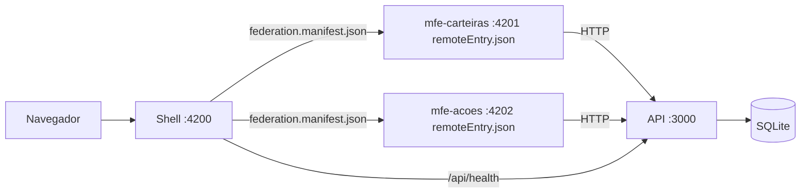

# Safra Invest Lab — Design (Micro Front-ends Angular)

- **Data:** 2026-10-09
- **Status:** Aprovado
- **Contexto:** Teste técnico para processo seletivo no Banco Safra
- **Prazo:** Entrega no mesmo dia (2026-10-09)

## 1. Objetivo

Construir uma aplicação Angular em arquitetura de **micro front-ends** com menu, páginas e CRUD, simulando um pequeno domínio de investimentos:

- **Carteiras**: cadastro (CRUD) de carteiras de investimento.
- **Ações**: cadastro (CRUD) de ações e **compra** de ações vinculada a uma carteira.
- **Home**: documentação completa do projeto — como foi feito, estrutura, decisões e **como a IA foi utilizada**.

Os serviços persistem dados em **SQLite** através de uma API Node.

### Critérios de sucesso

1. Shell carrega dois micro front-ends remotos em runtime via Native Federation.
2. Cada MFE também roda isoladamente na própria porta.
3. CRUD completo de carteiras e ações; fluxo de compra debitando saldo e gerando posição.
4. Regras de negócio garantidas na API (saldo, integridade, validação) e cobertas por testes.
5. Home renderiza a documentação do repositório (fonte única em `docs/`).
6. Avaliador sobe tudo com `npm install && npm run dev`.

## 2. Stack e versões

| Camada | Escolha | Observação |
|---|---|---|
| Runtime | Node **24 LTS** (24.21) | Node 20 está em fim de vida (abr/2026); libs atuais exigem Node ≥ 22. |
| Front-end | Angular **22.2** (standalone, signals, zoneless, builder esbuild) | Exige Node `^22.22.3 \|\| ^24.15.0`. |
| Micro front-ends | `@angular-architects/native-federation` **22.2** | Caminho recomendado para Angular moderno (sem webpack). |
| UI | Angular Material 22 | Tema customizado azul-marinho + dourado. |
| Docs na Home | `ngx-markdown` 22 + Mermaid 11 (import dinâmico) | Renderiza `docs/*.md`. |
| API | Node 24 + Express 5 + TypeScript | Executada com `tsx`. |
| Banco | SQLite via `better-sqlite3` | Arquivo `api/data/safra.db`; `:memory:` nos testes. |
| Validação | `zod` | Schemas compartilhados entre rotas. |
| Testes API | `vitest` 4 + `supertest` | |
| Testes Angular | Runner padrão do Angular 22 (Vitest) | |
| Orquestração dev | npm workspaces + `concurrently` | |

`.nvmrc` fixa `24`; `engines.node` na raiz: `>=22.22.3`.

## 3. Arquitetura

### 3.1 Estrutura do repositório

```
teste_safra/                      (raiz, npm workspaces)
├── apps/
│   ├── shell/          :4200     host: layout, menu, rotas, Home = docs
│   ├── mfe-carteiras/  :4201     remote: CRUD de carteiras + detalhe/posições
│   └── mfe-acoes/      :4202     remote: CRUD de ações + compra
├── api/                :3000     Express + better-sqlite3
├── libs/shared/                  @safra/shared — tipos de domínio e contratos
├── docs/                         markdown exibido na Home
│   └── superpowers/{specs,plans} artefatos do processo com IA
├── package.json                  workspaces + scripts dev/test
└── README.md
```

Cada app Angular é um workspace Angular independente (próprio `angular.json`, `package.json`, porta e build). Dependências são hoisted pelo npm workspaces na raiz, garantindo versões idênticas de Angular entre host e remotes (requisito para `shared` singleton).

### 3.2 Runtime



1. Shell inicializa a federação com `federation.manifest.json` (nome do remote → URL do `remoteEntry.json`).
2. Rotas do shell:
   - `''` → Home (docs)
   - `carteiras/**` → `loadRemoteModule('mfe-carteiras', './routes')`
   - `acoes/**` → `loadRemoteModule('mfe-acoes', './routes')`
3. Cada remote expõe `./routes` (array `Routes` standalone).
4. MFEs não importam código um do outro. Comunicação:
   - **Dados:** a API/SQLite é a fonte da verdade. `mfe-acoes` lê carteiras via `GET /api/carteiras`.
   - **Eventos:** após compra, `mfe-acoes` dispara `window.dispatchEvent(new CustomEvent('safra:compra-realizada', { detail }))`; shell escuta e exibe notificação.
   - **Navegação:** link "Ver carteira" navega para `/carteiras/:id` pelo router do shell.
5. **Shared singleton:** `@angular/*`, `@angular/material`, `@angular/cdk`, `rxjs`. `@safra/shared` é resolvido por `paths` do tsconfig e empacotado em cada app (`skip` na federação): contém só tipos e constantes, sem estado, então singleton é desnecessário e evita mapear código fora da pasta do app.
6. **Resiliência:** falha no `loadRemoteModule` (remote fora do ar) → rota resolve para componente `RemoteIndisponivelComponent` no shell; app não quebra.
7. **URL da API:** constante `API_BASE_URL` em `@safra/shared` (`http://localhost:3000/api`).

## 4. Domínio e persistência

### 4.1 Tabelas

```sql
CREATE TABLE carteiras (
  id         INTEGER PRIMARY KEY AUTOINCREMENT,
  nome       TEXT    NOT NULL UNIQUE,
  descricao  TEXT,
  saldo      REAL    NOT NULL DEFAULT 0 CHECK (saldo >= 0),
  criado_em  TEXT    NOT NULL DEFAULT (datetime('now'))
);

CREATE TABLE acoes (
  id            INTEGER PRIMARY KEY AUTOINCREMENT,
  ticker        TEXT    NOT NULL UNIQUE,
  nome          TEXT    NOT NULL,
  setor         TEXT,
  preco         REAL    NOT NULL CHECK (preco > 0),
  atualizado_em TEXT    NOT NULL DEFAULT (datetime('now'))
);

CREATE TABLE compras (
  id             INTEGER PRIMARY KEY AUTOINCREMENT,
  carteira_id    INTEGER NOT NULL REFERENCES carteiras(id),
  acao_id        INTEGER NOT NULL REFERENCES acoes(id),
  quantidade     INTEGER NOT NULL CHECK (quantidade > 0),
  preco_unitario REAL    NOT NULL,
  total          REAL    NOT NULL,
  data           TEXT    NOT NULL DEFAULT (datetime('now'))
);
```

`PRAGMA foreign_keys = ON`. Schema criado na inicialização (idempotente).

**Posição** não é tabela: query agregada sobre `compras` agrupada por `acao_id`:
- `quantidade = SUM(quantidade)`
- `precoMedio = SUM(total) / SUM(quantidade)` (média ponderada)
- `precoAtual` vem de `acoes.preco`; `valorAtual = quantidade * precoAtual`.

Valores monetários: `REAL`, arredondados a 2 casas na camada de serviço. (Simplificação aceitável para o teste; documentada nas decisões técnicas.)

### 4.2 Regras de negócio (na API)

| Regra | Resposta |
|---|---|
| Compra com `total > carteira.saldo` | `422 SALDO_INSUFICIENTE` |
| Compra usa `acoes.preco` atual, gravado em `preco_unitario` | histórico preservado |
| Débito de saldo + insert da compra em uma transação | atomicidade |
| Excluir carteira com compras | `409 CARTEIRA_COM_COMPRAS` |
| Corpo JSON malformado | `400 JSON_INVALIDO` |
| Excluir ação com compras | `409 ACAO_COM_COMPRAS` |
| Nome de carteira / ticker duplicado | `409 DUPLICADO` |
| Ticker fora de `^[A-Z]{4}\d{1,2}$`, quantidade ≤ 0, preço ≤ 0, depósito ≤ 0 | `400 VALIDACAO` com `details` |
| Recurso inexistente | `404 NAO_ENCONTRADO` |

Saldo inicial só é definido na criação da carteira; depois muda apenas por depósito ou compra. `PUT /carteiras/:id` altera `nome` e `descricao`.

### 4.3 Seed

Na primeira execução (banco vazio):
- Ações: PETR4, VALE3, ITUB4, BBDC4, BBAS3, WEGE3, ABEV3, MGLU3 com preços fictícios.
- Carteiras: "Carteira Conservadora" (saldo R$ 10.000) e "Carteira Arrojada" (saldo R$ 25.000).

### 4.4 Endpoints

```
GET    /api/health
GET    /api/carteiras                 lista com resumo (saldo, valorInvestido, qtdAtivos)
POST   /api/carteiras                 { nome, descricao?, saldoInicial? }
GET    /api/carteiras/:id
PUT    /api/carteiras/:id             { nome, descricao? }
DELETE /api/carteiras/:id
GET    /api/carteiras/:id/posicoes
POST   /api/carteiras/:id/deposito    { valor }
GET    /api/acoes                     ?ticker= (filtro parcial)
POST   /api/acoes                     { ticker, nome, setor?, preco }
GET    /api/acoes/:id
PUT    /api/acoes/:id                 { ticker, nome, setor?, preco }
DELETE /api/acoes/:id
GET    /api/compras                   ?carteiraId=
POST   /api/compras                   { carteiraId, acaoId, quantidade }
```

Formato de erro único: `{ code: string, message: string, details?: unknown }`.

### 4.5 Organização da API

```
api/src/
├── server.ts            bootstrap (porta 3000)
├── app.ts               createApp(db) — usado por server e testes
├── db/                  conexão, schema, seed
├── routes/              carteiras, acoes, compras, health
├── services/            regras de negócio (lança DomainError)
├── repositories/        SQL puro com prepared statements
├── schemas/             zod
└── middleware/          error-handler, cors
```

CORS liberado para `http://localhost:4200`, `4201`, `4202`.

### 4.6 Tipos compartilhados (`@safra/shared`)

`Carteira`, `CarteiraResumo`, `Acao`, `Compra`, `Posicao`, `NovaCompra`, `ApiError`, `API_BASE_URL`, constante do evento `COMPRA_REALIZADA_EVENT`. Somente tipos e constantes — sem lógica nem dependência de Angular.

## 5. Telas

### 5.1 Shell

- Toolbar: nome "Safra Invest Lab", selo "teste técnico", indicador de status da API (poll em `/api/health`).
- `mat-sidenav` com Home, Carteiras, Ações; item ativo destacado; responsivo (hamburger no mobile).
- Tema Material customizado azul-marinho (primária) + dourado (acento), inspirado, sem uso de logo ou marca oficial.
- Listener de `safra:compra-realizada` → snackbar global.

### 5.2 Home (documentação)

Renderiza `docs/*.md` com `ngx-markdown` (Mermaid habilitado), com índice lateral:

1. `01-visao-geral.md`
2. `02-arquitetura.md` (diagramas de MFE e runtime)
3. `03-estrutura.md` (árvore de pastas comentada)
4. `04-dados-e-api.md`
5. `05-decisoes.md` (mini-ADRs: Native Federation, Angular 22, Express + SQLite, Material, monorepo, posição calculada)
6. `06-como-rodar.md`
7. `07-uso-de-ia.md` (fluxo brainstorming → spec → plano → implementação; o que a IA gerou vs. o que foi revisado; prompts-chave; links para spec e plano)

Os arquivos são copiados para `apps/shell/public/docs/` por um script `sync-docs` executado antes de `dev` e `build` (pasta gerada, no `.gitignore`). Fonte única continua em `docs/`, legível também no GitHub.

### 5.3 mfe-carteiras (`/carteiras`)

- **Lista** (`''`): tabela (nome, saldo, valor investido, nº ativos, ações: ver/editar/excluir) + botão "Nova carteira".
- **Formulário** (`nova`, `:id/editar`): reactive forms — nome (obrigatório, ≤ 60), descrição (≤ 200), saldo inicial (≥ 0, só na criação).
- **Detalhe** (`:id`): cards (saldo, investido, total), tabela de posições (ticker, quantidade, preço médio, preço atual, valor atual), histórico de compras, botão "Depositar" (dialog).
- Exclusão com `mat-dialog` de confirmação; `409` exibido como mensagem amigável.

### 5.4 mfe-acoes (`/acoes`)

Abas (`mat-tab-group`):
- **Catálogo**: tabela (ticker, nome, setor, preço) + filtro por ticker; criar/editar em dialog; excluir com confirmação.
- **Comprar**: select de carteira (mostra saldo), select de ação (mostra preço), quantidade; exibe total e saldo após compra em tempo real (computed signals); botão desabilitado se inválido ou saldo insuficiente. Ao confirmar: `POST /api/compras` → snackbar sucesso → dispara `safra:compra-realizada` → link "Ver carteira" para `/carteiras/:id`.

### 5.5 Comum aos MFEs

- Estados de loading (spinner), vazio e erro.
- Interceptor HTTP: converte `ApiError` em snackbar com `message`.
- Moeda BRL via `CurrencyPipe`, `LOCALE_ID = 'pt-BR'`.

## 6. Tratamento de erros

- **API:** middleware único — `ZodError` → `400 VALIDACAO`; `DomainError` → status/código definidos; demais → `500 ERRO_INTERNO` sem stack no corpo (log no console).
- **Front:** interceptor + snackbar; remote indisponível → `RemoteIndisponivelComponent`; API fora → indicador vermelho na toolbar.

## 7. Testes

**API (vitest + supertest, banco `:memory:` novo por teste):**
- CRUD de carteiras e ações.
- Compra válida debita saldo e gera posição.
- Compra sem saldo → `422` e saldo inalterado.
- Excluir carteira/ação com compras → `409`.
- Ticker inválido / quantidade ≤ 0 → `400`.
- Preço médio ponderado após duas compras a preços diferentes.

**Angular (Vitest):**
- Componente de compra: total calculado, botão desabilitado sem saldo, evento disparado após sucesso.
- Formulário de carteira: validações.
- Services HTTP com `HttpTestingController`.

**Smoke manual no navegador antes da entrega:** shell carrega os dois remotes; CRUD completo; fluxo de compra; derrubar um MFE e verificar fallback.

## 8. Entrega

- Repositório git com commits por etapa (histórico também documenta o processo com IA).
- `README.md` raiz: resumo, pré-requisitos (Node 24 LTS), `npm install && npm run dev`, portas, link para `docs/`.
- Scripts raiz: `dev` (API + 2 MFEs + shell via `concurrently`), `test` (API + apps), `build`.
- Push para GitHub somente com aprovação explícita.

## 9. Fora do escopo

Autenticação, venda de ações, cotação em tempo real, deploy em cloud, Docker, testes e2e automatizados.
